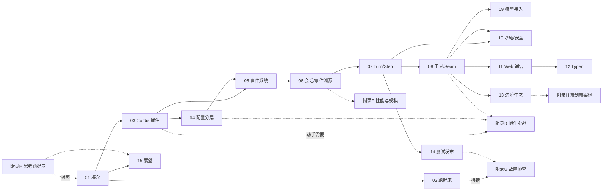

# 前言

## 这本书写给谁

我们正处于一个奇特的时刻：大模型已经能"做事"，但让模型真正做事的那层基础设施——沙箱、会话、权限、工具、可观测性——才刚刚开始成形。DeepSeek Harness（DSH）是这层基础设施的一个完整样本，而且它开源、可运行、设计文档齐全：仓库里除了源码，还有 `docs/` 下成体系的架构文档，以及 `.agents/notes/` 下一千多篇（英文原文，另配中文译本）记录"为什么这么做"的设计笔记。

这本书适合四类人：

- **想搞懂 Agent Harness 是什么的人**。你可能已经用过 ChatGPT、Claude 或 DeepSeek，也知道大模型 API 怎么调，但不清楚"Agent 运行时"到底解决什么问题。第 1 章就是为你写的。
- **想上手 DSH 的开发者**。第 2 章带你从零把 DeepSeek Harness 跑起来——Web、Headless、桌面端三种形态都会走一遍，第 3-5 章建立核心心智模型。
- **想写插件/工具/适配器的工程师**。第 8、9 章直接给出代码骨架——但更重要的是，这些骨架背后的"接缝"思想，会改变你对自己系统里扩展点的看法。附录 D 带你从零写一个插件。
- **对系统架构感兴趣的学习者**。第 6、7、10、11、12 章剖析事件溯源、主循环、沙箱、类型安全 RPC 这些硬核设计，以及它们各自的历史渊源与权衡。

## 前置知识

- 会基本的命令行操作（PowerShell 或 bash）。
- 了解 Node.js/TypeScript 基本语法（不深也行，代码可以照着读）。
- 理解"大模型通过 API 输入输出文本/工具调用"这个基本事实。
- 不需要预先会 Cordis、不需要预先了解任何 Agent 框架。

## 怎么读这本书：四个层次

同一份内容，可以按四个层次去读。层次越高，收获越持久：

1. **用户层**：它能跑什么？怎么配置？——完成动手实验，建立"它真的能跑"的信心。
2. **开发者层**：我想扩展它，改哪里？——读懂插件、接缝、事件的接入点。
3. **架构师层**：这些机制为什么这么设计？换成我，我会怎么做？——思考每一章的设计动机与权衡。
4. **思考者层**：DSH 的选择，在更大的技术演进中意味着什么？Agent 时代的基础设施应该是什么样？——读第 15 章的展望，并形成自己的判断。

本书正文按层次 1-3 组织：先讲问题与背景，再讲机制与用法，最后给设计思考。每章末尾的**思考题**属于层次 3-4，它们没有标准答案——很多问题连 DSH 自己都还在演化中。附录 E 给出了思考题的提示与参考思路。

## 本书的技术基准

- 仓库：`deepseek-ai/deepseek-harness`（官方文档站：`https://deepseek-harness.github.io/deepseek-harness/`）
- 版本快照：`0.1.7-rc.2`（开发者预览，对应 tag `dsh-v0.1.7-rc.2`）
- 运行时：Node.js `^22.19.0 || >=24.0.0`，包管理器 pnpm `11.7.0`（`packageManager: pnpm@11.7.0`）
- 规模：pnpm monorepo，共 **334** 个 workspace 包——其中 `packages/` 下 **312** 个（按能力分组），另有 9 个 vendor 进来的 Cordis 系包、`native/system` 原生启动器系列、4 个应用（`cli`、`desktop`、`desktop-host`、`web`），以及 `benchmarks`、`website`、`python/sdk-runtime`；TypeScript 严格模式
- 形态：CLI（`dsh`）、Web、**桌面应用（Electron）**、Headless、ACP、SDK（TypeScript / Python）多种产品装配

> 注意：DSH 仍在快速迭代，官方明确声明"未来将出现破坏兼容性的变更"。从本书上一版的基准 `0.1.5-rc.2` 到 `0.1.7-rc.2`，仓库经历了三千多个提交：E2B 远程沙箱被移除、新增了 SSH 远程执行、DeepSeek 账号登录、浏览器/电脑操作、Office 文档预览、会话格式 v4 等一大批变化。本书描述的是当前快照的行为，你读到的代码如果和仓库最新版不一致，请以仓库为准。这也意味着——**书中所有思考题，你都可以用"最新仓库发生了什么"来检验自己的判断。**

## 为什么值得学 DSH：五条设计主线

DSH 不是一个"又一个聊天应用"，而是一个研究性质浓厚的工程样本。透过它，你可以一次性看到五条反复出现在现代 Agent 系统中的设计主线：

1. **一切皆插件（可组合性）**：包括模型适配、工具注册表、会话日志、主循环在内的所有能力都可替换。这背后是一个深刻的判断：**Agent 产品的形态还没有定型，所以把"换一个产品"的成本压缩到"换一行配置"。** 同一个底座，今天装配成 Web 应用、一次性 CLI、SDK 服务器、ACP 服务器，明天套上 Electron 外壳就是桌面应用。
2. **事件溯源（可信度）**：会话是追加式日志，状态从日志推导；日志格式本身带版本号，并由一串 `session-format-v*-to-v*` 迁移包逐代升级（当前已到 v4）。这背后是对"可回放、可审计、可恢复"的执着——当系统要替你做越来越多的事，"它到底做了什么"必须可查。
3. **能力接缝（依赖倒置的极致）**：文件系统、子进程、沙箱、PTC 运行时等能力都以"服务接口 + 可替换提供方"的形式存在。本地实现和 SSH 远程实现可以互换，工具代码一行不改。这让"产品形态"和"执行环境"解耦。
4. **平台原生沙箱（信任边界）**：Linux 上的 bwrap / Landlock、macOS 上的 Seatbelt、Windows 上基于 ACL 与完整性级别的受限令牌，没有可用沙箱时直接报 `SANDBOX_UNAVAILABLE`，绝不静默放行（fail-closed）。安全不是附加功能，而是默认状态。
5. **编译期类型契约（工程严谨）**：Typert 从类型图生成前后端 RPC 契约。在前端变化最快的领域，选择最严格的静态保证。

理解这套组合，等于理解了一类现代 Coding Agent 系统的最佳实践——以及它们的共同盲区（第 15 章会展开）。

## 全书知识地图：章节依赖一览

章节之间是有依赖的——有的章节是另一章的地基。这张图帮你规划跳跃阅读（箭头 = "读它之前建议先读箭头起点"）：

阅读建议：路线 A（快速上手）只走 01→02，遇到问题查附录 B（命令速查）与附录 G（故障排查）；路线 B（理解设计）按箭头顺序；跳读时认准"前置：第 X 章"（每章开头导航里标注）。

## 致谢与说明

本书内容全部来自公开仓库源码与官方文档的分析与整理，代码示例为教学目的做了简化。感谢 DeepSeek 团队开源。书中所有对"为什么"的解释，都是作者基于源码与设计文档的推断——它不是官方答案，而是一个邀请：**请用你自己的思考去检验它。**
