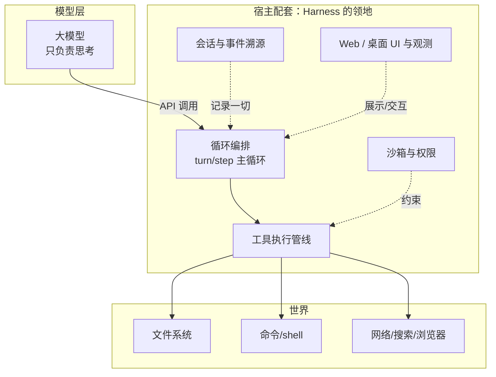

# 第 1 章 什么是 Agent Harness：模型只会说话，谁替它做事？

> 全书的第一章。我们不从定义开始，而是从一个会发生在你身上的具体困惑开始：你有一个很强的大模型 API，你让它"帮我修一下这个仓库里的测试"，然后呢？

> **本章你将学到**：
> - 概念：Harness 与模型/框架/产品的分工
> - 设计：为什么"一切皆插件"是当下正确的判断
> - 动手：仓库结构速览与最小实验

## 1.1 一个朴素的问题：模型只能说话

大模型 API 的本质是：输入 token，输出 token。它返回文本，或者一段结构化的工具调用（tool call）JSON——但也仅此而已。

所以"帮我修一下这个仓库里的测试"这句话，会立刻撞上一串问题：

- 谁来执行 `git status`、打开文件、运行测试？模型不会，得有一个**宿主程序**替它做；
- 宿主程序怎么决定允许模型访问哪些文件、跑哪些命令？总不能把整台电脑无脑交给模型；
- 一次对话怎么保存、恢复、审计？模型看到的上下文怎么组织？上下文快满了怎么办？
- 模型要跑一个需要 5 分钟的命令，用户等不等？中途能不能取消？命令能不能挪到后台、晚点再看结果？

**Agent Harness（Agent 运行环境）就是回答这些问题的系统**：它把大模型接到真实世界（文件、命令、网络、浏览器、代码、子 Agent），并管理权限、会话、工具、观测与安全。一句话：**模型负责"想"，Harness 负责"活"——让模型安全地活在真实世界里。**

### 为什么是"现在"才需要它？

这个问题的答案值得先立起来：Harness 不是新发明的概念，而是技术条件成熟后的必然产物。

- 模型只会说话时，没有"循环"可管，不需要 Harness；
- 模型学会工具调用后，"思考-行动-观察"循环出现了，但循环是每个应用自己手写的；
- 当循环从"偶尔用一次"变成"日常开发工具"时，围绕循环的配套——沙箱、会话、权限、UI、审计、后台任务、定时提醒——才成为刚需，Harness 才应运而生。

第 15 章会把这条演进史完整展开。现在只需要记住：**Harness 是 Agent 从"能跑 demo"到"能干活"之间的那道鸿沟的答案。**

## 1.2 关键概念辨析：模型、API、Agent、框架、Harness

这一节的概念最容易混，我们用"谁在负责什么"来区分：

| 概念 | 是什么 | 负责什么 | 典型例子 |
| --- | --- | --- | --- |
| 模型 | 输入 token 输出 token 的神经网络 | 思考 | DeepSeek V4、GPT、Claude |
| API | 模型对外的接口（HTTP/SSE） | 传输 | DeepSeek API、OpenAI API |
| Agent | 能调用工具、多步决策的智能体实体 | 决策 | 会话里的一个角色 |
| Agent 框架/SDK | 编排 agent 循环、工具调用的开发库 | 循环的代码 | OpenAI Agents SDK、LangChain |
| Agent Harness | 可运行、可配置、带完整产品能力的宿主 | 循环的"生活条件" | DSH、Claude Code、Codex |

这张图把它们在技术栈里的位置画出来——注意 Harness 横跨"模型之上的全部配套"：



区别的关键一句话：**框架是库，你用代码拼自己的应用；Harness 是产品，你通过配置和插件定制它。** 框架给你"循环"，Harness 给你"循环 + 沙箱 + 会话 + 权限 + UI + 审计"——后者才是真正能长期运行的东西。

## 1.3 DSH 的核心主张：一切皆插件

DSH 的中文 README 开头两句是：

> DeepSeek Harness（`dsh`）是由 DeepSeek AI 开发的开源 agent harness（智能体框架）。
>
> 它构建于**一切皆插件**的架构之上，由 Cordis 驱动……

README 还指向了一篇论文 _A Programming Paradigm for Spatiotemporal Composability_（arXiv 2608.25512），专门阐述这套组合范式的设计。这句话值得拆开理解，因为它是一个**设计判断**，而不只是技术选型。`docs/architecture.md` 的第一节把它说得很直白：

- **没有特权内核**。模型适配器是插件，工具注册表是插件，会话日志是插件，连 agent 主循环都是插件。你要扩展系统，就是在它旁边挂一个插件，而不是给某个内核打补丁。
- **一切都可以用配置替换**。换个模型、换个沙箱、换个持久化后端，都是在配置里换一个插件行，不用改产品代码。
- **注册是"可逆副作用"**。插件卸载时，它注册的所有服务、监听器、工具自动撤销，系统回到干净状态——这为配置热重载（`dsh-hmr`）和运行中启停插件（插件管理器）打下基础。

为什么做这个判断？因为 **Agent 产品的形态还没有定型**。今天的 killer feature 可能是编码助手，明天可能是 Office 文档助手，后天可能是浏览器/桌面自动化。与其为每种形态写一个产品，不如写一个底座，让形态由配置决定。这个判断在 DSH 自己身上已经被反复验证：同一个底座先后长出了 Web 应用、一次性 CLI、SDK 服务器、ACP 服务器和 Electron 桌面应用。第 3 章我们会看到这个判断的工程实现。

## 1.4 DSH 解决的具体问题

把"一切皆插件"落到功能层面，DSH 解决五类问题：

1. **连接模型与工具**：模型要"用"文件、shell、网页、浏览器、子 Agent，DSH 提供统一的工具执行管线，负责参数校验、审批、执行、结果回传与失败处理（第 8 章）；模型侧通过 LLM 服务接入 DeepSeek 官方路由（API Key 或 DeepSeek 账号登录），以及经 pi-ai 适配器接入的第三方与自定义网关（第 9 章）；
2. **管理会话状态**：每次交互追加进不可变日志，模型看到的上下文从日志推导，可回放、可恢复、可审计；日志格式带版本并可逐代迁移（第 6 章）；
3. **权限与安全**：权限预设（新会话默认 `workspace-write`）+ 按需审批；不可信命令放进平台原生沙箱，沙箱不可用时直接失败（第 10 章）；
4. **可观测与产品化**：Web UI、桌面应用、会话标题、用量统计、OTel 遥测、设置与凭据管理、插件管理页、定时提醒——这些都是插件，按 profile 组装（第 11、13 章）；
5. **可编程接入**：CLI、ACP（Agent Client Protocol）、SDK JSON-RPC（TypeScript 与 Python SDK）、webhook 等多种入口（第 13 章）。

## 1.5 仓库结构速览：一张地图

克隆仓库后，顶层目录大致是：

```text
packages/   312 个 @deepseek-ai/dsh-* 等包，按能力分组（git 跟踪的分组目录 54 个）
  core/     产品 API 主干：session、system-prompt、tools、agent、agent-loop、scope…
  llm/      LLM 服务 + DeepSeek（API Key / 账号登录）+ pi-ai 多提供方适配
  api/      Host 侧 Remote 控制器（会话、工作区、设置、账号、任务…）
  typert/   类型图生成器、加载器、运行时注册表
  shell/    bash / pwsh 执行      subprocess/ 子进程      sandbox/ 平台沙箱
  ssh/      POSIX SSH 远程文件系统、子进程与沙箱
  session/  会话持久化 + 会话格式迁移（session-format-v0-to-v1 … v3-to-v4）
  bundle/   产品装配层：base / web-app / headless / sdk-app / sdk-minimal / acp-app
  experimental/  实验能力：agent-team、auto-review、voice-input-bundle、browser-use-*…
  browser-use/ computer-use/ document/ deliverables/ ptc-runtime/ schedule/ …
apps/      cli（dsh 命令）、web、desktop（Electron 桌面）、desktop-host
vendor/    vendor 进来的 Cordis 系源码（9 个包）
native/    system：Landlock 启动器与 flock 原生 addon（按平台分包）
docs/      官方文档（中英双语）   .agents/notes/  设计笔记
python/    Python SDK 与 sdk-runtime   benchmarks/  基准   website/  文档站
snapshots/ Web 快照测试场景   scripts/  构建、门禁、生成器脚本
```

和上一版相比，有几个值得留意的结构变化：

- **新增分组**：`browser-use`、`computer-use`（浏览器/桌面操作的服务注册）、`deliverables`（`present` 交付文件、工作区变更）、`document`（基于 LibreOffice kit 的 Office 转 PDF）、`ptc-runtime`（PTC 程序执行）、`ssh`（远程执行）。
- **移除 E2B**：原先的 E2B 远程沙箱提供方已被删除，"远程执行"这件事现在由 `ssh` 分组承担——这恰好是能力接缝的一次活体演示：换掉一整类提供方，工具代码不受影响。
- **PTC 运行时改名**：`code-runtime-python` 更名为实验性的 `ptc-runtime-python`，正式发布的执行提供方是 `ptc-runtime-node`（在沙箱化的 Node 进程里运行程序）。
- 早期版本的顶层 `examples/` 目录已退役——可运行的参考配置现在分布在 `packages/bundle/*/cordis.patch.yml`、`apps/cli/config/examples/` 与各包 README 中。

先记两个贯穿全书的概念（第 4 章细讲）：

- **Profile（启动配方）**：存放在 Harness home（默认 `~/.dsh`）里的一个具名组装，列出它叠放哪些组合包、安装了哪些树外插件，并保存用户自己的 `cordis.patch.yml`。`web`、`headless`、`sdk`、`sdk-minimal`、`acp` 是随发行版交付的五个模板——**同一个底座，不同配方，就是不同的产品**；
- **Bundle（组合包）**：Cordis 配置行 + 挂载代码的发行单元。`dsh-base` 是 `web`、`headless`、`sdk`、`acp` 共享的第一层（模型适配器、工具、持久化、沙箱与审批、设置、凭据、遥测）；`sdk-minimal` 是刻意保留的例外，它自带一棵完整的最小配置树，不叠加 `dsh-base`。

## 1.6 与同类系统的对比：设计取向，而非优劣

| | DeepSeek Harness | Claude Code / Codex | OpenAI Agents SDK |
| --- | --- | --- | --- |
| 形态 | 可配置的产品底座（CLI/Web/桌面/SDK/ACP） | 具体产品 | 开发库 |
| 插件体系 | 核心卖点，一切皆插件 | 有 hooks/skills，但有固定核心 | 有 tools/agents，无插件内核 |
| 沙箱 | 平台原生，默认启用，不可用即失败 | 产品内置 | 由宿主自建 |
| 会话模型 | 带版本的事件溯源日志 | 各自实现 | 无内建 |

这不是"谁更好"的对比，而是**设计取向**不同：Claude Code 追求"开箱即用的产品体验"，DSH 追求"研究性和组合性最强的底座"。有意思的是，二者并不互斥——DSH 提供 `dsh-hooks-claude-code`、`dsh-hooks-codex` 兼容这两类产品的 hook 约定，还提供可选的 `dsh-subagent-codex`、`dsh-subagent-claude-code` 组合包，把它们作为子 Agent 提供方接进来。理解取向，你才知道什么场景该用哪个——以及，如果你想改它的行为，哪个改得动。

## 1.7 动手实验

1. 打开仓库根目录，`git log --oneline -5` 看最近提交，再运行 `git rev-list --count dsh-v0.1.5-rc.2..dsh-v0.1.7-rc.2` 感受迭代速度（这也是全书"以仓库为准"的由来）；
2. 阅读 `docs/architecture.zh.md` 的前三节（Cordis、Profile 与组合包、应用启动）；
3. 运行 `git ls-files "packages/*/*/package.json"`，数一数各分组下的包数，对照 1.5 节的结构说明（提示：这个 pathspec 里的 `*` 会跨越 `/`，要按路径段数过滤掉模板目录里的嵌套 `package.json`）；
4. 阅读 `packages/bundle/web-app/cordis.patch.yml` 与 `apps/cli/config/examples/` 下的任意一个可选覆盖层——体会"一份 YAML 就是一次定制"。

## 1.8 思考题

1. 模型、框架、Harness 的分工是"想/循环/生活条件"。设想一个**非编码**场景（比如客服、数据分析、Office 文档处理），这三层分别是什么？Harness 的设计能直接搬过去吗？
2. "一切皆插件"的反面是什么？——如果某个能力不是插件而是写死在核心，DSH 会损失什么？又会得到什么（提示：想性能与复杂度）？
3. 如果你要设计一个 Agent 产品，你会先写"核心功能"还是先定"扩展点"？DSH 的答案暗示了什么？
4. E2B 提供方被整体移除，远程执行如今改由 SSH 这组提供方实现，而工具代码无需改动。这说明了能力接缝的什么价值？反过来，一个提供方被删除时，什么东西**仍然**可能受影响（提示：配置、已保存的会话、用户习惯）？

## 小结

- Harness 是"模型接到真实世界"的宿主产品，负责让模型安全地活在真实世界里。
- 它诞生于工具调用之后、Agent 日常化之时——技术条件成熟后的必然产物。
- 核心设计判断：一切皆插件、配置组合、可逆副作用——因为产品形态还没定型；DSH 自己从 Web 一路长出 Headless、SDK、ACP 与桌面端，正是这个判断的注脚。
- 学习路径：概念 → 跑起来 → 插件 → 配置 → 事件 → 深水区。

下一章，我们把 DSH 跑起来——并且借"跑起来"这个过程，理解 DSH 为什么用配置定义产品。
