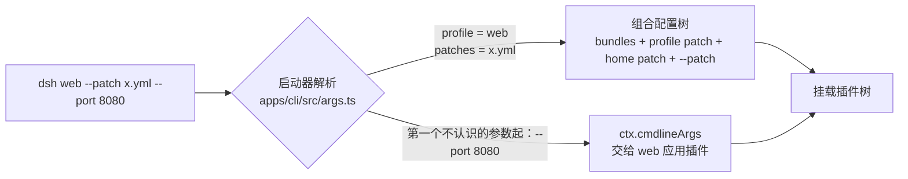
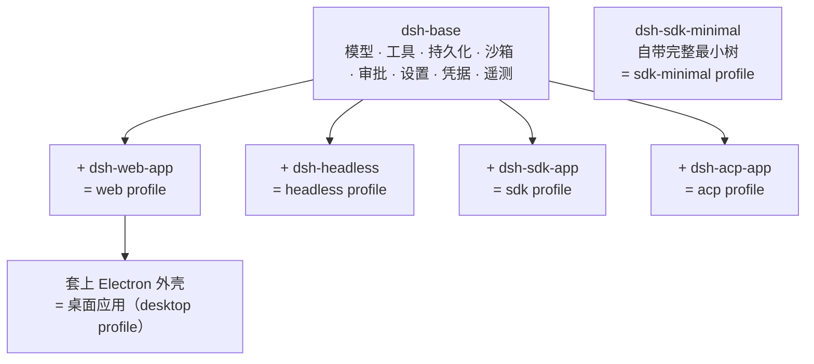

# 第 2 章 环境准备与快速上手：三个命令，一台会思考的机器

> 这一章是唯一"纯操作"的一章，但即使在这里，也有一个值得先想清楚的问题：**DSH 为什么同时有 Web、Headless、桌面端等多种形态？** 答案会第一次揭示"配置定义产品"的思想。

> **本章你将学到**：
> - 操作：克隆 → 构建 → 启动 Web UI 全流程，以及首次使用（配置模型、默认工作区）
> - 操作：`dsh` 命令行的结构——启动器参数与应用参数的边界
> - 设计：Web、Headless、桌面端如何共享一个底座（配置定义产品）
> - 动手：`--dump-config` 第一次"看见"整个系统

## 2.1 三种跑法：先想清楚你为什么要跑它

DSH 有三种运行方式，选择取决于目的：

1. **npm 快速体验**：`npx @deepseek-ai/dsh web`，一条命令启动 Web UI——适合先感受产品；
2. **源码运行**：克隆仓库、装依赖、构建、运行——适合学习和二次开发（本书主线）；
3. **桌面应用**：Electron 外壳里打包了精确版本的 dsh 运行时，不需要自己装 Node 或 pnpm——适合日常使用；从源码也可以用 `dev:desktop` 启动开发版（2.9 节）。

为什么本书坚持源码运行？因为后续所有动手实验都在仓库里进行，而且——**源码仓库本身就是这本书的"附录 D"**：书里讲的每个概念，都能在源码里找到对应实现。读代码、查文档、跑实验，三者互补。

## 2.2 准备环境

需要三样东西：

- **Node.js**：要求 `^22.19.0 || >=24.0.0`（本书用 v24）。这个范围写在根 `package.json` 的 `engines` 里，CI 也会在 Node 22.19、24、26 上跑兼容性矩阵——版本不对会得到一堆看不懂的报错；
- **pnpm**：仓库锁定了 `pnpm@11.7.0`（`packageManager` 字段）。没有全局 pnpm 时用 Node 自带的 corepack：

```powershell
corepack pnpm --version
```

  第一次运行会自动下载对应版本的 pnpm（需要网络）。
- **Git**：克隆仓库用。

Windows 上如果 PowerShell 报"禁止运行脚本"，可以改用 `corepack.cmd pnpm ...`；本书统一写作 `corepack pnpm ...`，所有命令都在 `deepseek-harness` 仓库根目录执行。

> 平台差异：在 Linux/macOS 上，构建的第一步会用系统 C 编译器（`cc`，Linux 静态启动器另需 `musl-gcc`）编译 `native/system` 下的原生 addon；Windows 没有对应的原生目标，这一步会直接跳过。

## 2.3 克隆与安装

```powershell
git clone --depth 1 https://github.com/deepseek-ai/deepseek-harness.git
cd deepseek-harness
corepack pnpm install
```

`pnpm install` 会安装整个 monorepo 的依赖（334 个 workspace 包及其第三方依赖），可能需要几分钟。有两个细节值得知道：

- **安装脚本是白名单制**。pnpm 10+ 默认阻止依赖包的 install/build 脚本，仓库在 `pnpm-workspace.yaml` 的 `allowBuilds` 里逐个审过：`esbuild`、`lefthook`、`node-pty`、`koffi` 等被允许，其余一律拒绝。根 `postinstall` 只做一件事——安装 lefthook git 钩子。
- **原生包按平台分包**。例如 `@deepseek-ai/node-addon-system-linux-x64` 在 `package.json` 里声明了 `os: ["linux"]`、`cpu: ["x64"]`，在 Windows 上不会被使用（第 10 章会讲为什么沙箱要按平台分包）。

## 2.4 构建：三步，各回答一个问题

```powershell
corepack pnpm run build
```

根 `build` 脚本现在是 `tsx scripts/build.ts`，它按顺序跑三个子脚本，每一步都在回答一个架构问题：

- `build:native-system`：编译本机平台的原生 addon（Windows 上是空操作）——回答"沙箱与文件锁需要的那点 C 代码从哪来"；
- `build:lib`：先 `build:lib:host`（`tsc -b tsconfig.host.json` + tsdown 打包宿主端，并顺带打包桌面主进程 bundle），再 `build:lib:client`（`tsc -b tsconfig.client.json` + tsdown 打包客户端插件）——回答"代码从 TS 变成可运行产物，宿主和浏览器各拿哪一份"；
- `build:web`：`pnpm --filter @deepseek-ai/dsh-web-frontend run build`（vite）——回答"浏览器里那部分怎么变成静态资源"。

最后它会写一份客户端构建记录（打印类似 `build: recorded N client artifact(s)…` 的一行），把本次构建出的客户端产物与其公开环境绑定起来。

> Windows 提示：`build.ts` 通过 pnpm 注入的 `npm_execpath` 调用子脚本，因此用 `corepack pnpm run build` 启动是可行的；子脚本内部写的裸 `pnpm` 会解析到根 `devDependencies` 固定的 `pnpm@11.7.0`（位于 `node_modules/.bin`）。若你的环境仍报"pnpm 不是内部或外部命令"，可以逐个执行 `corepack pnpm run build:lib` 与 `corepack pnpm run build:web`。

## 2.5 启动 Web UI

```powershell
corepack pnpm dsh web
```

根脚本 `dsh` 就是 `node --import tsx/esm apps/cli/src/bin.ts`：它**不会**帮你构建，而是直接使用上一步的构建产物运行源码入口。第一次启动会做冷启动（初始化 profile、合成配置、加载插件、启动 HTTP 服务），稍等片刻后：

- Web UI 地址：`http://127.0.0.1:3080`；
- 本机启动时，整棵配置树结算完毕后会自动用默认浏览器打开这个地址，并打印提示 `dsh web: opening the default browser; pass --no-open to disable`；
- 通过 SSH 登录远程机器启动时（继承了非空的 `SSH_CONNECTION` 或 `SSH_TTY`），只打印地址、不打开浏览器，因为本地转发端口由 SSH 客户端或编辑器掌握。

`web` 应用自己的参数跟在后面即可：

```powershell
corepack pnpm dsh web --no-open            # 只起服务，不开浏览器
corepack pnpm dsh web --port 3081          # 换端口
corepack pnpm dsh web --help               # 打印 web 应用自己的参数说明
```

`web` 接受的参数是 `--host`、`--port`、可重复的 `--trusted-host`（给 `/api` 的浏览器信任围栏追加具名 authority）和 `--no-open`。注意 CLI **有意不支持** `--host 0.0.0.0`，会以用法错误退出——Web 服务器本身不带 TLS 与服务器级认证，不应随手暴露到网络上。

验证服务是否就绪：

```powershell
curl.exe -s -o NUL -w '%{http_code}' http://127.0.0.1:3080/
# 输出 401 说明服务已在监听、浏览器令牌认证在工作
```

首页受浏览器令牌保护（第 11 章）：只有启动日志里那条带 `?token=` 的地址能换到 Cookie，换到后会重定向到干净的 `./`；不带 Cookie 访问首页一律得到 401，静态资源文件本身仍是公开的。

以后台方式启动（不占用当前终端）可以用：

```powershell
Start-Process -FilePath (Get-Command corepack).Source -ArgumentList 'pnpm','dsh','web','--no-open' -WorkingDirectory (Get-Location) -WindowStyle Hidden
```

用 `Get-NetTCPConnection -LocalPort 3080` 找到监听进程，`Stop-Process -Id <pid>` 停止。前台运行时按 `Ctrl+C` 即可：插件树最多有 5 秒完成清理，第二次 `Ctrl+C` 会强制退出。

开发时还有两条等价的根脚本：`corepack pnpm run start:web`（和 `dsh web` 是同一次启动）与 `corepack pnpm run dev:web`（先构建一次、启动服务，并在源码修改时持续重建客户端 bundle）。

## 2.6 首次使用：配置模型、工作区与第一个任务

### 配置模型：API Key 还是 DeepSeek 账号？

全新安装第一次打开 Web UI 时，会弹出 DeepSeek 的凭据引导；你也可以随时打开**设置 → 模型**，在 DeepSeek 卡片里填入 API Key 并保存。几个要点：

- 密钥是**只写**的：保存后页面只拿到脱敏描述，明文存放在 `$DSH_HOME/.credentials.yaml`（默认 `~/.dsh/.credentials.yaml`），设置里只保留一个凭据引用；
- 模型变更在下一次请求时生效，不需要重启服务器；
- 除了 DeepSeek，"添加模型提供商"还可以选择内置的第三方提供商（如 `anthropic`、`openai`、`moonshotai`、`zai`），或者填一个自定义 API（OpenAI Chat Completions / OpenAI Responses / Anthropic Messages 三种协议之一）——这部分由 `dsh-llm-pi-ai` 适配器负责，第 9 章细讲。

0.1.7 起，DeepSeek 官方模型有**两条互相独立的路由**：

| 路由 | 凭据来源 | 请求头 | 由谁注册 |
| --- | --- | --- | --- |
| `deepseek-official` | API Key（默认引用 `DEEPSEEK_API_KEY`） | `x-api-key` | `@deepseek-ai/dsh-llm-deepseek-api-key` |
| `deepseek-account` | DeepSeek 账号浏览器登录得到的授权 | `x-dsh-auth-token` | `@deepseek-ai/dsh-llm-deepseek-account` |

两条路由都不会回退到对方的凭据，退出账号登录也不会删除 API Key。**账号登录的内置界面目前只在桌面端提供**（欢迎窗口与账号设置页）；普通 Web UI 保留 API Key 引导，不显示登录入口。两条路由共用 `@deepseek-ai/dsh-llm-deepseek` 提供的传输层——它现在只使用 Messages 协议，官方根地址是 `https://api.deepseek.com/anthropic`，可用 `DEEPSEEK_BASE_URL` 覆盖为其它兼容 Messages 的网关；默认模型目录包含 `deepseek-flash`（文本+图片）与 `deepseek-v4-pro`（纯文本）。

### 默认工作区

会话必须绑定一个工作区（它决定工具读写文件的根目录）。当 Host 上**既没有任何工作区、也没有任何会话历史**（包括已归档和隐藏的会话）时，客户端会请 Host 自动准备一个默认工作区：目录固定为 `<Documents>/deepseek-harness/default-workspace`（目录名与语言无关，界面上显示本地化的"默认工作区"标签），并创建一个空白会话供你直接输入。已经有历史的安装不会再触发它；准备失败时会退回到文件夹选择器。你随时可以通过**选择工作区**添加自己的项目目录——比如 DSH 仓库本身。

> 与 Web UI 不同，Headless、SDK、ACP 这些基于 base 的模式直接把**运行命令时所在的目录**当作默认 workspace 根目录，并在其中加载适用的 `AGENTS.md` 或 `CLAUDE.md` 指令。

### 运行第一个任务

选中工作区后发一条消息，例如 "Summarize this repository and identify its main packages."。Agent 可以读写工作区文件、运行命令、委派子 Agent、维护计划。新会话默认使用 `workspace-write` 权限预设：bash 与文件修改限制在会话工作区与平台临时目录内，需要越界时 Web UI 会先征求你的审批。

> 隐私提示：base 组合包默认启用 DeepSeek 会话日志贡献（`session-log-deepseek` 行），会随后续 DeepSeek 请求上传尚未确认的日志后缀；OTel 上传则默认只在你主动反馈（评分、编辑、撤回等）时触发。不希望上传会话日志，可以在 profile 的 `cordis.patch.yml` 里加一行：
>
> ```yaml
> - id: session-log-deepseek
>   config:
>     enabled: false
> ```
>
> 设置 `DSH_TELEMETRY_MODE=DISABLED` 则禁止 OTel 投递。细节见 `apps/cli/reference/README.zh.md` 的"共享部署行为"一节。

## 2.7 `dsh` 命令行：启动器只管"启动哪个 profile"

在继续之前，先把 `dsh` 这个命令本身看清楚。`apps/cli/src/args.ts` 的开头注释说明了它的设计：**启动器只解析它自己拥有的东西**——启动哪个 profile、叠加哪些额外 patch、要不要打印配置——然后把**它不认识的第一个参数及之后的一切**原样交给被启动的 profile，由其中的应用插件自己解析（经 `@deepseek-ai/dsh-cmdline` 提供的共享只读快照）。



所以 `dsh --profile web --help` 打印的是 **web 应用**的帮助，只有不带 profile 的 `dsh --help` 才打印启动器自己的帮助。启动器的全部参数如下：

| 参数 | 作用 |
| --- | --- |
| `dsh <name>` / `--profile <name>` | 启动 `$DSH_HOME/profiles/<name>`；`dsh web` 就是 `dsh --profile web` 的简写 |
| `--patch <path>` | 在 profile 层之后追加一个 patch 覆盖层，可重复 |
| `--from-default-profile <template>` | 用某个随附模板初始化一个**新的**自定义 profile，再启动它 |
| `--dump-config` | 打印组合后的配置树并退出（2.10 节） |
| `--dump-default-config` | 只打印组合包各层，不含用户层与 `--patch` |
| `--dump-config-schema` | 不挂载插件，打印描述配置条目与 patch 的 JSON Schema |
| `-V` / `--version` | 打印版本号 |
| `dsh plugin --profile <name> <pnpm 参数…>` | 在 profile 目录里把参数转发给 pnpm，管理该 profile 的插件 |

几条规则：

- **五个随附模板**：`web`（base + web-app）、`headless`（base + headless）、`sdk`（base + sdk-app）、`sdk-minimal`（独立组合包）、`acp`（base + acp-app）。它们第一次使用时会自动从模板初始化；其它名字的 profile 必须先用 `--from-default-profile` 或 `dsh plugin` 创建，否则会报错并提示你。
- **`desktop` 是保留名**：它归 Electron 桌面应用独占，CLI 会拒绝针对它的启动、dump 和插件管理。
- **`plugin` 只在紧跟 `dsh` 时是子命令**：要启动一个名叫 `plugin` 的 profile，必须写 `dsh --profile plugin`。
- 帮助里出现的 `tui` 只是示例：它假设你已经用 `dsh plugin --profile tui add github:deepseek-harness/turtle-ui` 装了一个外部终端界面插件。

```powershell
# 从 web 模板派生一个叫 rescue 的新 profile 并启动
corepack pnpm dsh rescue --from-default-profile web
# 以后直接启动它
corepack pnpm dsh rescue
```

## 2.8 无界面模式：headless——同一个底座，另一种产品

DSH 内置了一个"回答一次任务就退出"的 profile：

```powershell
# 在仓库根目录放一个 .env，内容为：
# DEEPSEEK_API_KEY=sk-xxx
corepack pnpm dsh headless "请介绍一下这个仓库的结构"
```

它会创建一个全新的持久化会话，提交任务、等待完全停稳并把会话落盘，然后从持久化事件里取出最后一段非空的助手文本：**最终回答打到 stdout**，模型的推理增量在 `dsh: reasoning:` 标题下流式写到 stderr；结束原因为 `completed` 时以 0 退出，否则以 1 退出。随附的 headless profile 不挂载 HTTP 服务器、Web 运行时或浏览器客户端，也不打开任何监听端口。

凭据从哪里来？提供方凭据依次从**继承的环境变量**、`$DSH_HOME/.credentials.yaml`、**调用目录的 `.env`**、`$DSH_HOME/.env` 解析——所以你在 Web UI 里保存过的 Key，headless 也能直接用；仓库根目录的 `.env` 则只在你从仓库根目录运行时生效。

### 设计思考：为什么一个底座能长出多种产品？

DSH 的五个内置 profile 模板共享同一套底层（除 `sdk-minimal` 外都以 `dsh-base` 为第一层：模型、工具、持久化、沙箱、审批、设置、凭据、遥测），差异只在**配置**：`web` 多叠一个 `dsh-web-app`（浏览器应用），`headless` 多叠一个 `dsh-headless`（一次性运行器），`sdk` 叠 `dsh-sdk-app`（stdio 上的 JSON-RPC 服务器），`acp` 叠 `dsh-acp-app`（stdio 上的 Agent Client Protocol）。连热重载都是配置决定的：base 启用只监视配置的 `dsh-hmr`，而 headless、sdk、acp 在自己的层里把它关掉——一次性任务不需要盯着配置文件。



这是第 1 章"一切皆插件"的第一个活例子：**产品形态 = 底座 + 配置**。`headless` 不是"阉割版 web"，而是"换了个装配方案的同一台机器"。理解这一点，第 4 章的 Profile 概念就有了直觉基础。

## 2.9 桌面应用：Electron 形态

除了 Web，DSH 还提供**桌面应用**——`apps/desktop`（Electron 外壳）+ `apps/desktop-host`（私有 Node 宿主）。Electron 以 RunAsNode 模式启动一个子进程，运行与 CLI 共享的 profile runner 和完整 Web 应用，窗口则从打包内的 `dsh-app://app/` 加载 Web 前端。从源码启动：

```powershell
corepack pnpm run dev:desktop     # 构建 Host、客户端、Web 前端与 Electron 壳，然后启动
corepack pnpm run start:desktop   # 跳过构建，直接启动上一次的产物
```

几个与 Web 不同、上手时容易踩到的点：

- **端口不同**：桌面端默认监听 `19387`，与 Web 的 `3080` 分开，可以同时运行；
- **开发 home 是隔离的**：`dev:desktop` 默认把会话、设置、凭据写进 `apps/desktop/.desktop-build/development/home`，不会污染你日常的 `~/.dsh`（显式设置 `DSH_HOME` 可以替换它）；
- **自带运行时**：启动前会准备一份"第一方运行时"（独立的 Python、Node.js、pnpm，Python 里预装了 numpy、pandas、python-docx、python-pptx、openpyxl 等），首次准备可能需要下载锁定的依赖；Office 类技能默认使用它；
- **没有凭据时先显示欢迎窗口**：可以用 DeepSeek 账号在系统浏览器中登录（Host 负责 PKCE 与本机临时回调，凭据保存后才进入工作区），也可以进入 API Key 页面填写密钥（"保存并继续"），或在该页选"稍后配置"直接进入工作区、下次启动再检查；
- **profile 是独占的**：打包应用拥有 `$DSH_HOME/profiles/desktop`，与 CLI 共享会话、设置、凭据等产品数据，但可执行包、插件激活和锁文件彼此隔离；插件通过主应用的"插件"页面管理。

打包命令（Windows 上本地测试最常用的是未签名版本，需要先设置 `DSH_DESKTOP_APP_ID`）：

```powershell
corepack pnpm run package:desktop:win:x64:unsigned   # 未签名的 Windows x64 安装包，仅供本地测试
corepack pnpm run package:desktop:win:x64            # 正式签名打包（需要 EV 签名配置）
corepack pnpm run package:desktop:dir                # 只生成可直接运行的应用目录
```

### 设计思考：桌面应用说明了什么？

桌面形态是"**一切皆插件 + 配置定义产品**"的又一次验证：它并没有另写一套 Agent，而是把**完整的 web profile** 连同精确匹配版本的 dsh 生产运行时一起签名打包——Electron 壳、dsh 运行时和 pnpm 作为一个更新单元发布，版本号与 `@deepseek-ai/dsh` 完全一致。**产品形态是可替换的外层，内核不动**；而"版本锁死"这个选择，则是在用磁盘体积换取"每一个组合都经过验证"。

## 2.10 看合成后的配置：一扇观察系统的窗

DSH 最大的特色之一：**当前机器实际启动的插件树可以打印出来**，而且不需要真的启动它。

```powershell
corepack pnpm dsh web --dump-config
```

输出是一份完整的配置树，并带注释标明每一行来自哪个文件、被哪些覆盖层改过；`!!js` 表达式保持未求值。三种 dump 互斥，各有用途：

| 命令 | 看什么 |
| --- | --- |
| `dsh web --dump-default-config` | 只看组合包各层（随发行版交付的默认） |
| `dsh web --dump-config` | 再叠上 profile 的 `cordis.patch.yml`、home 级 `$DSH_HOME/cordis.patch.yml` 和 `--patch` |
| `dsh web --dump-config-schema` | 不看值，看"每个插件能配什么"：输出 JSON Schema 2020-12 文档 |

注意 dump 不会运行应用的参数解析，所以 `dsh web --port 8080 --dump-config` 这类带应用参数的调用会被拒绝——它只展示"解析任何应用参数之前"的配置树，避免打印出与真实启动不一致的东西。另外，`--dump-config-schema` 需要导入插件模块，检查不受信任的插件前要当心。

这本书反复强调一个习惯：**遇到"系统行为不符合预期"，第一步永远是 `--dump-config`，而不是猜**。配置是系统的"自我陈述"——先问它"你以为你在跑什么"，再问"为什么"。第 14 章的调试三板斧会把这个习惯制度化。启动失败时，CLI 还会把完整诊断写到 `$DSH_HOME/logs/startup-<时间戳>-<uuid>.log`，并在 stderr 最后一行 `Full diagnostics:` 里指出路径（附录 G 会用到）。

## 2.11 Harness home：`~/.dsh` 里有什么

所有用户数据都在同一个根目录下：显式配置优先，其次是环境变量 `DSH_HOME`，最后默认 `~/.dsh`。跑过一次之后，你会看到这些条目：

```text
~/.dsh/
  profiles/<name>/          每个 profile 一个目录：package.json（dsh.profile.bundles、树外插件依赖）
                            + cordis.patch.yml（你自己的 patch 层，设置页也写这里）
  profiles/desktop/         桌面应用独占
  cordis.patch.yml          home 级 patch，跨所有 profile 生效
  .credentials.yaml         提供方凭据（设置页保存的 API Key 在这里）
  .env                      home 级环境变量层
  sessions/                 会话日志
  storages/                 结构化数据（JSON 存储后端）
  logs/                     启动失败诊断报告
  cache/                    缓存
  dsh-runtimes/             桌面端/工作区依赖工具安装的第一方运行时
  AGENTS.md                 用户级 Agent 指令（可选）
```

> 旧版本的 `settings.yaml` 已不再是设置的存放位置：设置现在由 profile 的 `cordis.patch.yml` 承载（"profile 自有的实时配置"）。如果 home 里还留着早期的 `settings.yaml`，Settings 插件会在启动时导入一次，并把它改名为 `settings.yaml.imported`。

## 2.12 本章命令速查

| 目的 | 命令 |
| --- | --- |
| 安装依赖 | `corepack pnpm install` |
| 完整构建 | `corepack pnpm run build` |
| 分步构建（备选） | `corepack pnpm run build:lib`、`corepack pnpm run build:web` |
| 启动 Web UI | `corepack pnpm dsh web` |
| 启动 Web 但不开浏览器 | `corepack pnpm dsh web --no-open` |
| 开发模式 Web（自动重建客户端） | `corepack pnpm run dev:web` |
| 打印合成配置 | `corepack pnpm dsh web --dump-config` |
| 打印配置 Schema | `corepack pnpm dsh web --dump-config-schema` |
| 跑一个 headless 任务 | `corepack pnpm dsh headless "任务描述"` |
| 从模板派生新 profile | `corepack pnpm dsh <新名字> --from-default-profile web` |
| 给 profile 装插件 | `corepack pnpm dsh plugin --profile <name> add <package>` |
| 启动桌面应用（开发） | `corepack pnpm run dev:desktop` |
| 未签名 Windows 安装包 | `corepack pnpm run package:desktop:win:x64:unsigned` |
| 快速体验 | `npx @deepseek-ai/dsh web` |

## 动手实验

1. 完成克隆、安装、构建、启动全流程，确认直接访问 `http://127.0.0.1:3080` 返回 401、用启动日志里带 `?token=` 的地址能打开界面；观察启动时打印的浏览器提示，再用 `--no-open` 启动一次对比；
2. 分别运行 `dsh web --dump-default-config` 和 `dsh web --dump-config`，把输出存成文件后 diff——差异就是你自己的 profile 层和 home 层；
3. 运行 `dsh web --dump-config-schema`，在输出里找到 `@deepseek-ai/dsh-llm-deepseek-api-key` 对应的配置定义，看看 `baseURL`、`reasoningEffort` 等字段的默认值与描述；
4. 在浏览器打开 Web UI，进入**设置 → 模型**，观察 DeepSeek 卡片与"添加模型提供商"入口（先不急着填 Key）；打开 `~/.dsh/profiles/web/cordis.patch.yml`，保存一次设置后再看它的变化；
5. 如果你有 API Key，运行一次 headless 任务，分别把 stdout 和 stderr 重定向到两个文件（`> out.txt 2> err.txt`），体会"最终答案"与"推理过程"的分流。

## 思考题

1. 对比 `web` 和 `headless` 两个 profile 的 `--dump-config` 输出：哪些插件是共同的？哪些是各自的？"共同的部分"是不是就是 `dsh-base`？`dsh-hmr` 那一行在两边有什么不同，为什么？
2. `--dump-config` 打印的是"合成后"的配置。设想你要给 DSH 加一个新能力（比如一个新的 shell 工具），你需要改哪一层？这个问题的答案，第 4 章会给你完整的工具。
3. headless 模式没有 Web UI，却有完整的会话持久化。这暗示了"UI 只是会话的一个消费者"——第 6 章会证明这个判断。
4. 启动器"只解析自己的参数，把其余原样交给应用"。相比让启动器集中定义所有应用的参数，这种设计换来了什么，又付出了什么（提示：想想 `dsh --profile web --help` 与 `dsh --help` 的区别，以及 dump 为什么拒绝应用参数）？
5. DeepSeek 的 API Key 与账号登录被设计成两条互不回退的路由，而不是"账号 token 塞进 `DEEPSEEK_API_KEY`"。如果合并成一条，会丢失哪些信息、引入哪些风险？
6. 桌面应用把 Electron 壳与 dsh 运行时锁在同一个版本号上发布。这个选择的收益与代价分别是什么？如果允许二者独立升级，会出现什么问题？

## 小结

- 三条路：npx 快速体验、源码运行（学习用）、桌面应用（日常用）；
- 三个命令走天下：`install` → `build`（native-system → lib → web）→ `dsh web`；
- 首次使用：在**设置 → 模型**里配置 API Key（桌面端还可以用 DeepSeek 账号登录）；没有任何历史时会自动准备 `<Documents>/deepseek-harness/default-workspace`；
- `dsh` 启动器只管"启动哪个 profile、叠哪些 patch、要不要 dump"，其余参数交给应用；
- web、headless、sdk、acp 是同一底座的不同装配方案，桌面端是 web 套上 Electron 外壳——配置定义产品；
- `--dump-config` 家族是你观察系统内部的一扇窗，也是调试的第一步。

下一章进入地基：Cordis 插件框架——以及 DSH 为什么选择"借"一个框架而不是自己写。
