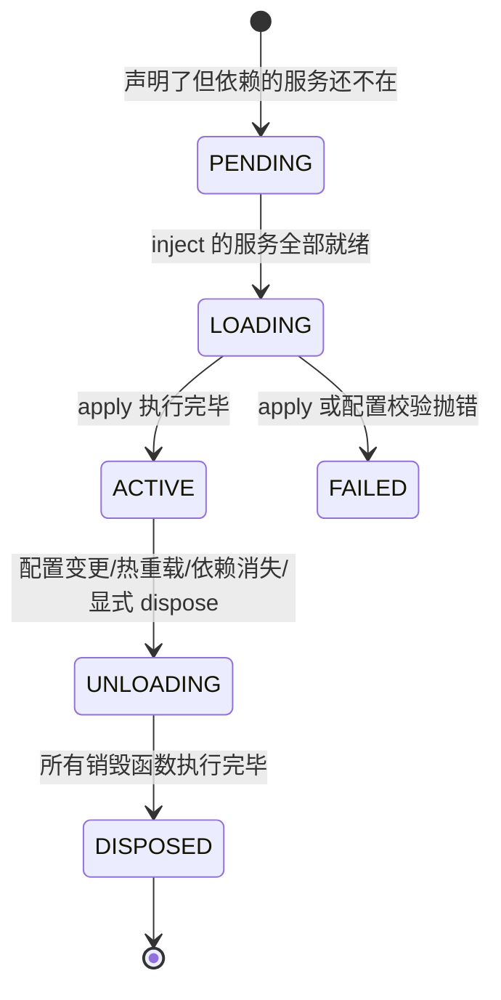
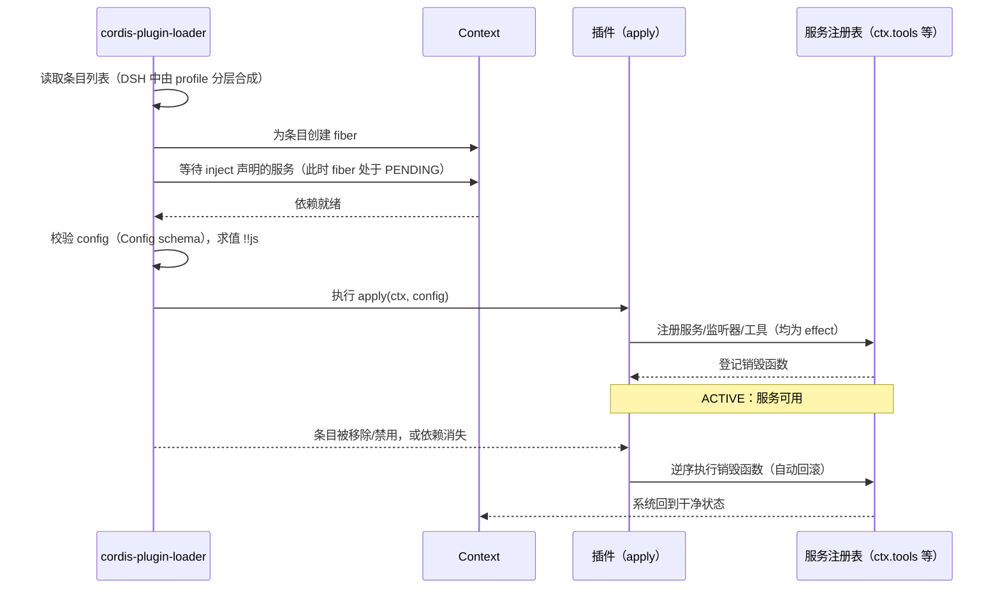

# 第 3 章 Cordis 插件框架基础：为什么 DSH 要"借"一个框架，而不是自己写

> 第 1 章说"一切皆插件"。这一章回答它的工程前提：**插件机制本身从哪来？** DSH 的答案是不自己发明轮子——它把一个通用框架（Cordis）以源码形式 vendor 进来，把整个产品建在它上面。理解这个决定，比背 Cordis 的 API 更重要。

> **本章你将学到**：
> - 概念：插件的三种形态、Context、inject、类型化事件（五种分发模式）、可逆副作用、Fiber 状态机
> - 设计：DSH 为什么 vendor 一个框架；可逆副作用为什么是灵魂；Loader 为什么放弃了"事务式重载"
> - 动手：用一个补丁 overlay 改 Web 端口，并观察"表达式 + 命令行参数"的优先级
>
## 3.1 先回答"为什么"：插件化要付出什么？

插件化不是免费的。它要付出三笔成本：

- **抽象成本**：能力不能直接调用，要走接口（`ctx.xxx`），多一层间接；
- **编排成本**：插件有依赖关系，谁先加载、谁后加载、谁卸载时清理什么，需要一套机制管理；
- **调试成本**：调用链被切碎成"注册 + 事件"，报错定位比直来直去难。

如果这些成本换不来足够的收益，插件化就是过度设计。DSH 的判断是：**收益远超成本**——Agent 产品的形态还没定型，扩展性就是生命力。但它不打算从零写这套机制：插件生命周期、依赖注入、类型化事件、可逆副作用，是任何插件系统都要解决的问题，而 Cordis 已经解决得足够好。

所以 DSH 把 Cordis 及其基础库以**源码**形式放进仓库的 `vendor/` 目录，而不是作为 npm 依赖安装。按 `vendor/README.md` 的说法，这样做是为了让 Harness "完全拥有自己的框架层"——可审计、可打补丁。目前 vendor 了 9 个包，全部改用 `@deepseek-ai` 作用域：

| 目录 | 包名 | 作用 |
| --- | --- | --- |
| `vendor/cordis` | `@deepseek-ai/cordis` | 框架内核：Context、插件注册、事件、Fiber、日志 |
| `vendor/loader` | `@deepseek-ai/cordis-plugin-loader` | 读取条目列表、挂载/卸载插件、求值 `!!js` |
| `vendor/include` | `@deepseek-ai/cordis-plugin-include` | 以文件为后端的条目子树，补丁（patch）语义就在这里 |
| `vendor/group` | `@deepseek-ai/cordis-plugin-group` | 把一组条目作为一个单元加载/卸载 |
| `vendor/hmr` | `@deepseek-ai/cordis-plugin-hmr` | 上游的热模块替换插件 |
| `vendor/timer` | `@deepseek-ai/cordis-plugin-timer` | `timer` 服务 |
| `vendor/logger-console` | `@deepseek-ai/cordis-plugin-logger-console` | 控制台日志导出器 |
| `vendor/schemastery` | `@deepseek-ai/schemastery` | 配置 schema 校验库 |
| `vendor/cosmokit` | `@deepseek-ai/cosmokit` | 工具函数库 |

"原样"并不等于"一字不改"：`vendor/README.md` 里有一份要求**穷举**的 *Local modifications* 清单，记录每一处与上游的差异（例如 `applyEntryPatches` 的导出、Fiber 的可重入销毁加固、可恢复的文件刷新、volatile 配置等），以及从上游同步时如何重新套用这些修改。vendor 的价值恰恰在这里：**可以改，但每一处改动都有账可查**。

从上一版基准 0.1.7-rc.2 到 0.2.1-alpha.2，vendor 层的变化很小，正好可以拿来看这本账怎么记：

- 9 个包统一发了一轮预发布版本（例如 `@deepseek-ai/cordis` 从 `4.0.4` 变为 `4.0.5-alpha.1`，`cordis-plugin-loader` 从 `1.0.5` 变为 `1.0.6-alpha.1`）；
- 清单新增了第 23 条：`vendor/loader/src/config/entry.ts` 里的每个条目（Entry）现在保留一个 `moduleNamespace` 字段——"导出规范化之前"的原始导入结果。DSH 的 HMR 用它去和 Node 缓存的模块命名空间做匹配，热重载成功后才更新它；`loader/README.md` 也同步记录了这个新增字段。这条修改服务于 0.2.1 的"插件包刷新"（第 4 章 4.8 节）：一个包的 `package.json` 变了，HMR 要能准确找到"哪些条目加载的是这个模块"。

注意它的写法：**只加字段、不改 `EntryTree.import()` 的参数和返回值**。对 vendor 代码做"增量、可描述、可重放"的修改，才能让下一次从上游同步时不至于变成一场考古。

Cordis 本身是一个通用的 Node.js 应用框架：**插件贡献服务、类型化事件、可逆副作用，共享同一个 Context**。DSH 没有另起炉灶，而是把整个产品建在它上面——理解下面五个概念，就等于理解了 DSH 的地基。官方文档对应的是 `docs/cordis-primer.md`（五个概念的速览）、`docs/cordis-tutorial/`（七章动手教程，不需要 API Key）和 `docs/cordis-api/`（从源码生成的 API 参考）。

## 3.2 五个核心概念：每个都在回答一个问题

### 1. 插件（Plugin）：功能的最小单元

插件回答的问题是："一个功能怎么被独立地安装和卸载？"Cordis 接受三种形态：

- **函数插件**：模块导出 `apply(ctx)` 函数（最常见）；
- **对象插件**：一个带 `apply` 方法的对象；
- **类插件**：`Service` 的子类，用于向别人提供服务。

模块还可以导出 `name`（仅用于诊断显示）、`inject`（依赖声明）和 `Config`（配置 schema）。

### 2. 上下文（Context）：服务的仓库

服务占住一个稳定的键（`ctx.tools`、`ctx.llm`、`ctx.sessions`），其他插件通过键找服务，**而不是 import 具体实现**。它回答的问题是："插件之间怎么不互相依赖？"——答案是把依赖变成"查字典"。服务名在一个应用里是**扁平的单一命名空间**，所以自定义服务要起有辨识度的名字（Harness 已经占用了 `tools`、`llm` 这类短名）。

### 3. 依赖声明（inject）：让框架推导加载顺序

插件声明"我需要哪些服务"，框架等这些服务就绪后再加载它。它回答的问题是："几十上百个插件谁先谁后？"——答案不是手工排布（那会随插件增多而失控），而是**从依赖关系推导**。条目在配置文件里的位置不保证任何加载顺序：同级条目是并发启动的。

### 4. 类型化事件：插件间通信的契约

插件之间通过事件通信。事件名和监听器签名通过 TypeScript 声明合并（`interface Events`）公开，分发方式有**五种模式**：`emit`、`waterfall`、`parallel`、`serial`、`bail`（第 5 章细讲）。它回答的问题是："插件怎么通知别人、拦截别人？"——答案是把通信变成有类型、有模式的公开契约，写错了编译器会拦你。

### 5. 可逆副作用：卸载 = 干净回滚

插件通过 Cordis API 做的注册（`ctx.on()` 监听器、`ctx.plugin()` 子插件、服务注册，以及 Harness 注册表如 `ctx.tools.register(...)`）都是 **effect**，插件卸载时自动撤销；Cordis 不管理的资源（定时器、连接、文件监视器）则包进 `ctx.effect()`，由你返回一个销毁函数。它回答的问题是："插件卸载后系统脏不脏？"——答案是**不脏**。这个性质看似平淡，却是热重载和稳定重启的前提：没有它，"换一个插件"就等于"重启整个系统"。

### 设计思考：可逆副作用为什么是插件化的灵魂

想象没有可逆副作用的世界：插件 A 注册了一个工具，插件 A 被卸载了，工具还挂在注册表里——模型调用它，报错"模块不存在"。系统从此处于半坏状态。可逆副作用把"安装"变成"安装-卸载成对出现"的操作：**系统的状态尽可能等于"当前已加载插件集合"的函数**。这让配置热更新、HMR（第 11 章）、稳定重启成为可能，也让"一切皆插件"真正立得住。

但"成对出现"也有细节要注意（`docs/cordis-tutorial/02-lifecycle-and-effects.md`）：销毁函数按注册的**逆序**启动，但多个**异步**销毁函数是并发执行的。如果几个清理步骤必须严格按顺序发生，就把它们放在**同一个** effect 里、在同一个销毁函数中依次 await。

## 3.3 一个最小插件：代码在回答什么

```ts
import type { Context } from '@deepseek-ai/cordis'

export const name = 'hello-plugin' // 仅用于诊断显示

export function apply(ctx: Context) {
  ctx.logger.info('[hello-plugin] 已加载')

  // Cordis 不管理的资源：包进 effect，返回销毁函数
  ctx.effect(() => {
    const timer = setInterval(() => ctx.logger.info('tick'), 5000)
    return () => {
      clearInterval(timer)
      ctx.logger.info('[hello-plugin] 已清理')
    }
  })
}
```

这段代码的每个要点都对应 3.2 节的一个概念：

- `name`：插件在诊断信息里的标签；
- 没有 `inject`：不依赖任何服务，所以可以立刻加载；
- `apply(ctx)`：插件激活时执行，所有注册都在这里做；
- `ctx.effect(() => { ...; return dispose })`：effect 体在加载时运行，返回的销毁函数在卸载时运行——**你永远不需要自己调用它**。

`ctx.logger` 是 Cordis 内核自带的日志服务（`info`/`warn`/`error`/`debug` 四个级别）；是否打印到控制台，取决于组合里有没有挂 `@deepseek-ai/cordis-plugin-logger-console` 这样的导出器。

## 3.4 Fiber：每个插件实例的运行时句柄

插件被加载一次，就对应一个 **Fiber**。`ctx.plugin(child)` 从代码里挂载子插件，返回的就是 fiber；`await fiber.dispose()` 会等所有清理（包括异步销毁函数和子插件）都完成才返回。Fiber 有一个明确的状态机：



两个值得记住的推论：

1. **PENDING 是合法状态，不是错误。** 一个插件 `inject` 了没人提供的服务，它会安静地一直等下去——因为提供者可能稍后才挂载。所以"我的插件什么都没打印"，第一个该查的就是它是不是卡在 PENDING。教程第 6 章给了一个遍历 `ctx.registry` 找出 PENDING fiber 的诊断插件（用到 `FiberState.PENDING`）。
2. **依赖在加载后仍被跟踪。** `inject` 不是一次性的启动检查：如果被依赖的服务在运行中消失（提供者被卸载或热替换），所有依赖它的插件也会被卸载，服务回来后再重新加载。配合可逆副作用，这保证了"不会有插件攥着一个已失效的服务引用"。这也是为什么在配置里把 `shell` 的提供者换掉，所有注入 `'shell'` 的插件都会干净地对着新实现重启。

对于"有更好、没有也能活"的能力，不要写进 `inject`，而是在使用处探测：`ctx.get('greeter')` 在没有提供者时返回 `undefined`。

## 3.5 服务与依赖注入：DSH 的产品功能就是一组组服务

一个插件可以提供服务，也可以消费服务。提供服务用 `Service` 子类，再配一段声明合并让 `ctx.xxx` 在编译期有类型：

```ts
import { Service, type Context } from '@deepseek-ai/cordis'

declare module '@deepseek-ai/cordis' {
  interface Context {
    greeter: GreeterService // 只影响类型，不生成代码
  }
}

export class GreeterService extends Service {
  constructor(ctx: Context) {
    super(ctx, 'greeter') // 运行时注册为 ctx.greeter；这本身也是一个 effect
  }
  greet(who: string) { return `Hello, ${who}!` }
}
```

消费服务只需声明依赖：

```ts
export const inject = ['tools'] // 声明依赖

export function apply(ctx: Context) {
  // 此时 ctx.tools 一定已经就绪
  ctx.tools.register(/* defineTool({...}) */)
}
```

DSH 的产品功能就是一张服务表（下表的提供者均为 HEAD 源码里 `super(ctx, '<键>')` 所在的包）：

| ctx 键 | 是什么 | 由谁提供 |
| --- | --- | --- |
| `ctx.sessions` | 会话存储 | `@deepseek-ai/dsh-session` |
| `ctx.tools` | 工具注册表 + 执行管线 | `@deepseek-ai/dsh-tools` |
| `ctx.llm` | LLM 适配器注册表 | `@deepseek-ai/dsh-llm` |
| `ctx.agents` | Agent 注册表 | `@deepseek-ai/dsh-agent` |
| `ctx.agentLoop` | 默认主循环 | `@deepseek-ai/dsh-agent-loop` |
| `ctx.systemPrompt` | 系统提示组装 | `@deepseek-ai/dsh-system-prompt` |
| `ctx.jobs` | 后台任务运行时 | `@deepseek-ai/dsh-jobs`（本地实现由 `dsh-jobs-local` 挂载） |
| `ctx.fs` / `ctx.subprocess` / `ctx.shell` / `ctx.sandbox` | 能力接缝 | 服务定义包（`dsh-fs`、`dsh-subprocess`、`dsh-shell`、`dsh-sandbox`）+ 各自的 provider 包 |
| `ctx.pluginPackages` | profile 模块解析与插件包元数据 | `@deepseek-ai/dsh-app-boot` |

好处是**面向接口编程**：工具插件只依赖 `ctx.tools` 这个抽象，不关心它背后是谁实现的（第 8 章会看到这个抽象的力量）。

### 设计思考：一个服务被整体删掉时发生了什么——运行时不变量的退场

"服务 = 插件贡献的能力"还有一个反面推论：**能力不想要了，删掉插件行就行**。0.2.x 里就有一个现成的例子（升级指南 `docs/upgrade-guide/v0.2.0-rc.2/remove-runtime-invariants/`）：

- 在 0.2.0-rc.2 及之前，`@deepseek-ai/dsh-invariants` 提供一个 `ctx.invariants` 服务，`dsh-session`、`dsh-agent`、`dsh-scope`、`dsh-agent-loop` 等包各自发布一个 `./invariant` 子路径的"伴生插件"，向它登记运行时检查；`sdk-minimal` profile 里挂着 `invariants`、`session-invariant` 等五行；
- 0.2.1-alpha.1 起，这个包、`InvariantRegistry` 等符号以及所有 `<包>/invariant` 子路径都不再发布，`sdk-minimal` 也去掉了那五行；对应的 `docs/subsystems/invariants.md` 一并删除。

删除过程本身就是本章概念的演示：因为它们只是"插件 + 服务 + 配置行"，删掉之后其他插件不需要改一行代码；残留的配置会以普通方式报出来——名字指向已删除模块的行**加载失败**，按 id 命中那五行的补丁只得到 `patch: entry <id> not found` 警告（第 4 章）。唯一需要注意的行为变化落在事件上：`credentials/reference-updated`、`credentials/record-updated`、`authorization/settled`、`llm/adapters-updated` 这四个 emit 现在会**捕获并记录**每个监听器的失败（包括 `code: 'INVARIANT'` 的错误），而不是重新抛出——依赖"监听器抛错能打断生产者"的插件，要改走自己的报告渠道。这正是第 5 章"emit 是观察语义"的另一种表述。

### 纵深对比：Cordis vs 传统 DI 容器（Spring / Inversify）

如果你用过 Spring 或 Inversify，会觉得 Cordis 的 Context + inject 似曾相识——它们都解决"依赖注入"。但有一个本质区别，值得停下来想清楚：

| | 传统 DI 容器（Spring/Inversify） | Cordis |
| --- | --- | --- |
| 核心职责 | 装配对象图、管理单例生命周期 | 装配 + **可逆副作用** + **类型化事件** |
| 扩展方式 | 注册 Bean/Provider | 插件贡献服务 + 监听事件 |
| 卸载语义 | 容器销毁时统一清理（粗粒度） | **插件卸载时精准回滚自己**（细粒度、可组合） |
| 依赖变化 | 通常启动时一次性解析 | 依赖消失 → 依赖者卸载；依赖回来 → 重新加载 |
| 通信 | 直接注入调用 | 类型化事件（观察/改写/扇出/有序决策/短路） |

Spring 的容器是"一个应用装配一次"——生命周期是整体性的；Cordis 的 Context 是"无数插件按需装配/卸载"——生命周期是**每个插件独立**的。可逆副作用让"热插拔一个插件"成为可能，这是传统 DI 容器没有的一等公民概念。换句话说：**Spring 解决"一个应用怎么组装"，Cordis 解决"一个应用怎么无限扩展还不乱"**。

把"加载 → 依赖注入 → 激活 → 卸载回滚"的完整生命周期画出来，注意最后一步——**可逆副作用**让系统回到干净状态：



## 3.6 插件如何被加载：配置即开关

插件的"开关"在 YAML 条目列表里。一个条目最少只需要 `name`（模块说明符：包名或路径），但在 DSH 里几乎总会带上稳定的 `id`：

```yaml
- id: hello              # 稳定身份：编辑时能区分"改了这一行"和"删一行再加一行"
  name: '@yourname/dsh-hello-plugin'
  disabled: false        # 保留条目但不挂载
  config:
    greeting: 你好
```

条目还可以携带 `inject`、`group`（嵌套一组子条目作为一个单元）和 `isolate`（让一个 group 拥有某个服务名的独立实例）。例如 Web 应用的 `minimal` Agent 预设里，就用一个 `cordis:group` 行配 `isolate: { terminals: true }`，让这组终端插件拥有自己的 `terminals` 服务实例。没有 `id` 的条目每次读取都会生成新 id，于是文件任何一处被编辑，它都会被当作"删除 + 新增"而重新挂载——这就是 DSH 的 bundle 文件里每一行都写 `id` 的原因。

加载器（`@deepseek-ai/cordis-plugin-loader`）读这份条目列表，为每条创建 fiber、等待依赖、校验配置、执行 `apply`。三个细节决定了这套机制的性格：

**配置由 schema 在 `apply` 之前校验。** 插件导出同名的 `Config` 类型与 schemastery schema，默认值直接写在字段上：

```ts
import type { Context } from '@deepseek-ai/cordis'
import Schema from '@deepseek-ai/schemastery'

export interface Config { greeting: string; targets: string[] }

export const Config: Schema<Config> = Schema.object({
  greeting: Schema.string().default('Hello'),
  targets: Schema.array(String).default(['world']),
})

export function apply(ctx: Context, config: Config) {
  // config 一定是完整、已校验的
}
```

非法配置让这个 fiber 进入 FAILED，插件**不会带着半截配置启动**。注意：Cordis 要求 `Config` 实现 Standard Schema 接口，导出一个普通对象当 `Config` 是不行的。

**易变字段（volatile）不必重启插件。** 字段加上 `.volatile()` 后，插件拿到的是一个稳定的引用，每次操作时用 `.get()` 读取当前值。当一次配置变更**只**涉及 volatile 字段时，Loader 校验新值、原地提交到这些引用，并向该实例发一个 `loader/volatile-update` 事件，而不是卸载重装整个插件；普通字段一变，仍然走"卸载 → 重新加载"的老路。DSH 的默认模型选择（`dsh-agent-default-model` 的 `provider`/`model`/`reasoningEffort`）就是这样声明的。第 4 章会看到这对"在 Web 表单里改配置"意味着什么。

**`!!js` 表达式只在两处求值。** `@deepseek-ai/cordis-plugin-include` 把 YAML 里的 `!!js` 标签解析成表达式节点；Loader 只在两个地方求值：条目的 `config`（在声明的依赖就绪之后、对着该插件自己的 context 求值，所以能写 `ctx.webStartup.port`），以及条目的 `disabled` 字段（每次做挂载决策时对着 loader 的 context 求值，所以能写 `disabled: !!js process.platform === 'win32'`）。`name`、`id`、`inject` 等其它元数据一律保持字面量。

### 设计思考：Loader 为什么放弃了"事务式重载"

在 0.1.5-rc.2 里，vendored Loader 曾经是"事务式"的（由仓库内的 PR #932 引入）：一次配置编辑如果让某个插件加载失败，就回滚到旧的插件和旧的配置。这听起来很安全，但它要求 Loader 自己管理候选导入、生命周期结算、回滚、选项身份……vendored 代码因此和上游越走越远。笔记 `.agents/notes/implemented/simplification/2026-09-09-nontransactional-loader.md` 记录了反向决定：**撤销这批改动，Loader 恢复为非事务式**。

现在的语义是：Loader 立即采用新的条目选项；同级条目并发启动、各自记录失败；**不会恢复旧插件或旧配置**，插件失败可能留下一棵"部分生效"的树。那"启动必须成功"的保证由谁来给？交给**应用层消费者**：app-boot 在 Loader 结算后做激活审计（必需条目失败则整体启动失败，可选条目只告警）；热重载后等 fiber 结算再审计；Web 启动在打印 URL 之前审计。代价写在笔记的 *Consequences* 里：`await Loader.create()` 本身不再代表"插件都激活了"，需要激活保证的调用方必须在结算后自己检查。

这是一个典型的 DSH 取舍：**与其在框架里维护一套复杂的回滚机器，不如让失败大声暴露，让下一次正确的编辑去恢复**。

还有一个容易踩的坑（教程第 1 章专门提醒）：模块**解析失败**（包名或路径拼错）会通过 Cordis 日志服务报告，而不是让进程崩溃；启动早期如果控制台导出器还没挂上，这条报告可能看不到。新加的条目"什么都没发生"时，先检查拼写。

## 3.7 事件的五种模式：通信的五种语义

| 模式 | 调用方式 | 是否等待 | 返回值 | DSH 中的例子 |
| --- | --- | --- | --- | --- |
| `emit` | `ctx.emit(name, ...args)` | 否，同步广播 | 忽略 | `session/event`、`tools/result` |
| `waterfall` | `ctx.waterfall(name, ...args, next)` | 链式 `next()` | 最外层监听器的返回值 | `agent/pre-step`、`agent/request`、`tools/pre-execute` |
| `parallel` | `await ctx.parallel(name, ...args)` | 是，并发 | 无 | `session/flush`、`workspace/session-stop` |
| `serial` | `await ctx.serial(name, ...args)` | 是，按序 | 第一个非空值（null/false/undefined 以外）胜出并停止 | `agent/created`、`agent/turn-stopping` |
| `bail` | `ctx.bail(name, ...args)` | 否 | 同 serial，但是同步版本 | Cordis 内部的 `internal/listener` 等 |

监听一律用 `ctx.on(name, listener)`（或只触发一次的 `ctx.once`），它返回一个销毁函数，而且本身就是 effect。waterfall 是最容易理解错的一个：监听器收到 `(...args, next)`，调用 `next()` 把（可能被改写后的）结果交给下一个；不调用 `next()` 就是短路，自己拍板。它的本质是**中间件**——和 Express/Koa 的中间件是同一个心智模型。第 5 章会深挖。

## 3.8 动手实验：挂一个补丁 overlay

不写任何代码，先体验"配置即扩展"。Web 应用的 `webserver` 条目在 `packages/bundle/web-app/cordis.patch.yml` 里是这样写的（它位于该文件的一个 `insert` 列表里，这里只摘出这一行）：

```yaml
- id: webserver
  name: '@deepseek-ai/dsh-host-webserver'
  inject: [webStartup]
  config:
    host: !!js ctx.webStartup.host ?? '127.0.0.1'
    port: !!js ctx.webStartup.port ?? 3080
    tls: !!js ctx.webStartup.tls
    compression: gzip
    compressionLevel: 1
    compressionThresholdBytes: 1024
```

`ctx.webStartup` 是 Web 应用解析命令行参数（`--host`、`--port`……）后提供的服务；表达式的意思是"命令行给了就用命令行的，否则用后面的部署默认值"。`tls` 一行是 0.2.x 新增的：它同样完全来自启动参数，没有部署默认值。

1. 在 deepseek-harness 根目录新建 `my-patch.yml`，把默认端口改成 3081——注意要把**整个 config 重写一遍**（包括 `tls` 这一行），并且保留表达式：

```yaml
- id: webserver
  config:
    host: !!js ctx.webStartup.host ?? '127.0.0.1'
    port: !!js ctx.webStartup.port ?? 3081
    tls: !!js ctx.webStartup.tls
    compression: gzip
    compressionLevel: 1
    compressionThresholdBytes: 1024
```

如果漏写了 `tls`，补丁照样生效，但"从命令行开启 TLS"的能力就随之消失了——这正是"整体替换 config"的代价（第 4 章 4.6 节）。

2. 先不启动，看合成结果（源码运行前需要已经执行过 `corepack pnpm run build`，见第 2 章）：

```powershell
corepack pnpm dsh web --patch .\my-patch.yml --dump-config
```

输出里 `webserver` 行上方的注释会标出它来自哪个文件、被哪一层补丁改过，`!!js` 表达式保持原样不求值。

3. 启动并访问 `http://127.0.0.1:3081`：

```powershell
corepack pnpm dsh web --patch .\my-patch.yml
```

4. 再试一次 `corepack pnpm dsh web --patch .\my-patch.yml --port 3090`：服务会监听 3090——命令行参数通过表达式仍然优先。如果你在补丁里把 `port` 写成字面量 `3081`，`--port` 就失效了，因为"读取命令行"的那段表达式被你整行替换掉了。

这个实验展示了 DSH 的核心机制：**补丁按 `id` 命中一行，整体替换它写出的字段（这里是 `config`）**；没写的字段（这里的 `name`、`inject`）保持原样。第 4 章会把分层与覆盖规则讲透。

## 3.9 思考题

1. Cordis 被 vendor 进来而不是作为 npm 依赖——想想"vendor"（把源码复制进仓库）和"依赖"（从 registry 安装）的区别。`vendor/README.md` 要求把每一处本地修改都记进清单，这份清单在"从上游同步"时起什么作用？什么情况下你愿意 vendor 一个框架？（提示：版本锁定、深度定制、可审计）
2. 可逆副作用让"卸载干净"成为保证。设想一个插件在 `apply` 里直接 `setInterval` 而没有包进 `ctx.effect()`——系统会怎样？如果它有两个异步清理步骤必须先后执行，却分别注册成两个 effect，又会怎样？
3. `inject` 让框架推导加载顺序，而一个 `inject` 了不存在服务的插件会安静地停在 PENDING。为什么 Cordis 选择"安静等待"而不是"启动时报错"？DSH 又是在哪一层把"必需插件没激活"变成启动失败的？
4. Loader 从"事务式重载"退回"非事务式"。站在一个正在编辑 profile 补丁的用户的角度，这两种语义各自给他什么体验？你认为"自动回滚"值得那么多额外的生命周期代码吗？
5. 运行时不变量服务（`ctx.invariants`）被整体移除后，四个凭据/授权/模型适配器相关的 emit 改为"捕获并记录监听器失败"。为什么一个"观察型"事件不应该让监听器的异常传回生产者？如果你确实需要"某个检查失败就让操作失败"，应该用哪种分发模式来表达？

## 小结

- DSH 不自己写插件框架，而是以源码形式 vendor 了 Cordis 及其 8 个配套包，所有本地修改都在 `vendor/README.md` 里记账（0.2.x 新增的一条是 Loader 条目保留 `moduleNamespace`，供 HMR 识别模块身份）；
- 五个概念：插件（三种形态）、Context、inject、类型化事件（五种分发模式）、可逆副作用；每个插件实例由一个 Fiber 承载，PENDING 是合法状态；
- 能力即服务：DSH 的产品功能是一张服务表；不再需要的能力（如 0.2.1 移除的运行时不变量服务）删掉插件行即可退场；
- 可逆副作用是插件化的灵魂：销毁逆序启动、异步销毁并发执行，顺序敏感的清理放进同一个 effect；
- 配置即开关：条目 + schema 校验；volatile 字段可以不重启就更新；`!!js` 只在 `config` 与 `disabled` 中求值；
- Loader 是非事务式的：失败不回滚，由应用层审计激活结果并大声报错。

下一章看配置的完整形态：Profile、Bundle、补丁——这几层如何叠出一台具体的 DSH，以及它们现在如何被 Web 界面直接编辑。
