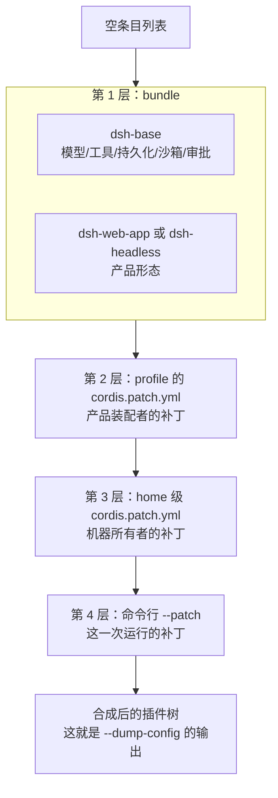

# 第 4 章 配置分层：Profile 与 Bundle——一份 YAML 就是一次产品定制

> 第 2 章我们看到了 web 和 headless 两种产品共享一个底座。这一章回答：**这种"换配置换产品"的机制是怎么实现的？** 答案是一个极简但深思熟虑的模型：分层、补丁、按 id 覆盖。

> **本章你将学到**：
> - 概念：Profile、Bundle、patch 三层模型与覆盖规则
> - 设计：为什么是分层补丁而不是一份大配置
> - 动手：给自己 profile 加一层补丁
>
## 4.1 一句话模型：运行中的 DSH = 有序分层合成的插件树

一个正在运行的 DSH 不是"一个配置文件"，而是一棵由多层叠加合成的插件树。后加的层覆盖先加的层：



每一层都是一份"补丁列表"：可以按 `id` 替换某个条目的整个 config，也可以 `insert` 新条目。**后加的层覆盖先加的层。**

## 4.2 设计思考：为什么是"分层补丁"而不是"一份大配置"？

DSH 完全可以生成一份"最终配置"文件让你直接编辑——很多系统就是这么干的。为什么偏要分层？因为分层的每一层对应一个**不同的责任主体**：

| 层 | 责任主体 | 回答的问题 |
| --- | --- | --- |
| bundle | 插件作者 | 这个插件默认需要什么配置？ |
| profile patch | 产品装配者 | 这个产品形态要什么配置？ |
| home patch | 机器所有者 | 这台机器上要什么配置？ |
| --patch | 运行者 | 这一次运行要什么配置？ |

分层的好处：**不同的人可以在不同层修改，互不覆盖、互不冲突**。升级插件时，bundle 层的默认值会更新，但你的用户层补丁纹丝不动。如果是一份大配置，升级 = 合并地狱。

分层的代价也很明确：**配置的"真相"分散在多层**，要看合成结果必须 `--dump-config`。这也是为什么 DSH 特意提供"打印合成配置"的能力——它知道自己的配置模型有这个认知负担。

## 4.3 Profile：命名的启动配方

**Profile** 存在 Harness home 里（默认 `~/.dsh/profiles/<名字>/`）。一个 profile 目录包含：

- `package.json`：声明这个 profile 挂哪些 bundle（`dsh.profile.bundles`）——这是 profile 的"骨架"；
- `cordis.yml`：加载器实际读取的条目文件（由 bundle 层 + 补丁层合成而来，别手改）；
- `cordis.patch.yml`：**你的补丁层**（改这里）；
- `node_modules`：profile 专属的插件安装位置。

DSH 内置**四个** profile 模板（`packages/boot/app-boot/src/profile.ts` 的 `PROFILE_TEMPLATES`）：

| 模板 | bundles | 补丁热加载 | 产品形态 |
| --- | --- | --- | --- |
| `web` | `dsh-base` + `dsh-web-app` | `live`（运行中可重载补丁） | 浏览器应用 |
| `headless` | `dsh-base` + `dsh-headless` | `startup`（启动时读取） | 一次性任务 CLI |
| `sdk` | `dsh-base` + `dsh-sdk-app` | `startup` | SDK 应用（供程序驱动） |
| `sdk-minimal` | `dsh-sdk-minimal` | `startup` | 最小 SDK 装配 |

每个模板现在是一个对象（`{ bundles, patchReload }`），而不是单纯的 bundle 数组——多出来的 `patchReload` 控制"补丁层能否在运行时热重载"：`web` 允许 `live`（改补丁即生效），其余是 `startup`（重启后生效）。

以 `web` 为例，它的 bundle 列表是：

```text
web: {
  bundles: ['@deepseek-ai/dsh-base', '@deepseek-ai/dsh-web-app'],
  patchReload: 'live'
}
```

**同一个配置，不同 profile 就是不同的产品**：`web` 是浏览器应用，`headless` 是一次性跑任务的 CLI，`sdk`/`sdk-minimal` 是给程序调用的装配。

## 4.4 Bundle：插件发行单元

**Bundle** 是"配置行 + 代码"的打包格式，声明在插件的 `package.json` 的 `dsh` 字段里：

```text
name: @deepseek-ai/dsh-web-app
dsh:
  bundle:
    patch: ./cordis.bundle.yml
```

- `dsh.profile`：profile 用它列出 bundles；
- `dsh.bundle`：bundle 用它指向自己的补丁文件。

bundle 的价值：**它插入的东西仍然可以被上层补丁改写**——这意味着插件作者可以提供"好用的默认值"，而装配者永远保留"最终决定权"。`packages/bundle/` 下的关键 bundle：

| Bundle | 作用 |
| --- | --- |
| `dsh-base` | 几乎所有 profile 的第一层：模型适配、工具、持久化、沙箱与审批策略、设置、凭据、遥测 |
| `dsh-web-app` | 浏览器应用（Web UI） |
| `dsh-headless` | 一次性运行器，没有 Host/HTTP（`web` 与 `headless` 共享 base） |
| `dsh-acp-app` | ACP（Agent Client Protocol）应用装配 |
| `dsh-sdk-app` | SDK 应用装配（供程序驱动） |
| `dsh-sdk-minimal` | 最小 SDK 装配 |

每个 bundle 的补丁文件就在 `packages/bundle/<名字>/cordis.patch.yml`——这也是早期 `examples/` 目录退役后，你查看"真实装配配置"的地方。

## 4.5 应用顺序与覆盖规则：两条规则，别无其他

从空条目列表开始，按这个顺序应用：

1. profile 列出的每个 bundle，按顺序；
2. profile 的 `cordis.patch.yml`；
3. home 级补丁（`~/.dsh/cordis.patch.yml`，机器级偏好）；
4. 命令行 `--patch <file>`，可重复。

覆盖规则只有两条，**故意只有两条**：

- 一个 patch **按 `id` 命中条目，替换该条目的整个 config**（不是合并！）；
- 或者用 `insert` 插入新条目。

所以第 3 章实验里，`webserver` 条目在更下层配置了 `port: 3080`，你的补丁把它整行替换成 3081。想"只改一个字段但保留其他字段"？必须把整个 config 重新写全。

### 设计思考：为什么"整行替换"而不是"深度合并"？

深度合并（merge）听起来更友好："我只改 port，其他字段自动保留"。但合并有一个致命问题：**它隐含了"我知道每个字段的语义"**。`config` 是一个任意形状的 JSON，深度合并两条任意 JSON 的规则是猜出来的（数组怎么并？null 怎么算？），猜就会出错。而整行替换的语义是确定的、可预测的：**你写的 config 就是最终的 config**。

代价是重复（改一个字段要写全兄弟字段），但换来的是"配置行为可推断"。DSH 选择了可推断，放弃了一点便利——这是它反复出现的品味：**简单、确定、fail-loud，胜过聪明、灵活、静默出错**。

## 4.6 Harness Home：`~/.dsh`——用户层与部署层的分界

本机用户级状态都在 `~/.dsh`（Windows 是 `C:\Users\<你>\.dsh`，可用环境变量 `DSH_HOME` 覆盖）：

```text
~/.dsh/
  settings.yaml              # 用户设置（可热加载）
  cordis.patch.yml           # home 级补丁层（跨 profile 生效）
  profiles/<name>/           # 每个 profile 一份
    package.json
    cordis.yml
    cordis.patch.yml
  storages/                  # 结构化数据（如 workspace 元数据）
```

这个目录结构本身就是一种架构声明：**"我的偏好"和"部署的默认值"是两回事**。`settings.yaml` 是"用户偏好"层（例如给 `llm-deepseek` 配一个 `settings` 段，覆盖 adapter 默认配置而无需重启），`cordis.patch.yml` 是"机器级覆盖"。第 9 章会看到这层分界对凭据管理的意义。

## 4.7 配置表达式：`!!js` 的力量与边界

条目 config 支持 `!!js` 表达式，在加载时求值。headless 示例里就有：

```yaml
- id: agent-spine
  name: '@deepseek-ai/dsh-agent-spine-demo'
  config:
    agents:
      - id: main
        provider: deepseek-official
        model: deepseek-v4-flash
        cwd: !!js process.cwd()
```

`process.cwd()` 在启动时被求值，把当前工作目录注入配置。这让配置可以引用环境变量、路径解析等动态值。

但注意边界：表达式能力很强，**不要把它当作不受限的脚本环境**。DSH 有引导环境变量的保护清单（第 10 章的 `BOOTSTRAP_NAMES`），防止被注入的配置劫持启动过程。这里的张力值得记住：**配置的灵活性和配置的安全性成反比**——每多一分表达式能力，就多一分被投毒的面。

## 4.8 动手实验：给你的 profile 加一层补丁

1. 打开 `~/.dsh/profiles/web/cordis.patch.yml`（没有就新建），加入：

```yaml
- id: webserver
  config:
    host: 127.0.0.1
    port: 3082
```

2. 启动 `corepack pnpm dsh web`，访问 `http://127.0.0.1:3082`——你改的是本机 web profile 的补丁层，效果和 `--patch` 一样，但持久生效；
3. 运行 `dsh --profile web --dump-config | Select-String webserver`，确认 port 变成 3082；
4. 想恢复默认？把补丁文件清空回 `[]` 即可。

## 4.9 常见坑

- **patch 是整行替换，不是深度合并**：改一个字段要把兄弟字段一起写全；
- **别直接改 `cordis.yml`**：那是合成出来的，会被重置；你的层是 `cordis.patch.yml`；
- **id 必须存在**：patch 命中不存在的 id 会报错（fail-loud）——这是保护你不是为难你；
- **改动 bundle 列表要谨慎**：`package.json` 的 bundles 决定产品骨架，误删会导致启动缺能力。

## 4.10 思考题

1. "整行替换"换来了可推断性，代价是重复。如果你是 DSH 的作者，你会考虑加"深度合并"吗？什么条件下合并是安全的？（提示：给 config 定义 schema 之后）
2. `--dump-config` 是分层配置的"认知税"。设想一种替代方案：每次启动自动把合成结果写回一份文件——你会失去什么？
3. `!!js` 表达式让配置能跑代码。如果你是安全负责人，你会允许哪些表达式、禁止哪些？和 `BOOTSTRAP_NAMES` 的黑名单思路对比一下。

## 小结

- Profile = 配方；Bundle = 插件发行包；patch = 覆盖层；应用顺序固定：bundle → profile patch → home patch → --patch。
- 覆盖规则只有两条：按 id 整行替换，或 insert——简单、确定、fail-loud。
- 分层对应责任主体：插件作者/产品装配者/机器所有者/运行者，各改各的层。
- 用户级状态在 `~/.dsh`，settings.yaml 可热更新；`!!js` 有力量也有边界。

下一章深入事件系统——插件之间真正的通信方式，也是 DSH 作为"API 表面"的地方。