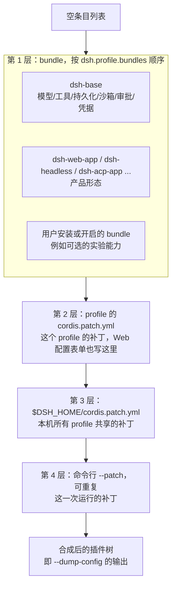
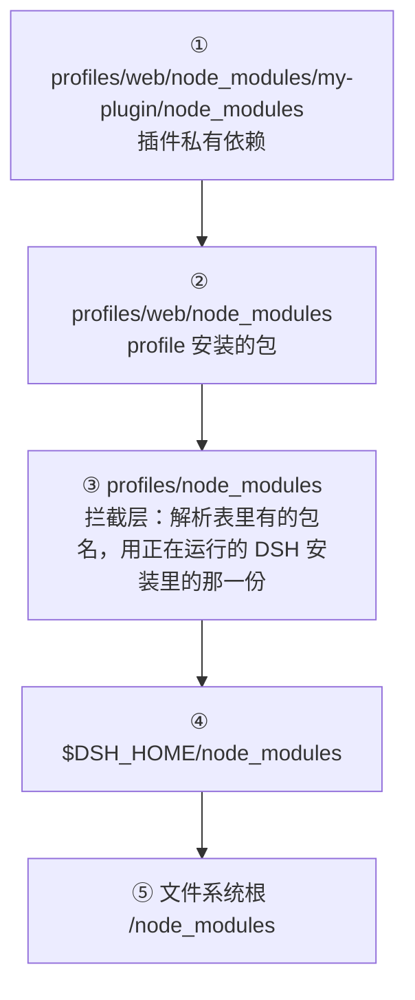

# 第 4 章 配置分层：Profile 与 Bundle——一份 YAML 就是一次产品定制

> 第 2 章我们看到了 web 和 headless 两种产品共享一个底座。这一章回答：**这种"换配置换产品"的机制是怎么实现的？** 答案是一个极简但深思熟虑的模型：分层、补丁、按 id 覆盖。在 0.1.7 里，这个模型又往前走了几步：配置表单直接写回 profile 的补丁层、Agent 预设变成普通的配置行、插件可以在 Web 界面里安装，而 profile 加载插件的模块解析规则被重新写成了"一句话能讲清"的形式。

> **本章你将学到**：
> - 概念：Profile、Bundle、补丁三层模型与覆盖规则；可选 bundle；profile 自有的实时配置
> - 设计：为什么是分层补丁而不是一份大配置；为什么"整行替换"而不是深度合并；为什么模块解析不再往磁盘写链接
> - 动手：给 web profile 加一层补丁，并用 `--dump-config-schema` 校验合成结果
>
## 4.1 一句话模型：运行中的 DSH = 有序分层合成的插件树

一个正在运行的 DSH 不是"一个配置文件"，而是一棵由多层叠加合成的插件树。合成从一个**空的条目列表**开始，后加的层覆盖先加的层：



每一层都是一份"补丁列表"：可以按 `id` 改写某个已有条目，也可以 `insert` 新条目。**后加的层覆盖先加的层。** 合成结果只存在于内存里——profile 目录中**没有**一份"合成好的 `cordis.yml`"，想看最终结果就用 `--dump-config`。

命令行参数（如 `dsh web --port 8080`）**不是**另一个补丁层：它们由应用自己的 provider 插件解析成服务（例如 `ctx.webStartup`），再由配置里的 `!!js` 表达式读取。第 3 章的实验已经演示过这一点。

## 4.2 设计思考：为什么是"分层补丁"而不是"一份大配置"？

DSH 完全可以生成一份"最终配置"文件让你直接编辑——很多系统就是这么干的。为什么偏要分层？因为分层的每一层对应一个**不同的责任主体**：

| 层 | 责任主体 | 回答的问题 |
| --- | --- | --- |
| bundle | 插件/产品作者 | 这个插件默认需要什么配置？这个产品形态由哪些插件组成？ |
| profile patch | 这个 profile 的使用者（手写，或通过 Web 配置表单） | 这个 profile 要什么配置？ |
| home patch | 机器所有者 | 这台机器上所有 profile 都要什么配置？ |
| --patch | 运行者 | 这一次运行要什么配置？ |

分层的好处：**不同的人在不同层修改，互不覆盖**。升级 DSH 时，bundle 层的默认值会更新，但你的补丁纹丝不动。如果是一份大配置，升级 = 合并地狱。

分层的代价也很明确：**配置的"真相"分散在多层**，要看合成结果必须 `--dump-config`。这也是为什么 DSH 特意提供了三个"不启动、只打印"的诊断开关（4.9 节）——它知道自己的配置模型有这个认知负担。

## 4.3 Profile：命名的启动配方

**Profile** 存在 Harness home 里：`$DSH_HOME/profiles/<名字>/`（默认 `~/.dsh/profiles/<名字>/`）。一个 profile 目录包含：

- `package.json`：这个 profile 的插件依赖（由 pnpm 管理），以及 `dsh.profile.bundles`——**有序的 bundle 列表**，这是 profile 的骨架；
- `cordis.patch.yml`：**你的补丁层**，在所有 bundle 层之后应用；
- `pnpm-workspace.yaml`：初始化时写入，让 pnpm 用 hoisted 布局安装、不自动安装 peer（原因见 4.8 节）；
- `compatibility.json`（可选）：对"声明的 DSH 版本范围不匹配"的插件做**精确版本豁免**；
- `node_modules`、`pnpm-lock.yaml`：profile 专属的插件安装。

DSH 内置**五个** profile 模板（`packages/boot/app-boot/src/profile.ts` 的 `PROFILE_TEMPLATES`），第一次使用时自动初始化：

| 模板 | bundles | 补丁热加载 | 产品形态 |
| --- | --- | --- | --- |
| `web` | `dsh-base` + `dsh-web-app` | 实时（运行中改补丁即生效） | 浏览器应用 |
| `headless` | `dsh-base` + `dsh-headless` | 仅启动时 | 一次性任务 CLI |
| `sdk` | `dsh-base` + `dsh-sdk-app` | 仅启动时 | 经 stdio JSON-RPC 由程序驱动 |
| `sdk-minimal` | `dsh-sdk-minimal` | 仅启动时 | 独立的最小 SDK 装配（不叠 base） |
| `acp` | `dsh-base` + `dsh-acp-app` | 仅启动时 | 经 stdio 说 ACP（Agent Client Protocol） |

和旧版不同，模板对象现在**只有 `bundles` 一个字段**，"补丁能否热加载"不再由模板字段决定，而是**由合成出来的 YAML 自己决定**：`dsh-base` 插入了一行 `hmr`（`@deepseek-ai/dsh-hmr`，负责监视 profile 清单和两层用户补丁），而 `dsh-headless`、`dsh-sdk-app`、`dsh-acp-app` 各自用一行极短的补丁把它关掉：

```yaml
- id: hmr
  disabled: true
```

这很能体现 DSH 的品味：**一个能力开不开，是配置事实，不是启动器里的特殊分支**。

启动方式也更短了：`dsh <名字>` 就是 `dsh --profile <名字>` 的简写（`feature/2026-09-15-profile-command-shorthand.md`），对自定义 profile 同样有效。唯一的例外是 `plugin`：紧跟在 `dsh` 后面时它是插件管理命令，想启动一个叫 `plugin` 的 profile 要写 `dsh --profile plugin`。

想基于内置模板建一个新 profile，用 `--from-default-profile`：

```powershell
corepack pnpm dsh rescue --from-default-profile web   # 以 web 模板的 bundle 列表创建新 profile "rescue" 并启动
corepack pnpm dsh rescue                              # 以后直接用
```

它只复制模板**当前**的 bundle 列表，依赖和补丁都是空的，也不记录"继承自谁"。另外还有一个名为 `desktop` 的**保留** profile，由 Electron 桌面端自己持有和加载，不走 CLI 的 profile 查找。

## 4.4 Bundle：插件发行单元

**Bundle** 是"配置行 + 代码"的打包格式：一个 npm 包，在 `package.json` 的 `dsh.bundle.patch` 里指向自己的补丁文件。`patch` 可以是一个文件，也可以是**有序的文件列表**，按顺序作为同一层应用。`dsh-web-app` 就是列表形式：

```json
"dsh": {
  "bundle": {
    "patch": [
      "./cordis.patch.yml",
      "./presets/standard.patch.yml",
      "./presets/ptc.patch.yml",
      "./presets/minimal.patch.yml",
      "./presets/cordis.patch.yml"
    ]
  }
}
```

这两种 `dsh` 声明——bundle 用的 `dsh.bundle` 与 profile 用的 `dsh.profile`——的类型现在集中在一个只含类型的公共包 `@deepseek-ai/dsh-package-manifest` 里（`architecture/2026-09-05-package-manifest-types.md`、`2026-09-10-public-package-manifest.md`）：

- `DshPackageManifest`：DSH 关心的 package.json 字段子集（必填 `name`、`version`，可选 `description`、`icon`、`peerDependencies`、`engines` 等）；
- `DshManifest`（即 `package.json.dsh`）：`manifestVersion`（声明格式版本，目前是 `1`）、`bundle`、`profile`、`client`；
- 运行时要求写在顶层 `engines.dsh`，仿照 VS Code 的 `engines.vscode`。

需要强调的是：**这些声明目前是"声明性"的**，安装器和加载器并不据此拦截。真正在加载前生效的兼容检查是另一条路：DSH 会对插件在 `peerDependencies` 里声明的 `@deepseek-ai/dsh` / `@deepseek-ai/dsh-*` 版本范围，与当前运行时版本做匹配；不匹配的插件行会在启动器自己的那份合成结果里被替换成 `disabled: true`（profile 文件不被改动），除非 `compatibility.json` 里有针对"这个插件的这个精确版本 × 这个精确 DSH 版本"的豁免。

bundle 的价值：**它插入的东西仍然可以被上层补丁改写**——插件作者提供"好用的默认值"，装配者永远保留"最终决定权"。仓库内置的 bundle 在 `packages/bundle/` 下：

| Bundle | 作用 |
| --- | --- |
| `dsh-base` | 除 `sdk-minimal` 外所有内置 profile 的第一层：模型适配、会话持久化、凭据与授权、设置、沙箱与权限预设、插件管理、HMR 等 |
| `dsh-web-app` | 浏览器应用（Web UI、HTTP 服务、Agent 预设） |
| `dsh-headless` | 一次性运行器，不挂 HTTP 服务和浏览器连接 |
| `dsh-acp-app` | ACP 应用装配 |
| `dsh-sdk-app` | SDK 应用装配 |
| `dsh-sdk-minimal` | 独立的最小 SDK 装配 |

这些内置 bundle 的名字**总是从正在运行的 DSH 安装里解析**，所以你的 bundle 可以放心依赖"`dsh-base` 一定在、而且和 DSH 同版本"；profile 目录里 pnpm 管理的只是外部安装的 bundle。某个 bundle 解析失败、清单损坏或不兼容时，它会被**跳过**（启动时在 stderr 打印一次 `skipping profile bundle ...`），其余 bundle 保持顺序继续合成——但剩下的组合能否提供所需服务，就不保证了。

每个 bundle 的补丁文件就在 `packages/bundle/<名字>/cordis.patch.yml`（`web-app` 还有 `presets/`）——这是你查看"真实装配配置"的地方。

## 4.5 可选 bundle：随安装附带、默认关闭

有些能力官方想提供，但不想默认开启。0.1.7 为此引入了**随安装附带的可选 bundle**（`process/2026-09-15-shipped-optional-bundles.md`、`architecture/2026-09-21-experimental-capabilities-as-optional-bundles.md`）。清单就是 `profile.ts` 里的 `OPTIONAL_BUNDLES`：

```ts
export const OPTIONAL_BUNDLES: readonly string[] = [
  '@deepseek-ai/dsh-experimental-agent-team-profile',
  '@deepseek-ai/dsh-experimental-voice-input-bundle',
  '@deepseek-ai/dsh-experimental-auto-review',
]
```

规则很克制：每个可选 bundle 必须是 CLI 安装包的运行时依赖、声明 `dsh.bundle.patch`、带 `icon` 和 `./locale/*.json` 显示元数据，并且**不被任何内置模板选中**。插件管理器把它们报告为 `optional`：默认关闭、不可删除、从安装目录解析；Web 插件页的"官方"分组把它们排在最前面，标注为实验性。

为什么只有这三个？因为可选 bundle 的依赖图会被**每一次** `dsh` 安装下载，所以只接纳"依赖图已经在安装闭包里"的包。浏览器操控（Playwright MCP、Chrome DevTools MCP）和计算机操控（Cua Driver）的 provider 会让每次安装多出约 85 MB、21 个包，因此仍然保持为需要显式组合的实验包；Inspector 也只能显式安装。这是一个很现实的权衡：**"开箱可选"的代价由所有用户承担，所以门槛必须高。**

## 4.6 应用顺序与覆盖规则：两条规则，别无其他

从空条目列表开始，按这个顺序应用：

1. profile 的 `dsh.profile.bundles` 里每个 bundle 的补丁，按列表顺序；
2. profile 自己的 `cordis.patch.yml`；
3. home 级补丁 `$DSH_HOME/cordis.patch.yml`（所有 profile 共享，所以它**高于** profile 层）；
4. 命令行 `--patch <文件>`，按出现顺序，可重复。

覆盖规则只有两条，**故意只有两条**（语义实现在 `vendor/include/src/index.ts` 的 `applyEntryPatches`）：

- **按 `id` 命中**：补丁里除 `id`/`name`/`insert` 之外写出的每个字段（`config`、`disabled`、`inject`、`isolate`……）都**整体替换**目标条目的同名字段；没写的字段保持原样。如果补丁同时写了 `name`，它是一个断言：和目标条目的 `name` 不一致就跳过这条补丁。
- **`insert` 插入**：不带 `id` 时追加到顶层；带 `id` 时插入到那个 group 条目的子列表里。同一份补丁列表中，后面的补丁可以命中前面刚插入的条目。

所以第 3 章实验里，`webserver` 条目在 bundle 层配置了带表达式的 `port`，你的补丁把整个 `config` 替换掉——想"只改一个字段但保留其他字段"？必须把整个 config 重新写全。

还有两个边界行为要记牢：补丁命中一个**不存在的 id**，只会打印一条警告并跳过（`--dump-config` 会带上层标签报告它），而不是启动失败；一个**空的或只有注释**的补丁文件会让启动失败——想"禁用这一层"，写 `[]`。

### 设计思考：为什么"整行替换"而不是"深度合并"？

深度合并听起来更友好："我只改 port，其他字段自动保留"。但合并有一个致命问题：**它隐含了"我知道每个字段的语义"**。`config` 是任意形状的数据，深度合并两份任意数据的规则是猜出来的（数组怎么并？null 算删除还是算值？表达式和字面量怎么并？），猜就会出错。整行替换的语义是确定的：**你写的 config 就是最终的 config**。`dsh-base` 的补丁文件开头就写着这条纪律：因为补丁整体替换 config，所以"随产品形态而不同"的配置行不放在 base 里，而是由各个形态 bundle 各自写全，让任何一行最多只经过"一个 bundle 层 + 用户层"。

代价是重复（改一个字段要写全兄弟字段），但换来的是"配置行为可推断"。DSH 选择了可推断，放弃了一点便利——这是它反复出现的品味：**简单、确定、失败时大声，胜过聪明、灵活、静默出错**。

## 4.7 Profile 自有的实时配置：表单写回补丁层

旧版 DSH 有一个独立的 `$DSH_HOME/settings.yaml`：设置页的改动存进这里，优先级高于部署层。问题在于，schema、默认值、持久化、变更通知都有了两份，而且"某个值到底来自哪一层"丢失了。0.1.7 把它**删掉了**（`architecture/2026-09-19-profile-owned-live-configuration.md`）：

- 插件的**每个**可配置值都声明在它的 Cordis `Config` 里；不需要重启就能改的字段用 `.volatile()`（第 3 章），消费者在每次操作时通过引用读取；
- 设置界面只负责**枚举**这些字段来生成表单，自己不再提供任何业务配置；
- 保存表单时，配置编辑器（`@deepseek-ai/dsh-config-editor`）写的是**当前 profile 的 `cordis.patch.yml`**，然后走普通的 Loader 协调路径——只改了 volatile 字段就原地更新，改了普通字段就重装那个插件；
- 如果这次修改会被更高的层（home 补丁或 `--patch`）遮蔽，写入会在持久化之前就被拒绝——不会让你"保存成功但毫无效果"；
- 旧的 `settings.yaml` 会在第一次启动时被导入当前 profile，然后改名为 `settings.yaml.imported`，保证只导入一次。

这里有一个直接来自"整行替换"的代价，笔记里写得很坦白：因为补丁只能整体替换 config，表单保存时会把**整个条目的 config**（写入时刻合成出来的普通字段 + 所有 volatile 字段）存进 profile 行。于是之后 bundle 对这些字段默认值的升级，就**不会再流到这个 profile**，直到你把这一行的覆盖删掉（表单上"重置整个条目"就是干这个的）。要想只存"改过的字段"，补丁 `config` 就得支持合并——而 DSH 刻意没有提供。

### 声明式 Agent 预设：预设也只是一行配置

同样的思路也被用在 Agent 预设上（`architecture/2026-09-18-declarative-agent-presets.md`）。旧版的预设是一个个目录，有自己的发现、复制、编辑 API；现在，一个预设就是一行普通的 Cordis 配置：

```yaml
- insert:
    - id: preset-minimal
      name: '@deepseek-ai/dsh-agent-preset'
      config:
        id: minimal
        order: 3
        plugins:            # 这个预设的子插件列表，就是普通的条目
          - id: persona
            name: '@deepseek-ai/dsh-persona'
            config:
              prefix: You are a helpful software engineer assistant.
              complete: true
          # ……
```

（节选自 `packages/bundle/web-app/presets/minimal.patch.yml`。）`@deepseek-ai/dsh-agent-preset` 声明身份、显示元数据和子插件列表；`@deepseek-ai/dsh-agent-preset-registry` 负责选择与**运行时修订**：每次编辑生成一个新修订，正在运行的 Agent 继续持有旧修订，直到它们释放。Web 编辑器和 `agent_preset` 工具只接受子插件 YAML，保存时同样写进当前 profile 的补丁层（覆盖这一行的 `config.plugins`）。所以用户的覆盖会**整体替换**子插件列表，而不会合并未来内置预设的改动——还是同一条规则。

## 4.8 Profile 如何找到插件代码：解析顺序与"代"

profile 从自己的 pnpm 项目里加载插件，但 DSH 自身的包、bundle 里内嵌的依赖都不在这个项目的依赖树上——Node 默认从 profile 出发沿祖先 `node_modules` 查找，是找不到它们的。旧版的做法是在磁盘上写"回退链接"和代理包，这带来了跨进程的状态、锁、陈旧链接……0.1.7 把它改成了纯进程内的方案（`architecture/2026-09-09-profile-resolution-generations.md`、`2026-09-19-profile-resolution-lookup-order.md`）。

**规则可以用一句话讲清**：普通的模块请求保持 Node 的祖先 `node_modules` 顺序；在 profile 内部，DSH 的"运行时解析表"只占据 `$DSH_HOME/profiles/node_modules/<包名>` 这一层的对应位置。以 `$DSH_HOME/profiles/web/node_modules/my-plugin/index.js` 为发起方：



- 解析表在 profile 启动时一次性算好：从正在运行的 DSH 包出发，广度优先遍历 `dependencies` 与 `peerDependencies`（"安装闭包"，数百个条目），再加上被选中 bundle 独有的依赖；
- **近者优先**：① ② 里有同名包就用它，所以插件自己声明的第三方库版本不会被安装闭包覆盖；
- 解析表是**不可变的"代"（generation）**：替换时构造一个完整的后继、一次性换掉引用，失败则保持当前代不变；已有包的目录或版本不能在运行中被替换（Node 的模块缓存会保留旧身份），这类变化需要重启；
- 拦截层**不读写任何磁盘链接**；0.1.5 的链接后端写进 profile 的 `.dsh-module-fallback` 投影，会在加载时被清理一次；
- 对"链接到 profile 之外的开发目录"的插件（`dsh plugin add ../my-plugin` 这种），规则是：在每个祖先位置，只有该位置 `package.json` 里声明为 **peer** 且解析表里有的包名，才换成运行中 DSH 的那一份。所以插件开发者应当像仓库内的包一样，把需要和宿主共享实例的 DSH 包同时写进 `peerDependencies` 和 `devDependencies`（附录 D 会用到）。

这也解释了 4.3 节 `pnpm-workspace.yaml` 里的 `autoInstallPeers: false`：插件声明为 peer 的 DSH 包**不安装**进 profile，由拦截层提供运行中安装的那一份，插件和宿主共享同一个模块实例。

### 设计思考：为什么不再往磁盘写链接？

磁盘链接的问题不在"能不能用"，而在"状态归谁"。链接一旦写到磁盘，它就跨进程、跨安装地存在：两个不同版本的 DSH 共用一个 home 时谁说了算？进程崩溃时写了一半怎么办？打包成 Electron 后路径怎么办？进程内的不可变解析表把这些问题全部消掉——**每个进程自己算、自己用、原子替换**，代价是要依赖 Node 内部的加载器接口，并为此维护一套跨 Node 版本的兼容测试。

## 4.9 看清合成结果：三个诊断开关与配置目录

| 命令 | 输出 |
| --- | --- |
| `dsh <profile> --dump-default-config` | 只合成 bundle 层 |
| `dsh <profile> --dump-config` | bundle + profile 补丁 + home 补丁 + `--patch`；每行上方注释标出来源文件和改过它的层，`!!js` 原样保留 |
| `dsh <profile> --dump-config-schema` | 不挂载插件，把合成树里每个插件的 schemastery `Config` 投影成一份 JSON Schema 2020-12 |

三个开关互斥，都不接受应用参数。`--dump-config-schema` 值得多说两句（`feature/2026-09-20-config-schema-dump-validation-policy.md`）：它会**导入**每个组合里的模块来读取 schema（所以只对你信任的 profile 运行），但不会执行 `apply`、不求值表达式、不跑 transform 回调。静态文档无法复现原生校验的全部行为，因此它的策略是：

- 根上的 `x-cordis` 注解给出 `profile`、`complete`、`entries`、`diagnostics`；
- 只要有任何错误诊断、`partial`/`unsupported`/`error` 条目、或一个插件名对应多个 Config，`complete` 就是 `false` 且**退出码为 1**——即使 stdout 上已经有一份有用的 schema。退出码回答的是"这份文档能否替代原生校验"，而不是"有没有输出"；
- 发现过程**包含被禁用的行**（用户很可能会重新启用它们）；遇到无法静态模拟的原生改写行为时，宁可放宽并记一条限制，也不去模拟。

仓库里还有一份从源码生成的 `docs/config-catalog.md`：列出每个 harness 包的 `config:` 声明原文、`inject` 的服务和源码位置，由 `corepack pnpm run verify-config-catalog`（属于 `doc-sync`）保证新鲜。写补丁前查它，比翻源码快得多。

## 4.10 配置表达式：`!!js` 的力量与边界

条目 config 和 `disabled` 支持 `!!js` 表达式（第 3 章）。`dsh-base` 里就有几种典型用法：

```yaml
- id: session-persistence-jsonl
  name: '@deepseek-ai/dsh-session-persistence-jsonl'
  config:
    root: !!js dshHomePath('sessions')       # 启动器提供的 Harness home 路径助手

- id: settings
  name: '@deepseek-ai/dsh-settings'
  disabled: !!js "!ctx.get('profileContext')" # 不是经 profile 启动时就不挂载
```

另外还有 `mode: !!js process.env.DSH_PERMISSION_MODE ?? 'workspace-write'`、`workspaceRoot: !!js process.cwd()` 这类读取环境变量和工作目录的写法。这让配置可以引用环境、路径和其它服务的值。

但注意边界：**表达式在 Host 进程里执行，配置本身就是可信代码**。声明式预设的笔记为此规定：让 Agent 通过工具改写预设配置，必须经过审批或处于完全访问模式，"因为配置在 Host 中执行"。与之配套的另一道防线在更早的环节：`packages/boot/app-boot/src/index.ts` 里的 `BOOTSTRAP_NAMES`（以及 `DSH_`、`XDG_` 等前缀）列出了**不允许由发现到的 `.env` 文件设置**的环境变量——`PATH`、`NODE_OPTIONS`、各种解释器启动钩子、`DEEPSEEK_BASE_URL`、证书相关变量等，只能来自继承的进程环境；四个代理变量只允许来自 Harness home 下的 `.env`，不允许来自随仓库克隆而来的当前目录 `.env`。这里的张力值得记住：**配置的灵活性和配置的安全性成反比**——每多一分表达式能力，就多一分被投毒的面，所以 DSH 选择把"谁能写配置"管住，而不是假装表达式是沙箱。

## 4.11 插件管理：CLI 与 Web 插件页

往 profile 里加插件有两条路，底层调用的是**同一套**包操作（`architecture/2026-09-14-current-profile-plugin-management.md`）：

**CLI**：`dsh plugin --profile <名字> <参数...>` 在 profile 缺失时先初始化它（内置模板，或其它名字时只含 `@deepseek-ai/dsh-base`），然后把参数原样转给 pnpm，在 profile 目录执行——`add`、`remove`、`update` 都照常可用。每次成功运行后，`dsh.profile.bundles` 会与安装状态对账：声明了 `dsh.bundle.patch` 的依赖加入层栈，没有声明的只作为普通依赖并警告一次，被删除的依赖离开层栈。CLI 参考文档说明，这类 bundle 成员变化对正在运行的 profile 要重启后生效，而普通的补丁编辑通过热重载生效。

**Web 插件页**：由 `@deepseek-ai/dsh-plugin-manager` 驱动，0.1.7 为它补齐了几项关键体验：

- **引导式安装**（`architecture/2026-09-15-guided-plugin-installation.md`）：安装前先"读"一遍 spec（registry 包名、绝对路径、git 地址、tarball），通过 `pnpm view` 或目录下的 `package.json` 拿到名字、版本、描述和 bundle 声明；**没有 bundle 补丁的包在 pnpm 运行前就被拒绝**。安装失败、被取消、或装上的包没有 bundle 补丁时，会恢复安装前快照的 `package.json` 和 `pnpm-lock.yaml`。安装完成后才提供"立即启用"，而不是先勾选再安装；
- **安装源计划**（`architecture/2026-09-18-plugin-install-registries.md`）：`PluginManager.Config` 新增 `registry`（首先询问的源）与 `fallbackRegistries`（默认是 npmmirror）。只有网络、超时、包不存在、版本不匹配这几类"换个源可能就好"的失败才会切到下一个源；**私有源永远不会回退到公共源**——否则一个在两边同名的包，就可能装成别人的（依赖混淆）。CLI 侧对应的是 `dsh plugin add --registry`；
- 每个插件的标题、描述和图标来自插件自己导出的 `locale/<语言>.json`（`meta.title`、`meta.description`）和 `package.json` 的 `icon`，读取时**不导入、不激活**插件，所以被禁用或加载失败的插件也能正常显示。

## 4.12 Harness Home：`~/.dsh`——用户层与部署层的分界

本机用户级状态都在 `~/.dsh`（Windows 是 `C:\Users\<你>\.dsh`，可用环境变量 `DSH_HOME` 覆盖）：

```text
~/.dsh/
  .env                       # 普通环境变量层（优先级低于继承的进程环境）
  .credentials.yaml          # 由 Web 模型页管理的凭据文档（不会写进 process.env）
  cordis.patch.yml           # home 级补丁层（跨 profile 生效，高于 profile 层）
  profiles/
    <name>/                  # 每个 profile 一份
      package.json
      cordis.patch.yml
      pnpm-workspace.yaml
      compatibility.json     # 可选
    node_modules/            # 拦截层所在的位置（4.8 节）
  sessions/                  # 会话日志（dsh-base 中 session-persistence-jsonl 的 root）
  storages/                  # 结构化数据
  logs/                      # 启动失败时的完整诊断报告
```

这个目录结构本身就是一种架构声明：**"我的偏好"和"部署的默认值"是两回事**。和旧版相比最大的变化是：`settings.yaml` 没有了，**持久化的表单值是 profile 专属的**。笔记也承认这放弃了"跨 profile 共享偏好"——想要回来，需要一个显式的共享 Cordis 层和明确的写入目标。第 9 章会看到凭据来源的顺序：继承的环境 → `.credentials.yaml` → 当前目录 `.env` → `$DSH_HOME/.env`。

## 4.13 动手实验：给你的 profile 加一层补丁

1. 打开 `~/.dsh/profiles/web/cordis.patch.yml`（第一次运行 `dsh web` 后就会生成，初始内容是 `[]`），改成：

```yaml
- id: webserver
  config:
    host: !!js ctx.webStartup.host ?? '127.0.0.1'
    port: !!js ctx.webStartup.port ?? 3082
    compression: gzip
    compressionLevel: 1
    compressionThresholdBytes: 1024
```

2. 不启动，先确认合成结果（在 deepseek-harness 根目录）：

```powershell
corepack pnpm dsh web --dump-config | Select-String -Context 0,8 "id: webserver"
```

注释里能看到这一行被 `profiles/web/cordis.patch.yml` 改过。

3. 用 schema 校验这次合成：

```powershell
corepack pnpm --silent dsh web --dump-config-schema > web-schema.json
$LASTEXITCODE
(Get-Content web-schema.json -Raw | ConvertFrom-Json).'x-cordis'.complete
```

（`--silent` 让 pnpm 不往 stdout 打印脚本横幅，保证文件里只有 JSON。）如果退出码是 1、`complete` 是 `False`，别急着认为出错了：打开 `x-cordis.diagnostics` 和各条目的 `status`，看看是哪些插件的 schema 只能部分投影。这正是 4.9 节说的"退出码回答的是能否替代原生校验"。

4. 启动 `corepack pnpm dsh web`，访问 `http://127.0.0.1:3082`——你改的是本机 web profile 的补丁层，效果和 `--patch` 一样，但持久生效。
5. 想恢复默认？把补丁文件改回 `[]`（不要清空成空文件，空文件会让启动失败）。

## 4.14 常见坑

- **补丁是整字段替换，不是深度合并**：改 config 的一个字段要把兄弟字段一起写全；带 `!!js` 的字段如果被你写成字面量，它读取命令行或环境的能力也随之消失；
- **profile 里没有合成好的 `cordis.yml`**：你的层是 `cordis.patch.yml`，要看合成结果用 `--dump-config`；
- **id 写错不会让启动失败**：只有一条警告，然后这条补丁被跳过——改完配置没效果时，先看 stderr 或 `--dump-config` 的报告；
- **空补丁文件会让启动失败**：禁用一层写 `[]`；
- **Web 表单保存后，bundle 默认值不再更新**：因为整个条目的 config 被存进了 profile 层；想重新跟随默认值，就重置整个条目；
- **home 补丁高于 profile 补丁**：在 `~/.dsh/cordis.patch.yml` 里写过的行，会让 Web 表单对同一行的编辑被拒绝。

## 4.15 思考题

1. "整行替换"换来了可推断性，代价是重复——而 profile 自有的实时配置又把这个代价放大成"表单保存后 bundle 默认值不再流入"。如果你是 DSH 的作者，你会考虑给补丁 `config` 加"深度合并"吗？在 config 都有 schema（甚至有 `--dump-config-schema`）之后，合并在什么条件下是安全的？
2. `--dump-config` 是分层配置的"认知税"。设想一种替代方案：每次启动自动把合成结果写回 profile 目录里的一份文件——你会失去什么？（提示：想想"谁是真相"，以及 Web 表单该写哪一份）
3. `!!js` 表达式让配置能跑代码，而 `BOOTSTRAP_NAMES` 管的是 `.env` 文件能设置哪些变量。这两道防线分别防的是什么样的攻击者？为什么 DSH 不去做"表达式沙箱"，而是把"谁能写配置"管住？
4. 可选 bundle 只接纳"依赖图已在安装闭包里"的包，浏览器操控 provider 因为多出约 85 MB 被挡在外面。"开箱可选"与"安装体积"之间，你会把线划在哪里？还有什么别的分发方式能两全？
5. profile 的模块解析从"磁盘链接"改成了"进程内不可变的解析代"。为什么"已有包的版本不能在运行中替换，只能重启"是一个诚实的限制，而不是偷懒？

## 小结

- Profile = 配方（有序 bundle 列表 + 自己的补丁层）；Bundle = 带补丁文件的 npm 包；应用顺序固定：bundle → profile 补丁 → home 补丁 → `--patch`；
- 覆盖规则只有两条：按 id 整字段替换，或 insert；id 不存在只警告，空文件才失败；
- 内置五个模板（新增 `acp`），热加载与否由合成出的 `hmr` 行决定；`dsh <名字>` 是 `--profile` 的简写；可选 bundle 随安装附带、默认关闭；
- `settings.yaml` 已移除：表单直接写 profile 补丁层，volatile 字段原地更新；Agent 预设也只是普通配置行；
- profile 通过进程内不可变的运行时解析表找到 DSH 自身的包，不再写磁盘链接；
- `--dump-config` 看结果，`--dump-config-schema` 做校验，`docs/config-catalog.md` 查字段；`!!js` 在 Host 中执行，配置就是可信代码。

下一章深入事件系统——插件之间真正的通信方式，也是 DSH 作为"API 表面"的地方。
