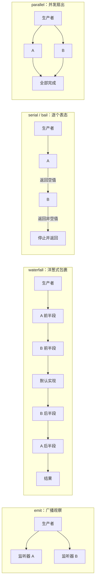

# 第 5 章 事件系统：插件之间怎么"说话"

> 本章基于 DSH 0.1.7-rc.2。事件名、签名与分发模式以源码中的 `interface Events` 声明为准；`docs/event-producer-consumer.md` 是从这些声明生成的生产者/消费者矩阵，可以当作本章的"活附录"。

## 5.1 先问"为什么"：插件之间的通信不能是"直接调用"

上一章说过，DSH 的几乎所有能力都由插件提供，而且插件可以被任意组合：换一个 profile，某个插件就可能不在了。那插件之间怎么协作？

最直接的办法是"我 import 你，调你的函数"。但这会带来三个问题：

- **强耦合**：审批插件要知道"工具注册表"的内部实现，工具注册表也得知道"谁可能要拦截我"；
- **不可替换**：想把 Web 审批换成自动审查（`auto-review` 可选 bundle），所有调用点都要改；
- **组合爆炸**：N 个插件两两调用，依赖图是 N² 级别，而且插件卸载后留下的函数引用会变成悬空调用。

DSH 的回答分两层：

- **服务（Service）** 解决"我需要一个能力"：`ctx.tools`、`ctx.sessions`、`ctx.systemPrompt` 等，由第 3 章讲过的依赖注入提供；
- **事件（Event）** 解决"我想在某个时刻插一脚"：模型请求发出前改写参数、工具执行前做策略判断、会话写入一条事件后做观察。

生产者只负责"在这个时刻广播"，不需要知道谁在听。下面是几个真实的扩展点：

| 场景 | 事件 | 模式 |
|------|------|------|
| 工具执行前做 allow / deny / ask 判断 | `tools/pre-execute` | waterfall |
| 给工具调用套超时、重试、计量 | `tools/execute` | waterfall |
| 工具结果出来后替换、补充或拦截 | `tools/post-execute` | waterfall |
| 只观察最终落定的工具结果 | `tools/result` | emit |
| 在每次模型请求前调整调用参数 | `agent/request` | waterfall |
| 一轮对话即将结束时"再追一句" | `agent/turn-stopping` | serial |
| 会话日志追加了一条事件 | `session/event` | emit |
| 会话需要把缓冲落盘 | `session/flush` | parallel |

## 5.2 设计思考：事件 vs 回调 vs 消息队列

| 方式 | 优点 | 缺点 |
|------|------|------|
| 回调（传函数进去） | 简单、直接 | 调用方要预留参数；多个订阅者难处理；生命周期要手动管 |
| 进程内事件 | 解耦；多订阅者；可声明语义；随插件自动卸载 | 调用链不如直接调用直观 |
| 消息队列（跨进程） | 可跨进程、可持久 | 重、慢，对进程内插件协作是杀鸡用牛刀 |

DSH 选了**进程内事件**，并做了两件让它"不那么难追"的事：

1. **类型化**：每个事件都通过 TypeScript 声明合并登记在 Cordis 的 `interface Events` 上，名字拼错、参数写错是编译错误；
2. **声明语义**：每个事件的 JSDoc 用 `@mode` 标签写明分发模式（emit / waterfall / serial / parallel / bail），`docs/event-producer-consumer.md` 由脚本从源码生成，列出每个事件的模式、声明位置、谁在生产、谁在消费。

跨进程怎么办？宿主（Host）和浏览器之间走的是类型化 RPC（第 12 章），其中一小部分 Host 事件会被**原样转发**给远端（见 5.7）。进程内依然只有一套事件声明，远端只是这套声明的一个受限投影。

## 5.3 事件的三要素：一个事件 = 名称 + 参数 + 模式

以工具注册表的前置拦截为例，它在 `packages/core/tools/src/index.ts` 里这样声明（简化了注释）：

```ts
declare module '@deepseek-ai/cordis' {
  interface Events {
    /**
     * Scope-filtered dispatch (`@deepseek-ai/dsh-scope`): agent-scoped listeners receive only that agent's calls.
     * @mode waterfall
     */
    'tools/pre-execute'(
      this: Scoped<ToolRuntime>,
      exec: ToolExecution,
      next: () => Promise<PreToolDecision>,
    ): Promise<PreToolDecision>
  }
}
```

三要素一目了然：

- **名称**：`tools/pre-execute`，按 `领域/动作` 命名；
- **参数**：`exec` 是待执行的调用（`callId`、`name`、`arguments`、调用方 `agent` 等），`next` 是链上的下一环；
- **模式**：`@mode waterfall`。

还有一个容易忽略的细节：`this: Scoped<ToolRuntime>`。它表示这个事件是**作用域过滤**的——绑定在某个 Agent 作用域里的监听器，只会收到这个 Agent 发起的调用（5.6 详述）。

注册和分发的写法是分开的，这一点旧资料里常常写错：

```ts
// 注册：永远用 ctx.on / ctx.once，不论事件是什么模式
ctx.on('tools/pre-execute', async (exec, next) => {
  if (exec.name === 'bash') return { kind: 'ask', reason: 'shell 命令需要确认' }
  return next()
})

// 分发：由生产者按模式选择 ctx.emit / ctx.waterfall / ctx.serial / ctx.parallel / ctx.bail
const decision = await ctx.waterfall(
  carrier, 'tools/pre-execute', exec,
  () => Promise.resolve<PreToolDecision>({ kind: 'allow' }),
)
```

分发时第一个参数 `carrier` 是作用域载体（可省略），最后一个参数是链尾的默认实现：如果没有任何监听器短路，就得到 `{ kind: 'allow' }`。`ctx.on` 还接受第三个参数 `EventOptions`：`{ prepend: true }` 把监听器插到最前，`{ global: true }` 让监听器不受作用域过滤。

## 5.4 五种分发模式：五种语义

Cordis 的分发模式有五种，不是四种。它们回答的是同一个问题：**多个监听器同时存在时，谁说了算？**



### emit：观察——"我看见了，但我不管"

emit 同步调用所有监听器，不收集返回值。它适合"通知"：

```ts
ctx.on('session/event', (session, event) => {
  if (event.type === 'tool/result') console.error('[observer] 工具结果已写入日志')
})
```

`tools/result` 也是 emit：它在结果落定之后发出，载荷是冻结的；监听器抛错会被隔离，不会改变工具结果。**想改结果请用 `tools/post-execute`，想看结果请用 `tools/result`**——这是 DSH 工具文档反复强调的分工。

### waterfall：改写与拦截——"先让我过目，我再放行"

waterfall 把监听器串成洋葱：每个监听器拿到 `next`，可以

- 直接返回一个值（短路，后面的监听器和默认实现都不会运行）；
- 调用 `next()` 拿到内层结果，再加工后返回；
- 在 `next()` 前后做事情（计时、重试、换一个 `AbortSignal`）。

DSH 里 waterfall 是最常见的"可插拔决策"形态：

- `tools/pre-execute` 返回 `PreToolDecision`：`allow`、`deny`（带 `reason`）、`cancel` 或 `ask`；
- `tools/execute` 包裹真正的执行，适合超时、重试、计量；包装者只能替换 `exec.signal`，调用身份不可变；
- `tools/post-execute` 返回 `PostToolDecision`：接受（可替换一种投影、附加 `additionalContexts`）或拦截；
- `agent/pre-step` 在每一步开始前决定 `{ kind: 'enter', messages }` 还是 `{ kind: 'reject' }`；
- `agent/request` 返回本次调用的 `LlmCallConfig`，只能调整调用参数，**不能改消息**——消息来自会话日志（第 6 章）；
- `agent/request-error` 可以返回 `{ kind: 'retry' }` 要求重试；
- `system-prompt/assemble`、`approval/request`、`llm/stream` 也是 waterfall。

### serial：有序决策——"逐个表态，第一个给出答案的说了算"

serial 按注册顺序**逐个 await** 监听器；某个监听器返回了非空值（不是 `null`、`false`、`undefined`），就立即停止并把这个值作为结果。它和"任何一个都能否决"的投票语义不一样：serial 是"第一个表态的赢"。

DSH 里最值得一看的 serial 事件是 `agent/turn-stopping`。它的签名返回 `void`：

```ts
'agent/turn-stopping'(this: Scoped<Agent>, payload: { agent: Agent; turn: number; signal: AbortSignal }): Promise<void> | void
```

一轮对话走到停止边界时，状态机依次通知监听器。有意见的监听器不是"投反对票"，而是调用 `agent.steer(...)` 往 Agent 的收件箱塞一条消息；状态机随后重新读收件箱：有新的 steering 就再跑一步，没有就结束这一轮。源码注释的原话是 "Data decides, so listener order cannot change the outcome"。

```ts
import { createUserMessage } from '@deepseek-ai/dsh-llm'

ctx.on('agent/turn-stopping', ({ agent }) => {
  if (!needsFollowUp(agent)) return
  agent.steer(createUserMessage({
    content: [{ type: 'text', text: '请先运行测试再结束。' }],
    source: { kind: 'my-plugin' },
  }))
})
```

这里的 `source` 要用自己的生产者 `kind`，并通过声明合并登记（5.5 的"生产者自有消息来源"）。

`agent/created` 也是 serial：新 Agent 创建后，各插件按顺序做初始化。

### bail：同步版的 serial

bail 与 serial 语义相同，区别是同步执行、不 await 监听器返回的 Promise。它适合必须在当前调用栈里得出结论的场景，Cordis 自己的内部事件（例如注册监听器时的 `internal/listener`）就用它。在 DSH 的生成矩阵里，目前没有任何 harness 事件声明为 bail——业务决策几乎都涉及 I/O，于是选择了异步的 waterfall 或 serial。

### parallel：并发扇出——"互不相干，一起干"

parallel 并发调用所有监听器，并等全部完成。典型例子是 `session/flush`（让各持久化插件把缓冲写盘）、`workspace/session-stop`、`feedback/committed`。

### 设计思考：为什么要有五种？

因为它们对应五种不同的"控制权分配"：

| 模式 | 返回值 | 谁说了算 | 适合 |
|------|--------|----------|------|
| emit | 忽略 | 没人（纯观察） | 通知、日志、UI 刷新 |
| waterfall | 链式传递 | 外层包裹内层，任何一层可短路 | 拦截、改写、包装 |
| serial | 第一个非空值 | 第一个表态者 | 有序决策 |
| bail | 第一个非空值（同步） | 第一个表态者 | 同步决策 |
| parallel | 等全部完成 | 所有人都要做完 | 独立的收尾工作 |

如果只有 emit，想"拦截"就只能靠监听器之间约定共享变量；如果只有 waterfall，纯观察者也被迫写 `return next()`，而且一个观察者忘了调 `next()` 就会悄悄吞掉整条链。把语义写进模式，等于把"这个扩展点允许你做什么"写进了类型。

## 5.5 两套词汇：Cordis 事件与会话事件类型

读 DSH 源码时最容易混淆的一点：**`turn/start`、`step/end`、`tool/result`、`assistant/message` 这些不是 Cordis 事件**，它们是会话日志里的**持久化事件类型**。

| | Cordis 事件 | 会话事件类型 |
|--|-------------|--------------|
| 声明位置 | `interface Events`（`declare module '@deepseek-ai/cordis'`） | `SessionEventMap`（`@deepseek-ai/dsh-session`） |
| 例子 | `tools/pre-execute`、`agent/request`、`session/event` | `turn/start`、`turn/end`、`step/start`、`step/end`、`tool/call`、`tool/result`、`user/message`、`assistant/message`、`assistant/attempt` |
| 生命周期 | 只存在于这一次分发 | 写入会话日志，重启、恢复后仍在 |
| 怎么订阅 | `ctx.on(name, ...)` | 监听 `session/event`，按 `event.type` 分支 |

内置的持久化类型清单在 `packages/core/session/src/known-event-types.ts` 的 `KNOWN_SESSION_EVENT_TYPES` 里。注意工具相关的两套名字：Cordis 事件是复数的 `tools/result`，会话事件类型是单数的 `tool/result`，别混用。插件也可以通过声明合并扩展 `SessionEventMap` 登记自己的持久化事件；为了兼容"写日志的插件后来被卸载"的情况，事件可以带 `ignorable` 标记，让读取方在不认识它时安全跳过。

按这个区分，DSH 的事件大致落在三个域：

| 域 | 典型成员 | 特点 |
|----|----------|------|
| 会话域 | `session/created`、`session/disposed`、`session/event`（emit）、`session/flush`（parallel） | 围绕持久化日志；想要"重启后还在"，就写成会话事件类型 |
| Agent 域 | `agent/created`、`agent/pre-step`、`agent/request`、`agent/request-error`、`agent/turn-stopping`、`agent/status`、`agent/assistant-stream` | 携带活跃 Agent，观察或干预进行中的工作 |
| 能力域 | `tools/*`、`fs/write-intent`、`fs/edit-intent`、`fs/observed`、`llm/stream`、`approval/request`、`system-prompt/assemble`、`session-telemetry/record` | 给能力接缝挂策略和适配器 |

判断准则：**需要重启后存活、需要进入模型上下文 → 会话事件类型；只干预进行中的工作 → Agent 域；给某个能力加策略 → 能力域。**旧版资料里的 `telemetry/*` 事件和 `assistant/chunk` 持久化类型在 HEAD 都不存在：遥测走 `session-telemetry/record`，流式增量走 `agent/assistant-stream`，只有最终消息才落日志。

### 生产者自有消息来源

每条用户侧消息都带一个 `source`，说明它是谁产生的。0.1.7 起，`source.kind` 直接就是**生产者自己的名字**，由生产者通过声明合并登记到 `MessageSourceMap`：

```ts
declare module '@deepseek-ai/dsh-llm' {
  interface MessageSourceMap {
    'cordis-host-runner': { kind: 'cordis-host-runner' }
  }
}
```

（这段取自 `packages/extensions/cordis-host-runner`。）以前的通用包装 `{ kind: 'plugin', plugin: '...' }` 已经废除：V3 → V4 的会话迁移会把旧记录改写成生产者自有的 `kind`，而原生 V4 日志直接拒绝 `kind: 'plugin'`。这样做的好处是，消费者看到 `kind` 就能按类型收窄出该生产者的附加字段，不需要再解一层"插件名"。

## 5.6 事件的作用域：事件不是全世界的

一个 DSH 进程里可能同时跑着多个 Agent（主 Agent、子 Agent、团队成员）。如果每个工具调用都广播给所有监听器，插件就得自己判断"这是不是我那个 Agent 的调用"。

DSH 用 `@deepseek-ai/dsh-scope`（`packages/core/scope`）统一解决：

- 事件声明里的 `this: Scoped<T>` 表示它是作用域过滤的；
- 生产者分发时传入作用域载体（上文的 `carrier`）；
- 通过某个 Agent 作用域的 `ctx`（例如 `agent.ctx`，或 `createScope(ctx, agent).ctx`）注册的监听器，只收到这个 Agent 的事件；祖先作用域可以观察后代的活动，反过来不行——所以插件在自己的根 `ctx` 上注册，能看到所有 Agent；
- 带 `{ global: true }` 的监听器完全跳过过滤。

并不是所有事件都过滤。比如 `tools/change`（工具集合变化）是刻意不过滤的 emit：工具注册表是全局的，每个观察者都应该知道。事件是否过滤、按什么过滤，写在各自的 JSDoc 里（"Scope-filtered dispatch (`@deepseek-ai/dsh-scope`): ..."）。

## 5.7 远程事件投递：让浏览器也能 `$on`

Web 前端运行在浏览器里，不在 Host 进程中。它同样需要知道"插件管理器状态变了""有一个审批请求"。0.1.7 把这类需求收敛成一个消费动词：

```ts
ctx.remote.$on('plugin-manager/install-state', (state) => { /* 刷新安装进度 */ })
```

几条规则：

- **显式白名单**：可转发的事件只登记在 `packages/api/remotes/src/remote-events.ts` 的 `API_REMOTE_FORWARDED_EVENTS` 里，Host 转发循环和远端 `$on` 的类型键读同一份声明；
- **只转发两种模式**：emit 事件，以及以 Agent 为作用域的 waterfall（如 `approval/request`、`user-questions/request`：浏览器给出的答复会作为 waterfall 的结果返回 Host）；
- **原样转发**：事件名和载荷就是 Cordis `Events` 声明里的那一份，不改名、不另起 DTO；
- **不重放**：普通事件只投递给当时在线的订阅者，错过就错过了。需要"最新状态"的消费者应当在订阅后主动查询一次快照；
- **生产者操作私有**：远端只能订阅，不能冒充 Host 发事件。

传输层上，这些事件复用 Gateway 在 `/api/remote.mux` 上的内部逻辑流 `$events`。细节属于第 11、12 章。

## 5.8 找到"谁在听"：生产者/消费者矩阵

事件解耦的代价是调用链不直观："我改了 `tools/post-execute` 的载荷，会影响谁？"DSH 的答案是生成文档：

- `docs/event-producer-consumer.md` 由 `scripts/gen-doc-graphs.ts` 扫描所有包的 `interface Events` 声明、分发点和监听点生成（`corepack pnpm gen-doc-graphs` 重新生成），按事件列出模式、声明位置、生产者、消费者；
- 矩阵同时列出声明的 `@mode` 和每个生产者实际使用的分发方法（如 `waterfall`、`serial`，或绕过 `ctx.emit` 的 `events.dispatch`），两者对不上一眼可见；反过来，持久化的会话事件类型如果带了 `@mode` 标签会被脚本判为违规——它们没有分发模式；
- 没有正式声明的内部事件（如 `internal/*`、Loader 发出的 `loader/volatile-update`）单独列在"未声明"部分。

改事件签名前先查这份矩阵，比全仓 grep 可靠得多。

## 5.9 动手实验：写一个会话观察者

旧版实验建议"打开会话 JSONL 文件看事件"。在 HEAD 上这不太现实：会话默认存放在 `~/.dsh/sessions/--<规范化的工作目录>--/<编码后的会话 id>/session.v3.jsonl.zstd`，是 zstd 压缩的。更好的办法是写一个十几行的观察者插件，直接订阅 `session/event`。

在 deepseek-harness 仓库根目录下新建 `scratch\observer.ts`：

```ts
import type { Context } from '@deepseek-ai/cordis'
import type {} from '@deepseek-ai/dsh-session'

export const name = 'session-observer'

export function apply(ctx: Context) {
  ctx.on('session/event', (session, event) => {
    console.error(`[observer] ${event.type}`)
  })
}
```

两个 `import type` 在运行时会被擦除，只用于类型检查。输出写到 stderr，是因为 headless 一次性任务的 stdout 只留给最终答案。

再新建 `scratch\observer.yml`，把插件插入配置。路径请写**绝对路径**（先在仓库根目录执行 `(Get-Location).Path` 查看），并使用正斜杠：

```yaml
- insert:
    - id: session-observer
      name: 'D:/code/deepseek-harness/scratch/observer.ts'
```

然后在仓库根目录运行一次 headless 任务：

```powershell
corepack pnpm dsh headless --patch .\scratch\observer.yml "不要调用任何工具，用一句话解释什么是事件溯源"
```

提示里要求"不要调用任何工具"，是因为 headless 没有审批界面，需要确认的工具调用无法得到批准。你会在 stderr 看到类似下面的序列（具体条目和顺序以实际运行为准）：

```text
[observer] user/message
[observer] turn/start
[observer] step/start
[observer] assistant/message
[observer] step/end
[observer] turn/end
```

stdout 只有最终答案；如果模型返回了推理内容，它会出现在 stderr 的 `dsh: reasoning:` 标题下，与观察者输出交织在一起。

进一步尝试（涉及工具调用的实验，建议改用 `corepack pnpm dsh web --patch .\scratch\observer.yml`，在浏览器里对话和审批）：

1. 把监听器换成 `ctx.on('tools/result', ...)`，比较它与会话里的 `tool/result` 在时机和内容上的差别；
2. 在 `tools/pre-execute` 上返回 `{ kind: 'deny', reason: '实验：禁止所有工具' }`，观察模型如何收到拒绝并改变策略；
3. 用 `corepack pnpm dsh headless --patch .\scratch\observer.yml --dump-config` 确认你的插入行确实出现在组合后的配置里。

## 5.10 常见坑

- **用 `ctx.waterfall` 注册监听器**：`ctx.waterfall` / `ctx.serial` 是分发 API，注册永远用 `ctx.on`；
- **waterfall 忘调 `next()`**：不想短路就必须 `return next()`（或 `await next()` 后返回加工结果），否则内层监听器和默认实现都不会运行；
- **在 emit 监听器里改参数**：emit 是观察语义，`tools/result` 的载荷更是冻结的；要改写请用对应的 waterfall；
- **把会话事件类型当 Cordis 事件订阅**：`ctx.on('turn/start', ...)` 不会触发，应监听 `session/event` 后判断 `event.type`；
- **以为 serial 是投票**：serial 返回第一个非空值；`agent/turn-stopping` 更是用 steering 数据决定，而不是看谁返回了什么；
- **远端订阅后等着"补发"**：远程事件不重放，先订阅、再拉一次快照；
- **在监听器里做重活**：监听器在主路径上，会拖慢每一次工具调用或模型请求；耗时工作交给 `ctx.jobs` 后台任务（第 13 章）。

## 5.11 思考题

1. waterfall 的 `next()` 机制和 Express 中间件几乎一样。你觉得把"事件"设计成"中间件"而不是"订阅-发布"，各自的适用场景是什么？（提示：想"加工"和"观察"的区别，以及 `tools/post-execute` 与 `tools/result` 的分工）
2. 类型化事件让"事件名拼错"变成编译错误。代价是什么？（提示：想动态场景——运行时才知道事件名、第三方插件的类型声明谁来维护）
3. 会话事件类型会入日志，Agent 域的 Cordis 事件不会。如果某个"决策"（比如"我决定不调用这个工具了"）既需要实时拦截又需要事后审计，你会怎样组合 `tools/pre-execute` 和会话日志？
4. `agent/turn-stopping` 不让监听器"返回否决"，而是让它 `steer` 一条消息，再由状态机读收件箱决定。相比"任何监听器返回 true 就继续"，这种"数据决定"的设计解决了什么问题？
5. 远程事件投递刻意不重放普通事件。如果让 `$on` 在订阅时补发最近 N 条事件，会带来哪些新问题？

## 小结

- 服务解决"我需要一个能力"，事件解决"我想在某个时刻插一脚"；事件通过声明合并类型化，`@mode` 标签写明语义；
- 五种模式对应五种控制权分配：emit（观察）、waterfall（包裹/改写/短路）、serial 与 bail（第一个表态者说了算）、parallel（并发收尾）；注册永远用 `ctx.on`；
- Cordis 事件与会话事件类型是两套词汇：后者进日志，经 `session/event` 观察；消息来源由生产者用 `MessageSourceMap` 自行登记；
- 作用域过滤由 `dsh-scope` 统一处理，远端通过白名单化的 `ctx.remote.$on` 订阅、不重放；
- 改事件前先查生成的生产者/消费者矩阵。

下一章：会话与事件溯源——为什么 DSH 敢说"模型看到的都来自日志"。
