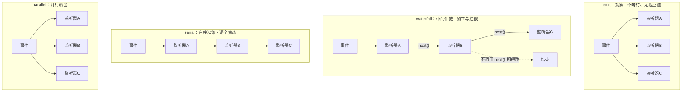

# 第 5 章 事件系统：插件之间怎么"说话"

> 第 3 章说插件之间不能互相 import。那它们怎么协作？这一章讲 DSH 的答案：**类型化事件**。它是插件的"API 表面"——观察、改写、拦截，全靠事件。

> **本章你将学到**：
> - 概念：事件三要素、四种分发模式、三个事件域
> - 设计：事件 vs 回调 vs 消息队列的选型光谱
> - 动手：在会话日志里观察真实事件流
>
## 5.1 先问"为什么"：插件之间的通信不能是"直接调用"

如果插件 A 想"在模型请求发出前加点东西"，最直接的做法是 import 插件 B 的函数来调用。但直接调用意味着：

- **耦合**：A 必须知道 B 的存在和接口；B 改名，A 就坏；
- **顺序依赖**：谁先执行、谁后执行，写死在 A 的代码里；
- **不可插拔**：想"换一个 B"，得改 A 的代码。

事件系统把通信反转过来：**产品在关键位置"抛事件"，任何插件都可以"监听事件"**。产品不知道也不关心谁在听——监听者随时可以加入或离开。这就是"控制反转"在通信层面的体现。

DSH 的事件是插件的"API 表面"：

- 想拦截一次模型请求？监听 `agent/request`（waterfall）；
- 想记录每次工具调用？监听 `tools/pre-execute` / `tools/post-execute`（emit）；
- 想阻止一轮对话结束？监听 `agent/turn-stopping`（serial）。

## 5.2 设计思考：事件 vs 回调 vs 消息队列

"用事件通信"有很多种实现，DSH 的选择处在一条光谱上：

- **回调（callback）**：把函数传给你调用——最直接，但顺序写死、无法叠加；
- **事件（event）**：你在关键点广播，监听者订阅——顺序由注册顺序决定，可叠加，这是 DSH 的层次；
- **消息队列（MQ）**：异步、持久化、跨进程——最松耦合，但延迟高、顺序难保证，不适合进程内高频调用。

DSH 选事件是因为它的场景恰好匹配：进程内、低延迟、需要"多个插件按序参与同一件事"。如果哪天 DSH 需要跨机器通信（比如远程沙箱），它用 RPC/协议而不是事件（第 13 章）。**通信机制的选择，取决于"耦合的粒度"和"延迟的预算"。**

## 5.3 事件的三要素：一个事件 = 名称 + 参数 + 模式

每个事件由三部分构成：

1. **名称**：如 `session/event`、`agent/pre-step`、`tool/result`；
2. **参数**：监听器收到的载荷，如 `(session, event)`；
3. **模式**：`emit` / `waterfall` / `parallel` / `serial`，决定分发行为。

模式和参数都是**公开契约**，写在类型声明里（Cordis 的 `interface Events`），所以**监听器写错参数/模式会得到类型错误**。这就是"类型化事件"的价值：事件名不是字符串拼写，而是编译期检查的符号。

## 5.4 四种分发模式：四种语义

| 模式 | 是否 await | 顺序 | 返回值 | 典型事件 |
| --- | --- | --- | --- | --- |
| `emit` | 否 | 注册顺序 | 无 | `session/event`、`tools/pre-execute` |
| `waterfall` | 否（next 链） | 注册顺序 | 有 | `agent/pre-step`、`agent/request`、`llm/stream` |
| `parallel` | 是 | 并行 | 无 | 扇出型任务 |
| `serial` | 是 | 注册顺序 | 有 | `agent/turn-stopping` |

### emit：观察——"我看见了，但我不管"

```ts
ctx.on('session/event', (session, event) => {
  ctx.logger.info('会话新增事件：%s', event.type)
})
```

适合做日志、遥测、UI 同步。语义纪律：**观察者不应改变事件本身**——想改写，请选 waterfall。

### waterfall：改写与拦截——"先让我过目，我再放行"

waterfall 是"环绕中间件"，签名是 `(...args, next)`：

```ts
ctx.waterfall('agent/pre-step', async (info, next) => {
  // 改写模型即将看到的输入
  info.messages.push({ role: 'user', content: '（附加的系统提示）' })
  return next() // 交给下一个监听器；不调用 next() 则短路
})
```

- 调用 `next()`：把（可能被改写后的）结果传给链上下一个监听器；
- 不调用 `next()`：自己拍板，短路后续监听器（用于策略性决策）。

waterfall 的本质是**中间件**——和 Express/Koa 的中间件是同一个心智模型。它解决了"多个插件都想参与同一件事"的编排问题：每个插件在自己的位置上加工，谁先注册谁先加工。

### serial：有序决策——"逐个表态，任何一个都能否决"

每个监听器按注册顺序执行、可以返回结果。典型场景是"要不要放行"：`agent/turn-stopping` 里，任何一个监听器说"还有事没做完"，这一轮就不结束。

### parallel：并行扇出——"互不相干，一起干"

所有监听器同时执行，全部完成后才继续。适合互不依赖的并行任务。

四种模式的差异，一张图说清（监听器 = 方框，箭头 = 数据流/调用顺序）：



### 设计思考：为什么要有四种？

因为"监听"这个动作背后有四种完全不同的语义：看（emit）、加工（waterfall）、决策（serial）、扇出（parallel）。如果把四种语义都压成一种（比如都是 emit），那么"想拦截请求"的插件就只能靠"改完再广播"这种 hack 来工作，系统语义会变得不可推断。**把语义显式化为四种模式，是让"扩展"可预期的关键。**

## 5.5 事件的作用域与事件域：事件不是全世界的

不是所有事件都全局广播。DSH 的 `dsh-scope` 支持**作用域过滤**：agent 级的监听器只收到该 agent 会话的事件，避免跨会话串扰（源码注释原话："scope-filtered dispatch：agent-scoped 监听器只收到通过该 agent 上下文进入的会话事件"）。

此外，DSH 把事件分成三个域，判断用哪个域有一个简单标准：**这个事实需要在重载后存活吗？**

| 域 | 例子 | 含义 |
| --- | --- | --- |
| 会话事件 | `turn/start`、`step/start`、`user/message`、`assistant/chunk`、`tool/result` | 持久事实，追加进会话日志（第 6 章） |
| Agent 事件 | `agent/*`（inbox、step、status、request…） | 携带活跃 Agent 对象，观察/拦截进行中的工作 |
| 能力事件 | `fs/*`、`tools/*`、`telemetry/*` | 给接缝挂策略和适配器 |

需要重载后存活 → 会话事件（会入日志）；只观察进行中的工作 → agent 事件；纯能力生命周期 → 能力事件。

## 5.6 动手实验：看事件在流动

不写插件也能看到事件在流动。跑一次 headless 任务，然后打开会话持久化文件：

```powershell
corepack pnpm dsh --profile headless 数一下 1 到 10 有几个偶数
```

跑之后打开 `~/.dsh/storages/` 或 session 持久化目录，看会话文件里的事件记录（JSONL 格式），你能看到 `turn/start`、`step/start`、`assistant/chunk`、`tool/result`、`step/end`、`turn/end` 这些真实事件。

## 5.7 常见坑

- **waterfall 忘调 `next()`**：如果不想短路，必须调用 `next()`，否则后续监听器收不到；
- **emit 监听器里改参数**：emit 是观察语义，改了可能没人管也可能引发诡异行为；要改写请选 waterfall；
- **事件名拼错**：类型系统会拦你——这就是"类型化事件"的价值，别绕过类型硬写字符串；
- **在监听器里做重活**：监听器会影响主路径延迟，重活请用 `ctx.jobs` 后台任务（第 13 章）。

## 5.8 思考题

1. waterfall 的 `next()` 机制和 Express 中间件几乎一样。你觉得把"事件"设计成"中间件"而不是"订阅-发布"，各自的适用场景是什么？（提示：想"加工"和"观察"的区别）
2. 类型化事件让"事件名拼错"变成编译错误。代价是什么？（提示：想动态场景——运行时才知道事件名、第三方插件的类型声明谁来维护）
3. 会话事件会入日志，agent 事件不会。如果某个"决策"（比如"我决定不调用这个工具了"）既需要实时拦截又需要事后审计，你会把它放在哪个域？还是两个域都要？

## 小结

- 事件 = 插件间通信 + 扩展点；类型化保证不写错；
- 四种模式对应四种语义：emit（观察）、waterfall（改写/拦截）、parallel（并行）、serial（串行决策）；
- 三个域：会话事件（持久）、agent 事件（实时）、能力事件（接缝）——按"重载后是否存活"判断；
- 会话日志里就能看到真实事件流，动手观察一次胜过读十遍。

下一章：会话与事件溯源——为什么 DSH 敢说"模型看到的都来自日志"。