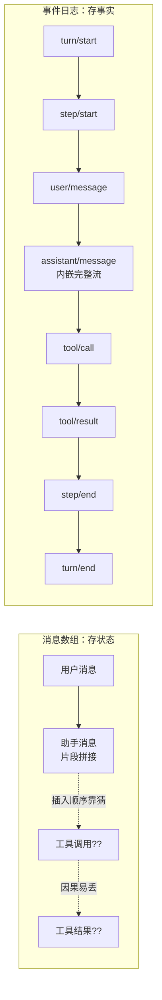
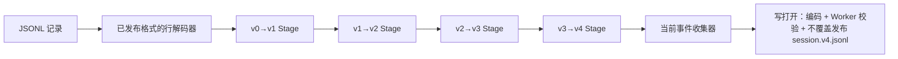

# 第 6 章 会话与事件溯源：为什么 DSH 敢说"模型看到的都来自日志"

> 上一章我们看了事件如何在插件之间流动。这一章进入本书最核心的设计之一：DSH 的会话不是一个"聊天记录文件"，而是一条**追加式事件日志**。理解这一点，你就理解了 DSH 整套可信度设计的根基——可回放、可审计、可恢复。

> **本章你将学到**：
> - 概念：事件溯源、表面（surface）与 model-visible 不变量、`deriveMessages()`
> - 设计：为什么"状态是算出来的"；为什么日志格式要版本化、要有"规范信封"
> - 演进：会话格式 v0→v4、已发布格式的流式迁移、投影缓存与"弃用同步读取历史"
> - 动手：解剖一份真实的 `session.v4.jsonl`，并对比同一会话的 v2/v3/v4 三代格式

## 6.1 先问一个朴素的问题：会话状态应该怎么存？

任何对话系统都要回答："这次聊到哪里了？"最简单的答案是存一个消息数组：用户消息、助手消息，一个接一个。传统聊天应用就是这么做的，看起来直接，但你把 Agent 的会话放进去就会发现三个窟窿：

- **流式输出怎么存？** 一次助手回复是几十个流式片段拼出来的。只存完整消息，前端想逐字重现"当时打字的样子"就没戏；每个片段存一行，日志又会膨胀到难以承受。
- **工具调用往哪插？** 模型调了工具、工具返回了结果，这两件事和"正在打字"的助手消息是什么先后关系？数组模型里没有"因果"的位置。
- **分支和重试怎么办？** 改一句话、重试一次、分叉一条新路——数组要么复制粘贴整个历史，要么就地修改（然后审计就废了）。

这三个窟窿的共同本质是：**状态（messages）是渲染的结果，不是事实本身。** 把渲染结果当存储，就等于把"屏幕上的字"当成"发生过的事"——一旦需要回放、分支、审计，你就得先发明一套补丁规则来还原真相。

两种模型的差别，画出来一看就懂——左边是"存结果"，右边是"存事实"：



## 6.2 换一个思路：不存状态，只存发生了什么

事件溯源（Event Sourcing）的答案很朴素：**只追加不可变的事实，状态随时从事实推导**。DSH 的会话就是一条追加式 `SessionEvent` 日志（定义在 `packages/core/session/src/types.ts` 的 `SessionEventMap`）。一次普通的"用户提问 → 模型调一次工具 → 模型回答"大致会留下这些核心事件：

```text
turn/start          一轮开始（在认领输入之前就打开，第 7 章细讲）
step/start          一个 step 开始：一次模型请求 + 它发起的工具调用
system/message      渲染好的系统提示词，作为"表面节点 0"进入历史
user/message        进入本 step 的用户输入（含 agent.inject 注入的附加上下文）
request/header      本次请求的"信封"：调用配置 + 工具 schema（只入日志，不产生消息）
request/context     路由元数据：provider、model、上下文窗口（只在变化时记录）
assistant/message   本 step 组装好的助手消息，内嵌这次模型调用的完整计时流
tool/call           模型请求调用工具：名字 + 模型原样生成的 arguments 字符串
tool/result         工具结果：一条 role 为 tool 的消息
step/end
turn/end            一轮结束，带结束原因（completed / aborted / blocked / error / max-tokens …）
```

还有几类值得认识的事件：

- `assistant/attempt`：一次**没有产生消息**的模型尝试（失败、重试、取消、流错误），同样内嵌它的流——证据保留下来，但不伪造模型历史；
- `developer/message`：会话中途的增量变化，例如工具集合的增减（见第 8 章"动态工具更新"）；
- `session/end-seed`：分叉或恢复时的"继承边界"标记；
- 以及大量插件通过**声明合并（declaration merging）**扩展的事件：`compaction/*`、`hook/*`、`todo/write`、`goal/change`、`agent/inbox/spliced`……完整清单由脚本生成在 `docs/persistence-catalog.md`，每个事件都标注了"surface（产生模型历史）"还是"log-only（只入日志）"。

注意每一条都是**发生过的事实**："用户说了这句话""模型调了 bash""工具返回了这些"。没有人去修改历史——新事实只追加在末尾。

> **和旧版本的一个差别**：早期格式把每个流式片段存成独立的 `assistant/chunk` 事件。从 v2 起，片段被压缩后**内嵌**进 `assistant/message` / `assistant/attempt` 的 `stream` 字段（"compacted without joining delta boundaries"——压缩但不合并片段边界）。回放保真度不变，事件数量却大幅下降；进程内的实时逐字显示改走瞬时事件 `agent/assistant-stream`（第 7 章）。

### 这不是新发明：三个熟悉的前辈

事件溯源的思想在你熟悉的系统里早已存在：

- **数据库 WAL（预写日志）**：MySQL/PostgreSQL 先写日志再改数据，崩溃后靠日志恢复——日志是事实，数据是推导（缓存）。
- **Git**：一次提交 = 一个不可变快照链。`git rebase` 不是改历史，而是造一条新历史。`git log` 就是事件溯源。
- **审计系统**：银行流水、操作日志——只增不改，出了问题倒查记录。

DSH 的不同之处在于：它不是把事件溯源当作"崩溃恢复机制"，而是当作**产品的主数据模型**——UI、上下文、标题、统计、搜索、分叉全部从这一条日志派生。

### 纵深对比：DSH vs 成熟的事件溯源生态（EventStoreDB / Axon）

事件溯源在领域驱动设计（DDD）社区有成熟实践：EventStoreDB 是专门的事件存储数据库，Axon 是完整的 CQRS/ES 框架。DSH 和它们同源，但目的不同：

| | EventStoreDB / Axon | DSH 的会话日志 |
| --- | --- | --- |
| 定位 | 通用事件基础设施（金融、电商等领域） | Agent 会话的专用数据模型 |
| 事件来源 | 业务领域命令（订单、账户…） | 模型交互（user/message、tool/result…） |
| 投影 | 显式 projection/read model | `deriveMessages()`、`ctx.sessionProjections` 投影单元 + 投影缓存 |
| 消费者 | 查询服务、报表、审计 | UI、模型上下文、标题、遥测、搜索、重放 |

共同的核心思想是"**事件 = 事实，状态 = 投影**"；区别在于 DSH 把事件溯源应用到一个**全新的领域**（Agent 交互）——这个领域的事件类型还在快速演化（新增一个事件类型 = 扩展产品能力），而金融等领域的事件类型早已稳定。DSH 的取舍是：**事件类型保持开放（声明合并，一切皆插件的延伸），但每个事件的"信封"和持久格式必须严格、版本化**——后者正是 6.6 节的主题。

## 6.3 核心不变量：模型看到的，必须已入日志

事件溯源解决"怎么存"，但还没解决"存什么"。如果模型看到的上下文和日志对不上，一切回放、审计、恢复都失去意义。所以 DSH 立了一条强不变量，`docs/architecture.md` 的原话是 **"Model-visible means logged."**：

> **任何进入模型请求的内容，都必须能从日志重建。**

翻译成人话：

- 想给模型加一种新输入？先定义一个新的会话事件类型，再让投影从日志画出它；
- 不允许"内存里塞了点东西就喂给模型，但日志里没记录"——这是架构红线；
- 连**请求本身**也要可重建：系统提示词是 `system/message` 事件，调用配置和工具 schema 在 `request/header` 里，路由信息在 `request/context` 里——所以"每次模型请求都是日志的纯函数"；
- 运行时有 invariant（不变量）检查请求确实能从日志重建；会修改已有消息内容的插件，必须注册**纯函数的消息投影**（`ctx.sessions.registerMessageProjection()`，如图片卸载插件），离线读者也要显式提供同一套定义。

这条不变量的分量，要在"信任"的语境下理解：**当系统开始替你做越来越多的事，"它到底做了什么"必须是可回答的。** 日志就是那个答案。没有它，你拥有的只是模型的一句"我做完了"。

## 6.4 从日志到上下文：表面与 deriveMessages——状态是算出来的

模型需要的不是事件，而是 messages 数组。这条投影分两层：

1. **表面（surface）**：只有五种"产生消息"的事件类型——`system/message`、`developer/message`、`user/message`、`assistant/message`、`tool/result`——可以进入有序的"表面"。每个这样的事件都**必须**声明 `surfaceOp`：要么 `'append'`（追加到尾部，最常见），要么 `{ op: 'replace', startSeq, endSeq }`（用自己替换一段已有节点——压缩摘要就是这么"覆盖"老区间的，第 13 章）。`turn/*`、`step/*`、`request/*` 这些结构性事件**禁止**携带表面字段。
2. **`Session.deriveMessages()`**：沿着表面节点逐个调用纯函数 `deriveEventMessage()`，得到模型看到的 `Message[]`。结果是**增量缓存**的（纯尾部增长只算新节点；一次 replace 或消息投影才重建）且**深度冻结**的（调用方不可能借投影篡改日志）。

投影规则很短：`user/message` → user 消息；`assistant/message` → assistant 消息（内容为空的跳过，比如被 max-tokens 截断且没内容的那一步）；`tool/result` → **一条一等公民的 tool 角色消息**（v4 起，见 6.6）；其余结构性事件不产生消息。

这里的关键不是函数怎么写，而是它背后的论断：**上下文不是"存"的，是"算"的。** 这带来两个直接后果：

1. **分叉（fork）是便宜的**：`ctx.sessions.fork(source, boundary?)` 按一个包含式的 `SessionSeq` 边界选中前缀，复制进新会话继续追加。现在可以从**任意**事件边界分叉；按 `SessionStore.fork()` 源码注释，如果边界落在一个还没结束的 turn 里，子会话会补上合成的工具结果和 step/turn 收尾事件（结束原因 `forked`），并在继承前缀末尾写入 `session/end-seed { inherited: true }`。
2. **恢复（resume）是确定的**：重启后读日志重建内存状态。崩溃时如果最后一个 turn 没收尾，恢复路径会追加一个 `interrupted` 原因的 `turn/end`，崩溃前的事件原样保留。

同一份日志喂养了所有功能：

| 功能 | 怎么来 |
| --- | --- |
| 模型上下文 | `session.deriveMessages()` 投影 |
| 工具声明历史 | `session.toolHistory()`：请求头与 developer 消息的增量折叠 |
| 会话标题 | `ctx.sessionTitle`（`session-title` + 一个可选的 LLM 标题 provider） |
| 列表、统计、轮次大纲、待办 | `ctx.sessionProjections` 投影单元（`session-stats`、`session-turn-outline` 等）+ `ctx.sessionProjectionCache` |
| 遥测 | `ctx.sessionTelemetry`（`session-telemetry` / `session-telemetry-otel`） |
| 会话搜索 | `ctx.sessionQuery`（`session-query` / `session-query-sqlite`） |
| 分叉 / 恢复 / 重放 | 复制、重建、重放同一份日志 |

## 6.5 规范信封：同一个事实只能有一种写法

"只存事实"还不够——**事实的写法**也必须唯一。设想同一个替换区间可以写成两种键名、同一个空工具列表既可以省略也可以写 `tools: []`：内存里的 Session、磁盘上的 JSONL、浏览器收到的线上事件，就可能对"哪些字段影响重建"产生分歧，甚至悄悄丢掉一条消息。

会话格式 v3 为此引入了**规范事件信封**（笔记 `2026-09-06-v3-canonical-session-envelopes.md`）：

- 信封只有 `type`、`seq`、`time`、`data`、可选的 `ignorable: true`，以及只允许出现在表面事件上的 `surfaceOp` / `sourceEventSeqs`；
- `surfaceOp` 只能是 `'append'` 或 `{ op: 'replace', startSeq, endSeq }`，没有别名、没有多余键；
- `request/header.header` 里禁止出现 `system` 字段（系统提示词只属于 `system/message`），空的 `tools: []`、`adapterDefaults: {}` 必须省略；
- `tool/result` 带 `data.error` 时，消息必须 `isError: true`——**不从矛盾的元数据里"猜"结果**；
- 读到**不认识且没标 `ignorable`** 的事件类型，读者必须拒绝重建，而不是静默丢弃——因为一个不认识的"必需事件"可能改变后续日志的含义。

校验在三处执行：`Session.append()`（写入时，非法事件在调用点就抛错，而不是等后台落盘才发现）、种子/恢复（读入时），以及浏览器端的 `SessionEventStream`（在发布给 UI 之前检查 follow 快照、实时事件和历史分页）。

### 设计思考：为什么宁可"拒绝"也不"修复"？

读者碰到不规范的记录，最省事的做法是"尽量修一修"：缺 `surfaceOp` 就当 append、矛盾的错误标记就以诊断信息为准。DSH 明确拒绝了这些备选方案——**默认值等于替日志做了一个它没做过的决定**。事件溯源的全部价值在于"日志说了算"；一旦读者开始脑补，不同读者就会脑补出不同的历史。宁可在入口处响亮地失败，也不要让一条畸形记录在模型历史里悄悄消失。

## 6.6 格式版本化：已发布的日志永远可读

会话日志一旦随某个版本发布（哪怕是 alpha / rc），用户磁盘上的数据就不再是"可以随手丢弃的预发布状态"。所以 DSH 把会话格式做成了一条**相邻迁移链**：

| 包（`packages/session/`） | 负责的那一步 |
| --- | --- |
| `session-format` | 纯库：相邻格式链的编排与制品校验 |
| `session-format-v0-to-v1` | 冻结的 v0 解码器 + 到 v1 的迁移（旧事件名改名、补齐确定性 id 等有界归一化） |
| `session-format-v1-to-v2` | 把分散的助手流片段折叠进 `assistant/message` / `assistant/attempt`，并重映射序号引用 |
| `session-format-v2-to-v3` | 系统提示词成为表面节点、规范信封、PTC 相关迁移 |
| `session-format-v3-to-v4` | v3 → v4：工具结果改为一等 tool 角色消息，并带"感知代际"的投递校验 |
| `session-format-catalog` | 生成的静态目录：把已发布的相邻迁移按顺序组装起来 |

当前写入版本由 `packages/core/session/src/types.ts` 里的 `SESSION_FORMAT_VERSION = 4` 唯一决定。`docs/session-format-status.md` 另外维护两条记录：**finalization 记录**（`latestFinalizedVersion: 4`，v4 已有被接受的兼容基线 `docs/persistence-changes/finalized/v4.json`）和**发布记录**（在 HEAD 的这份文档里仍写着 `latestReleasedVersion: 3`，证据标签 `dsh-v0.1.5-alpha.1`）。三者刻意分开：代码常量说"现在写什么"，finalization 说"兼容性承诺从哪算起"，发布记录说"用户手里已经有什么"。

### v4 改了什么：tool 角色终于是一等公民

v3 及以前，工具结果被包在一条 **user 角色**消息里的 `tool-result` 内容块中；而模型对话协议和各家 provider 都把工具结果当作单独的角色。两种描述并存，校验、回放、适配器投影就会互相打架。v4（笔记 `2026-09-15-first-class-tool-role-messages.md`）把一条工具结果存成 `role: 'tool'` 的消息，`toolCallId`、来源 `callId`、内容和错误标记一起校验。v3→v4 迁移**只**提升恰好一层的旧包装；遇到嵌套包装就拒绝迁移并保留源文件——因为把嵌套结果"压平"会丢掉内层的 callId 与错误状态。

与之配套的是**原生 v4 读取校验**（笔记 `2026-09-17-native-v4-read-validation.md`）：v4 恢复器和 JSONL 扫描器共享一趟**强制的跨事件关系检查**——turn/step 顺序、每个 `tool/result` 都有已声明的 `tool/call`、PTC 父子关系、重试链、压缩归属与当前区间、受保护的系统头……一个事件单看字段完全合法，但和前面的持久事件矛盾（例如没有对应调用的工具结果），也会在暴露给任何消费者之前被拒绝。可选的运行时 invariant 只提供诊断，**不是**持久准入的前提。未完结的尾巴（打开的 turn、step、工具调用）是允许的——崩溃本来就会留下这些。

### 迁移怎么跑：有状态的流式 Stage

"迁移"听起来像一个函数：读入旧制品、返回新制品。DSH 第一版就是这么实现的，结果一个真实的 116 MB 会话在 16 GB 的 Node 进程里 OOM——v0 的打包片段展开成九百多万个逻辑事件，每条迁移边都做整份快照和深冻结。笔记 `2026-08-31-released-session-format-migrations.md` 记录了重做后的设计：

- 每条迁移边是一个**不可变声明** + 每个制品独立的**有状态 Stage**（`transformEvent` / `transformRun` / `finish`），通过同步的 `emitEvent` / `emitRun` 上下文逐条向下游推送，链路中**没有中间事件数组**；
- JSONL 后端只扫一遍帧边界、复用一个 Zstandard 解码器、增量解析 JSONL 行，直接喂进 `createRestore()`；
- **已提交的代际文件永不改动**：v0 是 `session.jsonl[.zstd]`，之后是 `session.vN.jsonl[.zstd]`。读打开只在内存里用迁移结果、不发布新文件；写打开才把最终版本编码到临时文件，在 Worker 线程里完整校验，再以"不覆盖"的方式发布为新代际，旧文件原样保留；
- 迁移只能来自**静态目录**，不允许运行时挂载的插件注册迁移——否则"历史是否可读"会取决于部署装了哪些插件。



这就是追加式日志的一个直接红利：**历史格式永远可读，新版本只新增一条相邻边，不破坏旧数据**——你早期录下的会话，在当前版本打开时会自动走完整条链。

## 6.7 读侧：投影、投影缓存与"不再同步读历史"

### 权衡：事件溯源不是银弹

这本书的每一章都会问同一个问题：代价是什么？事件溯源的代价很具体：

- **查询慢**：状态是投影，读一次要扫一遍日志；
- **日志膨胀**：流、工具结果都要存；
- **投影逻辑复杂**：事件类型几十种，渲染规则要跟上新类型，这是一笔持续的维护税。

DSH 用一组具体机制对冲：

- **投影单元**（`ctx.sessionProjections`，包 `session-projection`）：各领域注册"把已提交事件折叠成完整当前值"的单元，驱动器维护每个会话的水位线，Session Controller 向客户端推送变化的值；
- **投影缓存**（`ctx.sessionProjectionCache`，包 `session-projection-cache`）：把投影检查点持久化，冷会话的列表、统计、标题**零 I/O** 从内存表读出，冷折叠可以跳过已检查点的前缀。它的保证是"**日志领先、缓存跟随**"：先把会话缓冲事件刷盘，再写缓存行，所以崩溃只会让缓存落后、永远不会超前。缓存记录绑定生命周期身份（`formatVersion`、`createdAt`、`cwd`、`isSeeded`，折叠侧还要求精确的 `inheritedEventCount`），跨格式代际或跨分叉切点的行不能拿来"播种"折叠；只读的列表视图则按身份匹配提供值，并标成 `cached`，一旦连上的会话产生新值就被替换（笔记 `2026-09-19-projection-cache-listing-identity-and-cached-rows.md`）。检查点 JSON 的读校验也改为无损谓词 `isJsonValue`，不再因为重建对象而丢掉像 `__proto__` 这样合法的自有键（笔记 `2026-09-19-lossless-projection-checkpoint-json.md`）；
- **spill 与压缩**：大输出落外部存储、日志只留定位信息（第 8 章）；老区间用 `replace` 压成摘要（第 13 章）。

### 弃用"同步读取任意历史事件"

一个更长远的方向是：**Session 不必把完整事件序列常驻内存**。一旦历史事件需要存储 I/O，"同步读取第 N 条事件"这种保证就无法维持。所以笔记 `2026-09-09-deprecate-synchronous-session-event-reads.md` 把 `Session.eventAt()`、`Session.snapshotEvents()`、`Session.ownEvents()` 全部标记为 `@deprecated`：已有代码可以暂不迁移，但**禁止新增调用**（测试文件除外）。替代做法是：

- 把"恢复后需要的状态"设计成投影，resume 时重建一次，此后用新提交的事件增量维护；
- 需要展示历史内容时，用显式的**异步分页**，每次只读请求的窗口（远程接口 `page` / `follow` 就是这么做的）；
- 真正需要完整历史的少数操作（如分叉）走显式的存储读取，而不是借同步读取器偷懒。

注意这是一条 **API 使用纪律**，当前实现仍在内存里保留完整序列——它约束的是"新依赖"，为将来的存储重构留出空间。

## 6.8 会话生命周期里的几条新规则

事件溯源管"日志里有什么"，但会话作为一个产品实体，还有"谁能写、什么时候停"的问题。0.1.5 之后落地了几条值得了解的规则：

- **单写者租约与空白会话复用**（笔记 `2026-09-17-process-local-blank-sessions.md`）：两个宿主共享同一个会话存储时，可能同时选中同一个"空白会话"（还没有 `turn/start`，但已经可以执行斜杠命令、积累配置事件）。现在的做法是：显式按 id 创建会话时先恢复并**获取写者锁**，只有 `session/writer-held` 错误才触发新建一个会话；Agent 在整个生命周期内持有这把锁。持久数据和远程 schema 里**不写 PID**——内核级的写者租约已经是权威，PID 会复用、会过期，只会增加噪声。
- **归档会停止正在运行的工作**（笔记 `2026-09-21-archive-stops-running-session-work.md`）：以前"归档"只是改可见性，归档中途的会话会在看不见的地方继续烧 token。现在 `WorkspaceRegistry.archiveSession()` 默认**拒绝**归档有活动的会话（返回 `workspace/session-active`，附带活动清单）；带 `stopActivity: true` 时先写归档、再通过 `workspace/session-stop` 让各自的拥有者停下：Agent 注册表以 `agent.cancel({ kind: 'user' })` 取消当前 turn，job 注册表 kill 掉会话拥有的后台任务，子 Agent 运行时取消其后代，Schedule 插件删除该会话的定时任务。此外 Session Controller 在 `agent/pre-step` 上拦截：归档会话（及其子 Agent 后代）提出的 step 一律被拒，turn 以 `blocked` 结束——**没有新的事件类型，也不往别人的 turn 里写东西**，恢复后的会话从一个正常结束的日志继续。
- **任意位置分叉**：前面 6.4 已提到，分叉边界是精确的 `SessionSeq`，继承切点由 `session/end-seed { inherited: true }` 标记推导，而不是写在头部。

这几条规则有一个共同点：**能用日志里已有的事实表达的，就不发明新事件；需要"外部权威"的（写者锁、归档集合），就交给真正的权威，而不是在日志里伪造。**

## 6.9 动手实验：解剖一份真实的会话日志

**无 Key 版本（推荐先做）**：仓库里提交了录制好的会话快照，而且同一个会话保留了多代格式。

1. 在 deepseek-harness 根目录统计一份 v4 日志的事件类型：

```powershell
Get-Content snapshots/session/bash-tool-turn/session.v4.jsonl |
  ForEach-Object { ($_ | ConvertFrom-Json).type } |
  Group-Object | Sort-Object Count -Descending
```

2. 第一行 `type` 为 `session` 的是**头部**（`"version":4`、`isSeeded`、`cwd` 等，快照里做了占位替换），不是事件。对照 6.2 节的列表，逐个找到 `turn/start`、`step/start`、`system/message`、`user/message`、`request/header`、`assistant/message`、`tool/call`、`tool/result`、`step/end`、`turn/end`。你会看到两个 step：第一个 step 模型调了 `bash`，第二个 step 模型给出回答。
3. 打开 `assistant/message` 那一行，找到 `stream` 数组——这就是内嵌的计时流，取代了旧格式里成百上千行的 `assistant/chunk`。
4. **对比三代格式**：分别在 `session.v3.jsonl` 和 `session.v4.jsonl` 里找 `tool/result` 那一行。v3 是 `"role":"user"` 的消息里包着一个 `"type":"tool-result"` 内容块；v4 直接是 `"role":"tool"`，`toolCallId` 提升到消息上。再看 `session.v2.jsonl` 的头部 `"version":2`。同一段对话，三种持久表示——这就是 6.6 节迁移链要保证等价的东西。
5. 数一数：哪些事件"只对审计/重建有意义、模型根本没看到"？（提示：`request/*`、`agent/inbox/spliced`、`permission/preset`、`sandbox/mode`、`approval/policy`、`session/title` 都是 log-only，可以在 `docs/persistence-catalog.md` 里核对。）

**有 Key 版本**：

```powershell
corepack pnpm dsh --profile headless "写一个加法函数"
```

base bundle 把 JSONL 后端的根目录配置为 `dshHomePath('sessions')`（默认 `~/.dsh/sessions`），每个会话一个目录：`<root>/--<规范化 cwd>--/<编码后的会话 id>/session.v4.jsonl.zstd`。默认是 Zstandard 压缩（每个追加批次一个带校验的帧），不能直接用文本编辑器看；想要纯文本日志，需要在自定义 profile 里给 `session-persistence-jsonl` 配置 `compression: none`——注意**一个根目录只能有一种编码**，所以要同时换一个新的 `root`。

## 6.10 常见坑

- **别把"模型要看到"的内容直接塞内存**：必须走会话事件，否则违反不变量，重放会丢；
- **别给表面事件省略 `surfaceOp`，也别给结构性事件加表面字段**：`Session.append()` 会直接拒绝；
- **别在新代码里调用 `eventAt()` / `snapshotEvents()` / `ownEvents()`**：它们已弃用，用投影或异步分页；
- **别在 switch 里对 `SessionEvent` 用 `assertNever`**：`SessionEventMap` 可被插件扩展，未知类型是合法值，应该走 `default`；
- **别把工具大段输出直接入日志**：大输出走 spill（第 8 章），否则上下文爆炸；
- **日志是追加的，别去改历史**：要改就 fork 新分支；要换格式就新增一条相邻迁移边——这既是技术约束，也是审计纪律。

## 6.11 思考题

1. 如果把 DSH 的会话换成"消息数组 + 定期快照"，哪些功能会退化？（提示：逐项对照 6.4 节的表格）
2. `deriveMessages()` 是"算"出来的上下文。当模型上下文窗口继续扩大，"算"的成本会怎样变化？compaction（把老事件压成摘要）和"直接喂更大窗口"，你会怎么选？
3. 事件溯源让"审计"成为默认能力。设想一个 Agent 删了你的文件——日志能告诉你它干了什么。但**它怎么解释自己为什么这么干**？审计日志和"决策动机"之间，还缺什么？
4. v3 的规范信封选择"读到不规范记录就拒绝"，而不是"尽量修复"。在什么场景下这个选择会让用户付出代价？DSH 用什么机制把这个代价控制住？（提示：旧代际文件永不改动、迁移只在相邻边上做有名有姓的转换）
5. 投影缓存保证"日志领先、缓存跟随"。如果反过来先写缓存再刷日志，崩溃后会出现什么症状？为什么"落后"可以自愈，"超前"却不行？

## 小结

- 会话 = 追加式事件日志；状态（含模型上下文）由日志推导，不是"存"的。表面（`surfaceOp`）决定哪些事件、以什么方式进入模型历史。
- "Model-visible means logged" 是可信度的根基：系统提示词、请求信封、路由信息都在日志里，每次请求都是日志的纯函数。
- 事件的"写法"也要唯一：v3 规范信封、v4 一等 tool 角色消息与强制关系校验，让内存、磁盘、浏览器三方对同一份历史没有分歧。
- 已发布的格式永远可读：相邻迁移链 + 有状态流式 Stage + 不覆盖的代际发布。
- 权衡：查询要投影、日志会膨胀，靠投影单元、投影缓存、spill、compaction 对冲；新代码不再同步读取任意历史事件，为存储重构留路。

下一章看主循环：模型请求与工具调用是怎么一圈圈转起来的——以及"一轮对话什么时候算结束"这个看似简单的问题，为什么值得用一整章来回答。
