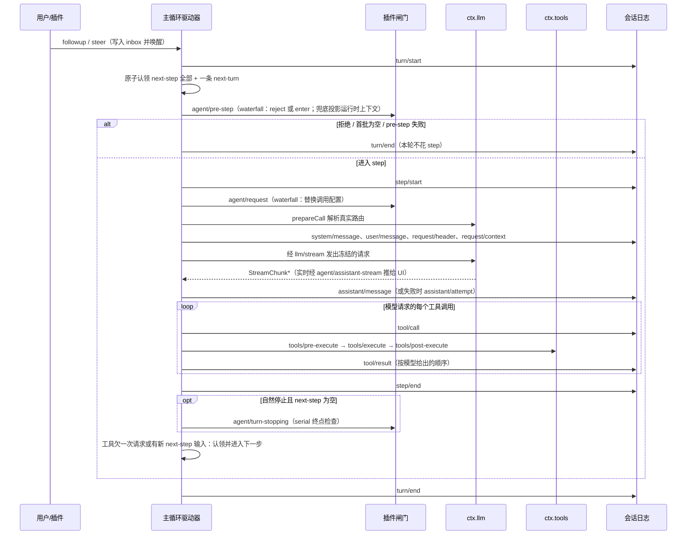

# 第 7 章 Turn 与 Step 主循环：Agent 是怎么"转"起来的

> 第 6 章我们知道了会话是一条事件日志。这一章讲**是谁在往日志里写事件**——那个驱动模型思考、调用工具、再思考的循环。它是 Agent 的灵魂，也是 DSH 里被插件化得最彻底的东西。

> **本章你将学到**：
> - 概念：step 与 turn、完整时序、inbox 的两个边界与"先认领再决策"
> - 设计：为什么主循环是插件；pre-step / request / llm-stream 三个 waterfall 与 turn-stopping 的"数据决定"
> - 控制：显式的 turn 取消、followup / steer / inject 三种投递语义、后台任务完成如何唤醒 Agent
> - 新变化（上一版基准 0.1.7-rc.2 → 0.2.1-alpha.2）：子 Agent 统一为"激活"、Agent Teams 直投 inbox、可超时的用户提问、失败 step 补写工具结果
> - 动手：在真实会话日志里观察 step 边界与"模型自己决定多走一步"

## 7.1 先问"为什么"：循环是从哪来的？

模型本身没有循环。你调一次 API，它返回一次回答——仅此而已。"思考-行动-观察-再思考"的循环，是**宿主程序**转出来的：

```text
while (还有事要做) {
  1. 把"当前状况"（历史 + 工具结果）组装成请求；
  2. 调模型；
  3. 如果模型想调用工具：执行工具，把结果喂回去，回到 1；
  4. 否则：回答完毕，退出。
}
```

这个循环在历史上经历了三次"搬家"（呼应第 15 章的演进主线）：最早写在每个应用的 main 函数里；后来被框架（LangChain、OpenAI SDK）封装成库函数；在 DSH 里，它变成了一个**插件**——`@deepseek-ai/dsh-agent-loop`（`packages/core/agent-loop`），对外以 `ctx.agentLoop` 注册。`docs/capability-seams.md` 对它的描述是"唯一的具体循环插件；扩展包依赖的是 `dsh-agent` 的事件与服务，而不是这个包本身"。

把循环插件化意味着什么？意味着**循环的每一步都可以被事件拦截**：想看模型请求？加个监听器；想改写进入本步的输入？挂个 waterfall；想在请求失败时自动恢复？挂 `agent/request-error`。主循环不再是"写死的代码"，而是"一组可插入的钩子组成的骨架"。

## 7.2 术语先对齐：step 与 turn

DSH 的官方术语（`docs/architecture.md` 的 Turn flow 一节）：

- **step（步）**：一次模型请求 + 它发起的工具调用；
- **turn（轮）**：零到多个 step。它在**第一个输入被认领之前**打开，在**什么都不欠（nothing is owed）**时关闭。

一个 turn 可以一步都不走就结束（比如输入被拒绝），也可以连续执行几十个工具调用（多步）。**模型"自己决定"要不要再来一步**：工具执行完，结果要喂回去，于是"欠"模型一次请求，循环就进入下一步。注意这里的反转：不是宿主说"你该停了我帮你停"，而是模型说"我还要继续"，宿主负责"凭什么你说了算"的判定（7.5 节）。

## 7.3 完整时序：一次 turn 的内部

下图按 `docs/agent-lifecycle.md` 精简而来（原图由 `scripts/gen-doc-graphs.ts` 生成）：



几个容易忽略的细节：

- **先 `turn/start`，再认领，再 pre-step**。认领和它的那一次 pre-step 决策因此有了持久的 turn 归属。
- `agent/request` 和 `prepareCall()` 都在 `step/start` 之后、系统提示词与用户消息**提交之前**运行；在这两个异步阶段取消，**两者都不会被提交**。
- 请求在发出前被"从日志推导并冻结"——这正是第 6 章"Model-visible means logged"的落地。
- **运行时上下文**（当前工作目录、文件策略等，第 6 章）在 pre-step 监听器之后由兜底逻辑投影；而且每次请求**准入**时还会再求值一次动态上下文 provider、对齐保留下来的运行时上下文（升级指南 `working-directory`）。所以 provider 要返回"此刻的状态"，不能假设每个 step 只被调用一次。
- 模型请求失败时，`agent/request-error` 可以返回 `{ kind: 'retry' }`，在**同一个打开的 step 里**重试：不重复 pre-step，也不重复追加用户消息。压缩插件就用它处理"上下文溢出"（第 13 章）。
- 实时逐字显示走进程内的 `agent/assistant-stream`（start / chunk / end 帧）；它是瞬时的，持久证据是 step 结束前写入的那条 `assistant/message` 里内嵌的完整流。
- **失败的 step 也要"把账还清"**（笔记 `2026-09-19-failed-step-tool-results.md`）：助手消息已经请求了工具，调度却在结果写完之前失败——如果就这样关闭 step 和 turn，后续请求会因为"有调用没结果"被要求配对的 provider 拒绝，而已关闭的 error turn 又不会被崩溃修复逻辑处理。现在驱动器在关闭失败 step **之前**，按助手给出的调用顺序为每个未回答的调用补写错误结果：有 `tool/call` 记录但没结果的得到 `TOOL_OUTCOME_UNKNOWN`（文字提醒不要盲目重试可能有副作用的操作），连调用记录都没有的得到 `TOOL_NOT_STARTED`；已提交的结果原样保留，turn 仍以原来的失败结束。没有新事件类型，也没有格式变化。

### 三个 waterfall 闸门，和一个 serial 终点

时序图里有三个 waterfall（监听器必须调用 `next()` 才会把控制交给下游）：

| 事件 | 能做什么 | 不能做什么 |
| --- | --- | --- |
| `agent/pre-step` | 返回 `{ kind: 'reject' }` 拒绝本步，或 `{ kind: 'enter', messages }` 决定**哪些消息进入本步**（可改写、可合并）；还可以声明 `startsRequestSeries` 开启新的请求系列 | —— |
| `agent/request` | 替换冻结的调用配置 `LlmCallConfig`（切换模型、推理强度等） | **不能改消息**：模型可见的内容必须走日志通道 |
| `llm/stream` | 包装流式输出（例如 `dsh-session-checkpoint-policy` 用它在模型请求开始前先确保会话日志落盘（持久性检查点）；测试替身 `llm-replay` 在没注册适配器时用它直接回放录制的流） | —— |

它们回答了同一个问题：**"模型看到什么、用什么配置看"应该由谁决定？** 答案不是"主循环写死"，而是"插件在明确的闸门处加工"——而且闸门的职责被刻意收窄了：只有 pre-step 能决定输入内容，request 只管配置。这样"模型看到的输入"只有一个入口，审计时不必在多个钩子之间猜。

而 `agent/turn-stopping` 是 **serial**，没有 `next()`。它不是"任何一方都能喊停"的投票，恰恰相反：它在"模型已经什么都不欠"（没有进行中的工具调用、没有新 steer）时被 await，一个**反对停止**的监听器会调用 `agent.steer(...)` 塞进一条新输入，循环重新读 inbox——有新 steer 就再走一步，没有就关闭 turn。源码注释的原话是："**Data decides, so listener order cannot change the outcome.**" 反方向的控制（让工具循环提前结束）同样是数据：工具结果带上 `concludesTurn`，本 step 结束后就收尾——但它不会短路已经提交的 next-step 输入。

### 设计思考：为什么"决策"要落在数据上？

如果 turn-stopping 是"任一监听器返回 false 就继续"，那么两个插件（比如"目标驱动继续"和"预算耗尽停止"）谁先注册谁说了算，结果依赖加载顺序。DSH 把决策转成数据：想继续，就往 inbox 里放一条真实的、会入日志的输入；想停，就在工具结果里声明。**控制流变成了日志里看得见的事实**，回放时也能解释"为什么多走了一步"。

## 7.4 输入怎么进来：inbox、认领与三种投递语义

### 两个边界，一次认领

每个 Agent 有一个持久的 inbox：两个 `UserMessage[]` 列表，`next-turn` 和 `next-step`，每条消息用 `MessageId` 寻址。笔记 `2026-07-31-claimed-pre-step-inbox-lifecycle.md` 定下了现在的规则：

- 每个拟议 step 之前，循环**原子地认领一整批**：`next-step` 里的全部消息，外加（在 turn 边界时）一条 `next-turn` 消息；
- 认领记录为持久的 `agent/inbox/spliced`（纯删除），并对每条消息发出实时的 `agent/inbox/claimed { message, turn }`；
- 这批消息交给**唯一一次** `agent/pre-step` 决策。被拒绝时，认领的消息**不会**回到 inbox——认领是一次所有权转移，而不是"先借后还"；
- 以前的 `agent/prompt-prepare`、`agent/prompt-submit`、`agent/step` 这些扩展点都已不存在。

插件因此有两条清晰的路：需要**改写当前这一步**的输入，就在 `agent/pre-step` 里返回新消息；只需要**以后**让模型看到，就直接改 `agent.inbox`。

### 四个投递方法

`Agent`（类型在 `packages/core/agent/src/runtime-types.ts`）提供的投递方法，差别在"放到哪个边界"和"是否唤醒"：

| 方法 | 目标边界 | 唤醒空闲 Agent？ | 语义 |
| --- | --- | --- | --- |
| `followup(message)` | next-turn | 是 | 排一个普通的后续 turn，它是那一轮唯一的普通消息 |
| `steer(message)` | next-step | 是 | 引导最近的一步：空闲就开一轮，运行中就在下一个 step 边界被认领 |
| `inject(message)` | next-step | **否** | 静默附加上下文：运行中会在下一个 step 边界带上；空闲时等别人唤醒 |
| `send(message, target, wakeup)` | 任选 | 任选 | 上面三者的通用形式 |

参数都是**已标识、冻结的** `UserMessage`，通常用 `@deepseek-ai/dsh-llm` 的 `createUserMessage()` 构造，`source` 说明来源：

```ts
import { createUserMessage } from '@deepseek-ai/dsh-llm'

// 唤醒 + 进入下一步：比如用户在模型干活时补一句"先别改测试"
agent.steer(createUserMessage({
  content: [{ type: 'text', text: '先别改测试文件' }],
  source: { kind: 'user' },
}))

// 静默附加上下文：下一次模型请求才看到，不打断、不唤醒
// （dsh-user-approval 切换审批策略时就是这么通知模型的）
agent.inject(createUserMessage({
  content: [{ type: 'text', text: 'The approval policy changed from "ask" to "never" (changed by the user).' }],
  source: { kind: 'user-approval' },
}))
```

> `source` 的类型 `MessageSourceMap`（`packages/llm/llm/src/message.ts`）是可合并扩展的：核心只声明 `user`、`model`、`tool`、`system-prompt` 四种，**没有**通用的 `plugin` 兜底种类——每个生产者在自己的模块里声明自己的 `kind`（如上例的 `'user-approval'`），消费者遇到不认识的种类要走默认分支。

想想为什么需要这个区分：**"打断"是有代价的**。模型正在写一个 5 分钟的函数，此时一个后台任务汇报了进度——如果这也算"新消息"，模型会被反复打断，什么都干不完。inject 提供了"不打断但保证下次能看到"的通道；steer 提供了"必须在下一步被看到"的通道。这种对"中断语义"的精细区分，是产品级 Agent 和 demo 级 Agent 的分水岭。

### 相邻 Agent 之间也只用 steer

父子 Agent 之间曾经有两套方向相反的控制：父用 `send_message` 走 FIFO followup，子用专门的 `report` 工具和系统提示段汇报。笔记 `2026-08-27-adjacent-agent-steer-messaging.md` 把它们统一成**一个**操作：`SubagentRuntime.sendMessage(sender, targetId, content, { signal })`，只允许在**相邻的一条边**上（父 ↔ 直接的可续子 Agent）发送，每条被接受的消息都走 `Agent.steer()`，模型可见内容统一加上 `Agent <sender-id> sent a message:` 的前缀。模型侧只剩一个方向中立的 `send_message` 工具（`@deepseek-ai/dsh-tool-subagent-control`，同包还有 `interrupt_agent`、`list_agents`）。一个附带好处是：子 Agent 不再有专属工具和提示段，分叉出来的子会话请求头与父会话一致，provider 的前缀缓存得以复用。

### 子 Agent 统一为"激活"：委派从不阻塞父 step

0.1.7-rc.2 时，委派子 Agent 有两种工具路径——前台等结果，或作为后台 Job 运行（`run_in_background`，用 `job_output` / `job_kill` 收取和停止）——外加一个独立发布的进程内驱动包 `subagent-in-process-driver`，本地一次性执行和可续驻留各自管理创建、取消、结果与清理。0.2.1-alpha.1 把它们收敛成一个入口（笔记 `2026-09-17-unified-subagent-activations.md`，升级指南 `subagent-activations`）：

- `SubagentRuntime.startActivation(spec)` 是所有 provider 的唯一消费入口，返回的句柄暴露子 Agent 身份、结果 Promise 和"只销毁这一次激活"的 `dispose()`；启动时传入的 signal 只负责取消**尚未发布**的创建；
- 面向模型的 `subagent` 工具（`@deepseek-ai/dsh-tool-subagent`）接受子 Agent 后**立刻**返回 `{ kind: 'activation', subagentId }`，这次工具调用立即结算，父 Agent 不必等子任务跑完；子 Agent 的最终答复以一条**入日志的完成通知**投递给父 Agent。`backgroundMode`、`enableRunInBackground` 和 `run_in_background` 参数全部删除，子 Agent 也不再出现在 `ctx.jobs` 里；
- 需要在代码里同步拿结果的消费者（工作流）选择 `delivery: 'caller'`：等 `activation.result`、再 `dispose()`，此时**不**给父 Agent 发完成通知——结果已经由调用方消费，再唤醒父 Agent 只会重复上下文；
- 本地的 Spawn / Fork provider 只通过 `prepareContinuable()` 贡献创建输入，Agent 的创建与驻留归子 Agent 服务所有，`subagent-in-process-driver` 包被删除；ACP、DSH SDK、Codex、Claude Code 这些外部 provider 仍是"执行一次"，加入同一套容量与所有权管理，但不接受后续消息。

从主循环的角度看，这让委派变成了和后台任务一样的**事件驱动**：父 step 不被一个可能跑十分钟的子任务卡住，子任务结束时的通知像其它输入一样进入 inbox、被认领、进入下一次请求。

### Agent Teams：消息直接进目标 inbox

实验性的 Agent Teams（`@deepseek-ai/dsh-experimental-agent-team`）曾经维护一个独立的 Team 邮箱：消息先排队、再投递、再确认。笔记 `2026-09-26-team-direct-inbox.md` 认为这是和 Agent inbox 重复的第二套所有权，于是把新消息**直接**送进目标 Agent 的 inbox（经 Lead 的 steer 或宿主专用的子 Agent steer 适配器），发送者身份沿用已有的 `agent-message` 来源。模型侧的 `send_message` 现在只返回 `{ "sent": true }`——"已被 inbox 接受"既不代表模型处理过，也不代表同步落盘；失败的发送不会被保留重试，显式重发也不去重。配置键 `maxPendingMessagesPerMember` 被删除；历史的 `team/message/queued` / `team/message/delivered` 记录仍可读、可投影，但升级前没投递的排队消息**永远不会**再被派发（升级指南 `team-direct-inbox`）。

### 可超时的用户提问：前台等待与迟到回答是两次结算

`ask_user_question`（`@deepseek-ai/dsh-tool-ask-user`）默认仍是阻塞式：工具调用一直等到用户回答。笔记 `2026-09-19-timed-user-question-two-settlements.md` 让它可以**不阻塞**——配置 `mode: timed`（`timeout` 默认 120 秒，`-1` 表示退回阻塞），这一模式已经落地，但仓库自带的 preset 仍使用默认的 `legacy`：

- 前台等待超时后，工具返回"待回答"（pending），模型可以继续做不依赖答案的工作；问题本身**不会**被丢弃；
- 用户稍后回答时，`dsh-user-questions` 校验答案后通过 `agent.steer(createUserMessage(...))` 投递一条普通用户消息，`source` 为 `{ kind: 'user-question-reply', callId, outcome: 'answered' }`。inbox 里的这条消息就是"已排队的回答"，被接纳为 `user/message` 时问题才算结算；
- 问题状态由 `userQuestions` 投影从已有事件重建（`request/header` 里的 `timeout` 参数识别计时模式、`tool/call` 打开问题、pending 结果使其"待续"、被接纳的回答使其结算）——**没有新事件类型，也没有等待状态日志**，只是在消息来源上多了一个种类（持久化记录 `2026-09-21-user-question-reply`）；关闭面板不会伪造一条回答。

这正是本节"投递语义"的一个综合应用：迟到的回答用 steer（需要被下一步看到），而前台等待的倒计时、聚焦、草稿都是客户端本地状态，不进日志。

### 后台任务完成：默认每次都唤醒

长任务通过 `ctx.jobs` 在后台运行（第 8 章、第 13 章）。任务完成时，`dsh-tool-jobs` 以 `completionDelivery` 默认的 `wakeup` 方式通知拥有它的 Agent：空闲就开一轮。曾经有一个默认值为 3 的 `maxConsecutiveWakes` 上限，结果连续串起四个后台任务的会话在第四个通知时"卡住"——通知被塞进一个没人会唤醒的 inbox，客户端又不显示它。笔记 `2026-09-22-unbounded-completion-wakes-by-default.md` 把上限改成**默认不设**、需要时显式配置，理由一句话：**看得见的成本胜过看不见的停滞**（多花的模型请求用户能看到、能停止；停在 inbox 里的通知谁也看不到）。设置了 `maxConsecutiveWakes` 时，超出预算的通知降级为 inject，领取任何用户撰写的消息会恢复预算；`completionDelivery: quiet` 则让通知一律走注入通道。注意如今这里的"后台任务"只剩后台 bash/pwsh 命令和 PTY 发送——子 Agent 的完成走上面的激活通知，不再经过 `ctx.jobs`。

## 7.5 一轮怎么算结束：turn 是"推导"出来的，不是"人定"的

"turn" 不是用户说了算，而是**主循环推导**的：

- turn 在"第一个输入被认领"之前打开；
- 当"什么都不欠"时关闭：工具不再欠模型一次请求、next-step 里没有新输入、`agent/turn-stopping` 之后也没人 steer；
- 被拒绝、首批为空、在进入 step 前取消或失败，都会得到一个**没有 step 的平衡 turn**（有 `turn/start` 和 `turn/end`，没有 `step/*`），日志保留这次尝试。

`turn/end` 带一个可合并扩展的结束原因 `TurnEndReasonMap`：

| 原因 | 含义 |
| --- | --- |
| `completed` | 正常结束 |
| `aborted` | 被取消，`reason` 记录取消原因（见 7.6） |
| `blocked` | 拟议的 step 被拒绝（例如归档会话的 pre-step 拦截） |
| `error` | 失败，携带结构化的 `LlmFailure` |
| `max-tokens` | 至少一个 step 撞到了输出上限（即使之后插件让它继续了） |
| `interrupted` | 崩溃后恢复时补写，循环从不实时发出 |
| `forked` | 分叉种子里补写，循环从不实时发出 |

### 设计思考：为什么"结束"要由系统推导？

朴素的做法是"用户问一句，模型答完就算一轮"。但 Agent 的场景里，"答完"的边界很模糊：模型调了工具，工具结果需要再喂回去，这算"没答完"；模型自己决定再检查一遍测试，这算"新的一轮"还是"同一轮"？

DSH 的答案是**把判定标准显式化**："什么都不欠"。这让 UI 上的"停止"按钮、后台任务、子 Agent 汇报都成为**纯事件驱动**——它们只是往 inbox 或取消信号上施加变化，而不是散落各处的 if/else。这种"把边界条件变成可推导不变量"的做法，是 DSH 反复出现的工程品味。

## 7.6 取消：一个 turn，一个信号，一个明确的原因

"停止"看似简单，其实要回答三个问题：**谁**要求停？停的是**哪一轮**？**怎么**让正在干活的代码知道？笔记 `2026-07-16-explicit-turn-cancellation.md` 的答案：

- **谁**：`agent.cancel(cause, options?)` 必须给出一个类型化原因 `AgentCancelCause`：`{ kind: 'user' }`、`{ kind: 'parent' }`、`{ kind: 'hook'; reason }`、`{ kind: 'disposed' }`。ACP 的取消映射为 `user`，进程内子 Agent 的传播映射为 `parent`。
- **哪一轮**：循环为每个预期的 turn 私有地持有一个 `TurnCancellation`（一个 `AbortController`），从认领、pre-step、提示词组装、每个 step 的模型与工具执行，一直到 `agent/turn-stopping`；在发布 `turn/end` 之前精确清除。下一轮拿到全新的信号，旧回调不可能"越权"取消新一轮。
- **怎么知道**：信号**显式**地放在每个事件 payload（`{ agent, ..., signal }`）和请求值里传递，而不是塞进 AsyncLocalStorage——环境上下文会跟着异步后代活满整个驱动器生命周期，而取消权限只应活一个 turn。

取消是**协作式**的：循环在每个 await 边界前后检查中断，但不会用 `Promise.race` 抛弃一个不配合的 Promise；不响应信号的工作必须自己结束，`whenIdle()` 才会报告静止。

取消的结果也要入日志：被打断的 turn 以 `{ kind: 'aborted', reason }` 结束（`reason` 为 `TurnEndCancelCause`，即上面的类型化原因，导入旧记录时可能是 `{ kind: 'legacy' }`）；流到一半被取消的助手输出，会把已送达的文本前缀定稿为带 `interrupted: true` 的 `assistant/message`，尚未派发的工具调用不出现。

默认情况下 `cancel()` 会清空排队的 followup 与 steer；传 `{ keepInbox: true }` 则保留待处理输入——远程接口 `session.cancel` 的说明就是"取消当前 turn，但不丢弃待处理的 inbox"。

## 7.7 并行工具调用与超时：别让模型卡住

- 模型一次可以请求多个工具调用。循环按每个调用**当前**的执行模式调度：`ctx.tools.executionMode()` 返回 `{ kind: 'parallel' }` 或 `{ kind: 'exclusive' }`；可并行的调用进入一个有界滚动池，上限是 `dsh-agent-loop` 的配置项 `maxParallelToolCalls`（默认 `DEFAULT_MAX_PARALLEL_TOOL_CALLS = 10`），独占的调用等池子排空后单独执行。每次启动前都会重新分类。结果按**模型给出的顺序**逐个经过 post-execute 并写入 `tool/result`。
- 另一个容易混淆的配置 `maxParallelSubCalls`（`dsh-tools`，默认 10）管的是 PTC 模式下 `run_code` 程序里子调用的并发（第 8 章）。
- 每个工具执行都带取消信号：`exec.signal` 是必须遵守的契约（第 8 章详述）。
- `packages/guard/` 里有两个"循环卫生"插件，base bundle 默认启用：
  - `@deepseek-ai/dsh-repeat-tool-reminder`：发现模型重复发出**完全相同**的工具调用时，提醒它换个思路或结束——它是"咨询性"的，不拦截、不否决，决定权始终在模型；
  - `@deepseek-ai/dsh-tool-call-timeout-policy`：给**声明了时限**的工具调用加上超时，挂起的调用会以清晰的超时错误返回给模型，而不是让会话一直等下去。

这里有一个值得品味的克制：**reminder 只提醒、不强制**。为什么？因为"重复调用"不总是错误——有时重试正是正确策略。把"判断"留给模型，把"提醒"交给系统，是一种有意的边界划分。

## 7.8 循环写下的消息，UI 怎么看

循环写进日志的是 step 粒度的事件，但产品界面并不按 step 展示：

- **工具结果是一等的 tool 角色消息**。循环写下的 `tool/result`，在会话格式 v4 里就是 `role: 'tool'` 的消息（第 6 章），各家 provider 适配器再把它映射成自己的工具结果表示。对话角色集合是**封闭的**：一个模型可见的角色必须既有持久的会话事件、又有适配器投影，适配器不会把没入日志的扩展角色偷偷变成用户文本。
- **进程分组与 step 正交**。Web 聊天界面会把连续的"过程内容"（推理、工具调用）折叠成可展开的组，而回复、用户输入、turn 控件保持独立。一个 assistant 节点可能把推理放进组里、把回复放在组外，之后的工具又进入下一个组——**用 step 编号区间描述不了这种成员关系**。笔记 `2026-09-21-conversation-build-groups.md` 因此把分组规则交给注册的 `ConversationGroupDefinition`（`packages/client/ui-conversation`），由业务方（`ui-chat`）拥有分组逻辑，通用的 Builder 只做输入、分派与发布，且三种显示模式共享同一份分组结果。
- 工具卡片在 `tool/call` 到达之前就可以出现："preparing → start → result" 三阶段（第 8 章），只影响呈现，不改变请求、派发时机或会话事件。

## 7.9 Agent 与 AgentHandle：活跃 Agent 的生命周期

- `ctx.agents`（`@deepseek-ai/dsh-agent`）拥有活跃 Agent 句柄、创建/恢复的工厂接缝，以及进程内的"发起者"传播；
- `createAgent()` / `resume()` 返回 `AgentHandle`，负责生命周期与销毁；
- 每个 Agent 暴露 `session`、`inbox`、`status`、`ctx`（Agent 作用域的上下文，贡献随 Agent 销毁而撤销），以及 `cancel()`、`whenIdle()`、`runMaintenance()`（在真正空闲时运行一个不开 turn 的维护任务，期间唤醒输入会留在 inbox 里等它结束）；
- Agent 可以被 fork、resume，也可以通过子 Agent 能力被代理（第 13 章）。

## 7.10 动手实验：观察 step 的边界

**无 Key 版本**：打开第 6 章用过的 `snapshots/session/bash-tool-turn/session.v4.jsonl`，只看事件类型序列：

```powershell
Get-Content snapshots/session/bash-tool-turn/session.v4.jsonl |
  ForEach-Object { ($_ | ConvertFrom-Json).type }
```

回答：

- 有几次 `step/start`？第一个 step 里 `assistant/message` 之后跟着什么？第二个 step 为什么没有 `tool/call`？
- 日志里有两条 `agent/inbox/spliced`：`turn/start` **之前**那条带 `inserted`，`turn/start` 之后、`step/start` 之前那条带 `removedCount: 1`。它们分别对应什么？（提示：一条是 followup 入队，一条是 7.4 节的"认领"）
- `system/message` 和 `user/message` 出现在 `step/start` 之后还是之前？这和 7.3 节"`agent/request` 在提交系统提示词与用户消息之前运行"一致吗？第二条 `user/message`（`source.kind` 为 `runtime-context`）又是谁写的？

> 仓库的无 Key 测试还会用 `@deepseek-ai/dsh-llm-mock-server`（`packages/test-support/llm-mock-server`）按脚本模拟模型流。0.2.1-alpha.1 起它在每个结构化 SSE 帧旁边带上 Messages 事件名，原生 SDK 才能处理消息与内容块事件；只接受"无名 SSE 消息"的自定义消费者需要改为读取具名事件（升级指南 `mock-messages-events`）。脚本内容、顺序、请求捕获和分片数都不变。

**有 Key 版本**：

```powershell
corepack pnpm dsh --profile headless "用 ls 和 cat 了解一下当前目录，然后总结"
```

然后在会话日志里（位置与读法见第 6 章实验）数一数"模型自己决定多走一步"发生了几次——每一次，都是上一步的工具结果让循环"欠"了模型一次请求。再想一想：`agent/turn-stopping` 为什么**不会**在日志里留下痕迹？（提示：它是 live 扩展点，只有当某个监听器 steer 时，日志里才会多出一个 step。）

## 7.11 常见坑

- **认为"一次提问 = 一次模型调用"**：错。一个 turn 可能多次请求，因为工具结果会再喂回模型；
- **在 `agent/request` 里改消息**：它只能替换调用配置，要改模型看到的内容请用 `agent/pre-step` 或会话事件；
- **在 `agent/pre-step` 里做重活**：它是每步必经之路，重活会拖慢整个循环；
- **忘掉 waterfall 的 `next()`**：拦截了却不放行，下游的决策就丢了；包装 pre-step 时用 `{ ...decision, messages }` 保留下游声明的 `startsRequestSeries`；
- **以为 pre-step 拒绝会把消息还回 inbox**：不会，认领是所有权转移；
- **用 inject 去"叫醒"一个空闲的 Agent**：inject 不唤醒，需要唤醒请用 steer 或 followup；
- **把取消当作可选项**：`exec.signal` 以及各事件 payload 里的 `signal` 是契约的一部分；不响应取消会让 `whenIdle()` 永远等下去，也别把某一轮的 signal 保存下来去控制另一轮；
- **还在找子 Agent 的 `run_in_background` 或用 `job_output` 收子 Agent 结果**：已删除。委派工具返回 `subagentId`，结果走完成通知；代码里要同步拿结果，用 `startActivation({ ..., delivery: 'caller' })` 并记得 `dispose()`；
- **把 Agent Teams 的 `{ sent: true }` 当成"对方已处理"**：它只表示目标 inbox 已接受。

## 7.12 思考题

1. 主循环被插件化之后，"循环的每一步"都变成可拦截的。这对调试意味着什么？如果你要"回放一次出错的 turn"，日志里的事件够不够？（提示：结合第 6 章，想想 `request/header` 与 `assistant/attempt`）
2. `agent.inject` 不打断当前工作。设想你需要"紧急打断"（比如用户点了停止）——该走哪条路？"停止"和"注入"在"欠账"模型里分别是什么？`keepInbox` 又解决了什么问题？
3. guard 插件"只提醒不强制"。如果换成"强制终止重复调用"，系统会得到什么、失去什么？（提示：想想模型需要重试的场景）
4. `agent/turn-stopping` 用"数据决定"取代"监听器投票"。请设计一个"预算耗尽就停止"的插件：它应该挂在哪个扩展点、用什么数据表达"停"？（提示：比较 `concludesTurn`、`agent/pre-step` 的 reject 和 `agent.cancel()` 三者的语义差别）
5. 后台任务完成通知从"默认最多唤醒 3 次"改成"默认不设上限"。你能想到哪种场景下默认上限反而更安全？如果你是部署方，会用什么信号决定是否配置 `maxConsecutiveWakes`？
6. 可超时的用户提问把"前台等待"和"迟到回答"拆成两次结算，迟到回答用 `steer` 而不是 `inject` 投递。如果改用 `inject`，或者干脆让原来的工具调用一直挂着等回答，分别会出现什么问题？

## 小结

- step = 一次请求 + 工具调用；turn = 零到多个 step，在认领输入前打开、在"什么都不欠"时关闭；
- 主循环是插件（`dsh-agent-loop`）：`agent/pre-step` 决定输入、`agent/request` 只换配置、`llm/stream` 包装流；`agent/turn-stopping` 是 serial 终点，决策落在数据（steer / `concludesTurn`）上；
- inbox 有 next-turn / next-step 两个边界，每步前原子认领一次；followup / steer 唤醒，inject 静默；父子 Agent 之间统一用 steer；子 Agent 委派统一为激活（立即返回、完成通知入日志），Agent Teams 直投 inbox，迟到的提问回答也是一条 steer；
- 失败的 step 在关闭前补写 `TOOL_OUTCOME_UNKNOWN` / `TOOL_NOT_STARTED` 结果，保证工具调用与结果始终配对；
- 取消是显式的：类型化原因、每轮一个信号、协作式执行，结果以 `aborted` 及其原因入日志；
- 循环卫生靠 guard 插件：提醒不强制，决定权在模型；并行度由 `maxParallelToolCalls` 与执行模式共同决定。

下一章写"真正的代码"：工具与 Capability Seam——模型与真实世界之间的那道闸门。
