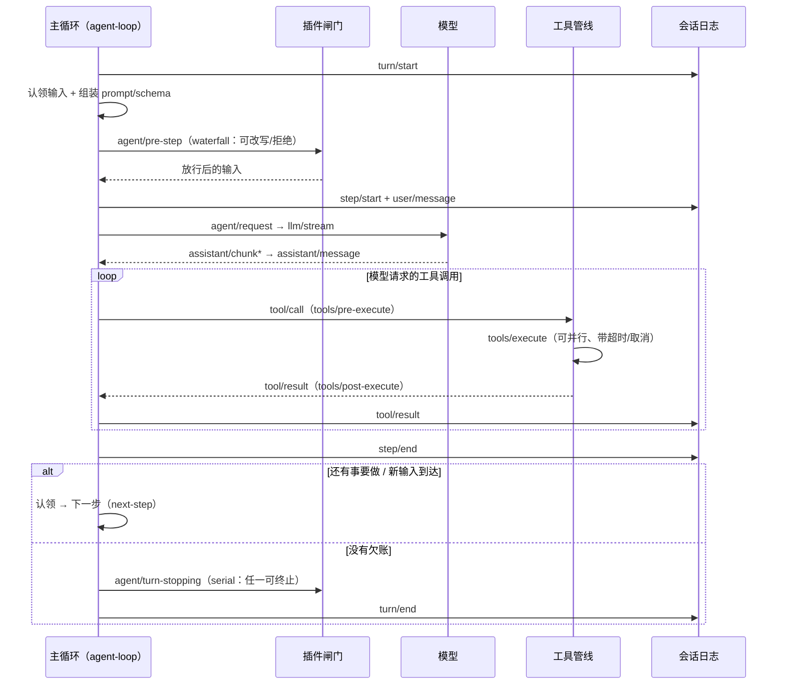

# 第 7 章 Turn 与 Step 主循环：Agent 是怎么"转"起来的

> 第 6 章我们知道了会话是一条事件日志。这一章讲**是谁在往日志里写事件**——那个驱动模型思考、调用工具、再思考的循环。它是 Agent 的灵魂，也是 DSH 里被插件化得最彻底的东西。

> **本章你将学到**：
> - 概念：step/turn、完整时序、inbox 与 inject
> - 设计：为什么主循环是插件，三个 waterfall 闸门
> - 动手：观察 step 边界与"模型自己决定多走一步"
>
## 7.1 先问"为什么"：循环是从哪来的？

模型本身没有循环。你调一次 API，它返回一次回答——仅此而已。"思考-行动-观察-再思考"的循环，是**宿主程序**转出来的：

```text
while (还有事要做) {
  1. 把"当前状况"（历史 + 工具结果）组装成请求；
  2. 调模型；
  3. 如果模型想调用工具：执行工具，把结果喂回去，回到 1；
  4. 否则：回答完毕，退出。
}
```

这个循环在历史上经历了三次"搬家"（呼应第 15 章的演进主线）：最早写在每个应用的 main 函数里；后来被框架（LangChain、OpenAI SDK）封装成库函数；在 DSH 里，它变成了一个**插件**（`dsh-agent-loop`）——可替换、可观察、可拦截。

把循环插件化意味着什么？意味着**循环的每一步都可以被事件拦截**：想看模型请求？加个监听器；想改写输入？挂个 waterfall；想阻止循环无限转下去？加个策略。主循环不再是"写死的代码"，而是"一组可插入的钩子组成的骨架"。

## 7.2 术语先对齐：step 与 turn

DSH 的官方术语（`docs/architecture.md`）：

- **step（步）**：一次模型请求 + 它发起的工具调用；
- **turn（轮）**：零到多个 step。一轮从"认领到输入"开始，到"没有欠账"结束。

一个 turn 可以只问一句就结束（0 步），也可以连续执行几十个工具调用（多步）。**模型"自己决定"要不要再来一步**：工具执行完，如果还有事要做，就发起下一次请求。注意这里的反转：不是宿主说"你该停了我帮你停"，而是模型说"我还要继续"，宿主负责"凭什么你说了算"的判定（7.5 节）。

## 7.3 完整时序：一次 turn 的内部



### 三个"闸门"：为什么是 waterfall？

时序图里最值得注意的是三个关键闸门，它们都是 waterfall：

- `agent/pre-step`：决定模型看到什么（改写消息或直接拒绝）；
- `agent/request`：模型请求发出前（可注入/替换）；
- `llm/stream`：流式输出管线（可包装流）。

它们的存在回答了一个问题：**"模型看到的输入"应该由谁决定？** 答案不是"主循环写死"，而是"任何插件都可以在闸门处加工"——系统提示、上下文注入、敏感信息过滤，都是靠这些闸门实现的。这就是把循环插件化的具体形态。

而 `agent/turn-stopping` 是 serial：每个监听器依次表态，任何一方都能终止本轮。它是"决策"语义，不是"加工"语义——所以用 serial 而不是 waterfall。

## 7.4 输入怎么进来：inbox 与 inject——两种输入，两种语义

主循环的输入走 **inbox 机制**（源码里每个 agent 拥有两条待处理队列：`next-turn` 和 `next-step`，输入总要先进入 inbox 才能被主循环认领）：

- 用户/系统的"新消息"会立即唤醒空闲的 agent；
- 而 `agent.inject(...)` 注入的"附加上下文"**不会唤醒它**，只会在下一次请求时被带上。

这个区分非常重要，它对应两种完全不同的产品语义：

```ts
// 唤醒 + 用户可见：作为 user/message 事件入日志
agent.send('帮我看看这个报错')

// 静默附加上下文：下一次模型请求才看到，不打断当前工作
await agent.inject({ content: '补充材料：文件 A 的摘要……', source: { kind: 'plugin', plugin: 'my-plugin' } })
```

想想为什么需要这个区分：**"打断"是有代价的**。模型正在写一个 5 分钟的函数，此时一个后台任务汇报了进度——如果这也算"新消息"，模型会被反复打断，什么都干不完。inject 提供了"不打断但保证下次能看到"的通道。这种对"中断语义"的精细区分，是产品级 Agent 和 demo 级 Agent 的分水岭。

## 7.5 一轮怎么算结束：turn 是"推导"出来的，不是"人定"的

"turn" 不是用户说了算，而是**主循环推导**的：

- turn 在"第一个输入被认领"之前打开；
- 当"没有欠账"时关闭：没有进行中的 step、没有排队输入、没有必须继续的工具；
- 空输入被拒绝也会记录一个"没花 step 的 turn"，日志保留这个尝试。

### 设计思考：为什么"结束"要由系统推导？

朴素的做法是"用户问一句，模型答完就算一轮"。但 Agent 的场景里，"答完"的边界很模糊：模型调了工具，工具结果需要再喂回去，这算"没答完"；模型自己决定再检查一遍测试，这算"新的一轮"还是"同一轮"？

DSH 的答案是**把判定标准显式化**："没有欠账"（没有进行中的 step、没有排队输入、没有必须继续的工具）。这让 UI 上的"停止"按钮、后台任务、子 agent 汇报都成为**纯事件驱动**——它们只是在"欠账"集合里加东西，而不是散落各处的 if/else。这种"把边界条件变成可推导不变量"的做法，是 DSH 反复出现的工程品味。

## 7.6 并行工具调用与超时：别让模型卡住

- 模型可以一次请求多个工具调用（`tool/call*` 复数），DSH 支持并行执行，数量上限有配置（`maxParallelSubCalls`，旧版用 `DEFAULT_MAX_PARALLEL_TOOL_CALLS`）；
- 每个工具执行带超时与取消：`exec.signal` 是必须遵守的取消信号（第 8 章详述）；
- `packages/guard/` 里有两个"循环卫生"插件，防止循环失控：
  - `dsh-repeat-tool-reminder`：监视对同一工具的连续重复调用，达到阈值时注入提醒，让模型停下来重新读结果或换思路——它是"咨询性"的，不拦截、不否决，决定权始终在模型；
  - `dsh-tool-call-timeout-policy`：控制工具调用的超时策略。

这里有一个值得品味的克制：**guard 插件只提醒、不强制**。为什么？因为"重复调用"不总是错误——有时重试正是正确策略。把"判断"留给模型，把"提醒"交给系统，是一种有意的边界划分。

## 7.7 Agent 与 AgentHandle：活跃 Agent 的生命周期

- `ctx.agents` 是活跃 agent 的注册表；
- 每个 agent 有一个 `AgentHandle`：负责生命周期、取消、销毁；
- agent 可以被 fork、resume、以及被 subagent 能力代理（第 13 章）。

## 7.8 动手实验：观察 step 的边界

1. 跑 headless 任务，让模型"先用 ls 和 cat 了解当前目录，然后总结"：
```powershell
corepack pnpm dsh --profile headless 用 ls 和 cat 了解一下当前目录，然后总结
```
2. 打开会话 JSONL，观察：
   - 几次 `step/start`？每个 step 里各有哪些 `tool/call`？
   - `tool/result` 和 `assistant/chunk` 的穿插顺序；
   - 最后一次 `turn/end` 前是否有 `agent/turn-stopping` 的迹象（日志事件）；
3. 数一数"模型自己决定多走一步"发生在哪里——这就是 agent 主循环的本质。

## 7.9 常见坑

- **认为"一次提问 = 一次模型调用"**：错。一个 turn 可能多次请求，因为工具结果会再喂回模型；
- **在 `agent/pre-step` 里做重活**：它是每步必经之路，重活会拖慢整个循环；
- **忘掉 waterfall 的 next()**：拦截了请求却不放行，模型就永远等不到请求；
- **把取消当作可选项**：`exec.signal`/\`options.signal` 是契约的一部分，不响应取消会留下僵尸任务。

## 7.10 思考题

1. 主循环被插件化之后，"循环的每一步"都变成可拦截的。这对调试意味着什么？如果你要"回放一次出错的 turn"，日志里的事件够不够？（提示：结合第 6 章）
2. `agent.inject` 不打断当前工作。设想你需要"紧急打断"（比如用户点了停止）——该走哪条路？"停止"和"注入"在欠账模型里分别是什么？
3. guard 插件"只提醒不强制"。如果换成"强制终止重复调用"，系统会得到什么、失去什么？（提示：想想模型需要重试的场景）

## 小结

- step = 一次请求 + 工具调用；turn = 一组 step，直到"没有欠账"；
- 主循环是插件（`dsh-agent-loop`），三个 waterfall 闸门控制模型可见内容：pre-step、request、llm/stream；
- inbox 唤醒 vs inject 静默，是两种不同的输入语义；"停止""汇报"都是事件驱动的欠账变化；
- 循环卫生靠 guard 插件：提醒不强制，决定权在模型。

下一章写"真正的代码"：工具与 Capability Seam——模型与真实世界之间的那道闸门。