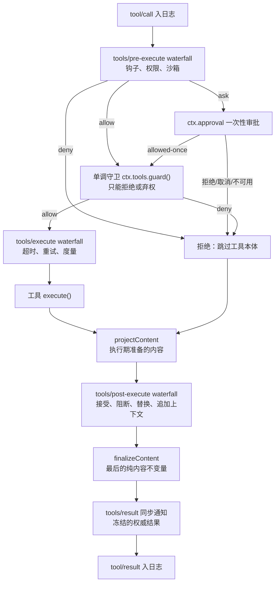
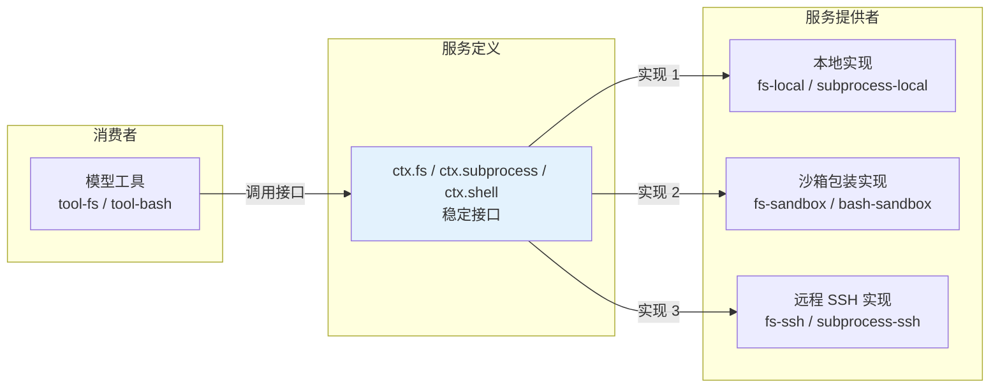

# 第 8 章 工具与 Capability Seam：模型与真实世界之间的那道闸门

> 前两章看了循环怎么转、事件怎么流。这一章回答一个更具体的问题：**模型说"我要读文件"，这句话是怎么变成真实世界的文件读取的？** 答案是一个统一管线（`ctx.tools`）+ 一组可替换的"能力接缝"。

> **本章你将学到**：
> - 概念：工具管线、执行契约、接缝三角（定义 / Provider / Consumer）
> - 设计：接缝 = 依赖倒置的极致（换 Provider 换执行世界）；为什么 E2B provider 被移除
> - 新能力：后台任务接缝合并、工具输出 spill、动态工具更新、工具调用的三阶段呈现与参数预读、PTC runtime 与 native/ptc 二选一、MCP 资源与服务器说明
> - 上一版基准 0.1.7-rc.2 → 0.2.1-alpha.2：工作目录与 worktree 接缝、SSH 辅助程序的显式启动模式、Python PTC 沙箱、`tool-schedule` 拆分、终端/Ralph/会话查询工具移入实验区
> - 动手：读 `tool-bash` / `tool-fs` 生产级源码，画出"工具 → 管线 → 接缝 → Provider"

## 8.1 工具是什么：模型面与系统面

对模型来说，工具是"一个可以调用的函数"：有名字、描述、参数 schema、返回值。但对 DSH 来说，工具不只是函数——它是**模型与真实世界之间的闸门**。所有工具调用都经过 `ctx.tools`（`@deepseek-ai/dsh-tools`，`packages/core/tools`）的统一管线，`docs/capability-seams.md` 对它的定位是："注册能力、拥有 PTC 模式传输，并把调用依次路由过 pre 策略、单调守卫、around 派发、post 策略和最终结果观察。"

一个工具调用在系统面上要经历：

1. **参数校验**：模型生成的 arguments 是 JSON 字符串，必须先按 schema 校验，非法直接拒绝——模型会幻觉出各种离谱参数；
2. **策略**：权限、审批、沙箱、钩子；
3. **执行**：真正调用底层能力（文件系统、shell、网络）；
4. **结果规范化**：把返回值变成规范 JSON，再渲染成模型可读的内容；
5. **UI 呈现**：把结果渲染成用户能看的卡片（diff、终端、表格）。

还有一条隐性的第六条：**工具的 schema 会自动汇入每一步的请求**——`ctx.systemPrompt` 收集提示段与面向模型的工具 schema，组装好的工具列表记录在会话的 `request/header.tools` 里（第 6 章）。所以"注册一个工具 = 模型自动知道怎么用它"，而且"模型当时看到了哪些工具"本身也是可回放的事实。

## 8.2 一个工具的最小形态：代码在回答什么

下面的骨架与 `docs/cookbook/adding-a-tool.md` 一致：

```ts
import { readFile } from 'node:fs/promises'
import type { Context } from '@deepseek-ai/cordis'
import { defineTool } from '@deepseek-ai/dsh-tools'

export const name = 'my-tool'
export const inject = ['tools']

export function apply(ctx: Context) {
  ctx.tools.register(defineTool({
    name: 'read_file',
    description: '读取一个文件的内容。',
    parameters: {
      path: { type: 'string', required: true, description: '文件的绝对路径' },
      limit: { type: 'number' }, // 默认可选
    },
    output: {
      schema: { type: 'string' },
      render: (_args, value) => [{ type: 'text', text: value }],
    },
    async execute(args, exec) {
      // args 已按 schema 校验，类型为 { path: string; limit?: number }
      return readFile(args.path, { encoding: 'utf8', signal: exec.signal })
    },
  }))
}
```

这段骨架里的每个字段，都在回答一个"为什么"：

1. **参数自动校验**：`defineTool` 在 `execute` 之前按统一的 `ParameterSchemaSpec` 校验类型、必填键、字面量约束等，`execute` 里拿到的 `args` 是类型安全的——**边界在门口，不在屋里**（DSL 表达不了的约束，比如"非空字符串"，仍需自己检查）；
2. **返回一个规范 JSON 值**，而不是 prose：`output.schema` 声明它的形状（根可以是对象、数组、标量或 null），`output.render` 负责把值转成模型可读的内容——**值和呈现分离**；
3. **必须遵守 `exec.signal`**：取消时停止在途工作——这是取消契约（第 7 章），不响应会让 Agent 永远到不了空闲；
4. **注册即 effect**：插件卸载，工具自动注销（第 3 章的可逆副作用在这里兑现）；
5. **注册借用的是只读定义**：不要在注册后改 schema 或替换回调；热替换就"销毁旧 effect + 注册新工具"。

## 8.3 工具的执行契约：异常、快照、身份、后台

- **抛出异常 = isError**：`execute` 抛错、返回值不符合 schema、渲染器出错、无法做无损 JSON 快照……都会被捕获并标记为失败，模型看到的是结构化错误而不是裸异常——**错误也是数据**。基础设施故障就抛；"命令以非零码退出"这种成功的领域结果，应该写进规范值里。
- **快照与冻结**：参数在策略开始前被一次性物化为脱离的无损 JSON 并冻结；返回值同样被快照、校验、冻结后再交给 render——审计需要"当时到底是什么"。
- **身份保护**：`exec.token`（不透明令牌）、`callId`、`name`、`arguments`、`agent`、必需的 `signal`，以及可选的 `parent`（外层传输的令牌，如 PTC 子调用）在派发期间不可变。只有 around 派发包装器能拿到可变视图，而且只能为了施加截止时间替换 `exec.signal`，不能移除它。
- **UI 用的持久数据**：`output.presentationMeta(args, value)` 从同一个规范值派生可回放的 JSON，写在 `tool/result` 的 `meta` 上（比如 `write`/`edit` 实际应用的 diff 块），重放时卡片能原样重现。0.2.1-alpha.1 起它对**成功的 PTC 嵌套调用**同样运行，结果记在 `tool/ptc-dispatch` 新增的可选 `meta` 上（持久化记录 `2026-10-05-ptc-operation-metadata`）——这样历史行能保留"操作当时"的目录和文件目标，即使会话后来切换了工作目录。投影出错会让这次嵌套调用以 `ToolOutputError` 失败，但程序拿到的规范值和模型内容不变。所以 `presentationMeta` 必须是纯函数，并且要同时经得起原生调用和嵌套调用两种场景。
- **后台运行**：长任务用 `ctx.jobs.start(...)` 注册，工具立刻返回一个类型化句柄（如 `{ kind: 'background', jobId }`），模型用 `job_output` / `job_list` / `job_kill` 读取、列出、停止（`@deepseek-ai/dsh-tool-jobs`）。一旦任务 id 发布，就要用任务自有的取消信号而不是 `exec.signal`——外层调用取消只是"不再等"，不会杀掉已发布的工作。

### 后台任务接缝：一个环、一个投影、一条事件流

`ctx.jobs` 曾经是"长出来的"：生产者要把输出声明两次（给模型消费的读取钩子，和给观察者的记录环），注册表对同一个任务有三套词汇、三类监听器，还替工具记着"这个结果报告过没有"。先是笔记 `2026-09-01-jobs-absorb-activity-record.md` 把独立的 activity 观察接缝并入 `ctx.jobs`（`packages/activity/` 被删除），接着笔记 `2026-09-03-jobs-seam-consolidation.md` 把接口整体收敛：

- **每个任务一个输出环**：`JobSpec` 声明可选的拉取式 `output` 源（注册表按自己的节奏泵取），或者由生产者通过 `JobHandle.append` 推送；模型的消费式读取 `read(id)` 和观察者的无状态绝对偏移读取 `readAt(id, from)` 读的是同一份字节；
- **一个投影**：`JobView`（浏览器安全的叶子入口 `@deepseek-ai/dsh-jobs/view`）同时服务模型工具、浏览器任务列表和观察帧，`owner` 是会话 id 而不是 Agent 对象；
- **一条事件流**：`events.subscribe(filter, listener)` 取代三类监听器，`settled` 事件写明原因（`producer`、`kill`、`teardown`）；
- **"报告过没有"归工具所有**：通知账本搬到 `dsh-tool-jobs`，只有它知道哪些投递真正到达了模型；任务列表也从会话控制流搬到 `dsh-api-job-controller` 的 `job.list` / `job.follow`。

模型可见的文字（状态行、工具描述、通知措辞）在这次重构中**逐字节不变**——接口收敛只改内部结构，不改模型体验。任务完成如何唤醒空闲的 Agent，见第 7 章。

### 设计思考：为什么"返回值必须结构化"？

早期 Agent demo 常见一个坏习惯：工具返回一大段人类可读文本（"文件读取成功，内容如下：……"），让模型自己去解析。这等于把"解析逻辑"外包给模型的幻觉。DSH 的纪律是：**工具返回数据，render 负责说话**——模型拿到的是 render 出的内容，程序（包括 PTC 模式下的程序，见 8.8）拿到的是干净的规范值，UI 拿到的是可回放的卡片。三者互不污染，才能各自独立演化。

## 8.4 管线全貌：策略、守卫、包装、观察

`docs/tool-execution-pipeline.md` 给出了完整流程，这里保留主干：



要点：

- **三个 waterfall 都可以变换调用**：`tools/pre-execute` 放可扩展的 allow / deny / ask 策略；`tools/execute` 包在派发外面（`dsh-tool-call-timeout-policy` 的超时就在这里）；`tools/post-execute` 可以替换呈现内容、阻断结果或附加面向模型的上下文。
- **单调守卫**（`ctx.tools.guard()`）是"后面的监听器无法撤销"的最终拒绝，适合不允许被重排的所有者策略。
- **`ctx.approval` 在守卫之前解决 ask**：审批者缺席或无法回答时，**失败即拒绝**（`unavailable`）。
- **`tools/result` 只观察**：它看到的是冻结的、无损 JSON 的最终结果。
- 文件系统的"先读后改"检查不在工具里，而在 `tool-fs` 之下的 `fs/*` 事件闸门上（`dsh-fs-observation-policy`）。

### 工具输出 spill：大结果落盘，上下文只留定位

一次 `grep` 可能返回几万行，一次网页抓取可能是几百 KB。全部塞进下一次请求，上下文就爆了；直接截断，模型又失去了"之后再看全文"的机会。笔记 `2026-07-08-tool-output-spill-files.md` 的方案是一个很薄的接缝加一个策略插件（`packages/spill/`）：

| 包 | 角色 |
| --- | --- |
| `@deepseek-ai/dsh-spill` | 接缝定义：`ctx.spillStore`——保存文本，返回定位符 + 取回提示 |
| `@deepseek-ai/dsh-spill-local` | 本地后端：会话作用域的私有文件 |
| `@deepseek-ai/dsh-spill-policy` | 消费者：挂在 `tools/post-execute` 上，把超限的最终文本结果替换为"保留的预览 + spill 定位符" |

几个细节体现了分寸：tool-result spill 是**可选**的，由 `maxInlineTokens` 开启；存储失败时**保留原结果**而不是吞掉它；有些工具有自己的早期 spill（`dsh-bash-local` 的输出流溢出、`tool-fs-search` 的超量结果），和通用策略并存。

## 8.5 工具调用的三个阶段：preparing → start → result

模型往往在还在生成参数时就已经给出了工具名和调用 id，但 `tool/call` 要等整个助手流结束才到达。一次响应里有多个调用时，前面的调用即使参数早已完整也得等后面的；`write` 的参数里包含整份文件内容，这段等待可能长达几秒，界面上看起来像"什么都没发生"。

笔记 `2026-09-22-tool-call-three-phases.md` 让 Web 客户端的工具节点按 `callId` 拥有三个阶段：

| 阶段 | 由什么触发 | 可展示什么 |
| --- | --- | --- |
| `preparing` | 实时流里出现带调用 id 和工具名的增量 | 调用身份、名字、时间；一行不可展开的占位 |
| `start` | `tool/call` | 完整参数，启用工具原有的调用呈现 |
| `result` | `tool/result` | 结果 |

关键的克制在于：**preparing 只改变呈现**——不改变模型请求、工具派发时机、会话事件，也不改变持久格式；历史分页不会把已定稿的助手消息展开回实时增量，所以实时路径是 preparing → start → result，历史路径直接 start → result，两者的**最终状态相同**。

### preparing 阶段能看到多少：惰性参数视图与参数顺序

只显示工具名还不够：`write` / `edit` 想尽早显示文件路径和已写入的字数，`bash` / `run_code` 想在命令或程序流完之前先显示一句描述。笔记 `2026-09-24-preparing-tool-arguments.md` 为此做了两件事：

- **惰性参数视图**：`@deepseek-ai/dsh-util-values` 的 `PartialArguments` 保存参数片段，只为顶层键建索引，**被请求的字段才解码**——问长度就只算长度（例如以 1024 字符为单位报告 `content` 的进度），问前缀就只解码前缀。解析发生在 Web 客户端的工具定义里而不是 React 组件里，所以行卡片和分组标题共享同一份结果；第三方工具无需注册就能拿到同一个视图。它不做正式的参数校验，也不新增任何会话事件；
- **调整参数声明顺序**：模型基本按 schema 的 `required` 顺序生成参数，而 DSL 按属性声明顺序生成 `required`。所以 `tool-bash` / `tool-pwsh` 把 `description` 声明在 `command` 之前并在描述里加一句"先给出 `description`"，`run_code` 把 `description` 放在 `code` 之前，`write` / `edit` 把 `file_path` 放在最前。笔记记录了对真实 DeepSeek V4 API 的 310 次受控请求：只调整 `properties` 顺序几乎无效，连同 `required` 一起调整再加一句说明才稳定。这只是"鼓励"而非保证——参数顺序不对时，preparing 行退回只显示标题。

## 8.6 动态工具更新：工具集合在对话中途变化

插件热加载、MCP 服务器重新同步，都会让工具集合在对话中途改变。不同 provider 对"新增工具"和"移除工具"的支持差异很大：有的支持延迟加载定义，有的能在历史里声明移除，有的都不支持。笔记 `2026-09-20-dynamic-tool-updates.md` 的设计把"逻辑事实"和"发给谁什么"分开：

- **逻辑事实与模型能力无关**：`request/header.tools` 记录组装出的**活跃**工具；循环比较前后两个请求头的工具名，发出一条 `source` 为 `tool-registry` 的 `developer/message`，列出新增和移除，新增项通过 `headerSeq` 引用定义它们的请求头；
- **Session 负责历史关系**：`session.toolHistory()` 增量折叠已提交的请求头与 developer 消息，给出不可变快照（初始声明 + 有序的更新）；
- **适配器负责翻译**：派发时 `projectToolUpdates` 按已准备路由的 `toolUpdate` 能力（`'in-history'` 或 `'addition-only'`）决定发什么；不支持的路由只收到当前活跃的定义。DeepSeek 适配器把更新翻译成系统角色的 `tool_addition` / `tool_removal` 块和 `defer_loading` 声明。

这样设计的收益是**保住前缀缓存**：在支持的路由上，新增一个工具不必重写整个请求开头，之前的消息原封不动。代价也写得很清楚：同名工具改了 schema 会重建声明、放弃前缀复用；调用一个已移除的工具，走现有的 `UNKNOWN_TOOL` 失败路径。整个特性**没有新增持久字段，也没有升级会话格式**。

## 8.7 Capability Seam：服务定义 / Provider / Consumer

工具只是"模型可见的消费者"。DSH 更一般的抽象是**能力接缝（Seam）**，每个接缝有三个角色：

1. **Service Definition（服务定义）**：声明接口（如 `ctx.fs` 有哪些方法）；
2. **Service Provider（服务提供者）**：实现接口（本地实现、沙箱包装实现、远程实现）；
3. **Consumer（消费者）**：使用接口的一方，通常是模型工具（如 `tool-fs`）。

以 `ctx.fs`（文件系统）接缝为例（数据来自 `docs/capability-seams.md`）：

| 角色 | 包 |
| --- | --- |
| 定义 | `@deepseek-ai/dsh-fs`（`packages/fs/fs`） |
| 本地 Provider | `@deepseek-ai/dsh-fs-local` |
| 沙箱 Provider（按共享沙箱模式隔离写操作） | `@deepseek-ai/dsh-fs-sandbox` |
| 远程 Provider（POSIX SSH 主机） | `@deepseek-ai/dsh-fs-ssh`（`packages/ssh/fs-ssh`） |
| 伴随插件（`fs/*` 事件闸门上的观察状态检查） | `@deepseek-ai/dsh-fs-observation-policy` |
| 消费者（工具） | `@deepseek-ai/dsh-tool-fs` |

接缝三角的结构——Consumer 只依赖定义，不依赖实现；换 Provider 就是换执行世界：



### 远程执行世界：从 E2B 到 POSIX SSH

旧版曾有一组 E2B 云沙箱 provider（文件系统、子进程、沙箱所有者），证明了文件工具、Bash、PTY 和语言服务器可以共享同一套 `ctx.fs` / `ctx.subprocess` 接口而不需要专门的工具。**它们已被移除**（笔记 `simplification/2026-09-11-remove-e2b-providers.md`，`packages/e2b` 下已无被跟踪文件）。原因很具体：PTC 的 Node 隔离需要一条**独立于程序标准输入输出的双向控制通道**，而当时固定版本的 E2B SDK 只暴露标准流和 PTY 输出；要补上这条通道，就得自己做一个远程传输层（流控、有界缓冲、关闭语义、断连清理），而且 SDK 会完整保留 stdout/stderr，流级背压也无法约束宿主内存。笔记明确说明：这只是移除一个 provider 家族，**不改变**共享的文件系统、子进程、终端接口，也不意味着"远程执行"被放弃。

现在仓库里的远程执行世界是 **POSIX SSH**（`packages/ssh/`）：`ctx.ssh`（`@deepseek-ai/dsh-ssh`）拥有一条经过认证的 OpenSSH 连接和已安装的辅助程序，`fs-ssh`、`subprocess-ssh`、`sandbox-ssh` 分别实现 `ctx.fs`、`ctx.subprocess`、`ctx.sandbox`。Harness 本身（凭据、模型传输、会话状态）仍在本地，文件和进程在远程主机上——工具代码一行不改。

0.2.1-alpha.1 把远程辅助程序的启动方式做成了显式配置（升级指南 `ssh-helper-launch`）：`dsh-ssh` 顶层的 `node`、`bootstrapPath`、`bootstrapHash` 收进 `launch`，要么是 `launch: { kind: node-script }`（远端用 Node 跑辅助脚本），要么是 `launch: { kind: executable }`（打包好的可执行文件，`helper` 指向远端绝对路径、`helperHash` 取自归档里的 `manifest.json`）；客户端要求辅助程序使用**协议 2**，协议或摘要不匹配就必须把辅助程序和配置一起更新。打包版本由新包 `@deepseek-ai/dsh-ssh-helper-runtime`（`packages/ssh/ssh-helper-runtime`）构建：归档里内嵌 Node 运行时，远端不必安装 Node 或 npm 包，就能支持受管进程、终端、沙箱和内嵌的 PTC worker。远程 PTC provider 相应地用 `launch: ctx.ssh.ptcLaunch` 配置（`dsh-ptc-runtime-node` 自己的 `nodeExecutable` / `bootstrapPath` 也换成了 `launch`）。

### 纵深对比：接缝 vs 六边形架构（Ports & Adapters）

你可能会说：这不就是"端口-适配器"（Hexagonal Architecture）吗？确实同源，但有一个关键差异值得点破：

| | 六边形架构（Hexagonal） | DSH 的能力接缝 |
| --- | --- | --- |
| 目的 | 让领域逻辑与外部世界解耦（可测试、可替换） | 让**产品功能**与**执行环境**解耦（可配置、可部署） |
| 端口 | 应用定义的接口（仓储、网关…） | 服务定义（`ctx.fs`、`ctx.llm`…） |
| 适配器 | 数据库驱动、HTTP 客户端… | Provider（local / sandbox / ssh …） |
| 动态性 | 编译期选择，运行期固定 | **运行期由配置选择**（改装配就换实现） |

六边形架构的"端口"是**应用内**的设计决策；DSH 的接缝把端口**提升为运行时可配置的层**——而且适配器本身也是插件。可以说：**接缝 = 六边形架构的插件化**。

### 设计思考：接缝 = 依赖倒置的极致

"面向接口编程"大家都会说，但接缝把它做到了极端：**换 Provider 换整个执行世界**。本地 fs + 本地 subprocess + 本地 PTY + 本地 LSP 共享一个执行世界；把 `ctx.fs` / `ctx.subprocess` / `ctx.sandbox` 都指到 SSH 主机，就变成"文件和进程都在远程"——而工具代码一行不改。笔记 `2026-07-28-portable-execution-world-consumers.md` 对这对接缝的约定是：它们描述**同一个路径命名空间和进程世界**，路径转换、可执行文件查找、终端分配、清理都由 Provider 负责，消费者保留工具语义、策略和呈现。

这回答了第 1 章的问题："一切皆插件"为什么值钱？因为**执行环境**（本地/沙箱/远程）和**产品功能**（工具、UI、循环）被解耦了。你可以先在本地做出功能，再决定把它部署到什么环境——这个决定可以推迟到配置层。E2B 的去留本身也说明了这一点：一个 provider 家族被整体移除，消费者无需任何改动。

### 新接缝：工作目录与 Git worktree

接缝三角也适用于"状态"而不只是"执行"。0.2.1-alpha.1 新增的 `ctx.workingDirectory`（定义与实现都在 `@deepseek-ai/dsh-working-directory`，第 6 章）就是一个例子：一个会话投影拥有有效执行目录，消费者包括 `tool-working-directory`、`tool-fs`、`tool-bash`、`tool-pwsh`、`subagent` 和 SDK 的 JSON-RPC 服务器——`docs/tool-catalog.md` 里 `tool-fs-search`、`tool-lsp`、`tool-skill`、`run_code` 等工具的依赖也都多了一项 `ctx.workingDirectory`。这些工具不再各自从会话头部或进程目录解析相对路径，而是问同一个所有者；文件系统 Provider 负责校验目录变更，写权限仍锚定在原始项目上。

在它之上，实验性的 `ctx.worktrees`（`@deepseek-ai/dsh-experimental-worktree`，`docs/subsystems/worktrees.md`）再叠一层：消费者工具 `create_worktree`（`@deepseek-ai/dsh-experimental-tool-worktree`）从一个钉住的本地提交创建新分支和 checkout（默认放在当前 checkout 根下的 `.agents/worktrees/<name>`），Git 准备成功之后才通过工作目录服务切过去；不 fetch、不复制未提交文件，离开时（`working_directory({ cd })`）保留分支和 checkout。它没有自己的"当前目录"状态——**状态只有一个所有者，能力只是在上面组合**。这一对包通过默认关闭的 Git Worktrees 可选 bundle 加载（bundle 就由 `dsh-experimental-tool-worktree` 这个包提供，在插件页启用时把两个包一起挂上）。

## 8.8 PTC Runtime：让模型写一段程序来调工具

PTC（programmatic tool calling）模式下，模型可以写**一段程序**，在里面像调用普通异步函数一样调用工具，最后只把程序打印的输出和返回值带回上下文。这个执行能力是一条独立的接缝：

| 包 | 角色 |
| --- | --- |
| `@deepseek-ai/dsh-ptc-runtime`（`packages/ptc-runtime/ptc-runtime`） | 定义 `ctx.ptcRuntime`：对宿主提供的异步绑定运行一个程序，报告它打印了什么、返回了什么 |
| `@deepseek-ai/dsh-ptc-runtime-node` | 在全新的受管 Node 进程里、按解析出的沙箱策略执行 TypeScript；本地或远程 worker 的启动方式由 `launch` 配置决定 |
| `@deepseek-ai/dsh-experimental-ptc-runtime-python` | 实验性 Python 后端（仅 macOS / Linux 本地）：Node 宿主与 CPython 子进程之间走 fd-3 线协议 |

消费者是 `dsh-tools`（它拥有保留的 `run_code` 传输工具与 PTC 呈现）和 `dsh-workflow-ptc`（工作流编排）。

Python 后端在 0.2.1-alpha.1 补上了文件沙箱（升级指南 `python-ptc-sandbox`）：此前程序里直接的 Python 文件操作不受限制，现在 provider **必须**依赖 `sandbox` 与 `sandboxPolicy` 服务，对每个程序应用共享的沙箱策略，并在 `PtcRunResult.sandbox` 里报告实际的隔离情况；受限运行无法建立隔离时以 `sandbox-unavailable` 失败，而不是"悄悄不隔离"。仓库自带的 profile 仍使用 Node 运行时。

> **命名更正**：旧稿中的 `code-runtime` / `code-runtime-python` 等叫法已经过时。笔记 `2026-09-12-ptc-runtime-vocabulary.md` 统一了词汇：包族 `ptc-runtime`、类型 `PtcRuntime`、服务 `ctx.ptcRuntime`，**没有**保留旧名的兼容包或第二个服务注册。面向模型的 `run_code` 工具及其 `code` 参数名保持不变。

PTC 模式对工具作者是"免费"的：每个可见的已注册工具都能在程序里以 `await tools.<name>(args)` 调用，参数和返回值类型从同一套 schema 生成；子调用**重新进入完整的管线**（策略、守卫、审批一个不少），携带父令牌，记录 `tool/ptc-dispatch` 事件，成功时拿到的是策略之后的**规范值**而不是渲染文本——这正是 8.3 节"返回值必须结构化"的回报。子调用的并发上限是 `dsh-tools` 的 `maxParallelSubCalls`（默认 10）。

### 每个 Agent 只用一种调用形式：native 或 ptc

上一版基准里，工具呈现模式有三种：`native`（每个工具一个函数 schema）、`ptc`（只暴露 `run_code` 和生成的 SDK），以及混合的 `both`。笔记 `2026-10-05-native-or-ptc-presentation.md` 删除了 `both`：同一批能力同时以两种形式出现在请求里，只带来 schema 排序、准入、配置和测试组合的膨胀，并没有新的执行能力。现在 `@deepseek-ai/dsh-tools` 和 `@deepseek-ai/dsh-agent-tool-presentation` 的 `mode` 只接受 `native` 或 `ptc`，配置 `both`（包括环境变量 `DSH_TOOLS_MODE=both`）会被拒绝，而不是被悄悄映射成另一种；代码里的 `ctx.tools.presentAs('both')` 也要改成二选一（升级指南 `tool-presentation-mode`）。不同 preset 仍然可以在同一个应用里选不同模式——"二选一"是按 Agent 的，不是按进程的。

## 8.9 MCP：外部工具、资源与服务器说明

MCP（Model Context Protocol）服务器是另一类工具来源：

- **工具**：`@deepseek-ai/dsh-mcp-client` 每个实例连接一个服务器，把它的工具注册为稳定的服务器限定名 `mcp__<serverName>__<rawName>`（如 `mcp__github__create_issue`）。命名空间取自**本地配置**，不信任远端的 `serverInfo.name`。客户端基于官方 TypeScript SDK 2.0.0，协议版本协商、分页、列表变更订阅、输出校验都交给 SDK（笔记 `2026-09-12-mcp-sdk-protocol-negotiation.md`）。
- **资源**：`@deepseek-ai/dsh-mcp-resources` 提供三个共享工具 `list_mcp_resources`、`list_mcp_resource_templates`、`read_mcp_resource`，每次调用都必须显式指定服务器名，执行时在调用 Agent 的作用域里解析对应的 provider（接缝 `ctx.mcpResources`，实现方是各个 `mcp-client` 实例）。没有工具、只有资源的服务器也因此可用。
- **服务器说明（instructions）**：每个配置的服务器贡献一个字面的系统提示段，经已记录的 `system/message` 进入模型——**不为 MCP 另设持久事件**，因为组装好的系统消息和工具结果已经记录了模型可见的输入（笔记 `2026-09-12-mcp-resources-and-instructions.md`）。

这里又能看到第 6 章不变量的影子：资源内容**按需读取**，连接服务器不会预加载文档；读到的内容作为工具结果入日志；说明作为系统提示入日志——**没有任何 MCP 内容绕过日志进入模型**。

## 8.10 常用接缝速查

| ctx 键 | 能力 | 内置实现（Provider） |
| --- | --- | --- |
| `ctx.llm` | 模型 | `llm-deepseek`、`llm-pi-ai`、`llm-replay`（测试） |
| `ctx.tools` | 工具管线 | 核心服务，非接缝 |
| `ctx.fs` | 文件系统 | `fs-local`、`fs-sandbox`、`fs-ssh` |
| `ctx.subprocess` | 子进程 | `subprocess-local`、`subprocess-ssh` |
| `ctx.shell` | Bash / PowerShell 执行器 | `bash-local`、`bash-sandbox`、`pwsh-local`、`pwsh-sandbox` |
| `ctx.terminals` | 持久终端（PTY） | `terminal-bash`（模型工具 `tool-terminal` 已移入实验区） |
| `ctx.sandbox` | 进程沙箱 | `sandbox-local`（平台原生）、`sandbox-ssh` |
| `ctx.jobs` | 后台任务注册表 | `jobs-local` |
| `ctx.spillStore` | 大输出存储 | `spill-local` |
| `ctx.ptcRuntime` | PTC 程序执行 | `ptc-runtime-node`、`experimental-ptc-runtime-python` |
| `ctx.mcpResources` | MCP 资源访问 | `mcp-client` |
| `ctx.web` | 搜索 / 抓取 | `web-search-exa`、`web-search-perplexity`、`web-search-deepseek`、`web-fetch-http` |
| `ctx.lsp` | 语言服务导航 | `lsp-stdio` |
| `ctx.skills` | 技能 | `skill-filesystem`、`skill-office`、`sandbox-windows-acl`、`skill-badge`（实验区） |
| `ctx.subagents` | 子 Agent | `subagent-spawn-in-process`、`subagent-fork-in-process`、`subagent-acp`、`subagent-codex`、`subagent-claude-code`、`subagent-dsh-sdk` |
| `ctx.credentials` | 凭据 | `credentials-local` |
| `ctx.storage` | 非会话存储 | `storage-json`、`storage-sqlite` |
| `ctx.sessionPersistence` | 会话持久化 | `session-persistence-jsonl` |
| `ctx.workingDirectory` | 会话工作目录 | `working-directory` |
| `ctx.worktrees` | Git worktree 创建（实验） | `experimental-worktree` |

> **包位置变化**（上一版基准 0.1.7-rc.2 → 0.2.1-alpha.2）：持久终端的六个模型工具（`@deepseek-ai/dsh-tool-terminal`）、Ralph 循环工具（`@deepseek-ai/dsh-tool-ralph`）和会话查询工具（`@deepseek-ai/dsh-tool-session-query`）都搬进了 `packages/experimental/`，包名不变，分别由默认关闭的可选 bundle `@deepseek-ai/dsh-experimental-terminal-bundle`、`@deepseek-ai/dsh-experimental-ralph-bundle`、`@deepseek-ai/dsh-experimental-session-search` 加载。提醒管理工具则从 `@deepseek-ai/dsh-schedule` 里拆出成独立包 `@deepseek-ai/dsh-tool-schedule`（`schedule_create` / `schedule_list` / `schedule_update` / `schedule_delete`），由 preset 或 Agent 作用域挂载、由 preset 决定哪些 Agent 拿到它们；Schedule 服务本身由 Web 组合直接挂载（旧的 Automation tasks 可选 bundle 已退役，升级指南 `schedule-bundle-retired`）。这些都是"组合层"的移动——接缝和工具管线没有变。

注意这张表的读法：**每一行都是一条"换 Provider 的选项"**。产品在左，实现在右，中间是稳定的接口。完整的、由脚本从 Cordis 声明生成的清单（含每个接缝的直接消费者和伴随插件）见 `docs/capability-seams.md`；每个工具包注册了哪些工具、依赖哪些服务，见 `docs/tool-catalog.md`。

## 8.11 动手实验：读一个真实工具

1. 打开 `packages/shell/tool-bash` 的源码（官方指定的生产级三包示例），回答：
   - 它的 `presentCall` 返回什么卡片？（terminal 卡片，`title` 就是命令，`description` 参数作为说明）为什么 schema 里 `description` 声明在 `command` 之前？（提示：8.5 节的参数顺序）
   - 顺带看一眼客户端的 `TerminalBlock`（`@deepseek-ai/dsh-client-ui-primitives`）：0.2.1-alpha.1 起它的 `TerminalBlockLabels` 必须提供 `commandLine(line)`，为横向溢出的命令行生成本地化的无障碍名称，让键盘可以聚焦并滚动长命令（升级指南 `terminal-command-labels`）——这是纯呈现层的契约，不影响模型看到的内容
   - 它消费的是哪个接缝？（`ctx.shell`；真正 spawn 进程、套沙箱的是 `bash-local` / `bash-sandbox` 这些 Provider，它们再依赖 `ctx.subprocess` / `ctx.sandbox`）
   - 它什么时候提供 `run_in_background` 参数？（组合了 `ctx.jobs` 且没有设置 `enableRunInBackground: false` 时；否则注册不含该参数的纯前台 schema）
2. 打开 `packages/fs/tool-fs`，看 `write` / `edit` 的 `presentCall` / `presentResult` 与 `output.presentationMeta`：diff 卡片的数据从哪来？为什么 `write` 的 `oldText` 是 `null`？（提示：呈现函数必须是纯函数，拿不到文件旧内容）
3. 打开 `docs/tool-catalog.md`，找到 `@deepseek-ai/dsh-tool-fs-search` 那一行：它的 `glob` / `grep` 通过哪个接缝 spawn ripgrep？超量结果去了哪里？
4. 画一张图：工具 → `ctx.tools` 管线 → 能力接缝（fs / shell）→ Provider（local / sandbox / ssh）。再在图上标出：`dsh-spill-policy` 挂在哪一环？`ctx.approval` 在哪一环？

## 8.12 常见坑

- **工具返回"人类可读的 prose"而不是结构化值**：模型解析费劲，UI 无从渲染，PTC 程序也拿不到字段；
- **`output.render`、`presentCall`、`presentResult` 里做 I/O**：它们会在直播和重放两个场景运行，必须是纯函数；
- **不遵守 `exec.signal`**：取消后还在干活，Agent 到不了空闲；
- **后台任务发布后还用 `exec.signal` 控制它**：外层调用取消不应杀掉已发布的任务，要用任务自有的信号；
- **把 UI 格式化塞进模型结果**：模型看到的是 render 出的内容；UI 卡片是独立的呈现投影（`presentCall` / `presentResult` / `presentationMeta`），别混在一起。另外，内置 Web 客户端**不**消费 `presentCall` / `presentResult`，它从原始 `tool/call` / `tool/result` 事件和 `meta` 派生卡片；
- **以为同名工具可以随意改 schema 而没有代价**：可以改，但会重建工具声明、放弃前缀缓存；
- **在 PTC 程序里解析工具的渲染文本来拿 id**：用规范值；
- **还在配置 `mode: both` 或 `DSH_TOOLS_MODE=both`**：已被拒绝，每个 Agent 选 `native` 或 `ptc`；
- **工具自己从会话头部或 `process.cwd()` 解析相对路径**：用 `ctx.workingDirectory`，否则会话切换目录后你的工具会读写错项目；
- **假设 `presentationMeta` 只在原生顶层调用时运行**：嵌套 PTC 调用也会运行它，投影要纯、要能识别操作的真实目标。

## 8.13 思考题

1. 接缝让"换 Provider"变成一处装配修改。但 Provider 的接口（比如 `ctx.fs` 的方法集）是谁定的？如果两个 Provider 的能力有差异（本地能 chmod，远程 SSH 主机的权限模型不同），接口怎么处理这种差异？（提示：能力探测 vs 降级；再想想 `fs-sandbox` 是如何"包装"而不是"替换"语义的）
2. "工具返回数据，render 负责说话"。如果某个工具的结果特别大（比如整个仓库的 grep 输出），谁负责截断？这个决定应该放在工具里还是管线里？（提示：对比 `dsh-spill-policy` 与 `tool-fs-search` 各自的 spill）
3. 想一想：如果 DSH 没有接缝，而是让工具直接 import 本地 fs 实现，第 10 章的沙箱还能工作吗？接缝和沙箱是什么关系？
4. E2B provider 因为"缺一条独立控制通道"而被移除。如果让你为某个新的远程执行平台写一组 Provider，你会先确认它具备哪些能力？（提示：对照笔记中列出的控制通道、有界缓冲、关闭语义、断连清理）
5. 动态工具更新把"逻辑事实（活跃工具与增减）"和"发给 provider 的形式"分开。如果反过来直接把 provider 格式存进日志，换一个不支持工具更新的模型继续这个会话时会发生什么？
6. `create_worktree` 没有自己的"当前目录"状态，而是建好 checkout 后调用工作目录服务切过去。如果让 worktree 工具自己维护目录状态，文件工具、shell、子 Agent 分别会遇到什么不一致？

## 小结

- 工具 = 模型与世界的闸门：参数校验、策略、执行、结果规范化、UI 呈现；schema 自动进入请求并记录在 `request/header` 中；
- 管线：`tools/pre-execute` → 审批 / 单调守卫 → `tools/execute` → 工具本体 → `tools/post-execute` → `tools/result`；spill、超时、钩子都以插件形式挂在管线上；
- 接缝三角：定义 / Provider / Consumer——换 Provider 换执行世界；E2B 被移除、远程执行世界如今由 POSIX SSH 这组 Provider 提供，消费者无需改动；
- 新能力各守边界：`ctx.jobs` 一环一投影一事件流；工具调用三阶段与参数预读只改呈现；动态工具更新不改持久格式；PTC runtime 统一为 `ptc-runtime` 词汇，每个 Agent 在 native / ptc 中二选一，Python 后端强制共享沙箱；MCP 的资源和说明都经由日志进入模型；
- 0.2 系列新增 `ctx.workingDirectory` 与实验性 `ctx.worktrees`，SSH 辅助程序改为显式 `launch` 模式并可打包内嵌 Node；终端、Ralph、会话查询工具移入实验区，提醒工具拆为 `tool-schedule`；
- 生产级参考：`tool-bash`（terminal 卡片）、`tool-fs`（diff 卡片）。

下一章：把模型接进来——`ctx.llm` 与凭据，以及"密钥绝不进配置"这条纪律。
