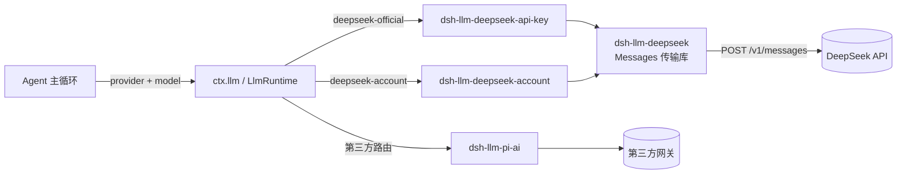
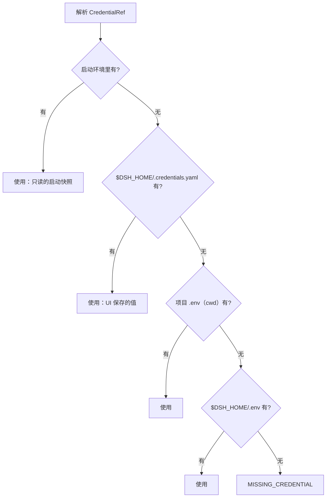
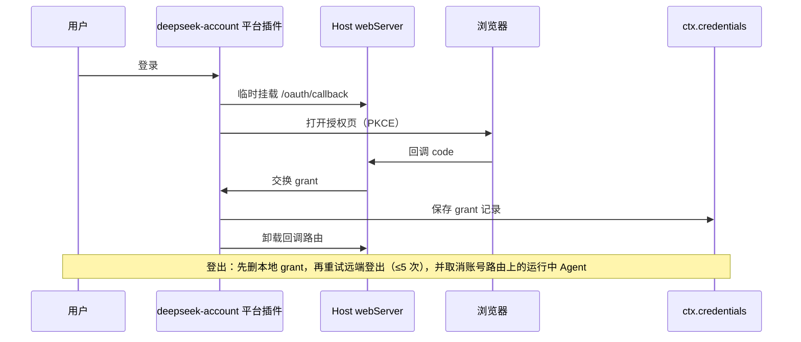

# 第 9 章 模型接入与凭据管理：模型也是"接缝"

> 第 8 章的接缝表里有一行 `ctx.llm`。这一章展开它：模型怎么接入、流式协议有什么规矩、API Key 和账号登录凭据为什么永远不能写进配置、出站流量怎么走代理。前两个是工程问题，后两个是**安全与运维纪律**——也是全章最重要的部分。

> **本章你将学到**：
> - 概念：`ctx.llm` 适配器与路由、`StreamChunk` 流式协议、`ctx.credentials` 凭据接缝、两条 DeepSeek 路由（API Key / 账号）
> - 设计：协议为什么苛刻、密钥为什么永不进配置、为什么只保留一条 Messages 传输、为什么请求扩展要"两阶段提交"又不能"挡路"
> - 动手：改推理等级、验证 `MISSING_CREDENTIAL` 与"无 Key 不列模型"、配置出站代理

> **版本说明**：本章按 0.2.1-alpha.2 核对（上一版基准 0.1.7-rc.2）。这一段的变化集中在四处：API Key 路由**没有凭据就不再列出模型**（升级指南 `deepseek-model-discovery`）；请求扩展的准备失败**不再阻断模型请求**；账号登录新增错误码 `no-response`（升级指南 `account-sign-in-errors`）；运行时不变式插件整体移除后，凭据与模型注册表的事件监听失败一律"记录、不抛出"。

## 9.1 ctx.llm：模型也是可替换的

`ctx.llm`（包 `@deepseek-ai/dsh-llm`，类 `LlmRuntime`）是一个**适配器注册表**：每个 Provider 插件调用 `ctx.llm.registerAdapter(providers, adapter)`，把一个 `LlmAdapter` 注册到一个或多个**路由名**上。Agent 发请求时按 `provider` 选适配器，按 `model` 选模型 id。同一路由重复注册会抛 `DUPLICATE_ADAPTER`。

这意味着：**换模型 = 换一个注册条目**，不是改产品代码。`packages/llm/` 这一组包在 0.2.1-alpha.2 的分工如下（与 0.1.7-rc.2 相比包的集合没有增删）：

| 包 | 角色 |
|----|------|
| `dsh-llm` | 接缝本身：`ctx.llm`、`LlmAdapter`、`StreamChunk`、错误码 |
| `dsh-llm-deepseek` | DeepSeek Messages **传输库**（不再是插件，没有 ctx 键） |
| `dsh-llm-deepseek-api-key` | 官方 API Key 路由 `deepseek-official` |
| `dsh-llm-deepseek-account` | DeepSeek 账号路由 `deepseek-account` |
| `dsh-llm-pi-ai` | 第三方/自定义模型后端（基于 pi-ai） |
| `dsh-deepseek-llm-api-extensions` | 请求扩展注册表 `ctx.deepseekLlmApiExtensions` |
| `dsh-plugin-package-inventory-deepseek` | 一个请求扩展：上报插件包清单 |
| `dsh-llm-retry` | Agent 级重试（监听 `agent/request-error`） |
| `dsh-token-meter` | token 计量 `ctx.tokenMeter` |

注意两处与旧版不同：**`dsh-llm-deepseek` 被拆成"一个传输库 + 两个路由插件"**；录制重放用的 `@deepseek-ai/dsh-llm-replay` 已移到 `packages/test-support/llm-replay`，它是测试支撑，不属于模型接入层（第 14 章再见）。

适配器的形状很小：

```ts
// 示意骨架：真实签名见 packages/llm/llm/src/index.ts
class MyAdapter extends LlmAdapter {
  async * stream(options: GenerateOptions): AsyncIterable<StreamChunk> {
    // block-start → *-delta … → block-end → usage → finish
  }
}
ctx.llm.registerAdapter(['my-route'], new MyAdapter())
```

除 `stream()` 外，`LlmAdapter` 还提供 `providerInfo`、`listModels`、`resolveModel`、`prepareCall`、`imageRequestPricing`、`providerRetryPolicy` 等可选钩子；上游插件还能通过 `llm/stream` waterfall 包装每一次调用。

运行时一侧的 `ctx.llm.prepareCall(config, signal, configure?)` 在 0.2 多了第三个参数：一个同步、纯函数的 `ConfigureCall`。它拿到**冻结的** `LlmCallControls`（`reasoningEffort` / `temperature` / `maxTokens` / `stop`）和本次路由的模型元数据，返回具体的控制值；运行时再补默认值、做校验。模型元数据里的 `reasoning.efforts` 现在明确**按推理强度从低到高排列**，于是"选这条路由最低的推理档"可以写成一个与供应商无关的小函数——会话标题这类辅助调用就是这么做的，不再由 DeepSeek 适配器按 `purpose: 'session-title'` 特判关闭思考。

```ts
// 示意：真实类型见 packages/llm/llm/src/call-config.ts
const leastReasoning: ConfigureCall = (controls, model) => {
  const first = model.reasoning?.efforts[0]
  return first === undefined ? controls : { ...controls, reasoningEffort: first.id }
}
await ctx.llm.prepareCall({ provider, model }, signal, leastReasoning)
```



## 9.2 流式协议的契约：为什么这些规矩不能破

`StreamChunk` 定义在 `packages/llm/llm/src/types.ts`，是一个**封闭联合**：

| 块 | 含义 |
|----|------|
| `block-start` | 开始一个内容块（文本 / 推理 / 工具调用） |
| `text-delta` | 文本增量 |
| `reasoning-delta` | 推理（思考）增量 |
| `tool-call-delta` | 工具调用参数增量，字段 `argumentsDelta` |
| `block-end` | 块结束，携带组装好的完整块 |
| `usage` | 本次调用的 token 统计 |
| `finish` | 流的句号：`reason`，外加可选 `replayState`（`ReplayEnvelope`） |

`finish.reason.kind` 取 `stop` / `tool-calls` / `max-tokens` / `aborted` / `error`，后两者携带 `LlmFailure`。

DSH 对适配器有几条硬规矩（`docs/subsystems/llm-streaming.md`），每一条都对应一个设计原因：

- **增量块让 UI 逐字重现"打字"过程**（第 6 章的 UI 保真），`block-end` 再给出权威的完整块，消费者不必自己拼；
- **工具调用参数端到端保持原始 JSON 字符串**，靠 `argumentsDelta` 拼接：模型输出的就是字符串，"先解析再拼接"会破坏原始格式；
- **`usage` 必须在 `finish` 之前，`finish` 之后什么都不发**：`finish` 是句号，句号之后不允许说话；
- **错误两条路径、一个形状**：要么 `stream()` 抛出，要么以 `finish { kind: 'error' | 'aborted' }` 结束，两者都承载同一个 `LlmFailure`；`LlmRuntime.stream()` 会把"抛出"规范化成终止的 error/aborted `finish`，消费者只需处理一种；
- **一次适配器调用 = 一次 Provider 尝试**：库内重试一律关闭，恢复在 Agent 层由 `agent/request-error` 与 `dsh-llm-retry` 完成；
- **`streamIdleTimeoutMs` 限制停顿**：流长时间无字节就以 `TIMEOUT` 失败，而不是永远挂着；
- **稳定错误码**：上下文溢出统一为 `CONTEXT_WINDOW_EXCEEDED`，空响应 `EMPTY_RESPONSE` 可重试；
- **每个 Provider HTTP 请求都必须带 `User-Agent` 归属头**；`ReplayEnvelope` 归适配器所有，别人只透传。

### 设计思考：协议为什么值得"苛刻"？

适配器接缝的消费者不止一个：主循环、token 统计、UI、会话日志、测试快照、重试策略。如果协议是"宽松的"（比如 `finish` 之后还能来几个块，或者错误有时抛、有时带内），每个消费者都得写防御代码，而防御代码的 bug 会在最糟糕的时刻暴露。DSH 的选择是**把协议钉死，并在运行时入口把两种错误路径收敛成一种**——适配器要么遵守，要么写不出来。"一次调用一次尝试"也是同一品味：重试放在一处（Agent 层），而不是每个适配器各藏一套。

## 9.3 凭据：密钥绝不进配置

这是全章最重要的一句话：**绝不把 API Key 硬编码进配置文件**。配置会进 git，git 会进远端仓库，远端会被扫描，Key 会泄露，账单会爆炸。

DSH 的做法是 `ctx.credentials` 接缝（`packages/credentials/`）。它的模型有两类对象：

- **`CredentialRef`**：一个"品牌化"的环境变量名（用 `@deepseek-ai/dsh-credentials` 导出的 `credentialRef()` 构造），例如 `DEEPSEEK_API_KEY`；
- **`CredentialKey` 记录**：以 `<owner>/<id>` 寻址，`kind` 为 `api-key` 或 `grant`（后者承载登录授权，9.5 节的账号登录用它）。

默认实现 `dsh-credentials-local` 按以下顺序解析一个引用：



几个要点：

- 环境变量是**启动时的快照**，只读；在 UI 里保存的值写入 `.credentials.yaml`（格式 `version: 1`，含 `refs:` 与 `records:`），并**优先于 `.env`**；
- 该文件必须 owner-only：POSIX 上权限不对会被拒绝并提示 `chmod 600`，Windows 上跳过此检查；
- 服务端 API 是 `ctx.credentials.set / unset / describe`，`describe` 只返回 `{ configured, source?, writable }` 这样的**脱敏描述符**——浏览器永远拿不到明文；变更广播 `credentials/reference-updated`（记录变更为 `credentials/record-updated`）。监听者抛错或异步拒绝**一律被收容并记录日志**，不会让已经落盘的写入"看起来失败"——0.1.7 时代还有一个例外：`code: 'INVARIANT'` 的失败会在所有监听者跑完后重抛；随着运行时不变式插件（`@deepseek-ai/dsh-invariants` 与各包的 `./invariant` 子路径）在 0.2 被整体删除，这个例外也一并消失；
- 适配器**每次请求时**才解析引用，所以换了 Key 下一个请求就生效；请求时没有 Key 得到 `MISSING_CREDENTIAL`，Key 形状不对得到 `INVALID_CREDENTIAL`——**凭据缺失是运行时状态，不是安装时错误**。

DeepSeek API Key 路由的默认环境变量是 `DEEPSEEK_API_KEY`。最快的配置方式是 Web 的 **设置 → 模型**，或者：

```powershell
# $DSH_HOME/.env 或项目根目录 .env（务必 gitignore）
DEEPSEEK_API_KEY=sk-你的key
```

> **诚实的边界**：`.credentials.yaml` 防的是"误提交、误分享"，**不是**防 Agent。Agent 的工具进程与 DSH 以同一个系统用户运行，理论上读得到这个文件。第 10 章会讲沙箱在这里能做什么、不能做什么。

### 设计思考：为什么"按请求解析"而不是"启动时读一次"？

启动时读一次 Key 看起来更简单。但真实场景里 Key 会过期、轮换、被吊销，账号登录的 grant 还会刷新——如果启动时读，换 Key = 重启整个产品；按请求解析，换 Key = 改文件或点保存，下一请求自动生效。**把"凭据变更"和"进程生命周期"解耦**，是运维体验的质变。

## 9.4 两条 DeepSeek 路由：API Key 与账号

0.1.7 把 DeepSeek 接入拆成两条**互不回退**的路由，共用 `dsh-llm-deepseek` 这一个 Messages 传输库：

| | API Key 路由 | 账号路由 |
|---|---|---|
| 插件包 | `@deepseek-ai/dsh-llm-deepseek-api-key` | `@deepseek-ai/dsh-llm-deepseek-account` |
| base bundle 条目 id | `llm-deepseek` | `llm-deepseek-account` |
| 路由名 | `deepseek-official` | `deepseek-account` |
| 凭据来源 | `CredentialRef`（默认 `DEEPSEEK_API_KEY`） | `deepseek-account` 平台插件保存的 grant |
| 请求头 | `x-api-key` | `x-dsh-auth-token`（不带 Bearer 前缀） |
| 特有错误码 | `MISSING_CREDENTIAL` 等 | `ACCOUNT_SIGN_IN_REQUIRED`、`ACCOUNT_TOKEN_INVALID`、`ACCOUNT_QUOTA` |

**任何一条路由都不会借用另一条的凭据**：账号过期不会偷偷改用 API Key 计费，反之亦然。

### 只剩 Messages：传输层的简化

旧版 DeepSeek 适配器可以在 Chat Completions 与 Messages 两种协议之间选择。现在官方路由只保留**一条 Messages 传输**：

- `baseURL` 默认 `https://api.deepseek.com/anthropic`，显式配置优先，其次 `$DEEPSEEK_BASE_URL`；请求发往 `/v1/messages`，图片走 `/v1/files`（失败时回退为内联 base64）；
- 用原生 `fetch` 发请求，并**拒绝重定向**；
- 配置里**没有 `protocol` 字段**，写了会报 "protocol is not configurable"。

默认模型目录（`packages/llm/llm-deepseek/src/models.ts`）：

| 模型 id | 显示名 | 输入 | 上下文窗口 |
|---|---|---|---|
| `deepseek-flash` | DeepSeek-V4.1-Flash | 文本 + 图片 | 1,000,000 |
| `deepseek-v4-pro` | DeepSeek-V4-Pro | 文本 | 1,000,000 |

（0.1.7-rc.2 里 Flash 的显示名写作 `DeepSeek-V41-Flash`，0.2 更正为 `DeepSeek-V4.1-Flash`；模型 id 没变。）

默认最大输出 `256_000` token，流空闲超时 300 秒。推理控制有两个字段：`thinking`（`enabled` / `disabled`），以及 `reasoningEffort`（`off` / `low` / `high` / `max`，**默认 `high`**）。后者发成 `output_config.effort`，`off` 则发 `thinking.type: disabled`。

### 没有 Key，就不列模型

0.1.7 的 API Key 路由即使没配凭据也会照常列出上面两个模型——用户选中后发第一条消息才撞上 `MISSING_CREDENTIAL`。0.2.1-alpha.1 起（升级指南 `deepseek-model-discovery`），`deepseek-official` 的模型发现会**先解析一次 `apiKeyEnv` 引用**：

- 缺凭据 → 返回**空目录**，Web 与 Desktop 的模型选择器里整个 DeepSeek 分组隐藏（设置页里的条目仍在，方便你去填 Key）；
- Key 形状不对或凭据查找本身失败 → 错误照常上抛，不会被吞成"空列表"；
- 已保存或默认的选择如果不在当前目录里，选择器显示"选择模型"，但**不改写**存下来的选择——补上 Key 后自动恢复。

注意它只检查"有没有、像不像"，**不会**为了列模型去远端验证 Key 是否被接受；账号路由则一直是"有 grant 才列模型"，不受影响。

### 设计思考：为什么"列不出"比"列出来再失败"好？

模型选择器是用户对"现在能用什么"的第一印象。列出一个注定失败的选项，等于把配置错误推迟到对话中途才暴露，还会让用户误以为是模型或网络的问题。把凭据检查前移到发现阶段，让"缺 Key"在选择器里就以"分组不见了"的形式显现；同时**不改写已存的选择**，避免"临时缺 Key"演变成"偏好被清空"。这和 9.3 节"凭据缺失是运行时状态"一脉相承：状态变了，视图跟着变，配置不动。

base bundle（`packages/bundle/base/cordis.patch.yml`）里的相关条目（节选）：

```yaml
- id: llm-deepseek
  name: '@deepseek-ai/dsh-llm-deepseek-api-key'
- id: llm-deepseek-account
  name: '@deepseek-ai/dsh-llm-deepseek-account'
- id: agent-default-model
  name: '@deepseek-ai/dsh-agent-default-model'
  config:
    provider: deepseek-official
    model: deepseek-flash
```

`dsh-llm-pi-ai` 也在 base 里挂载，但默认**零路由、处于休眠**，直到你在 **设置 → 模型** 里添加第三方或自定义提供商。**Provider 层声明"能用什么"，默认模型条目决定新会话"先用什么"**，用户在模型选择器里改选后，会成为新会话的默认值。

### 收窄 pi-ai 的导入面

`dsh-llm-pi-ai` 不再在运行时导入 pi-ai 的聚合入口，只按需导入 `providers/all`、`api/*.lazy`、`utils/overflow`，模型元数据改为包内 `models.ts`。结果是启动时只加载约 153 个 pi-ai 模块，且不再拉入 TypeBox。

### 设计思考：为什么删掉协议选择器？

"支持两种协议"听上去更灵活，实际代价是：两套序列化、两套 SSE 解析、两套错误映射、两倍的测试矩阵，而官方路由只需要一种。第三方网关的多协议需求交给 pi-ai 路由去承担（它在自定义提供商表单里提供 `openai-completions` / `openai-responses` / `anthropic-messages` 三选一）。**把灵活性放在真正需要它的那一层**，让官方路由保持单一、可审计。

## 9.5 DeepSeek 账号：登录、登出与额度

账号能力由平台插件 `@deepseek-ai/dsh-deepseek-account-platform`（base 条目 id `deepseek-account`）提供，模型路由 `dsh-llm-deepseek-account` 只负责拿 grant 发请求。

**登录**：浏览器 PKCE 流程。登录期间，Host 的 webServer 上临时挂一个 `/oauth/callback` 路由接收回调；**本地取消是权威的**——用户点了取消，就算回调稍后到达也不会生效。平台地址 `platformOrigin` 与推理地址 `inferenceOrigin`（默认 `https://api.deepseek.com`）分开配置。拿到的授权以 `grant` 记录存入凭据层。

**登出**：先删除本地 grant，再对远端登出**最多重试 5 次**。本地删除先行保证"点了登出就真的登出"；远端失败只影响服务端会话清理。登出还会广播 `deepseek-account/signed-out`，并**取消所有当前使用账号路由的运行中 Agent**（依据 `session.requestContext().provider`）——防止已登出的身份继续在后台消耗额度。会话过期时发 `deepseek-account/session-expired`，模型请求缺登录时发 `deepseek-account/model-sign-in-required`。

**额度与充值**：账号路由把通用的 `QUOTA` 改写成 `ACCOUNT_QUOTA`，覆盖 HTTP 402 与 SSE 流内错误；任何 401 都映射为 `ACCOUNT_TOKEN_INVALID`。`ACCOUNT_QUOTA` 会通过 `shell.quota-notice` 链驱动一个"取消 / 去充值"对话框；其他错误只显示中性的 Toast。**凭据和计费 URL 永远不进入对话内容或会话日志**。

**登录失败的错误码**（`SignInErrorCode`，经 `account/getState`、`account/startSignIn`、`account/watch` 暴露）在 0.2.0-rc.2 变成五个：`no-response`、`network`、`protocol`、`expired`、`storage`。新增的 `no-response` 表示 `fetch` 在拿到任何 HTTP 响应之前就失败了（包括请求超时）——这类失败以前也报 `network`。现在 `network` 只覆盖"收到了 HTTP 错误响应"或账号详情读取失败，登录对话框只对 `no-response` 给出"检查网络"的排障提示。自己写账号客户端或校验器的，要把 `no-response` 加进穷举分支（升级指南 `account-sign-in-errors`）。

账号设置界面 `@deepseek-ai/dsh-client-ui-settings-account` 由 Web bundle 挂载，Web 与 Desktop 共用：Web 在新标签页完成授权，Desktop 额外提供内嵌的 Platform 页面与首次启动引导（欢迎窗口里的 API Key 页也在 Desktop）。



### 设计思考：为什么"本地优先"？

登录取消、登出删除都以本地为准，远端只是"尽力同步"。原因是用户的心智模型是本地的：我点了登出，这台机器就不应该再能以我的身份花钱。如果反过来"等远端确认才删本地"，网络一抖，用户就处在"以为登出了、其实没有"的最坏状态。**安全相关的状态变更，应当在用户能直接控制的那一端先落地。**

## 9.6 请求扩展：把 Harness 信息带上线路

DeepSeek 请求里除了标准 Messages 字段，还会带一些 Harness 自己的信息（`docs/deepseek-llm-api-wire-extensions.md`），由 `ctx.deepseekLlmApiExtensions` 统一登记：

- **请求头**：`user-agent`、`x-deepseek-harness-user-id`、`x-deepseek-harness-session-id`、`x-deepseek-harness-compact`；
- **请求体字段**：`dsh_plugin_packages`（由 `dsh-plugin-package-inventory-deepseek` 贡献）与 `dsh_session_log`，都以 `dsh_` 前缀放在 `messages` **之外**，不污染对话内容。

每个扩展都走一个小事务：`prepare`（构造本次要发的值）→ 发 HTTP → 仅在 **2xx 后** `accept`（确认已送达，推进内部游标）。

0.2 把这个事务的失败语义整体调成"**诊断信息不挡模型请求**"：

- **某个扩展 `prepare` 抛错**：注册表只把**这一个字段**从本次请求里拿掉，其余字段照发；每个字段只记第一次失败的日志。只有请求被取消才会让 `prepare` 整体拒绝；
- **字段名与基础请求体冲突**：仍然在发 HTTP 之前以 `REQUEST_EXTENSION` 失败（错误消息会附上原因链）——这是组合错误，不是运行时抖动；
- **2xx 之后 `accept` 失败**：记日志、响应照常流式返回；没被确认的贡献者下一次请求重发自己的增量；
- **合并后的请求体序列化失败**：去掉全部扩展字段只发基础请求体，跳过 `accept`，并按路由只记一次警告。

插件包清单 `dsh_plugin_packages` 也随之放宽：清单项可以是 `{ name, version }` 或只有 `{ name }`（manifest 没有可用 `version` 时），读不到的包元数据只省略该项，而不是让请求准备失败。会话日志上传 `dsh_session_log` 的开关则在 **设置 → 通用** 里（"使用官方模型 API 时上传会话日志"，由 `@deepseek-ai/dsh-client-ui-settings-session-log` 提供），它编辑的是宿主插件 `@deepseek-ai/dsh-session-log-deepseek`（base 条目 id `session-log-deepseek`）的 `enabled` 字段。

### 设计思考：为什么要"两阶段提交"，又为什么不能"挡路"？

像会话日志这类"增量上报"，如果在发送前就推进游标，一旦请求失败，这段增量就永远丢了；如果在发送后才构造，又无法放进本次请求体。`prepare / accept` 把"构造"与"确认"拆开：失败的请求什么都不确认，下次重发同一段增量。这就是数据库里两阶段提交的迷你版。

但这些字段是**给服务端的附加诊断**，不是模型输入。0.1.7 让任何一个扩展的准备或确认失败都拖垮整个模型请求，等于让"可有可无的信息"拥有了否决权。0.2 的取舍是：**只有"组合本身写错了"（字段冲突）才阻断，运行时的偶发失败降级为日志 + 下次重发**——两阶段提交保证不丢，降级保证不挡。

### 借用模型路由的辅助调用：以 CoT 翻译为例

模型路由不只服务主对话。0.2.1 新增的实验性翻译服务 `@deepseek-ai/dsh-experimental-translator`（`ctx.translator`，见 `docs/subsystems/translation.md`）除了匿名的 Bing / Google 端点，还能**显式选择**付费的 `deepseek-account` 或 `deepseek-official` 路由来翻译思考过程（GUI 由可选 bundle `@deepseek-ai/dsh-experimental-cot-translation-bundle` 组装，功能本身放在第 13 章）。它从模型接入层"借路"时守着几条与本章一致的规矩：

- 只认内置的账号 / 官方路由，pi-ai 路由不参与；要求凭据已配置，且目录里**恰好存在** `deepseek-flash` 这个 id（名称、版本号标签都不算数）；
- 每次未命中缓存的翻译都单独 `prepareCall` 一次纯文本请求，**推理档必须是 `off`**，否则以 `TRANSLATION_UNAVAILABLE` 拒绝；
- 失败不换路由（不会从付费路由偷偷退回匿名端点，反之亦然），这和两条 DeepSeek 路由"互不回退"是同一个原则；
- 这类请求拿不到主会话身份，请求扩展因此**不会**借机上传主会话的完整日志。

## 9.7 出站代理

公司网络常要求所有出站流量走代理。自 0.1.7 起（0.2 未变），DSH 用一个**库**（不是插件）`packages/util/http-proxy` 统一处理：

- `installProxyFromEnvironment` 在 profile 启动时、**任何条目挂载之前**安装一个全局 undici dispatcher，于是所有 `fetch` 都遵循代理；
- 识别 `HTTP_PROXY` / `HTTPS_PROXY` / `ALL_PROXY` / `NO_PROXY`；**回环地址永远直连**；SOCKS 或格式错误的值会被报告，对应协议保持直连；
- 子进程环境由 `proxyEnvironmentForChild` / `clearedProxyEnv` 处理；PTC 程序环境**不**携带代理值；遥测（OTLP 导出走 `node:http`）保持直连，可用 `DSH_TELEMETRY_MODE=DISABLED` 关闭；
- 代理变量可以来自启动环境（优先）或 `$DSH_HOME/.env`；**项目 `.env` 里写代理变量会让 DSH 拒绝启动**——它随 `git clone` 而来，不能让一个仓库决定你的流量去向（实现见 `packages/boot/app-boot` 的 `HOME_LAYER_PROXY_NAMES`）；
- bash 工具里的命令、`git`、作为子进程启动的 MCP 服务器会继承代理变量——包括 URL 里的密码，所以带凭据的代理 URL 对模型写的命令同样可见；
- 仓库有门禁 `verify-no-bare-dispatcher`，禁止代码私自创建绕开全局策略的 dispatcher。

用户文档见 `docs/user/guide/network-proxy.md`。

## 9.8 配置落在哪里：从 settings.yaml 到 profile patch

旧版有一份独立的 `~/.dsh/settings.yaml`。现在它是**遗留格式**：首次启动时导入一次，然后改名为 `settings.yaml.imported`。

新的做法是：插件把可由用户调整的字段声明为 `.volatile()` 的 Config 字段，Web 设置页把它们渲染成表单，保存时写入**当前 profile 的 patch 文件** `$DSH_HOME/profiles/<profile>/cordis.patch.yml`。用 `dsh web` 启动时 profile 就是 `web`。适配器在下一次请求时重新读取，无需重启。

```yaml
# $DSH_HOME/profiles/web/cordis.patch.yml（节选）
- id: llm-deepseek
  config:
    reasoningEffort: max
```

分层仍然是第 4 章的思路：bundle 放部署默认值，profile patch 放用户偏好，**密钥永远走凭据层**——patch 里只出现 `apiKeyEnv` 这类引用名，而不是 Key 本身。

## 9.9 动手实验

以下命令在 deepseek-harness 仓库根目录的 Windows PowerShell 中执行，先 `corepack pnpm run build`。

1. **看组合后的配置**：`corepack pnpm dsh --profile web --dump-config`，找到 `llm-deepseek`、`llm-deepseek-account`、`agent-default-model` 三个条目，确认包名与默认模型 `deepseek-flash`。
2. **改推理等级**：在 `$DSH_HOME/profiles/web/cordis.patch.yml` 里给 `llm-deepseek` 写 `reasoningEffort: low`，启动 `corepack pnpm dsh web` 跑一个任务；再改成 `max`（无需重启），对比思考过程的长度。
3. **验证凭据是运行时状态**：移除所有来源里的 `DEEPSEEK_API_KEY`（环境变量、两个 `.env`、设置页里保存的值），启动后打开模型选择器，确认 DeepSeek 分组不见了、当前选择显示为"选择模型"——而不是启动失败；再在 **设置 → 模型** 填入 Key，**不重启**重新打开选择器，确认分组回来、原来的选择自动恢复。若某个旧会话仍以 `deepseek-official` 发请求，此时得到的错误码才是 `MISSING_CREDENTIAL`。
4. **代理隔离**：在项目根目录 `.env` 写一行 `HTTPS_PROXY=http://127.0.0.1:9`，确认 DSH 直接拒绝启动；把同一行移到 `$DSH_HOME/.env`，观察请求开始走（不存在的）代理而失败。做完记得删掉。

## 9.10 常见坑

- **Key 写进 cordis.yml / profile patch / 提交进 git**：必须走凭据层或 `.env`（并 gitignore）；
- **以为账号过期会自动回退到 API Key**：两条路由互不回退，这是有意的计费安全；
- **选择器里没有 DeepSeek 就以为是网络问题**：API Key 路由缺凭据时返回空目录；反过来，"列出来了"也只说明 Key 存在且形状正确，不代表远端接受它；
- **自己写的模型发现消费者假设目录非空**：未配 Key 之前目录就是空的，要能处理；
- **账号登录错误码只处理到 `network`**：0.2 起还有 `no-response`，穷举分支要补上；
- **还在配置里写 `protocol`**：官方路由只有 Messages，会直接报错；
- **适配器违反流协议**：`usage` 必须在 `finish` 前，`finish` 后不得再发；参数用 `argumentsDelta` 保持原始字符串；
- **适配器里自己写重试**：一次调用一次尝试，重试交给 `dsh-llm-retry`；
- **代理写在项目 `.env`**：DSH 拒绝启动，应导出环境变量或写在 `$DSH_HOME/.env`；
- **自己 new 一个 undici dispatcher**：会绕开代理策略，门禁会拦。

## 9.11 思考题

1. 流式协议规定"`usage` 必须在 `finish` 前"。如果你是 token 统计的消费者，收到了"`finish` 后的 `usage`"，你会容忍还是报错？再想想：`LlmRuntime.stream()` 为什么选择把"抛出"规范化成终止 `finish`，而不是反过来？
2. 凭据"按请求解析"让换 Key 不需要重启。如果 Key 不是缺失而是被吊销，系统在哪个环节发现？账号路由把任何 401 都映射为 `ACCOUNT_TOKEN_INVALID`，这种"宁可粗粒度"的映射有什么好处和代价？
3. 两条 DeepSeek 路由被刻意设计成"互不回退"。请从计费、审计、用户预期三个角度论证这个决定；你能想到哪种场景下用户其实希望自动回退？如果要支持，应该放在哪一层、由谁显式开启？
4. 代理变量被禁止写在项目 `.env`，但 API Key 却允许。两者的威胁模型有什么不同？
5. 0.2 让 API Key 路由"没有凭据就返回空目录"，却刻意不在列模型时去远端验证 Key。如果改成"列模型前先发一个探测请求"，会多出哪些成本与失败模式？"保留已存选择、只显示'选择模型'"又解决了什么问题？
6. 请求扩展从"任何失败都阻断请求"改成"只有字段冲突才阻断"。请说明为什么字段冲突被区别对待；如果某个扩展承载的是**合规必需**的信息（而非诊断信息），这种降级策略还合适吗？

## 小结

- `ctx.llm` 是适配器接缝，`StreamChunk` 是封闭联合，规矩钉死：`usage` 在 `finish` 前、参数保持原始 JSON、错误两路一形、一次调用一次尝试；`prepareCall` 可接一个纯函数 `ConfigureCall` 选择具体控制值（例如最低推理档）；
- DeepSeek 接入 = 一个 Messages 传输库 + 两条互不回退的路由（`deepseek-official` / `deepseek-account`），默认模型 `deepseek-flash`（显示名 DeepSeek-V4.1-Flash），上下文 1M；API Key 路由缺凭据时不列模型；
- 凭据按"启动环境 > `.credentials.yaml` > 项目 `.env` > `$DSH_HOME/.env`"解析，按请求生效，浏览器只见脱敏描述符；监听失败一律收容；
- 账号登录用 PKCE，登出本地优先并取消相关 Agent，额度不足走充值对话框且不泄露计费信息；连不上服务端报 `no-response`；
- 请求扩展以 `dsh_` 字段和 `x-deepseek-harness-*` 头上线，`prepare → accept` 保证不丢增量，运行时失败只降级不阻断；出站代理由全局 dispatcher 统一执行；
- 用户偏好写入 profile patch，`settings.yaml` 仅作一次性导入。

下一章：沙箱与安全——当模型要执行不可信代码，信任从哪来？
