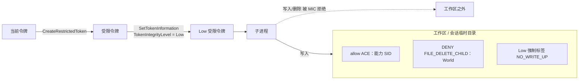
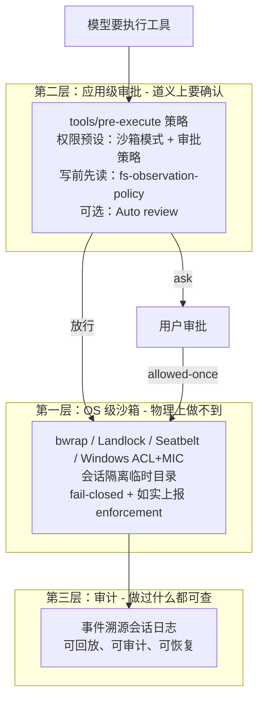
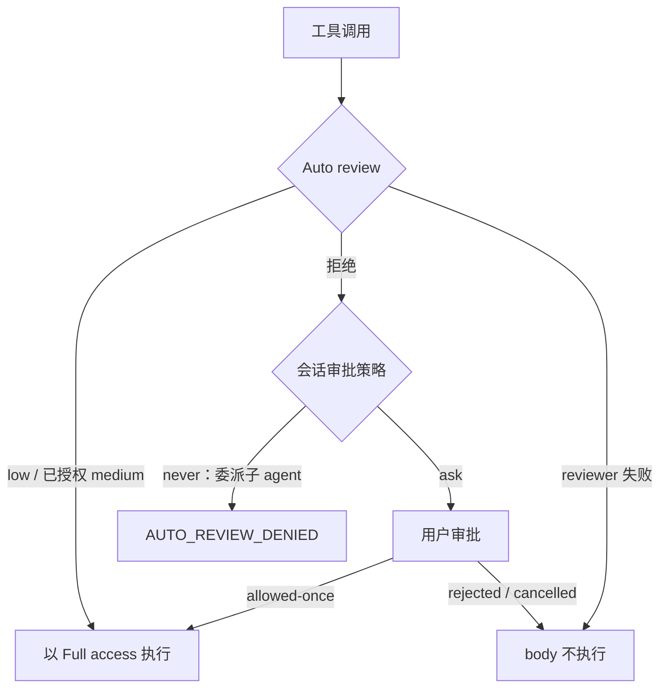

# 第 10 章 沙箱与安全：当模型要执行不可信代码，信任从哪来？

> 前几章我们讨论的都是"怎么让 Agent 做更多"。这一章讨论相反的问题：**怎么让它做不了不该做的**。沙箱是本书所有设计里最"生死攸关"的一环——因为它的失败模式不是功能 bug，而是信任崩塌。

> **本章你将学到**：
> - 概念：三平台沙箱 runner、子进程原生收容与控制管道、审批与权限预设、实验性 Auto review、信任根
> - 设计：fail-closed 与纵深防御、为什么不用容器、Windows 为什么要"降完整性级别"
> - 动手：观察权限模式、审批与 Windows ACL 的实际效果

> **先读这一段**：仓库根目录的 `SAFETY.md` / `SAFETY.zh.md` 明确声明——DSH 是实验性软件，**未经安全审计，沙箱不保证隔离**；需要可靠隔离时，请在虚拟机、容器或专用环境中运行。本章讲的是"它尽力做了什么、边界在哪"，而不是"它能挡住一切"。

## 10.1 问题：命令是模型下的，锅是宿主背的

Agent 要"跑测试""执行命令""改文件"，这些操作的意图来自模型——而模型是不可信的（不是"模型坏"，而是"模型会错"：幻觉、被 prompt 注入、被恶意文件内容诱导）。如果把整台电脑无脑交给模型，等于把门禁卡给了陌生人。

所以每个 Agent 系统都要回答一个根本问题：**在"模型需要真实世界的权限"和"真实世界不能被模型毁掉"之间，信任的边界画在哪？**

历史上答案分两派：

- **信任派**：让模型拥有全部权限，出问题再说——它能跑，但你不敢让它干活；
- **隔离派**：模型在一个封闭环境里干活，与真实世界隔离（虚拟机、容器、远程主机）。

隔离派的问题在于**能力折损**：模型在容器里改的代码怎么回到你的工作区？文件同步、网络穿透、工具链安装……隔离越彻底，协同越痛苦。DSH 的默认路线更精细：**让模型在真实环境里干活，但把每一步的权限压缩到最小——平台原生沙箱 + 应用级审批，外加审计**。需要真正隔离时，再把整个执行能力换成远程实现（10.8 节）。

## 10.2 设计哲学：四条底线

DSH 的安全设计（`packages/sandbox`、`packages/subprocess`）可以陈述为四条底线：

1. **默认收紧，按需放宽**：新会话默认 `workspace-write` + `ask`，更宽的权限要逐次申请；
2. **沙箱失败即拒绝执行**（fail-closed）：没有可用 runner 时 `confine()` 以 `SANDBOX_UNAVAILABLE`（`SandboxUnavailableError`）拒绝，绝不退回"不受限运行"；
3. **强制程度如实上报**：每次受限执行都报告 `enforcement: 'full' | 'partial'`，需要绝对边界的消费方可以据此拒绝；
4. **写权限按会话隔离**：每个"会话 × 工作区"一个随机私有临时目录，会话之间互不可见。

第四条值得展开：即使模型被诱导去写别的会话的临时目录，物理上也写不进去。这是**纵深防御**——不是靠一层防线挡住所有攻击，而是每一层都假设上一层会被突破。第三条则是 0.1.x 以来一直坚持的诚实：宁可报告"部分强制"，也不夸大成"完整隔离"。

## 10.3 沙箱接缝：模式、策略与 runner

`ctx.sandbox`（`dsh-sandbox`）只有一个核心动作：

```ts
// 示意：把一条命令包装成受限命令
const confined = await ctx.sandbox.confine(argv, policy, signal)
// confined: { argv, enforcement, denialSignatures, runnerFailureRules }
```

- **模式**有三个：`read-only`、`workspace-write`、`danger-full-access`。只有前两个会真正交给 runner，`danger-full-access` 意味着不包装；
- **策略按调用解析**：`SandboxPolicy` / `SandboxExecutionPolicy` 带 `workspaceRoot` 与 `sessionId`，由 `ctx.sandboxPolicy`（`dsh-sandbox-policy`）给出。base bundle 里它的模式是 `process.env.DSH_PERMISSION_MODE ?? 'workspace-write'`；
- `denialSignatures` / `runnerFailureRules` 让调用方区分"命令被策略拒绝"与"沙箱自己坏了"——**损坏的沙箱不会被误认为被拒绝的命令**。

默认后端 `dsh-sandbox-local` 按平台选择 runner 链：

| 平台 | runner 链 | 一句话原理 |
| --- | --- | --- |
| Linux | `bwrap`，其次 Landlock | bwrap：只读宿主根、全新 `/dev`、私有 PID 命名空间里的 `/proc`；`workspace-write` 另加临时 `/tmp` 与可写工作区绑定。Landlock：原生启动器自我限制后 exec |
| macOS | Seatbelt | `sandbox-exec` 施加默认允许、`(deny file-write*)` 再按模式放行的 SBPL profile |
| Windows | ACL 受限令牌 | `dsh-sandbox-windows-acl`：受限令牌 + 能力 SID + 低完整性级别（10.4 节） |

唯一候选直接选用；有竞争候选时按链序**各探测一次**，首个可用结论在提供方生命周期内缓存。配置字段只有三个：`runnerCommand`（默认 `[]`，自定义 bwrap 兼容 runner，属于操作方断言，会跳过探测）、`runnerFailureSignatures`、`probeTimeoutMs`（默认 5000）。

### 为什么是"平台原生"而不是容器？

- **粒度**：容器隔离的是"整台机器"，启动要几百毫秒到几秒；DSH 要沙箱化的是"一次 bash 调用"，延迟必须很低，否则主循环会卡住（第 7 章）；
- **侵入性**：容器需要守护进程、镜像、网络配置；平台原生机制是内核（或系统）自带能力，零守护进程、零镜像。

代价是**三套实现**。Linux 上把常见机制按"粒度 × 开销"排开：

| 机制 | 粒度 | 启动开销 | 在 DSH 中 |
| --- | --- | --- | --- |
| seccomp-bpf | 系统调用 | 极低 | 未使用：难以表达"路径" |
| Landlock（LSM） | 文件系统访问类别 | 极低 | 链上第二候选；旧内核 ABI 只能报告 `partial` |
| bwrap + namespace | 挂载 + PID 命名空间 | 低 | **链上首选** |
| 容器 | 完整运行环境 | 高 | 不在本地链上；需要时换远程执行 |
| 虚拟机 | 硬件级 | 最高 | `SAFETY.md` 推荐的强隔离方式 |

旧版本书说"Linux 只用 Landlock"，这已不准确：当前链是 **bwrap 优先、Landlock 兜底**。bwrap 的私有 PID 命名空间让命令能管理自己的后代却看不见宿主进程，procfs 的魔法链接因而无法绕过挂载。

### 一个值得反复品味的细节：自我限制再 exec

Landlock 启动器现在由原生包 `@deepseek-ai/node-addon-system` 的 `./landlock-run` 子路径提供（导出 `launcherPath`、`probe`、`grantArgs`），源码是 `native/system/packages/entry/src/main.c`，不到 300 行 C。它的核心技巧没变：先 `prctl(PR_SET_NO_NEW_PRIVS)`，再 `landlock_restrict_self` 给**自己**套上规则集，最后 `execvp` 目标命令——规则集随 exec 继承给整棵进程树。被包裹的命令从出生起就在沙箱里，没有任何"进入沙箱"的窗口：**限制不是施加在命令上，而是施加在启动器自己身上**。`dsh-sandbox-local` 只负责"模式 → 授权参数"的映射，路径解析与探测都留在带版本的二进制里。

## 10.4 Windows：受限令牌、能力 SID 与强制完整性

Windows 没有 Landlock，`dsh-sandbox-windows-acl` 用令牌与 ACL 拼出边界：

- **写授权挂在 SID 上而不是路径上**：每个工作区有一个由规范路径派生的确定性 SID（`workspaceWriteSid`）和一条常驻 ACE；每个"会话 × 工作区"有一个随机私有临时目录、独立 SID（`tempWriteSid`）和可撤销的 ACE；
- **所有 Win32 调用返回值都检查**：任何一步失败都 fail-closed。

2026-09-19 的变更补上了一个真实的逃逸（issue #4581）：受限令牌只约束针对对象**自身**安全描述符的访问检查，而 Windows 还会依据**父目录**的 `FILE_DELETE_CHILD` 权限批准删除——这项权限不需要 restricting SID 副署。于是受限子进程的普通写入被拒绝，却能用 `cmd /c del`（底层 `DeleteFileW`）删掉工作区**之外**的文件。现在每次授权在一次 `SetNamedSecurityInfoW` 中同时写入三样东西：

1. 能力 SID 的 **allow ACE**（写权限本身，未变）；
2. 对 World SID 的 **DENY `FILE_DELETE_CHILD`**，仅容器继承——让能力 ACE 成为授权根内唯一的删除授权来源，也把多个授权根彼此隔开；
3. **Low 完整性强制标签**（`S-1-16-4096`，NO_WRITE_UP）。

子进程令牌再通过 `SetTokenInformation(TokenIntegrityLevel)` 降到 Low。强制完整性策略在内核访问检查内部执行，不管权限来自哪里，授权根之外的 Medium 对象都**既防写也防删**。三项缺一不可。



代价同样被如实记录：

- 工作区根上的 Low 标签是**常驻的**，会比 DSH 进程活得更久；
- 被授权目录需要 `WRITE_OWNER` 权限才能写标签；
- 在已授权根下以 FullControl 打开子目录会被拒绝；
- read-only 模式也没有选更低的 Untrusted 完整性，因为 pwsh 在 Untrusted 下起不来。

即便如此，Windows 仍然是 **`partial`**：NTFS 硬链接、读取不受限、以及被其他 AppContainer 工具设了 ACL 的目录树（Low 子进程读不到）都是已知边界。

### 设计思考：为什么 Windows 要"再加一层"而不是修 ACL？

直觉的修法是"找出所有 Everyone 可写的目录，把它们的 ACL 改掉"。但那意味着 DSH 要去改用户整台机器的权限，而且永远改不全。MIC 的思路相反：**不动别人的 ACL，只把自己的子进程降级**，再给自己授权的少数目录贴上 Low 标签放行。"收紧自己"比"修补世界"可控得多——这和 Landlock 的"先给自己戴手铐"是同一个思想在不同内核上的投影。

## 10.5 子进程管理：沙箱决定"能碰什么"，收容决定"怎么死"

沙箱回答"能访问什么"，但沙箱里的进程还要被管理：怎么启动、怎么终止、怎么保证不残留。`ctx.subprocess`（`dsh-subprocess`，默认实现 `dsh-subprocess-local`）在 0.1.7 引入了**原生收容**：

- **Linux**：普通与 PTY 启动都通过一次性 bootstrap 进入一个临时的用户级 systemd scope（`systemd-run --user --scope`），整棵树由 cgroup 兜住；
- **Windows**：普通启动放进一个由私有 runner 持有的 **kill-on-close Job**，runner 一死整棵树跟着死；
- **不支持的宿主**（macOS、Windows ConPTY 等）退回较弱的兜底，只提示一次警告。

API 也随之收紧：普通 `SubprocessHandle` **不再暴露 PID**，只给 `.done`、`terminate()`、`waitForExit()`——"等退出"等到的是整个收容范围清空，而不只是直接子进程退出；终端句柄仍保留 `pid`。提供方**从不重放**一次启动。宿主退出时，`process.prependListener('exit', onHostExit)` 同步杀掉所有存活的收容范围——**不留孤儿进程**。

两条老纪律仍在：环境变量做凭据清洗（`scrubbedParentEnv()`，在 `packages/subprocess/subprocess/src/index.ts`）——API Key 不传给子进程，因为子进程跑的是模型的命令；交互式终端用 node-pty。

### 控制管道：给子进程一条"不授权"的旁路

`stdio.control: 'pipe'` 会给父进程一个 `handle.control`（`Duplex`），子进程通过 `@deepseek-ai/dsh-subprocess/control` 打开 fd 7 与之通信（Windows 上借助 overlapped stdio 实现）。它的用户是 PTC：`dsh-ptc-runtime-node` 让每个程序在全新的 Node 进程里运行、受同一个 `ctx.sandbox` 约束，工作流通过 `dsh-workflow-ptc` 复用这条通道。关键设计是：**这条通道本身不授予任何能力**——子进程要调用工具，仍要经过宿主一侧完整的审批与策略链。

## 10.6 第二层防线：审批、权限预设与 Auto review

先把 DSH 的防线画出来——每一层都假设上一层会被突破：



OS 沙箱挡的是"能力"，但很多危险操作就在能力范围内（`rm -rf` 在工作区里也是合法的）。所以还需要应用级审批：

- **`ctx.approval`**（base 中为 `dsh-user-approval`）：策略 `ask` 或 `never`，变更广播 `approval/policy`；一次审批的结果是 `allowed-once` / `rejected` / `cancelled` / `unavailable`，其中 `unavailable`（没有能回答的人）按拒绝处理——**审批也是 fail-closed**；上游可通过 `approval/request` waterfall 介入；
- **`ctx.permissionPresets`**（`dsh-permission-presets`）：把"沙箱模式 + 审批策略"打包成预设。base bundle 配置了三档：`read-only`（read-only + ask）、`workspace-write`（workspace-write + ask）、`danger-full-access`（danger-full-access + never），Web 上对应 Read Only / Workspace Write / Full access；`custom` 与 `auto` 两个名字被保留；
- **`tools/pre-execute` 钩子**：工具执行前的策略判断点；
- **`dsh-fs-observation-policy`**：写入/编辑前必须先"读过"该文件，且读后文件若被改动则拒绝；观察记录不持久化。它把"我不知道你在改什么"变成"你改之前得先知道"。

### 提权申请与"同模式直通"

shell 工具（bash / pwsh）和文件写工具接受成对出现的 `sandbox_permissions` + `justification` 参数，向用户申请本次调用使用更宽的模式。2026-09-16 起，**当申请的模式与当前生效模式相同时，`approveEscalation` 直接返回**，不再弹审批，也不再报错——重复声明已有权限既不增加授权，也不该阻塞工作；更宽的模式仍需审批，更窄或不支持的目标仍然失败。

### 实验性 Auto review

`packages/experimental/auto-review`（`@deepseek-ai/dsh-experimental-auto-review`）随安装附带但**默认关闭**，需要显式安装到 Web profile：

```powershell
corepack pnpm dsh plugin --profile web add ./packages/experimental/auto-review
```

启用后，权限选择器里多出带 `EXP` 标记的 **Auto review**（预设 `auto`，也可用 `/permission auto` 切换）。它以 `danger-full-access` 的沙箱值 + `ask` 审批策略运行，每一次原生工具调用、以及 PTC 里每一次已开始的 `tools.*` 内部调用，在 body 执行前都由**当前 agent 的 provider 与模型**审查一次：

- 请求由五个分区重建：`REVIEW_POLICY`、`ENVIRONMENT`、`PROJECT_INSTRUCTIONS`、`FILTERED_HISTORY`、`PENDING_ACTION`；主 agent 的正文、推理与工具结果都被排除；
- 风险 **low** 直接允许；**medium**（删除既有对象、生产操作、外部写入、改安全控制）只有在人类或直接父级明确授权时允许；**high**（跨信任边界泄露敏感信息）一律拒绝；
- **2026-09-24 的回退**：在 `ask` 策略下被拒绝的调用不再直接失败，而是转成用户审批，理由形如 `Auto review denied tool "<name>": ...`；只有进程内委派的子 agent 固定 `never`，得到最终的 `AutoReviewDeniedError`（`AUTO_REVIEW_DENIED`）；
- reviewer 自身失败时同样拒绝：`Auto review of tool "<name>" failed; its body was not executed: <error>`。



### 设计思考：为什么"拒绝"要回退给人？

模型审查器会误判。如果它的拒绝是终局的，用户就只能在"关掉 Auto review"和"忍受误拒"之间二选一；把拒绝回退到审批，等于让 Auto review 只负责**过滤掉大多数显然安全的调用**，把真正存疑的交还给人。而子 agent 没有人可问，所以固定 `never`——这正是审批结果里 `unavailable` 按拒绝处理的同一条原则。

## 10.7 用户终端与守护：不属于 Agent 的那部分

两类东西容易被误认为"也在沙箱里"：

- **Web 侧栏终端**：它是**用户自己的**终端，直接以系统用户身份运行，不经过 Agent 沙箱，也不走审批；但 OS 权限和凭据环境清洗仍然适用。切换 Agent 权限不会影响已打开的终端，终端的输入输出也**永远不会进入模型**；
- **循环守护（guard）**：`packages/guard/repeat-tool-reminder`（相同参数重复调用同一工具时，在第 3、5、8 次提醒模型换方法，只提醒不阻止）与 `packages/guard/timeout-policy`（`dsh-tool-call-timeout-policy`，为配合取消的工具调用施加协作式时限）。它们防的是"跑飞"，不是"越权"，base 默认启用。

## 10.8 启动环境防护与远程执行

还有一个容易被忽略的攻击面：**被发现的 `.env` 文件**。如果一个克隆下来的仓库在 `.env` 里写了恶意的 `NODE_OPTIONS` 或 `LD_PRELOAD`，就能在进程启动前劫持一切。`app-boot` 的防护是：

- `BOOTSTRAP_NAMES`：`PATH`、`NODE_OPTIONS`、`LD_PRELOAD`、`GIT_SSH_COMMAND`、`PYTHONPATH`、`DEEPSEEK_BASE_URL`、代理变量、CA 相关变量等**不允许由 `.env` 文件设置**；
- `DSH_`、`XDG_`、`DYLD_`、`BASH_FUNC_` 前缀同样受保护；
- 唯一例外是 `HOME_LAYER_PROXY_NAMES`：代理变量允许写在 `$DSH_HOME/.env`（第 9 章）。

这背后的思想是**信任根**：任何安全系统都要有一个"不可被污染的前提"。DSH 把它放在"进程环境由宿主启动器控制"这一点上——文件层永远在它之下。

**远程执行**：旧版曾有 E2B 远程沙箱后端，它已于 2026-09-11 **移除**。"把执行搬到别的机器"的方向仍然保留：SSH 系列提供方（`packages/ssh/` 下的 `fs-ssh`、`subprocess-ssh`、`sandbox-ssh`）让文件系统与子进程落在远端主机上，`dsh-sandbox-ssh` 让远端选择自己已安装的本地沙箱后端、在远端执行同一套逐调用策略。

## 10.9 权衡与边界：沙箱不是魔法

- **未经审计**：这是 `SAFETY.md` 的原话，不是谦虚；
- **Windows 是 partial**：MIC 补上了删除逃逸，但硬链接、不受限的读取、AppContainer ACL 边界仍在；Low 标签常驻工作区根；
- **Landlock 在旧内核上也是 partial**：旧 ABI 只能限制自身公开的访问类别；
- **沙箱不防"合法但危险"**：工作区内的覆盖、删除都在能力范围内，所以审批与观察策略不能省；
- **凭据文件不防 Agent**：同一用户运行的工具进程理论上能读 `.credentials.yaml`（第 9 章）；
- **安全是三件套**：沙箱 + 审批 + 审计（事件溯源日志，第 6 章），而不是任何单点。

## 10.10 动手实验：观察沙箱行为

在 deepseek-harness 根目录的 Windows PowerShell 中执行，先 `corepack pnpm run build`。

1. **读组合配置**：`corepack pnpm dsh --profile web --dump-config`，找到 `sandbox`、`sandbox-policy`、`approval`、`permission`、`fs-observation-policy` 条目，确认默认模式来自 `DSH_PERMISSION_MODE ?? 'workspace-write'`，以及三档预设。
2. **只读模式**：`$env:DSH_PERMISSION_MODE = 'read-only'; corepack pnpm dsh web`，让 Agent 在工作区新建一个文件，观察它被沙箱拒绝或转为提权申请；在 Web 的权限选择器里切到 Workspace Write 后重试。做完 `Remove-Item Env:DSH_PERMISSION_MODE`。
3. **写前先读**：让 Agent 直接编辑一个它从未读过的文件，观察 `fs-observation-policy` 的拒绝信息。
4. **Windows 标签**：在 Workspace Write 下让 Agent 运行一条命令后，在工作区根执行 `icacls .`，找一找 Low 强制标签与对 Everyone 的 DENY 条目——它们正是 10.4 节的三件套中的两件。
5. **读源码**：在 `packages/subprocess/subprocess-local/src/index.ts` 里找到 `prependListener('exit', onHostExit)`；在 `packages/sandbox/sandbox-local/src/profiles.ts` 里对照 bwrap、Landlock、Seatbelt 三种 profile。
6. **（可选）Auto review**：按 10.6 节安装实验包，选 Auto review，让 Agent 删除一个工作区里已有的文件，观察它被审查拒绝后弹出的用户审批。

## 10.11 思考题

1. "沙箱失败即拒绝执行"（fail-closed）意味着没有 runner 的机器上模型什么命令都跑不了。如果你是产品经理，会怎么在"安全底线"和"可用性"之间找平衡？`enforcement: 'partial'` 的如实上报在这里起了什么作用？
2. Windows 的修复选择了"把子进程降到 Low 完整性"，而不是"修正所有 Everyone 可写目录的 ACL"。请比较两种方案的影响面与可维护性；Low 标签常驻工作区根，又会带来哪些副作用？
3. observation policy 要求"写前先读"。这个策略如果应用到 bash（执行前先解释要干什么），会怎样？为什么 DSH 对 bash 选择了"审批 + 可选 Auto review"而不是同等强制的策略？
4. Auto review 的拒绝在 `ask` 下回退给用户，在委派子 agent 中则是终局。如果子 agent 也回退给用户，会出现什么问题？这与审批结果 `unavailable` 被当作拒绝是什么关系？
5. `.env` 文件能写业务变量但不能写启动变量（`BOOTSTRAP_NAMES`）。如果你要设计一个"插件市场"（任何人都能提交插件），这条信任根还够用吗？恶意插件能做什么？

## 小结

- 信任边界画在"平台原生沙箱 + 应用级审批 + 审计"上，哲学是默认收紧、fail-closed、如实上报、纵深防御；`SAFETY.md` 明言未经审计、不保证隔离。
- 三平台 runner：Linux `bwrap` 优先、Landlock 兜底（自我限制再 exec）；macOS Seatbelt；Windows 受限令牌 + 能力 SID + Low 完整性，补上了删除逃逸但仍是 partial。
- 子进程进入原生收容（systemd scope / kill-on-close Job），句柄不再暴露 PID，宿主退出同步清场；控制管道只传数据、不授能力。
- 审批（`ask`/`never`，`unavailable` 即拒绝）+ 三档权限预设 + 写前先读 + 同模式直通；实验性 Auto review 以模型审查每次调用，拒绝时回退给用户。
- 侧栏终端属于用户、不进模型；E2B 已移除，远程执行由 SSH 提供方承担。

下一章离开"本地"，看 DSH 的另一半：浏览器里的 Web 前端如何与宿主通信——以及"前端也是插件"这个反直觉的设计。
