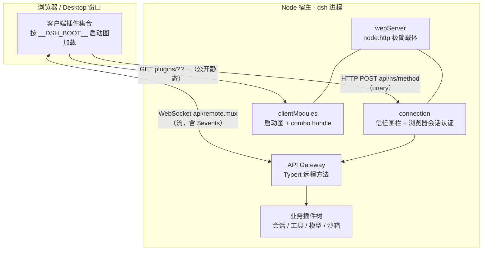
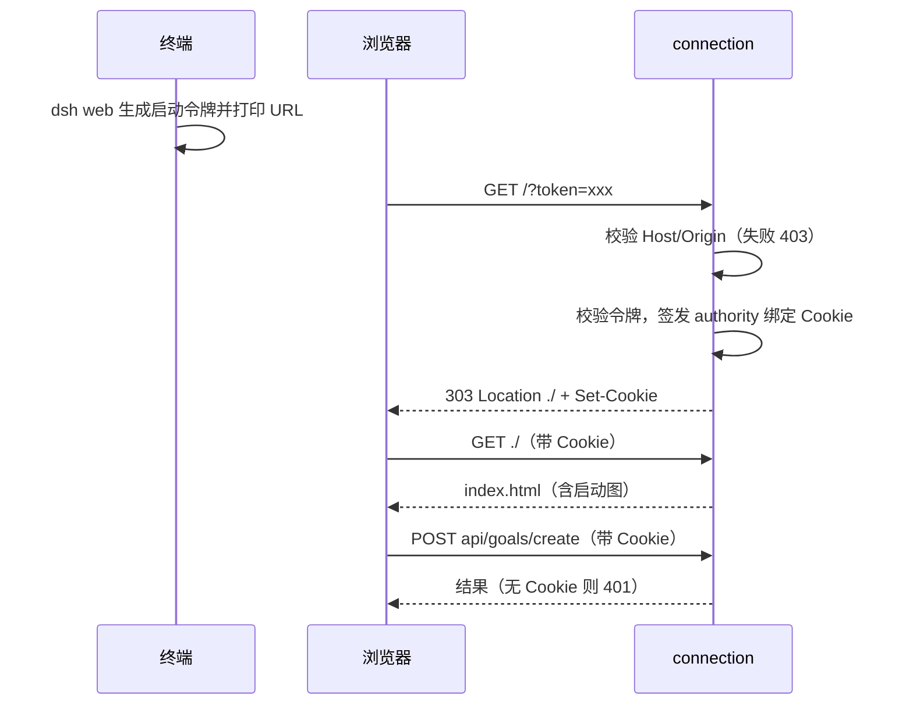
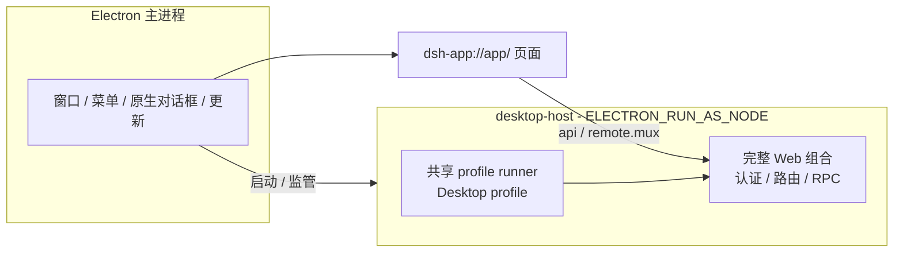

# 第 11 章 Web 前端与宿主通信：前端也是插件

> 到这里，我们一直在看宿主这一侧。这一章看另一半：浏览器里的 Web UI 怎么和宿主通信，Desktop 又是怎么"包"住它的。DSH 在这里有一个反直觉的设计——**前端本身也是插件**。理解它，你就理解了 DSH"一切皆插件"贯彻到底的决心。

> **本章你将学到**：
> - 概念：webServer / connection / clientModules / API Gateway、启动图 `__DSH_BOOT__`、双向远程流、Desktop 外壳
> - 设计：为什么"前端也是插件"、为什么要浏览器令牌认证、为什么路由要"相对文档"
> - 动手：用令牌换 Cookie、抓启动图与 combo bundle

> **先分清目录**：`apps/web` 是 Web 应用入口（包 `@deepseek-ai/dsh-web-frontend`，对 `@deepseek-ai/dsh-client-web` 外壳库做 Vite 构建，产物由 `dsh web` 提供）；前端插件散布在 `packages/client/*`；Desktop 是 `apps/desktop`（Electron）+ `apps/desktop-host`。而 `packages/web/*` **不是前端**——那是 Agent 的网页搜索/抓取工具（`tool-web`、`web-fetch-http`、`web-search-deepseek` 等）。

## 11.1 先问"为什么"：前端为什么要做成插件？

大多数产品里，前端是"产品的一部分"：改一个按钮、加一个面板，就是改前端代码。DSH 的思路不同：**每个声明了 `dsh.client` 的包都向浏览器贡献一份客户端代码**，宿主启动时把它们组装成一张启动图。

这意味着：加一个"目标管理"面板、一个"侧栏浏览器"、一个"插件管理页"，都像加工具一样——挂一个插件，而不是改前端仓库。**前端的功能边界，和宿主的功能边界一样，由插件集合决定。**

## 11.2 架构全景：一个端口、两类通道



两类交互的语义不同：

- **unary RPC**：`HTTP POST /api/<namespace>/<method>`，"你问我答"（创建目标、读列表）；二进制结果以 multipart 返回；
- **流**：统一走 API Gateway 持有的一条 WebSocket `/api/remote.mux`，在其上多路复用多条逻辑流。会话事件推送是其中一条名为 `$events` 的逻辑流，开流时先收到一个 `ready` 帧；断线按 500ms、1s、2s、4s、8s 退避重连，上限 10s，也可以 `ctx.connection.reconnect()` 主动重连。

旧版本书提到的 `HOST_EVENTS_PATH` / `MUX_EVENTS_PATH` 与 apiproxy 在当前源码中都已不存在。

## 11.3 webServer：极简 HTTP 载体——"我不懂业务"

`packages/host/webserver`（`ctx.webServer`）是一个不关心业务概念的 `node:http` 服务：

- **命名路由**：`register(route)`，`WebRouteKind` 为 `'exact' | 'prefix'`，重复注册抛错；匹配顺序是精确 → 最长前缀 → fallback；
- **升级路由**：`registerUpgrade(route)`（`WebUpgradeRoute`），WebSocket 走这里；
- **fallback**：`registerFallback(handler)`，由 `dsh-host-frontend-static` 认领，提供前端 dist；
- **首页注入**：`tapIndex(transform)` 之外，还有结构化的注入表——渲染首页时发出 `webserver/index-inject` 事件，各插件往里贡献行，启动图就是这样进入 HTML 的；
- **配置**：`host` 只能是 `'127.0.0.1' | '0.0.0.0'`，`port`，以及 gzip `compression`。Web bundle 的端口是 `ctx.webStartup.port ?? 3080`。

### 设计思考：为什么 webServer 要"不懂业务"？

webServer 只做路由、升级、兜底、注入。它不知道"会话""工具""模型"是什么——connection、clientModules、Gateway 只是在它上面注册路由。**HTTP 基础设施是稳定的，业务是易变的**，把稳定的放在核心、易变的放在外围，是经典的稳定-不稳定分层。

## 11.4 connection：信任围栏 + 浏览器令牌认证

`packages/client/connection` 是前后端通信的门卫，它有两道检查，顺序固定：

**第一道：Host/Origin 信任**（`src/api-request-trust.ts`）。请求的 `Host` 必须是回环地址或匹配 `trustedHosts`；带 `Origin` 时必须与 Host 一致，`sec-fetch-site: cross-site` 直接拒绝。失败返回 **403**。它防的是 DNS rebinding 与跨站请求，**但不建立身份**。

**第二道：浏览器会话认证**（0.1.7 新增的核心变化）。每个 Host RPC 方法与 WebSocket 流都要求一个浏览器会话，没有"回环地址免认证"这一档：

1. 每个进程生成一个随机**启动令牌**，`dsh web` 打印并打开形如 `http://127.0.0.1:3080/?token=...` 的地址；
2. 只有 `GET /?token=` 能用令牌换取一个**签名 Cookie**，然后 303 重定向到干净的 `./`，令牌从地址栏消失；
3. Cookie 与请求的 authority 绑定，`HttpOnly`、`SameSite=Strict`、不设 `Secure`，有效期 `cookieMaxAgeDays`（默认 30 天）；签名密钥是凭据层里的 grant 记录 `client-connection/browser-session`（第 9 章）；
4. 没有或无效 Cookie 的首页与 RPC 请求返回 **401**；静态资源保持公开；不接受其他位置的查询令牌或 `Authorization` 头；目前没有登出。



部署面也随之收紧：`dsh web` **拒绝 `--host 0.0.0.0`**，只能用默认的回环地址；`--trusted-host` 可以追加允许访问的主机。宿主侧，`ctx.connection.admit(request)` 返回操作者的 Peer，`connection.operator` 是对应的 PeerScope，`connection/request` waterfall 允许上游介入。

### 设计思考：只有信任围栏为什么不够？

旧版只有"默认只信 loopback"的围栏。但回环地址并不等于"是你本人"：同一台机器上任何进程、任何能让浏览器发请求的网页（借助 DNS rebinding 等手法）都可能碰到 `127.0.0.1:3080`。围栏回答的是"请求从哪来"，令牌回答的是"请求是谁发的"——**可达性与身份是两件事**。每进程随机的启动令牌 + authority 绑定的 HttpOnly Cookie，让"能访问端口"不再等于"能驱动 Agent 读文件、跑命令"。

## 11.5 clientModules：启动图 `__DSH_BOOT__`

浏览器打开首页时，HTML 里有一段 `window.__DSH_BOOT__`，这是宿主生成的**启动图**。它的工作方式（`packages/client/modules`，`ctx.clientModules`）：

1. **扫描**：扫描宿主 Loader 条目里声明 `dsh.client` 且导出 `exports["./client"]` 的包（增量扫描）；
2. **构图**：生成 `WebBootGraph { rev, entries: WebBootEntry[], batches: WebBootBatch[] }`，批次分 `bootstrap` 与 `application` 两个阶段；声明里的 `inject`、`immediately` 影响依赖与预取；
3. **服务**：客户端代码按**combo 地址**提供：`GET /plugins/??<pkg-a>/client.js,<pkg-b>/client.js&rev=<rev>`，一个请求拼接多个包，单个包也用同一形式（也是 HMR 的路径）；未知或过期的 `rev` 返回 404，而不是把 SPA 的 HTML 当 JS 返回；
4. **注入**：启动图、预加载与引导脚本作为 `webserver/index-inject` 的行写进首页，`<` 被转义，插件控制的字符串无法跳出 script 元素；
5. **HMR**：开发时由 `dsh-client-hmr` 通知浏览器热替换。

浏览器侧由 `packages/client/web`（`dsh-client-web`）引导：按启动图加载模块系统，**先激活所有客户端插件再挂载应用**，并用一个无框架的引导页逐项报告状态——某个 bundle 坏了会停在可见的错误上，而不是白屏。它还定义了共享模块表 `PLATFORM_MODULES`（React、Cordis 等），每个动态 bundle 都对它解析外部依赖。

包声明示例（package.json 的 `dsh` 字段，示意）：

```json
{
  "exports": { "./client": "./lib/client.js" },
  "dsh": {
    "client": {
      "platform": "web",
      "immediately": true
    }
  }
}
```

### 设计思考：为什么需要"启动图"而不是"前端自己 import"？

前端是插件集合时，**浏览器在运行时才知道有哪些客户端插件**——所以必须由宿主在启动时扫描并生成一张图，告诉浏览器"去加载这些、按什么顺序"。`__DSH_BOOT__` 的本质是：**把"哪些前端插件存在"这个事实，从编译期搬到了启动期**。combo 地址则是它的性能补丁：插件多了以后，一个插件一个请求会拖慢首屏，拼接 + 带版本号的不可变缓存把代价压了下来。

## 11.6 相对文档的路由：换个挂载点也能跑

如果你在反向代理后面把 DSH 挂到 `https://example.com/dsh/`，代理剥掉前缀再转发，那么浏览器里任何写死 `/api/...` 的请求都会打到源站根而落空。0.1.7 的解法（2026-09-14 / 09-17 两份决策）：

- 首页只有一个 `<base href="./">`，浏览器侧的引用一律写成相对形式 `api/x`、`plugins/x`；
- 服务端注册键保持绝对；每个功能包在绝对键 `*_PATH` / `*_ENDPOINT` 旁派生浏览器形式 `*_ROUTE`（如 `SESSION_LOG_EXPORT_PATH` / `SESSION_LOG_EXPORT_ROUTE`、`FILE_UPLOAD_PATH` / `FILE_UPLOAD_ROUTE`），浏览器代码只用 `*_ROUTE`；
- 门禁 `verify-client-route-resolution` 在 hygiene 与 CI 中运行，拒绝浏览器源码里根绝对、协议相对或绝对的应用路由（`api`、`plugins`、`open-in-app` 前缀）；
- `apps/web/tests/public-mount.e2e.ts` 端到端覆盖剥离前缀的代理；Desktop 用 `dsh-app://app/` 加载页面，流地址由 `streamBaseUrl` 给出。

### 设计思考：为什么用门禁而不是靠自觉？

"别写绝对路径"是一条每个人都同意、却每个新功能都可能忘记的规则。一旦忘了，只会在"挂在子路径的代理后面"这种少见部署里暴露，本地开发永远测不出来。**把约定变成静态检查**，让回归在 CI 里就失败，这是 DSH 对所有"跨层不变式"的一贯做法。

## 11.7 API 层：Typert 远程方法与双向流

业务能力对浏览器暴露为 Typert 远程方法（第 12 章）。浏览器端调用看起来是普通的类型安全函数：

```ts
await ctx.remote.goals.create(agentId, { objective: '发布 v1' })
// 作用域形式：agentCtx.remote.goals.create({ objective: '发布 v1' })
```

0.1.7 新增了**双向远程流**：宿主方法可以返回 `RemoteStream<Out, In>`，客户端拿到 `RemoteStreamHandle<Out, In>`，既能迭代下行数据，也能 `send` / `end` 上行、`dispose` 释放。宿主侧用 `this.ctx.invocation.uplink<In>()` 读上行，`this.ctx.invocation.peer` 知道调用者是谁。

- 帧：客户端 `open` / `item` / `end` / `cancel`，服务端 `item` / `error` / `end`；
- 每条逻辑流的上行缓冲上限 `streamInboxBytes`（默认 262144 字节），超出以 `gateway/uplink-overflow` 失败；协议错误为 `gateway/protocol`，上行数据校验失败为 `gateway/input-invalid`；
- 终端 attach 与双向 `$events` 暂缓。

### Web 客户端的分层

`docs/subsystems/web-client.md` 把浏览器侧分成几层：宿主应用 → 传输（connection / API Gateway / api remotes）→ 客户端模型（`session-controller`、`workspace-controller` 的 client 半边）→ UI 适配器 → 会话视图 → 插槽与渲染器。插件通常只在最后两层贡献内容。

## 11.8 Desktop：Electron 外壳包住完整的 Web

`apps/desktop`（`@deepseek-ai/dsh-desktop`）是 Electron 外壳，`apps/desktop-host`（`@deepseek-ai/dsh-desktop-host`）是它私有的 Node 模式宿主进程。关键决定是**"Web 包装"**：

- 私有 Desktop Host 用 CLI 共享的 profile runner 运行 Desktop profile，于是**完整的 Web 组合**（认证、路由、RPC）原样运行；Electron 只负责窗口、菜单、原生对话框、崩溃恢复与更新；
- 页面通过 `file://` / `dsh-app://app/` 加载，不经 webServer 提供资源；
- 保留 profile `.dsh/profiles/desktop`，CLI 拒绝使用这个名字；
- Electron 以 `ELECTRON_RUN_AS_NODE=1` 加 `--expose-internals` 运行宿主与 pnpm，不另带 Node 二进制；
- **Primary runtime**：Desktop 附带 Python、Node.js、pnpm 以及数据与 Office 相关库，安装到 Harness home，并写一份 `runtime.json` 清单；
- 同一个发行号同时锁定 `@deepseek-ai/dsh` 与 `@deepseek-ai/dsh-desktop-host`；更新客户端是强制的。



### 设计思考：为什么 Desktop 不"另写一套"？

另写一套 Desktop 专用的 IPC，意味着认证、路由、RPC 要维护两份，并且永远在追赶 Web 的新功能。"Web 包装"让 Desktop 自动继承 Web 的一切，Electron 只做浏览器做不到的事（原生菜单、对话框、更新、恢复）。**差异最小化**，把平台特有的部分收窄到最薄的一层。

## 11.9 两个新插件：侧栏浏览器与插件管理

两者都是"前端也是插件"的样板：

- **侧栏浏览器** `@deepseek-ai/dsh-client-ui-sidebar-browser`（`packages/client/ui-sidebar-browser`）：右侧栏的 `browser` 标签页。在 Web 上是带 `sandbox` 属性的 iframe，在 Desktop 上是 `<webview>`；只接受 http/https 地址。
- **插件管理页** `packages/client/ui-plugin-manager`：侧栏入口，后端服务是 `packages/boot/plugin-manager`，与 `dsh plugin` 命令共用。引导式安装先 `inspect`（对注册表名通过 `pnpm view` 查询），安装失败或取消时恢复 `package.json` 与 `pnpm-lock.yaml`；注册表按 `registry` → `fallbackRegistries`（默认含 npmmirror）依次尝试，私有注册表不会回落到公共注册表，失败时由 `failedAt` 指明卡在哪一步。

## 11.10 动手实验：令牌、启动图与 combo bundle

在 deepseek-harness 根目录的 Windows PowerShell 中执行，先 `corepack pnpm run build`，再 `corepack pnpm dsh web`，从终端输出复制带 `?token=` 的地址。

1. **体验认证**：不带 Cookie 直接请求首页，应得到 401：

```powershell
curl.exe -s -o NUL -w "%{http_code}`n" http://127.0.0.1:3080/
```

2. **用令牌换 Cookie 并抓启动图**（把 `<token>` 换成终端里的值）：

```powershell
curl.exe -s -c dsh-cookie.txt -L "http://127.0.0.1:3080/?token=<token>" | Select-String __DSH_BOOT__
```

观察 `entries` 和 `batches`：哪些在 `bootstrap` 阶段，哪些在 `application` 阶段。

3. **找 combo 地址**：在同一份 HTML 里找 `plugins/??` 开头的地址（注意它是相对路径），用 `curl.exe` 下载，确认静态资源不需要 Cookie；把 `rev=` 改掉再请求，确认得到 404。
4. **看流**：浏览器 DevTools → Network → WS，找到 `remote.mux` 连接，观察 `$events` 流开头的 `ready` 帧。
5. **看门禁**：阅读 `.agents/notes/implemented/architecture/2026-09-17-web-feature-routes-and-route-gate.md`，再在任一客户端插件源码里找一处 `*_ROUTE` 的用法。

## 11.11 常见坑

- **把启动令牌地址分享出去**：令牌在进程生命周期内有效，谁拿到都能换到 Cookie；
- **浏览器代码里写 `/api/...`**：挂在子路径代理后会落空，门禁会拦；用 `*_ROUTE`；
- **试图 `--host 0.0.0.0` 暴露给局域网**：`dsh web` 会拒绝；
- **改动客户端包后没构建**：combo bundle 是构建产物，开发时用 `corepack pnpm run dev:web`；
- **把敏感能力做成无校验的远程方法**：输入校验与权限判断都在宿主端（第 12 章的 Host-only 校验）；
- **在 webServer 里直接塞业务逻辑**：业务走 connection / clientModules / Gateway 或你自己的插件；
- **把 `packages/web/*` 当前端**：那是网页搜索/抓取工具。

## 11.12 思考题

1. "前端也是插件"让 UI 可组合，代价是什么？（提示：加载顺序、共享模块表 `PLATFORM_MODULES`、启动期扫描、combo 请求的 URL 长度上限）
2. 信任围栏回答"从哪来"，令牌 Cookie 回答"是谁"。如果要给团队在公网共享一个 DSH，现有机制还缺什么？（提示：登出、多用户、`Secure` Cookie、TLS 终止）
3. 所有流复用一条 `remote.mux` WebSocket，而不是每条流一个连接。这样做得到了什么、又承担了什么风险？`streamInboxBytes` 在其中扮演什么角色？
4. Desktop 选择"包装完整 Web"而不是"另写原生 IPC"。请举出一个 Web 做不到、必须由 Electron 负责的能力，并说明它为什么不适合放进 Web 组合。

## 小结

- 前端也是插件：`dsh.client` 声明 → 启动图 `__DSH_BOOT__`（bootstrap / application 批次）→ combo bundle `plugins/??…&rev=` → HMR；
- webServer 是极简载体：register / registerUpgrade / registerFallback / 首页注入表；
- 通信：unary 走 `POST /api/<ns>/<method>`，流走 `/api/remote.mux` 多路复用（含 `$events`），支持双向 `RemoteStream<Out, In>`；
- 安全：Host/Origin 围栏（403）+ 启动令牌换 authority 绑定 Cookie（401），`dsh web` 拒绝 0.0.0.0；
- 路由相对文档（`<base href="./">` + `*_ROUTE`）并由门禁维持；
- Desktop = Electron 外壳 + 私有 Host 运行完整 Web 组合，附带 primary runtime；侧栏浏览器与插件管理页都是客户端插件。

下一章：Typert——一个 `@Remote` 装饰器，怎么同时产出宿主实现、客户端类型和校验？
