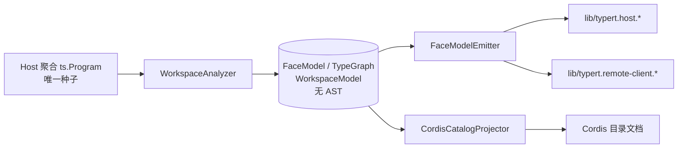
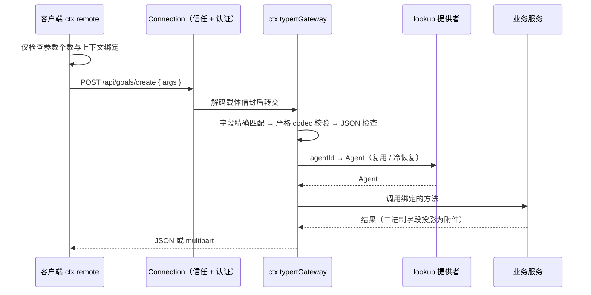

# 第 12 章 Typert：类型安全 RPC——让错误在构建时暴露

> 第 11 章出现了一行调用：`ctx.remote.goals.create(agentId, ...)`——在浏览器里，它看起来像调用本地函数。这一章讲支撑它的系统：**Typert**。它把一个很老的工程难题（前后端类型不匹配）用很新的方式解决：从 TypeScript 类型图生成 RPC 契约。

> **本章你将学到**：
> - 概念：`@Remote` / `@RemoteScope`、lookup 与 Context、生成器、运行时网关、流式方法、SRC 回退
> - 设计：为什么是编译期类型图、为什么模型要"与编译器无关"、为什么输入只在宿主校验
> - 动手：改一个 Remote 方法名感受构建期报错，用声明映射从调用跳到实现

## 12.1 先问"为什么"：前后端类型安全的痛点

浏览器要调宿主的业务方法（比如"给某个 agent 创建目标"）。朴素做法是手写 HTTP 接口 + 手写客户端类型——但这样会掉进三个坑：

- **类型漂移**：宿主改了方法签名，客户端还按老类型调用——编译期谁都不知道，运行时才炸；
- **复杂对象没法过线**：宿主里的 `Agent` 是一个活对象（有会话、有句柄），JSON 序列化不了；
- **校验写两遍**：宿主要校验参数，客户端也要校验——两份代码，两份 bug。

传统方案（tRPC、gRPC、OpenAPI）各有各的答案，但大多要求**契约单独声明**（手写 schema、proto、OpenAPI 文件）。Typert 的赌注是：**契约不需要单独声明——它就在 TypeScript 类型里**。

`packages/typert/` 下有四个包：

| 包 | 角色 |
|---|---|
| `dsh-typert-protocol` | 装饰器、网关绑定、可合并扩展的协议映射、调用描述符、`RemoteError`；不做任何 TS 分析 |
| `dsh-typert-generator` | 构建期严格分析 Remote 签名与类型图，生成产物 |
| `dsh-typert-loader` | 包挂载时把其生成的反射与 schema 工厂贡献进注册表，卸载时撤回 |
| `dsh-typert-registry` | 宿主侧 `ctx.typert`：放置描述符、schema，持有 lookup 与 Context 提供者 |

网关本身在 `packages/api/`：`@deepseek-ai/dsh-api-gateway` 提供宿主侧 `ctx.typertGateway` 和客户端侧 `ctx.remote`；`@deepseek-ai/dsh-api-remotes` 负责显式选择并挂载哪些 Remote 贡献；Agent/Session 的 lookup 策略归 `@deepseek-ai/dsh-api-session-controller`。

## 12.2 设计思考：为什么是"编译期类型图"而不是"运行时反射"？

既然类型已经在 TS 里了，为什么不直接在运行时读装饰器、推断类型、动态生成校验？原因有三：

1. **TS 类型在运行时不存在**：接口、泛型、条件类型编译后全没了。运行时反射只能拿到"装饰器上写了什么"，拿不到类型本身；
2. **可审计性**：编译期生成是"可检查的产物"——`lib/typert.remote-client.d.ts` 就摆在构建产物里，客户端签名长什么样一目了然；
3. **构建期即校验**：生成器在构建时跑，签名不合规直接构建失败——**错误在 CI 里暴露，而不是在用户面前**。

代价是改签名必须重新构建，开发循环变重。DSH 的折中是源码模式的 SRC 回退（12.8 节）——开发时宿主能跑，发布时严格。

## 12.3 声明一个 Remote 方法：代码在回答什么

```ts
// 示意骨架（形状与 docs/api-gateway.md 一致）
export class GoalService extends TypertRemoteService {
  constructor(ctx: Context) {
    super(ctx, 'goals') // 显式绑定 Cordis 服务键与默认 Remote 命名空间
  }

  @Remote('create')
  createForClient(agent: Agent, request: CreateGoalRequest, signal: AbortSignal): CreateGoalResult {
    signal.throwIfAborted()
    return this.create(agent, request)
  }
}
```

每个要点都在回答一个设计问题：

- **显式绑定**：服务继承 `TypertRemoteService`；如果已有别的基类，就声明 `readonly typertRemote = bindTypertRemote(this, serviceKey)`。两种方式都留下可检查的公开绑定，**不依赖编译器往构造函数里偷偷注入符号**；
- `@Remote('create')`：把 `createForClient` 暴露为远程方法 `goals.create`——**方法名和远程名解耦**；
- **对象不过线**：`Agent` 通过 `TypertLookupMap` 声明映射，线上只有 `agentId` 字段，网关在宿主侧把 id 解析回真实对象——**线路上只有 id，对象永远留在宿主**；
- **取消是协议的一部分**：可选的最后一个 `signal: AbortSignal` 参数不进线上参数列表，由载体的取消信号驱动；
- `@RemoteScope('agent', 'current')`：先通过 `ctx.typert.contexts` 把身份解析成作用域 Context，再从中取服务调用——适合依赖会话级组合、不需要显式接收 `Agent` 的方法。

严格规则也要记住：Remote 必须是**公开、非静态、非泛型的实例方法**；参数必须是必填的简单命名标识符，**不能解构、默认值、rest 或可选参数**。普通 JSON 可表示的类型生成严格 schema；复杂对象必须有唯一的 `TypertLookupMap` 声明。

### 流式方法

`@Remote({ mode: 'stream' })` 标记返回 `Iterable`、`AsyncIterable` 或 `RemoteStream<Out, In>` 的方法。网关把每个产出项通过 `/api/remote.mux` 多路复用 WebSocket（或进程内载体）送达，生成的客户端方法返回 `RemoteStreamHandle<Out, In>`：可迭代下行项，也能 `send` / `end` / `dispose`。第二个类型参数 `In` 声明上行项类型；上行项来自浏览器，网关会**用生成的 `In` codec 逐项校验**，宿主方法再通过 `this.ctx.invocation.uplink<In>()` 读取。上行数据既不进 `args`，也不进参数列表。

## 12.4 生成器：一个与编译器无关的模型

`packages/typert/generator` 是 Typert 的大脑。0.1.7 把它重构成两段：

1. **分析**：`WorkspaceAnalyzer` 读取 TypeScript 程序，产出与编译器无关的 `FaceModel` / `TypeGraph` / `WorkspaceModel` 数据——**不保留任何 AST 节点**；
2. **发射**：`FaceModelEmitter` 只读这份模型，产出可执行 JS（含 Zod 工厂）与 `.d.ts`；同一份模型还喂给 `CordisCatalogProjector`，生成 Cordis 目录文档。

生成器有 `check` 与 `write` 两种模式：语法/语义错误、缺失公开注解、私有跨包引用都直接失败——**生成器同时是构建期的类型检查器**。运行时的 `dsh-typert-registry` 则**在首次使用时才物化 schema**，避免启动时为用不到的方法付出代价。



### 设计思考：为什么模型要"与编译器无关"？

旧的生成器边分析 AST 边发射代码，分析与发射纠缠在一起：想加一个新产物（比如目录文档），就得再走一遍 AST；想测试发射逻辑，就得先构造一个 `ts.Program`。把中间层抽成**纯数据模型**之后，分析只做一次，发射器变成"数据进、文本出"的纯函数，可以独立测试、独立扩展。这是编译器领域"前端 / IR / 后端"分层的老智慧——**中间表示让 N 个输入和 M 个输出不必两两相连**。

## 12.5 构建流水线与产物

根构建按顺序运行 `build:lib:host` → `build:lib:client` → `build:web`：

- **Host 阶段**：先 `tsc -b tsconfig.host.json`，再 `tsdown --env.DSH_BUILD_FACE host`。生成器在这一轮 tsdown 中运行，**以 Host 聚合为唯一的 `ts.Program` 种子**；
- **Client 阶段**：`tsc -b tsconfig.client.json` 与 `tsdown --env.DSH_BUILD_FACE client`，消费刚生成的 Remote 客户端声明，**不再启动 Typert**。

旧版本书说生成器用 host/client 两个独立程序分析，这已不准确：Remote 生成只有 Host 一个种子。

每个贡献 Remote 的业务包，把生成文件写到**自己的 `lib/`**（不是源码目录）：

| 文件 | 消费者 | 内容 |
|---|---|---|
| `typert.host.js` / `.d.ts` | 宿主 Loader / 类型系统 | Host 面反射、严格调用描述符、schema 注册值 |
| `typert.remote-client.js` | `api-remotes` | 可挂载的 `TypertRemoteContribution`：严格描述符与运行时 codec |
| `typert.remote-client.d.ts` | 客户端类型系统 | 对 `TypertRemoteNamespaceMap` / `TypertRemoteScopeMap` 的声明合并 |
| `typert.remote-client.d.ts.map` | 编辑器 | 把生成的方法属性映射回宿主包里的 `@Remote` 声明 |

业务包通过 package.json exports 公开 `./typert`（宿主 Loader 入口）与 `./remote`（Host-for-Client 入口）；生成器会校验这些导出与发布文件清单，**只为显式提供入口的包生成产物**。客户端应用只组装 `@deepseek-ai/dsh-api-remotes`，由它导入选中业务包的 `/remote` 子路径，通过 `ctx.remote.$mount()` 挂载——**哪些宿主方法对客户端可见，是客户端组合者的显式选择**。

那个 `.d.ts.map` 是一个小而贴心的设计：支持声明映射的编辑器里，在 `ctx.remote.goals.create` 上"跳转到定义"，会直接落到宿主包里那个带 `@Remote` 的真实方法，而不是停在生成的 `.d.ts` 上。

### 设计思考："客户端只信构建产物"

**客户端不从运行中的宿主发现装饰器——它只信任构建产物**。"运行时发现"意味着客户端类型依赖宿主进程的状态，是非确定性的；构建产物是确定性的：同样的代码，永远生成同样的契约。**用一点构建时的不便，换运行时的确定性**——这是 Typert 最核心的取舍。

## 12.6 运行时：一次调用走过哪些关卡

客户端调用 `connection.rpc.call('/api', '<namespace>/<method>', { args }, signal)`，HTTP 载体把它映射为 `POST /api/<namespace>/<method>`，请求体只有一个具名的 `args` 对象。



- **输入只在宿主校验**（2026-09-15 起）：客户端挂载贡献时校验描述符完整性，调用时只检查参数个数与上下文绑定，然后原样转发；宿主网关按"字段精确匹配 → 严格 codec → JSON → lookup"的顺序校验，绕过生成 API 的畸形调用得到 `gateway/input-invalid`。副作用是：对象里未声明的属性会先经过载体，到宿主才被 codec 剔除——**客户端解析不再是脱敏步骤**，从含秘密的对象派生请求时必须构造只含声明字段的 DTO；
- **每次调用都从当前注册表解析**描述符与存活服务，不缓存业务对象；缺提供者、未知身份、绑定不匹配、参数缺失或多余、schema 失败、方法不存在，都在进入或离开业务代码前失败；
- **二进制结果**：`Uint8Array` 字段被网关投影为结果相对的字节附件，由 Connection 以 multipart 返回；客户端用生成的结果 codec 校验解码后的二进制结果；
- **失败词汇**：统一为 `RemoteError<Code>`（带 `code` 与 `details`，结构标记 `isDSHRemoteError`）。网关自身的码都以 `gateway/` 开头，例如 `gateway/lookup-unavailable`、`gateway/input-invalid`、`gateway/method-unavailable`；业务或 lookup 抛出的已分类 `RemoteError`（如 `session/not-found`、`session/agent-busy`）原样上线，只有未分类的异常折叠为 `gateway/internal`；
- **卸载**：卸载客户端贡献会移除描述符与方法、中止在途调用，外部持有的陈旧方法句柄后续调用直接拒绝；宿主上撤回的严格端点**不会降级为 SRC 推断**，防止热卸载悄悄削弱校验。

### 设计思考：为什么把校验"只"放在宿主？

"两边都校验"听上去更安全，其实是第 12.1 节"校验写两遍"的变体：客户端 codec 要跟着构建产物走，宿主 codec 要跟着运行中的代码走，两者一旦版本错位，就会出现"客户端拒绝了宿主其实接受的请求"这类诡异问题；而且客户端校验**从安全上讲毫无意义**——浏览器里的代码可以被绕过。输入来自不可信的一端，就在可信的一端校验一次、校验到位。客户端只保留不会与宿主意见相左的结构性检查（参数个数、上下文绑定）。附带的收益是性能：正常调用不再在浏览器里实例化并执行 Zod schema。

## 12.7 lookup 与 Context：id 是持久的，对象是临时的

- **注册**：lookup 提供者的 `ctx.typert.lookups.register()` 同时提供稳定声明与默认解析器；`configure()` 让宿主组合提供一个可异步、随 effect 生命周期作用的解析器。没有提供者时调用以 `gateway/lookup-unavailable` 失败；
- **标准语义**：`agent` / `session` 的解析归 `@deepseek-ai/dsh-api-session-controller`：复用存活的 Agent，普通冷会话自动恢复，并发恢复去重，拒绝归子 agent 路由所有的身份；`session` lookup 返回该 Agent 的 Session。恢复失败与归属栅栏分别抛出 `session/not-found`、`session/agent-busy`；
- **作用域签名**：当一个 `@Remote` 方法恰有一个 lookup 参数、且同名 `TypertContextMap` 使用同一线上身份时，生成的作用域签名会省略这个身份参数——于是有了 `agentCtx.remote.goals.create({ objective })` 这种不必传 `agentId` 的形式。

旧版本书说冷恢复语义由 `packages/api/remotes` 的 `agentFor()` 提供，这已不准确：`api-remotes` 只负责选择与挂载贡献，身份策略在 session-controller。

## 12.8 SRC 开发回退：开发时能跑，发布时严格

从源码启动宿主（`node --import tsx/esm`，也就是 `corepack pnpm dsh` 的方式）时不运行 Typert 编译器插件。此时：

- 标准装饰器初始化器仍在服务原型上记录方法名与调用模式，`TypertRemoteService` / `bindTypertRemote()` 提供显式绑定，网关据此构造一个较弱的临时描述符，**无需启动 `ts.Program`**；
- 从活函数解析简单参数名：命中已注册 lookup 的 `agent` / `session` 用对应的 `agentId` / `sessionId` 字段；其他参数只检查"无环、JSON 安全、无特殊原型"；
- 不读 TS 类型、不生成 Zod schema、不推断可选参数，不支持解构、默认值、rest、重复参数名；
- **客户端拒绝挂载缺少严格 codec 的 SRC 描述符**，其类型、codec 与注册值永远来自最近一次生成的 `lib/typert.remote-client.*`。

`corepack pnpm run dev:web` 会先完整构建一次再启动源码宿主，之后的 watcher 只重建客户端面，**不会重新分析宿主装饰器**——所以改了 Remote 签名，仍要重跑完整构建。这个回退的边界划得很清楚：**开发体验可以打折，生产契约不打折**。

## 12.9 与同类方案的对照：tRPC / gRPC / OpenAPI

| | Typert | tRPC | gRPC | OpenAPI/REST |
| --- | --- | --- | --- | --- |
| 契约来源 | TS 类型图（构建期生成） | TS 类型（类型层推导） | 手写 .proto | 手写 OpenAPI |
| 运行时校验 | 宿主侧生成的 Zod codec | 需自选校验库 | 代码生成 | 靠工具链 |
| 复杂对象 | lookup 映射 id | 需自行序列化 | message 定义 | JSON 手动映射 |
| 双向流 | `RemoteStream<Out, In>` | 订阅 | 原生双向流 | 需另行设计 |
| 跨语言 | 否（TS 专属） | 否（TS 专属） | 是 | 是 |

Typert 的定位很明确：**为 TS 全栈的复杂对象映射而生**。它放弃了跨语言，换来"类型即契约"的零声明成本和 lookup 的对象桥。选型口诀：TS 全栈且对象复杂 → Typert/tRPC；需要跨语言 → gRPC；需要公共 API 给第三方 → OpenAPI。

## 12.10 动手实验

在 deepseek-harness 根目录的 Windows PowerShell 中执行。

1. **找真实方法**：`rg -l "@Remote\(" packages -g "*.ts" -g "!*.spec.ts" -g "!*.test.ts"`，挑 3 个读它们的参数、lookup 与 `mode`。排除测试后，当前有二十余个源文件包含 `@Remote(`。
2. **读身份策略**：打开 `packages/api/session-controller` 的 README，找到"复用存活 Agent、冷恢复、去重、子 agent 栅栏"的描述。
3. **感受构建期报错**：给某个 Remote 方法的参数加一个默认值（例如 `request: X = {}`），运行 `corepack pnpm run build:lib`，观察生成器拒绝；改回后再构建。
4. **看产物**：构建后打开任一贡献包的 `lib/typert.remote-client.d.ts`，看生成的客户端签名；在编辑器里对 `ctx.remote.<ns>.<method>` 调用"跳转到定义"，确认借助 `.d.ts.map` 落到宿主源码。
5. **看宿主校验**：`corepack pnpm dsh web` 并登录后，在浏览器 DevTools 里观察一次 `POST api/<ns>/<method>` 请求的 `args` 结构。

## 12.11 常见坑

- **改签名不重新构建**：客户端用的是构建产物，`dev:web` 的 watcher 不会重新生成 Remote 声明；
- **用可选参数、默认值、解构**：严格分析直接拒绝；把可选性放进一个请求对象的字段里；
- **把不该过线的对象放参数里**：只有声明了 lookup 的类型才能过线，其他必须是 JSON 可表示的数据；
- **以为客户端会替你校验或脱敏输入**：输入只在宿主校验，未声明字段会先上线再被剔除；
- **长任务硬塞进 unary**：需要持续反馈时用 `@Remote({ mode: 'stream' })`，或返回 job 句柄（第 13 章）；
- **忘了在调用方声明依赖**：读 `ctx.remote.<namespace>` 的业务包要在自己的 `inject` 里同时声明 `remote` 与 `remote.<namespace>`；
- **绕过类型硬拼字符串调用**：等于放弃 Typert 的全部价值。

## 12.12 思考题

1. "客户端只信构建产物"换来了确定性。如果插件要在运行时动态添加一个 Remote 方法，Typert 支持吗？SRC 回退能解决这个问题吗？为什么客户端仍然拒绝 SRC 描述符？
2. lookup 把 `Agent` 映射成 `agentId`。如果方法需要传"一组 agent"呢？严格分析要求复杂对象有唯一的 `TypertLookupMap` 声明，这种"复杂对象过线"的问题，本质上是序列化的什么问题？
3. 输入校验从"两端都做"改为"只在宿主做"。请列出这个决定的收益与代价；"未声明的属性先经过载体、到宿主才被剔除"会不会成为安全问题？调用方应该怎么防范？
4. 生成器被重构为"分析 → 无 AST 的模型 → 发射"。如果要新增一种产物（比如为某个外部协议生成描述文件），在旧架构与新架构下分别要改哪些地方？

## 小结

- Typert = 编译期类型图 → RPC 契约（宿主 Zod codec + 客户端声明与贡献），契约不需要单独声明；
- `@Remote` / `@RemoteScope` 声明，显式服务绑定（`TypertRemoteService` / `bindTypertRemote`），lookup 把宿主对象映射成线上 id，`mode: 'stream'` 支持双向 `RemoteStream`；
- 生成器以 Host 聚合为唯一种子，经无 AST 的 `FaceModel` / `TypeGraph` 发射产物，兼做构建期类型检查；产物带声明映射，可从调用跳到实现；
- 输入只在宿主校验，失败统一为 `RemoteError`，`gateway/*` 码与业务码原样上线；
- 客户端只信构建产物；源码模式有 SRC 回退：开发时能跑，发布时严格。

下一章：进阶能力与生态——子 Agent、技能、工作流、外部协议，以及"让模型改自己运行时"的危险玩具。
