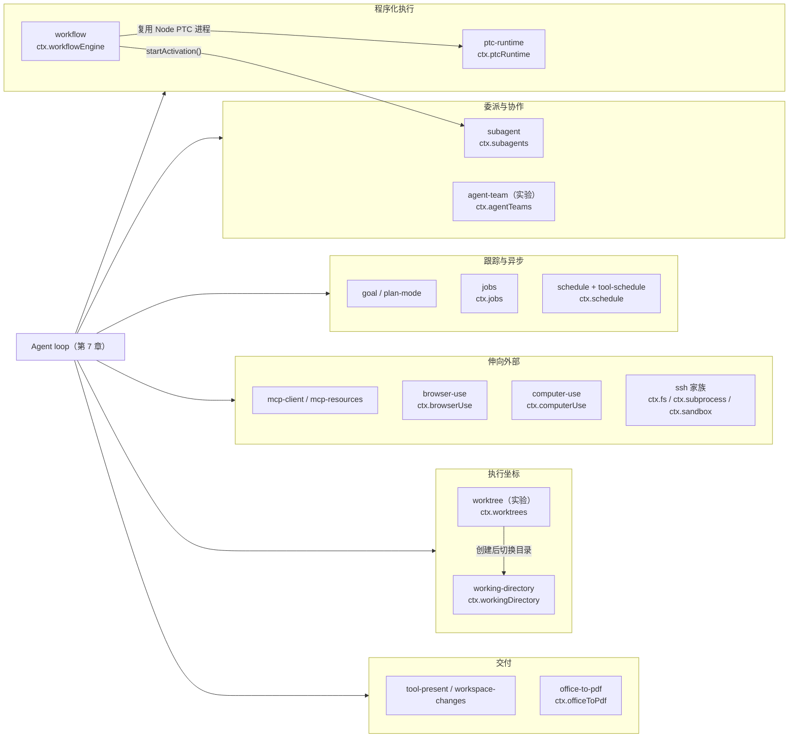
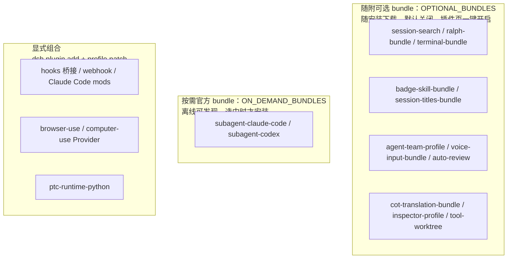
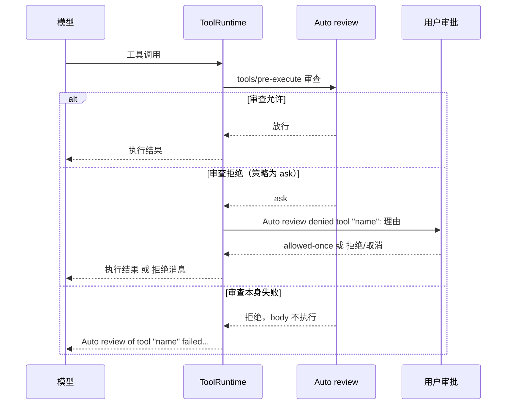

# 第 13 章 进阶能力与生态：Agent 的组合方式

> 前十二章讲的都是"单个 Agent 的完整骨架"。这一章扩展视野：Agent 怎么委派给别的 Agent？怎么加载技能、写程序、跟踪目标、定时提醒？怎么伸手到浏览器、桌面和远端机器？怎么被外部产品接入？怎么换一个目录、开一个 worktree 干活？——以及一个危险的问题：**模型能不能改自己的运行时？**

> **本章你将学到**：
> - 概念：子 Agent 与 activation、技能、PTC 程序执行与工作流、计划/目标/Schedule、Jobs、交付物与文档预览、MCP/浏览器/电脑/SSH、随附可选 bundle 与按需官方 bundle、hooks/webhook/Claude Code mods 桥接、多入口、会话工作目录与 Git worktree、OTel 通道
> - 设计：委派与上下文经济学、"只注册名称"的 Provider 模式、"随附但默认关闭"的组合策略、创造模式的信任边界
> - 动手：读 headless 组合、创造模式 preset、可选 bundle 清单与 Agent Teams 工具清单
>
> 本章基于源码 `0.2.1-alpha.2`（上一版基准 `0.1.7-rc.2` → `0.2.1-alpha.2`）。本章提到的每个包都在 `packages/<分组>/<包>/README.zh.md` 有中文说明；跨版本的破坏性变更以 `docs/upgrade-guide/<版本>/<主题>/guide.zh.md` 为准，遇到细节以包 README 与升级指南为准。

先用一张图把本章要讲的能力家族摆在一起——它们无一例外都是第 8 章讲过的"接缝 + Provider + 消费方"三角，只是面向的问题不同：



## 13.1 子 Agent（subagents）：把任务交出去

`ctx.subagents` 是"Agent 委派"接缝：主 Agent 可以把任务交给子 Agent。和"自己多调几次工具"不同，子 Agent 有**独立的会话、独立的上下文**，可能运行在进程内，也可能是另一个 Agent 产品。

### 设计思考：为什么要"委派"而不是"自己干"？

模型的上下文窗口是有限的，而"自己干"意味着所有中间过程都占自己的上下文。委派的价值在于**隔离上下文**：子 Agent 用自己的窗口干完活，只把结论汇报回来——主 Agent 的窗口只存放"决策"而不存放"执行细节"。这是 Agent 版的"分而治之"。

### Provider 一览

| Provider 包 | 是什么 |
| --- | --- |
| `subagent-spawn-in-process` | 进程内新开一个全新子 Agent（fresh child） |
| `subagent-fork-in-process` | 进程内分叉：子 Agent 从父级已完成的历史派生 |
| `subagent-acp` | 经 Agent Client Protocol 启动并驱动进程外子 Agent |
| `subagent-codex` | 经官方 app-server 协议运行真实 Codex 子 Agent |
| `subagent-claude-code` | 经官方 Agent SDK 运行真实 Claude Code 子 Agent |
| `subagent-dsh-sdk` | 经 TypeScript SDK 运行另一个进程外 Harness 运行时 |

这张表的读法是：**"子 Agent"是一个接缝**（第 8 章的三角结构）。进程内是默认实现，但同一个接口可以连 Claude Code、Codex、任意 ACP 服务器——`ctx.subagents` 是"委派"这个能力的产品无关化。

上一版里两个进程内 Provider 共用的 `subagent-in-process-driver` 包**已被删除**（升级指南 `v0.2.1-alpha.1/subagent-activations`）。现在本地 Provider 只通过 `prepareContinuable()` 贡献"怎么创建子级"的数据，子 Agent 的创建、驻留、取消与清理统一归 `ctx.subagents` 服务所有；外部 Provider（ACP、DSH SDK、Codex、Claude Code）保留 `start()` 单次执行适配器。

### 统一的 activation：委派一律"先回执、后通知"

笔记 `2026-09-17-unified-subagent-activations` 把上一版的三条路径——前台等待、Job 支持的后台、可继续驻留——合并成一个入口：**`startActivation()`**。

- **模型面**：`tool-subagent` 的 `subagent` 工具在接纳子级后立即返回 `{ kind: 'activation', subagentId }`，最终答案由运行时以**父级完成通知**送达。上一版的 `run_in_background` 参数、`backgroundMode`、`enableRunInBackground` 配置以及"前台结果 / `{ kind: 'background', jobId }`"结果**都已移除**；子 Agent 也不再经 `job_output`/`job_kill` 收结果或停止。
- **宿主代码**：需要同步拿结果的调用方（例如工作流）用 `delivery: 'caller'`，等待 `activation.result`，再 `dispose()`；调用方投递不会再发父级通知。

```ts
// 最小骨架（参见升级指南 subagent-activations）
const activation = await subagents.startActivation({
  provider: 'spawn',
  label: 'Review changes',
  request: { parent, prompt: [{ type: 'text', text: 'Review these changes.' }] },
  signal,
  delivery: 'caller',
})
const result = await activation.result   // output / stopReason / 可选 structured、diagnostic
await activation.dispose()
```

- **续话与打断**：`tool-subagent-control` 提供 `send_message`、`interrupt_agent`、`list_agents`。Spawn 与 Fork 本地子级可以接收后续消息（组合了持久化与 Session 查询服务时，结算后也能接收）；外部 Provider 只执行一次、不接受后续消息，因此 `send_message` 只对本地子级有效。
- `list_subagent_models` 仍列出子级可选路由与推理强度。

委派深度由 `tool-subagent` 的 `maxDepth` 配置限制：它可以是一个自然数，也可以是 `'provider-managed'`（交给 Provider 自己管）。Provider 不具备 `depthLimit` 能力却配置了数字上限时，挂载阶段就会报错并提示改用 `'provider-managed'`；进程内超限时 `dsh-subagent` 抛出 `SubagentDepthError`（`subagent depth N exceeds maxDepth M`）。

新子 Agent 的执行目录来自启动请求里显式的 `cwd`，未提供时捕获父 Agent 的**当前**工作目录（13.12 节）；`subagent-acp` 与 `subagent-dsh-sdk` 的 `cwd` 配置键已移除（升级指南 `working-directory`）。

### 原生子 Agent bundle：按需安装、全局工具

Claude Code 与 Codex 两个原生集成携带各自的运行时，塞进每次安装太重。笔记 `2026-10-05-official-on-demand-bundles` 的做法是：`ON_DEMAND_BUNDLES`（`packages/boot/app-boot/src/official-bundle-packages.ts`）只列出 `@deepseek-ai/dsh-subagent-claude-code` 与 `@deepseek-ai/dsh-subagent-codex`，安装方内嵌它们的本地化元信息与图标——**插件页离线就能"发现"它们，真正选中时才走普通第三方 bundle 的安装通道**。

升级指南 `native-subagent-bundle-tools` 补充：选中的 bundle 现在除了 Provider，还贡献 Host 行 `tool-subagent-claude-code` / `tool-subagent-codex`，把委派工具注册为 **Host 全局工具**——包括 minimal 在内的所有 preset 都能看到；preset 自己注册的同名工具会遮蔽它。这些原生 Provider 仍支持 `maxDepth: provider-managed`。

### 子 Agent 目录：父会话拥有"我生了谁"

"主 Agent 怎么找到自己的子 Agent？"早期实现是扫描全局会话语料再读每个候选子级的日志——成本随无关会话增长。现在的决策（笔记 `2026-09-01-parent-owned-subagent-catalog`）是：**父会话里的 `subagent/catalog` 事件是直接子级发现的持久权威**。每条事件是一次"创建成功"的事实；只有成功才发布，没有补偿事件或回滚协议；fork 出的会话会忽略继承前缀里的目录事件，不会"继承别人的孩子"。

随后又做了两次减法：目录只保留成员关系，不记录创建时的模型路由（`2026-09-16-subagent-catalog-membership-only`）；统一 activation 之后，由父级交付的外部叶子也登记进目录，条目带 `mode: 'external'`——因为它没有可打开的本地 Session（`packages/subagent/subagent/src/catalog.ts`）。执行状态和结果不写进成员记录。

这是第 6 章事件溯源思想的又一次应用：**"谁是我的孩子"是一个事实，由知道它的那一方（父会话）在发生时记下来**，而不是事后从全局推导。

## 13.2 技能（Skills）：可加载的"行为包"

`ctx.skills` 是技能注册表：技能是一段可按需加载的任务指令。它合并各来源的目录，并为每个名称选出一个胜出者。

| 包 | 职责 |
| --- | --- |
| `skill` | 合并任意 Provider 的技能目录、按名称解析胜出技能（`ctx.skills`） |
| `skill-filesystem` | 从项目、自定义与用户目录发现技能，并监视变更 |
| `skill-office` | 随包提供 Word、PowerPoint、Excel 工作流及文件结构检查 |
| `tool-skill` | 发布会话技能目录与模型面的 `skill` 加载工具；也接受用户 `/name` 直接调用 |
| `tool-workspace-dependencies` | `load_workspace_dependencies`：为 Desktop 与 SDK 报告内置 Office 解释器路径与版本 |
| `experimental/skill-badge` | 官方"powered by dsh"徽章技能（**已移入 experimental**，包名仍为 `@deepseek-ai/dsh-skill-badge`） |

启用模型访问前必须至少配置一个来源。徽章技能不再是 base 里的休眠行：base 已省略该行（升级指南 `experimental-package-composition`），用户在插件页开启可选 bundle `@deepseek-ai/dsh-experimental-badge-skill-bundle` 才会插入 `skill-badge` 行。

Office 技能和 `load_workspace_dependencies` 是配套的：Desktop 携带独立的 Python/Node/pnpm 分发（含 python-docx、openpyxl 等库），首次调用该工具时离线安装到 `$DSH_HOME/dsh-runtimes/dsh-primary-runtime` 并返回绝对路径（见 `apps/desktop/README.zh.md`）。随附分发现在裁剪了 NumPy 与 pandas 的上游测试目录（升级指南 `bundled-python-tests`）。Python SDK 运行时 wheel 则**不再内含** Office sidecar 与创作环境，需要显式下载（13.10 节）。

### 设计思考：技能和"系统提示"有什么区别？

系统提示是每次请求都带的（常驻），技能是按需加载的（惰性）。区别在于**成本**：技能描述可能很长，全塞进系统提示会挤占上下文；按需加载让模型"需要时再取"。这是"上下文经济学"的体现——上下文是稀缺资源，一切设计都在优化它的分配。MCP 资源（13.7 节）也遵循同样的"按需读取、不预加载"原则。

## 13.3 程序化执行：PTC 运行时与工作流

### PTC：让模型写一段程序来调用工具

`ptc-runtime` 分组（旧名 code-runtime，笔记 `2026-09-12-ptc-runtime-vocabulary` 统一了词汇）让模型编写一个程序，以普通异步调用的方式调用宿主提供的函数，最后只返回程序的打印输出和返回值。模型面的工具叫 `run_code`（`packages/core/tools/src/ptc.ts` 中的 `RUN_CODE_NAME`）。

| 包 | 角色 |
| --- | --- |
| `ptc-runtime` | 定义 `ctx.ptcRuntime`：针对宿主绑定运行一个程序，报告打印与返回内容 |
| `ptc-runtime-node` | 在全新受管 Node 进程中按已解析的沙箱策略执行 TypeScript；启动方式由 `launch` 配置描述 |
| `experimental/ptc-runtime-python` | 实验性 CPython 后端：现在**要求** `sandbox` 与 `sandboxPolicy`，对每个程序应用共享文件沙箱，无法约束时以 `sandbox-unavailable` 失败（升级指南 `python-ptc-sandbox`） |

每次运行都不保留之前程序的状态；失败作为结果返回，供调用方诊断或反馈给模型。

工具呈现方式现在**只有两种**：`native`（直接函数调用）或 `ptc`（只公开 `run_code`，程序通过生成的 SDK 调用工具）；混合的 `both` 已被拒绝（升级指南 `tool-presentation-mode`、笔记 `2026-10-05-native-or-ptc-presentation`）。Web 组合里，`tools` 行的 `mode` 读取环境变量 `DSH_TOOLS_MODE`（`native|ptc`），这是 `packages/bundle/web-app/cordis.patch.yml` 注释中明确标注的**临时**进程级开关；按 preset 选择应改 `@deepseek-ai/dsh-agent-tool-presentation` 行。另一个细节：工具的 `output.presentationMeta` 投影现在也会在嵌套 PTC 调用中运行（升级指南 `working-directory`），所以投影函数必须是纯函数。

### 工作流：让模型写"编排程序"

`ctx.workflowEngine` 让模型编写一个编排脚本，脚本里的 `agent()` 调用通过 `ctx.subagents` 扇出（调用方投递的 activation），最终返回一个值：

- `workflow`：定义 seam（`ctx.workflowEngine`）；
- `workflow-ptc`：**复用共享的 Node PTC 进程运行时**执行工作流脚本（旧版的 worker 线程实现已被取代）；
- `tool-workflow`：模型面的 `workflow` 工具，支持 `run_in_background`（作为 job 登记，13.5 节）；
- `experimental/tool-ralph`：固定的"全新 Agent 迭代循环"消费者。

Ralph 的位置变化值得单独说。上一版它还是随附组合里 `disabled: true` 的休眠行（笔记 `2026-09-12-ralph-off-in-shipped-defaults`）；现在 `tool-ralph` 移入 `packages/experimental/`，base 与完整 Web preset **直接省略了 Ralph 行**——只把 `disabled` 改成 `false` 的旧 patch 不会再插入它（升级指南 `experimental-package-composition`）。需要时在插件页开启可选 bundle `@deepseek-ai/dsh-experimental-ralph-bundle`：它在一个带 `isolate: { workflowEngine: true }` 的组里插入自己的 `workflow-ptc` 与 `tool-ralph`，因此不依赖 preset 里是否挂了工作流。

为什么工作流从 worker 线程迁到 PTC 进程？笔记 `2026-09-13-workflow-ptc-sandbox-reuse` 说得很直白：worker 线程只把脚本移出宿主事件循环，**逃逸 VM 的代码仍拥有宿主进程的文件权限**；而 PTC 已经有 OS 文件约束、隔离程序状态、有界输出和受管清理。复用它，就不用维护第二套启动器。注意笔记同时强调：**工作流 VM 里的并发/agent 总数计数器不是安全边界**，真正的文件强制、堆限制与进程清理仍由 PTC 及沙箱/子进程 Provider 负责。

### 设计思考：从"决策式"到"程序式"

如果说子 Agent 是"模型委派人"，工作流就是"模型写编排程序"。前者的编排是模型逐步决策，后者是模型一次性写出执行计划再交给运行时执行。**从"决策式"到"程序式"，是自动化程度的跃迁，也是信任风险的跃迁**——所以 DSH 的回答不是"相信脚本"，而是"让脚本跑在和 `run_code` 同一套受管、受沙箱约束的进程里"。

## 13.4 计划、目标与定时提醒

### 计划模式（plan-mode）

`plan-mode` 提供 `ctx.planMode`：激活期间 Agent 先探索和设计再执行，完成后通过 `exit_plan_mode` 把计划呈交用户评审；用户用 `/plan` 命令进入、离开、批准或让 Agent 回去继续规划。它是**引导而非限制**：所有工具仍然可用，沙箱与审批要另行配置。

### 目标（goal）

`goal` 分组让一个会话在重启、恢复和 fork 后继续追求**一个**持久的完成目标：

| 包 | 职责 |
| --- | --- |
| `goal` | `ctx.goals`：每会话一个目标，创建/编辑/暂停/恢复/完成/阻塞/清除 |
| `tool-goal` | 模型工具 `get_goal`、`create_goal`、`update_goal` |
| `command-goal` | 用户 `/goal` 命令（不消耗模型轮次） |
| `goal-round-driver` | 自动续行：把进行中的目标变成连续的 Round |

持久阶段是 `active | paused | blocked | complete`，每次变更递增修订号，调用方用 `GoalRef`（id + revision）做比较并设置。关键设计是：**目标记录"完成状态"，不调度工作**——自动续行必须单独启用 `goal-round-driver`。"目标是什么"和"要不要自动继续干"是两个决定。

### Schedule：Host 拥有的定时提醒

`schedule` 分组现在拆成两个包：

| 包 | 职责 |
| --- | --- |
| `schedule`（`@deepseek-ai/dsh-schedule`） | `ctx.schedule`：Host 级持久提醒，共享管理，投递回原会话 |
| `tool-schedule`（`@deepseek-ai/dsh-tool-schedule`，**新增**） | 模型工具 `schedule_create`、`schedule_list`、`schedule_update`、`schedule_delete` |

拆分背后是一段"进进出出"的组合史，正好说明 profile 机制如何承载破坏性调整：

1. `0.1.7-rc.2` 时 Web 组合以 `disabled: true` 携带 `time-context`、`schedule`、`ui-schedule` 三行；
2. 随后它们被移入实验性的"自动化任务"可选 bundle `@deepseek-ai/dsh-experimental-schedule-bundle`（升级指南 `v0.1.7-rc.2/schedule-optional-bundle`）；
3. 到 `0.2.0-rc.2` 之后该 bundle **退役**（升级指南 `v0.2.0-rc.2/schedule-bundle-retired`、笔记 `2026-09-24-web-default-schedule-composition`）：`@deepseek-ai/dsh-web-app` 在每个 Web profile 中直接挂载 `schedule` 与 `ui-schedule`；`standard`、`cordis`、`ptc` 三个 preset 各自声明时钟读数（`time-context` 行）和 `tool-schedule` 行，`minimal` 两者都不声明（笔记 `2026-09-24-preset-scoped-schedule-tools`、`2026-09-24-preset-scoped-time-context`）。

加载 profile 时，启动器会自动从 `dsh.profile.bundles` 删除已退役的 schedule bundle 并重写 `package.json`；顶层针对 `time-context` 的旧覆盖项不再匹配任何行，应删除。已存储的任务和投递记录一直保留在磁盘上。

几个值得记住的约定（`docs/subsystems/schedule.zh.md`）：

- 记录存在 Host 的 `schedule` storage domain（版本 1）的 `tasks` 表，与原 `sessionId` 绑定；任务必须有标题（去除首尾空白后非空、≤120 字符）；
- 到期提醒作为**普通 follow-up 消息**进入原对话，而不是邮件、短信或推送；同一次扫描中属于同一会话的到期重复提醒合并成一条 follow-up（笔记 `2026-09-24-scheduled-message-framing`）；
- 固定速率间隔最小 **60 秒**（`MIN_EVERY_INTERVAL_SECONDS = 60`，`packages/schedule/schedule/src/domain.ts`）；
- 只有显式删除才移除任务（笔记 `2026-09-22-schedule-hard-delete-and-bounded-history`）。

## 13.5 后台任务（Jobs）：别让长任务堵住主循环

`ctx.jobs` 管理后台任务：bash、持久终端（PTY）、后台工作流等长时间工作都可以注册为 job。

| 包 | 职责 |
| --- | --- |
| `jobs` | 定义约定：id、归属、生命周期、完成监听器 |
| `jobs-local` | 在本进程中运行并存储任务，按所有者隔离 |
| `tool-jobs` | `job_output`、`job_list`、`job_kill`，并投递完成通知 |

两个要点：任务**属于启动它的 Agent 会话**，一个 Agent 永远看不到另一个 Agent 的工作；任务完成时以**会话内通知**送达拥有者，**无需轮询**。自旧基准以来，jobs seam 做过一次合并（笔记 `2026-09-03-jobs-seam-consolidation`）。

注意一个边界变化：**子 Agent 不再走 Jobs**。统一 activation 的笔记专门考虑过"让所有后台子级使用 Jobs"并否决了它——Jobs 会在 activation 驻留和 Agent 收件箱之外再加一套工作注册表与取消权限，而子级发现和完成本来就属于 subagent 服务（13.1 节）。

第 8 章说过工具可以"后台运行"——这里补上它的意义：**Agent 的很多操作天然是长任务**（跑测试 3 分钟、编译 5 分钟）。如果同步等待，主循环被卡死，用户连"取消"都点不了。Jobs 让主循环永远活着，完成通知又让 Agent 不必浪费轮次去问"好了没"。

## 13.6 交付物与文档预览：一轮结束时交给用户什么

### deliverables：显式交付 + 观察到的改动

`deliverables` 分组把"一轮交给用户的内容"记录为**只有客户端读取**的持久 Session 事件：

- `tool-present`：模型用 `present` 工具把已有文件声明为最终交付物（`PresentedFile`：路径 + 可选描述），需要 `ctx.tools` 与 `ctx.fs`；
- `workspace-changes`：用轮开始/结束时的 git 工作树快照，加上文件工具编辑前后的整文件捕获，汇总本轮改动的文件与行数（`WorkspaceChangedFile`），追加 `workspace/changes` 事件，并通过 `ctx.workspaceChanges` 提供逐文件对比；需要 `ctx.subprocess` 和 git。

Web 的 `ui-deliverables` 在轮末把两者渲染成卡片。注意分工：**"我交付了什么"由模型声明，"实际改了什么"由系统观察**——两者并列展示，用户可以对照。

### document：Office 转 PDF（LibreOffice kit）

`packages/document/office-to-pdf`（`ctx.officeToPdf`）在 Node 宿主上把已授权的 Office 文件（`doc/docx/xls/xlsx/ppt/pptx`）转换为 PDF，供 Web 侧边栏的文档预览（`ui-sidebar-documentpreview`）复用：

- 引擎来自独立维护、独立发布的外部包 `@deepseek-ai/libreoffice-kit`（笔记 `2026-09-14-independent-libreoffice-kit`）；目标平台声明了原生引擎就用原生，否则用 Node WASM（`2026-09-15-platform-office-engines`）；
- 提供方负责有界准入、按内容身份共享转换、临时 PDF 缓存；**不创建模型工具、不追加 Session 事件**，源文件和 PDF 字节都不进 Session 存储；
- 引擎失败、资源缺失直接拒绝，不切换引擎，也不探测系统 LibreOffice。

`web-app` patch 中的 `office-to-pdf` 行说明它是 Web 默认组合的一部分。

## 13.7 伸向外部世界：MCP、浏览器、电脑与 SSH

### MCP：工具、资源、指令与协议协商

`mcp` 分组有两个包：

- `mcp-client`：每个实例拥有一条到 MCP 服务器的连接，暴露其工具与**服务器指令**，并注册资源 Provider；
- `mcp-resources`：三个共享工具 `list_mcp_resources`、`list_mcp_resource_templates`、`read_mcp_resource`，每次都要**显式指定**已配置的服务器名。

三项自更早基准以来的变化：

1. **资源按需读取**（笔记 `2026-09-12-mcp-resources-and-instructions`）：连接服务器不会把文档预加载进提示词；没有工具、只有资源的服务器也能用。随附 profile 统一挂载一次 `mcp-resources`（`2026-09-13-mcp-resources-in-profiles`）。Prompts 仍不支持，资源订阅也未实现。
2. **服务器指令作用域化**：每个已配置服务器贡献一段作用域内的字面系统提示词段落；只有作用域中存在该服务器的调用方才会看到。
3. **协议协商交给官方 SDK**（`2026-09-12-mcp-sdk-protocol-negotiation`）：`dsh-mcp-client` 使用官方 TypeScript client 2.0.0 自动协商协议，由 SDK 负责现代发现与旧版初始化、列表变化订阅、分页、请求 header、取消与输出校验；桥接器只保留服务器限定命名、原子注册和图片接纳。

### browser-use 与 computer-use：只注册名称的服务

两个分组采用同一种极简设计：

| 分组 | 服务 | 实验性 Provider（均在 `packages/experimental/`） |
| --- | --- | --- |
| `browser-use` | `ctx.browserUse` | `browser-use-playwright-mcp`、`browser-use-chrome-devtools-mcp`、`browser-use-stagehand-native`，共享 `browser-use-runtime` |
| `computer-use` | `ctx.computerUse` | `computer-use-cua-driver-mcp`（连接已安装的 `cua-driver`）、`computer-use-cua-driver-native`（随 npm 安装原生运行时） |

共享服务的 API 只有一个方法：`register(name)`——**独占**唯一的 Provider 槽位，第二次注册（哪怕同名）直接失败。它不包含任何"通用浏览器操作方法"或"模型可选的后端选择器"：工具 schema、结果渲染、配置和上游限制全归 Provider。

所有权语义不同，值得对比：

- **浏览器**：启动的浏览器属于使用它的**确切 Agent 与 Session**，跨轮次复用，Session 释放时关闭；重新加载或 fork 创建全新浏览器状态，登录状态不从日志恢复。附加到外部浏览器时，同一 Provider 实例内一次只允许一个 Session 附加。
- **电脑**：Provider **不为任何 Session 预留桌面**，跨 Session 与跨进程的"观察-操作-验证"协调由调用方负责；取消无法撤销桌面已收到的输入。

这些 Provider 都不在默认安装里，也不在随附可选 bundle 名单中：笔记 `2026-09-21-experimental-capabilities-as-optional-bundles` 解释，浏览器与电脑 Provider 会增加较大的运行时或要求外部可执行文件，Stagehand 还需要模型凭据，因此保持显式组合——需要在 profile patch 里同时挂载 Service Definition 与一个 Provider。

> 不要把 browser-use 和 Web 右侧栏的"浏览器"面板（`ui-sidebar-browser`）混为一谈：后者是给用户看的界面，前者是给模型用的能力。

### ssh：POSIX SSH 运行时

`ssh` 分组把文件、普通进程、终端与沙箱执行放到同一台 POSIX SSH 主机上，**Harness、模型传输和 Session 存储留在本地**：

| 包 | 实现的接缝 |
| --- | --- |
| `ssh` | `ctx.ssh`：OpenSSH 连接、远端辅助程序身份校验（`helperHash`）、传输生命周期 |
| `ssh-helper-runtime`（**新增**） | 私有可执行载体：打包后的 POSIX SSH helper 与受管 worker |
| `fs-ssh` | `ctx.fs`：远端文件身份、读取、带保护的原子修改 |
| `subprocess-ssh` | `ctx.subprocess`：可执行文件查找、进程、控制流、终端 |
| `sandbox-ssh` | `ctx.sandbox`：远端文件效果限制 |

升级指南 `ssh-helper-launch` 记录了一次配置形状的改变：`dsh-ssh` 把顶层 `node`、`bootstrapPath`、`bootstrapHash` 收进 `launch`（`{ kind: node-script }` 或打包 helper 的 `{ kind: executable }`），并要求 SSH 协议 2；`dsh-ptc-runtime-node` 同样改用 `launch`，远端 PTC 通过 `launch: ctx.ssh.ptcLaunch` 配置。打包 helper 的发行包由独立的 GitHub workflow 构建并随 `dsh-v<版本>` 发布。

它**不引入任何 SSH 专用模型工具**——只是替换已有接缝的实现，于是远端 FS、Bash、终端、LSP、PTC 消费方共享同一套"执行坐标"。几条关键约束（`docs/subsystems/ssh.zh.md`）：连接不自动重连，SSH 丢失会使待处理操作失效，客户端绝不重放"可能已执行"的操作；绝不从远端路径字符串推断本地路径访问能力；Web 工作区视图假定可访问主机文件系统，**仅替换 Provider 不会让它们支持远端**，目前适用于 headless 或自定义组合。

### 设计思考：为什么"只注册名称"？

browser-use、computer-use 的服务几乎是空的，这看起来很奇怪。但回想第 8 章：接缝的价值是"让换实现成为一行配置"。如果服务定义里写死一套"通用浏览器 API"，每个后端都得削足适履；而只做"唯一槽位登记"，服务就只承担一件别人做不了的事——**保证同一时刻只有一个后端**，其余全部交给最懂自己的 Provider。SSH 家族则是反方向的同一个道理：已有接缝足够好，就不要发明新工具。

## 13.8 实验能力与可选 bundle：随附、按需与显式组合

`packages/experimental/` 是"可公开安装的预稳定原型"：约定可能变更、不提供产品支持承诺。注意两个口径变化：

- **包名不再一律是 `dsh-experimental-*`**。本轮从产品组移入 experimental 的包（`hook-protocol`、`hooks-claude-code`、`hooks-codex`、`webhook`、`webhook-github`、`tool-terminal`、`tool-ralph`、`tool-session-query`、`session-title-all-prompts-llm`、`skill-badge`）保留了原包名，例如 `@deepseek-ai/dsh-hooks-claude-code`、`@deepseek-ai/dsh-tool-ralph`；命名与发布由 `scripts/experimental-package-policy.ts` 管理。以各包 `package.json` 为准。
- **"实验性""可选""官方"是三个独立属性**（`packages/experimental/README.zh.md`）：实验性说成熟度，可选说"用户显式选择"，官方说"项目维护并在插件页列出"。插件页出现在"官方"分组，不代表它已经稳定。

### 三种交付方式



**随附可选 bundle**由 `packages/boot/app-boot/src/profile.ts` 的 `OPTIONAL_BUNDLES` 列出，当前共 11 项：

| 包 | 一句话 |
| --- | --- |
| `@deepseek-ai/dsh-experimental-session-search` | 给 Agent 搜索、读取当前工作区历史会话的工具（组内挂 `session-query-sqlite` 内存索引 + `tool-session-query`） |
| `@deepseek-ai/dsh-experimental-ralph-bundle` | 显式请求的"全新 Agent 重复工作"（13.3 节） |
| `@deepseek-ai/dsh-experimental-terminal-bundle` | 跨工具调用保活的持久 shell（`tool-terminal` 的 `terminal_open/send/read/signal/close/list` 六个工具） |
| `@deepseek-ai/dsh-experimental-badge-skill-bundle` | powered-by-DSH 徽章技能 |
| `@deepseek-ai/dsh-experimental-session-titles-bundle` | 随新的人类提示刷新会话标题（禁用默认的首提示标题行，插入 `session-title-all-prompts-llm`） |
| `@deepseek-ai/dsh-experimental-agent-team-profile` | Agent Teams |
| `@deepseek-ai/dsh-experimental-voice-input-bundle` | 语音输入 |
| `@deepseek-ai/dsh-experimental-cot-translation-bundle` | 思考内容机器翻译 |
| `@deepseek-ai/dsh-experimental-auto-review` | Auto review 权限选择 |
| `@deepseek-ai/dsh-experimental-inspector-profile` | Inspector 与 Session Inspector 开发者工具 |
| `@deepseek-ai/dsh-experimental-tool-worktree` | 创建并进入 Git worktree（13.12 节） |

准入规则写在笔记 `2026-09-21-experimental-capabilities-as-optional-bundles`（已随实现更新）与 `2026-09-15-shipped-optional-bundles`：可选 bundle 的依赖随每次 `dsh` 安装下载，所以要权衡安装成本，以及开关能否**不加配置表单**就提供一个可用组合；每个 bundle 必须声明 `icon` 并导出带 `meta.title`/`meta.description` 的 `./locale/*.json`。**演示性钩子、webhook 与模组不进入名单。**

还有一条组合上的关键约定：bundle 插入的是普通 Host 行，可选模型工具注册到**全局工具层**，因此包括 minimal 在内的所有 preset 都会拿到它们；搜索、Ralph、终端在各自的 Host 组里用 `isolate` 提供自己的服务，不碰 preset 里的同名服务。切换 bundle 会为运行中的 Agent 注册或移除其工具，后续用户 patch 层依然优先。

### Agent Teams：一个组合包、直接投递

`dsh-experimental-agent-team-profile` 在**一个**可选组合包里携带 Team 服务、工具与浏览器 UI（笔记 `2026-09-18-agent-teams-single-bundle`）。patch 保留 `agent-team`、`tool-agent-team`、`ui-agent-team` 三个行 id，自定义 profile 仍可单独控制每行。

- `agent-team`（`ctx.agentTeams`）：隐式 Root Team，session 的 Agent 是 Lead，可以创建命名 teammate；成员名单与共享任务板（`task-<n>` 单调编号）持久保存；
- `tool-agent-team`：`spawn_teammate`、`send_message`、`list_agents`、`wait_agent`、`interrupt_agent`、`team_task_create`、`team_task_list`、`team_task_get`、`team_task_update` 九个工具；
- `client-ui-agent-team`：Web 端成员列表、任务板与 teammate 导航。

消息投递是本轮最大的变化（升级指南 `team-direct-inbox`、笔记 `2026-09-26-team-direct-inbox`）：上一版的**独立持久 Team 邮箱被删除**，新消息直接进目标 Agent 的收件箱。`send_message` 只返回 `{ "sent": true }`——不暴露消息 ID、不返回 `accepted`/`queued`；"发送成功"既不代表模型已处理，也不保证已同步落盘；失败不保留重试，显式重发也不去重。配置键 `maxPendingMessagesPerMember` 已移除，`maxMessageBytes` 仍限制含发送者标识的完整消息大小。历史 `team/message/queued`/`team/message/delivered` 记录仍可读，但升级前未投递的排队消息**永远不会再派发**。

### Auto review：让同一个模型在每次工具调用前审查

`dsh-experimental-auto-review`（笔记 `2026-08-28-auto-review`、`2026-09-24-auto-review-user-approval-fallback`）贡献一个仅限当前会话的 `auto` 权限选择，持久身份为 `permission/preset:auto`，使用 Full access 的 `danger-full-access` 沙箱，审批策略写为 `ask`。每个原生工具调用、以及 PTC 里已开始的 `tools.*` 内部调用，在执行 body 前都要经过一次审查：



注意两种"不通过"被刻意区分：**策略拒绝**可以交给人拍板；**审查器技术失败**直接拒绝，不弹审批——否则技术错误会被伪装成策略问题。进程内委派的子 Agent 审批固定为 `never`，所以子 Agent 的 Auto 保留最终拒绝。外层 `run_code` 传输与 PTC 程序内直接的 Node 效果不在保证范围内。

### 语音输入（实验）

`voice-input-bundle` 把五个实验包（`speech-to-text`、`speech-to-text-sensevoice`、`api-speech-to-text`、`client-ui-voice-input` 与 bundle 本身）组合成一个默认禁用的可选 bundle（笔记 `2026-09-16-experimental-voice-input`）。设计要点：本地 SenseVoice + Silero VAD 跑在托管 CPU 子进程里，模型需显式准备下载；**没有 Provider 回退**——本地失败不能授权把语音上传到云端；识别结果只插入草稿，**不启动 Agent 轮次、不写音频 Session 事件**。

### 思考内容翻译（CoT translation，新增）

`cot-translation-bundle` 把 `translator`（`ctx.translator`）与 Web 消费者 `client-ui-cot-translation`（`ctx.cotTranslation`）组合起来，默认 `provider: bing`、`targetLanguage: auto`（跟随界面语言），见 `docs/subsystems/translation.zh.md`：

- `TranslationProvider` 可选 `bing`、`google`、`deepseek-account`、`deepseek-official`。前两者是免登录远端端点，**原文会发给对应的远端服务**；后两者是显式选择的付费原生路由，要求目录里存在 ID 恰为 `deepseek-flash` 的模型，并以关闭思考的独立纯文本查询执行（笔记 `2026-10-05-anonymous-reasoning-translation`、`2026-10-05-paid-native-flash-reasoning-translation`）；
- 失败**不切换 Provider**；Provider 错误信息省略原文与响应体；
- 绑定 Session 的调用把请求与结果持久化为 `plugin:translator/request` / `plugin:translator/result`，translator 只用已激活 Session 的现有写入器，自己不打开写句柄（`2026-10-05-persistent-machine-translation`）；
- 译文**从不替换原始 Session 事件或模型输入**——它只替换 Chat 里 `conversation.chat.reasoning.body` slot 的显示条目，原文始终可访问（`2026-10-09-reasoning-content-slot-factory`）。

### Inspector 与 Session Inspector

`dsh-experimental-inspector` 是跨 realm 的 CDP hub：在 Chrome DevTools 里检查运行中的 Host 与浏览器 Client（Console、Sources、Network 采集、Cordis 树）。新增的 `dsh-experimental-session-inspector`（笔记 `2026-09-24-session-inspector`）注册一个 `session-inspector-log` 侧栏页面：用虚拟表格按 Turn → Step → 事件分组查看原始 Session 日志，并与主 Chat 的节点双向定位；它只读已加载窗口，**不增加 Session 流或持久化格式**。

与上一版"需 `dsh plugin add` 显式安装"不同，两者现在由随附可选 bundle `inspector-profile` 一起开启（`experimental-inspector` 设 `disabled: false` 与 `captureFetch: true`，外加 `session-inspector` 行）。开启意味着允许本地调试端口执行代码、采集**未脱敏**的 Host fetch——风险说明见 `packages/experimental/inspector/README.zh.md`。源码树里仍可用 `corepack pnpm run demo:inspector`（经 `cordis.source.patch.yml` overlay 挂载）。第 14 章调试部分还会提到它。

## 13.9 桥接与外部事件：hooks、Claude Code mods、webhook

这三类能力都被归到 experimental，**也都不在任何随附名单里**——CLI 与 Python 运行时的安装依赖不再包含 hook 桥接，CLI 也不再包含 webhook 包对（升级指南 `experimental-package-composition`）。用到时要连同 peer 一起显式装进 profile（profile 关闭了自动 peer 安装），再在 patch 里插入行：

```powershell
corepack pnpm dsh plugin --profile web add @deepseek-ai/dsh-hooks-claude-code @deepseek-ai/dsh-hook-protocol
```

### hooks：复用 Claude Code / Codex 的 command hook

`hooks-claude-code` / `hooks-codex` 在 DSH 的拦截接缝上运行你为 Claude Code / Codex 写好的 `hooks.json` command hook，共享 `hook-protocol`（匹配器、stdin/退出码/stdout 编解码、多 hook 合并与 `hook/*` 会话事件）。

### Claude Code mods（新增）

`dsh-experimental-claude-code-mods`（`ctx.claudeCodeMods`）是另一种桥接：它运行 Claude Code 的**进程内模组**——`defineMod({ name, version, root, register })` 把模组的 `register(on, options)` 包装成普通 Cordis 插件，挂在桥接之后，钩子即可经 `$`、`e`、`next` 链守卫工具调用、改写提示词、注册命令与工具，并由 `client-ui-claude-code-mods` 在 Web 提示框上方绘制横幅。桥接需要 `dsh-working-directory`。

`docs/subsystems/claude-code-mods.zh.md` 以 Claude Code 2.1.287 为基准，逐行列出每一处行为差异，几条最能说明"桥接边界"的：

- `tool.call` 包裹 `tools/execute` 运行，**在 harness 权限决定之后**；改写参数或改派工具的钩子会被跳过并报告——因为已写入日志的调用必须按原样运行；
- `next` 只运行一次，第二次调用返回第一次的结果——每条写入日志的调用只执行一次工具；
- 没有 `Pane`、热键、焦点、滚动；永不触发的事件在加载时以警告点名，未服务的 `$` 成员以 `no implementation for <namespace>.<method>` 拒绝；
- **不施加沙箱**：模组在进程内拥有进程全部权限（`$.env`、`$.http.fetch`、`$.fs`）。只挂载你愿意当作插件运行的模组。

它与 hooks 是不同的桥：`hooks.json` 里的设置钩子仍由 `@deepseek-ai/dsh-hooks-claude-code` 负责。

### webhook：外部事件驱动会话

`dsh-webhook` + `dsh-webhook-github`（现位于 `packages/experimental/`）提供外部事件接入：

- `webhook`（`ctx.webhookRuntime`）：受信任的程序化规则注册表；规则拥有任意条件与外部调用，返回 `null` 或一个会话请求，可在 Web Workspace 中创建普通根会话；
- `webhook-github`：GitHub HTTP 签名验证适配器，消费 `ctx.webhookRuntime` 与 `ctx.webServer`。GitHub review 示例改由适配器随附（`docs/user/guide/github-review.zh.md`），旧的 CLI 示例已删除。

边界同样清楚：分发**仅在进程内、fire-and-forget**，不拥有交付数据库、队列、重试、去重，也不跟踪 Agent 完成状态。这意味着 DSH 不再只是"人对话驱动"，但它也不假装自己是一个可靠消息队列——需要这些保证的部署应在外部补上。

仓库里还有两份相关提案（`proposed/feature/2026-10-03-pi-extensions-bridge`、`2026-10-03-pi-plugins-compatibility`）讨论第三种生态桥——第 15 章再谈。

## 13.10 多入口：DSH 不止 Web UI

| 入口 | 说明 |
| --- | --- |
| CLI | `dsh` 命令，随附 profile：`web`、`headless`、`acp`、`sdk`（均基于 `dsh-base`），以及独立的 `sdk-minimal`（`packages/bundle/*`）；完整参数见生成文档 `docs/cli-help.zh.md` |
| Headless | `dsh --profile headless "<task>"`，支持 `--session-id` 接管已有会话、`--json` 机器可读输出（`packages/bundle/headless/cordis.patch.yml`） |
| Web | 浏览器 UI（第 11 章） |
| Desktop | Electron 壳包裹完整 Web 应用（`apps/desktop`），独占 `$DSH_HOME/profiles/desktop` |
| ACP | `dsh-acp` / `dsh-acp-app`：**仅面向自动化**的 ACP stdio 服务器 |
| JSON-RPC SDK | `packages/sdk/{protocol,client,server}`：按换行分帧的 JSON-RPC；TS 客户端用具名 profile 启动 `dsh` |
| Python SDK | `python/sdk`（分发名 `deepseek-harness-sdk`，模块 `deepseek_harness`）+ `python/sdk-runtime`（`deepseek-harness-runtime-bin`，内置 `dsh` 可执行文件） |
| 生态桥接（实验） | hooks、Claude Code mods、webhook（13.9 节），均需显式安装 |

ACP 的定位需要单独强调：笔记 `2026-07-23-acp-automation-only-protocol` 把它定为**自动化协议而非第二套产品 UI**；`2026-08-22-standard-acp-automation-controls` 实现了标准 ACP v1 的自动化子集——`session/new`、`session/list`、`session/resume`、`session/close`、`session/prompt`、`session/cancel`、`session/set_config_option`、`$/cancel_request`、`session/update`、`session/request_permission`，不加自定义方法或私有 `_meta`；`session/load`、`session/fork`、终端、客户端文件系统等仍不支持。

Python SDK 默认启动匹配的内置 `dsh --profile sdk` 运行时，每次启动都要求显式选择 Harness home（绝不静默读取 `~/.dsh`），与 TypeScript 客户端使用同一种协议。运行时 wheel 现在**不含** Office sidecar、创作解释器和库（升级指南 `python-optional-resources`）：处理 Office 文件前调用 `deepseek_harness_runtime.download_office()`，使用内置创作环境前调用 `deepseek_harness_runtime.download_primary_runtime()`；离线部署可预先准备缓存并设置 `DSH_RESOURCE_CACHE`。

### 设计思考：为什么要这么多入口？

因为"Agent 的消费者"不止人类：可能是你（CLI/Web/Desktop），可能是自动化控制器（ACP），可能是另一个程序（JSON-RPC/Python SDK），可能是别的 Agent 工具的扩展体系（hooks、mods），也可能是外部系统事件（webhook）。**每个入口都是一类消费者**。DSH 把它们都做成可组合的一等公民，同时刻意划清每个入口"不做什么"（ACP 不做 UI、webhook 不做队列、mods 桥接不施加沙箱也不默认安装）——你的 Agent 应该是别人系统的组件，而组件要有清楚的边界。

## 13.11 扩展自己的产品：声明式 preset 与创造模式

### 声明式 Agent preset 与代际

preset 分组现在是 `agent-preset-registry`（`ctx.agentPresets`：选择、代际保留、profile 编辑）+ `agent-preset`（在普通 Cordis YAML 中声明标识、显示元数据和子插件列表）+ `persona`。笔记 `2026-09-18-declarative-agent-presets` 的要点：

- 注册表为每个代际维护独立的 scope 与 Loader 树；Agent 链接到选定代际，子 Agent 继承父方的**确切**代际；
- 更新使旧代际退役，但仍在使用它的 Agent 保留引用直到释放——"保存 preset"不会拔掉正在运行的 Agent 脚下的插件；
- Web 编辑器只接受子插件 YAML，保存写入当前 profile 的用户 patch（`$DSH_HOME/profiles/<profile>/cordis.patch.yml`），带版本检查与 profile 锁；
- preset 的服务提供方与消费者需要处于隔离 realm 中。

Web 随附四个 preset：`standard`、`ptc`、`minimal`、`cordis`（`packages/bundle/web-app/presets/*.patch.yml`）。注意可选 bundle 的工具走全局工具层（13.8 节），不需要改 preset；而 Schedule 工具则反过来是 preset 自己声明的（13.4 节）——"哪些工具属于某种 Agent 角色"与"哪些工具是全局能力"是两种不同的组合位置。

### 创造模式：从"模型改运行时"到"模型安装组合包"

旧版 DSH 让模型通过 `tool-cordis` 在运行中 define/run/stop/undefine 自己生成的插件代码。笔记 `2026-09-16-creator-persistent-plugin-management` 取代了这条路：

- `tool-cordis`（`packages/extensions/tool-cordis`）现在只提供**两个只读**运行时 API 发现工具：`cordis_inspect_list` 与 `cordis_inspect_query`（检查注册表由 `cordis-host-runner` 提供，宿主组合需挂载 `@deepseek-ai/dsh-tool-cordis/host`）；
- 真正的变更走已有的 `plugin_manager` 工具（`@deepseek-ai/dsh-plugin-manager/tools`，动作包括 `install_bundle`、`remove_bundle`、`set_bundle` 等）：Agent 把包和 Loader YAML patch 写进工作区文件，再以**普通组合包**的形式安装——和用户在插件页装插件走同一套 profile 锁、包安装、启停与 HMR；
- **整个管理工具要求 `danger-full-access` 或单次调用的审批**：在较低沙箱模式下，`ask` 请求审批，`never` 直接拒绝；批准不改变会话权限，但本次 profile 变更会持久化并影响该 profile 的所有会话；
- 历史 Cordis 会话里的旧工具卡片仍可读（以 `retired-tools` 覆盖回放）。

`cordis` preset（`packages/bundle/web-app/presets/cordis.patch.yml`）同时挂载 `tool-cordis` 与 `tool-plugin-manager` 行，就是"创造模式"的组合。

### 设计思考：self-modification 的边界被画在了哪里？

旧设计里，模型"改运行时"和"写插件"是一回事，官方只能警告"把它当成 shell 权限"。新设计把这件事拆成两半：**看**（只读检查，随便用）和**改**（安装持久化组合包，要么完全访问，要么逐次批准）。更重要的是，"改"不再有一条模型专属的生命周期——生成代码和人手写的插件走同一条安装通道，同样可见于插件页、同样可卸载、同样重启后保留。**信任边界不是靠"禁止"画出来的，而是靠"让危险操作变得可见、可审批、可撤销"画出来的。**

## 13.12 执行坐标与可观测：工作目录、Git worktree 与 OTel

### 会话工作目录（新增）

上一版里"Agent 在哪个目录干活"散落在各处：loop 的 `{{cwd}}` 提示词变量、子 Agent Provider 的 `cwd` 配置、`Session.header.cwd`。现在它有了唯一所有者 `dsh-working-directory`（`ctx.workingDirectory`，笔记 `2026-09-13-session-working-directory`、`docs/subsystems/working-directory.zh.md`），base 与 `sdk-minimal` 都已挂载它和模型工具 `tool-working-directory`：

- **两个"目录"被刻意分开**：不可变的 header 标识**原始项目**（沙箱可写根与项目归属仍绑定它）；`working-directory/change` 事件记录**当前目录**，供相对路径文件操作、新启动的进程、指令发现、技能和文件补全使用。已有终端和持久 shell 保留自己的目录；
- 服务 API 只有三个方法：`get(session)` 读已提交值（无 I/O）、`ensure(agent)` 校验并在目录消失时恢复原始项目、`set(agent, path)` 校验并记录变更；
- 模型通过 `working_directory` 工具读当前目录，带可选的 `cd` 参数切换：`working_directory({ cd: "/absolute/project" })`；
- 当前目录作为**必需的 user context** 到达模型（即使可选运行时上下文被禁用），不进系统提示词；每次已提交变更还会尝试向 Agent 收件箱排入通知；
- **切换目录不授予额外写权限**。

破坏性一面：loop 内置的 `{{cwd}}` 提示词变量已移除，自定义模板里残留未解析的 `{{cwd}}` 会在请求发出前失败（升级指南 `working-directory`）。

### Git worktree（实验，新增）

`dsh-experimental-worktree`（`ctx.worktrees`）+ `dsh-experimental-tool-worktree`（模型工具 `create_worktree`）建立在工作目录服务之上（笔记 `2026-09-13-explicit-worktree-creation`、`docs/subsystems/worktrees.zh.md`），由随附可选 bundle `tool-worktree` 一起插入：

- 调用方会话的**当前目录**决定源仓库；请求只有可选的 `name` 与 `from`（省略时取 `HEAD`），创建前先把版本固定为具体提交；名称必须对应**新分支**和未使用的检出路径；
- 默认目标 `<当前检出根>/.agents/worktrees/<name>`；仅当服务自己创建了该父目录时才写一个内容为 `*` 的 `.gitignore`；
- **不复制**暂存、未暂存、未跟踪或被忽略的文件，也不获取缺失对象；
- Git 初始化成功后才切换工作目录；离开（`working_directory({ cd })`）会保留检出与分支，失败也可能留下部分产物——**不自动删除任何分支或检出**；
- 结果 `CreatedWorktree` 报告 `path`、`branch`、`baseCommit`、`repositoryRoot`，不改变会话的原始项目或写权限；调用方的沙箱策略必须允许写入目标目录与共享 Git 目录。

### OTel 通道（新增分组 `telemetry`）

`telemetry/otel`（`@deepseek-ai/dsh-otel`，`ctx.otel`）是上一版 OTel 逻辑的一次"抽服务"：它只是独立**普通事件通道**与**字节有界 Session 日志通道**的共享工厂（`createEventReporter()` / `createSessionLogReporter()`），持有传输与 SDK 实现；**挂载它不会分配任何队列、身份或网络连接**（`docs/subsystems/otel.zh.md`）。真正的策略在两个适配器里：

- `session-telemetry-otel`：base 中默认 `mode: FEEDBACK_ONLY`——**只有在用户提交反馈之后**，才获得规范日志前缀的捕获授权，脱敏后上报；单次请求受 `maxRequestBytes` 约束（笔记 `2026-09-25-session-log-otel-byte-limits`）；非空的 `DSH_TELEMETRY_DISABLED` 让进程退出遥测，`DSH_TELEMETRY_OTLP_URL` 覆盖端点；
- `host/product-telemetry-otel`：Web 组合里仅在 `desktop` profile 启用的产品事件适配器（配合新增的 `client/product-analytics`）。

"共享服务没有自动身份或捕获策略，通道之间不共享队列或请求"——这是第 8 章"服务定义要瘦"的又一个例子。注意它与第 14 章的"会话日志随 DeepSeek 请求上传"（`session-log-deepseek`）是两条不同的通道，各有各的开关。

## 13.13 动手实验

1. 读 `packages/bundle/headless/cordis.patch.yml`，找出 headless 如何在 `dsh-base` 之上只加一个启动 Provider 和一个 runner，并关闭 `hmr`；
2. 查看 Web profile 的最终配置层：
   ```powershell
   corepack pnpm dsh --profile web --dump-config | Select-String "== "
   ```
3. 列出随附可选 bundle 与按需官方 bundle，再挑两个读它们的 patch，体会"组内 `isolate`"与"禁用一行再插入一行"两种写法：
   ```powershell
   rg -n -A 13 "export const OPTIONAL_BUNDLES" packages/boot/app-boot/src/profile.ts
   rg -n -A 3 "export const ON_DEMAND_BUNDLES" packages/boot/app-boot/src/official-bundle-packages.ts
   Get-Content packages\experimental\ralph-bundle\cordis.patch.yml, packages\experimental\session-titles-bundle\cordis.patch.yml -Encoding UTF8
   ```
4. 读 `packages/bundle/web-app/presets/cordis.patch.yml`，找到 `tool-cordis`、`tool-plugin-manager`、`tool-schedule` 三行，对照 13.4 与 13.11；
5. 列出 Agent Teams 的九个工具：
   ```powershell
   rg -n "name: '" packages/experimental/tool-agent-team/src/index.ts
   ```
6. 读升级指南 `docs/upgrade-guide/v0.2.1-alpha.1/subagent-activations/guide.zh.md` 与 `working-directory/guide.zh.md`，各写一句话说明"旧配置为什么会失败、该怎么改"；
7. 读 `docs/subsystems/claude-code-mods.zh.md` 的"事件"表，找出 `tool.call` 在 Claude Code 与本桥接里的时机差异，并解释为什么改写参数的钩子会被跳过。

## 13.14 常见坑

- **子 Agent 深度失控**：`maxDepth` 别设太大——子 Agent 再开子 Agent 是指数增长的；
- **还在给 `subagent` 传 `run_in_background` 或配 `backgroundMode`**：已移除。委派一律返回 `subagentId`，答案走完成通知；宿主代码要同步结果请用 `startActivation({ delivery: 'caller' })`；
- **对外部子 Agent 用 `send_message`**：ACP/SDK/Codex/Claude Code 子级只执行一次，不接受续话；
- **以为 ralph、徽章、hooks、webhook 还是"改个 `disabled` 就能开"**：这些行已从 base/preset 省略，旧的"仅启用"patch 不会插入插件；请开启对应可选 bundle，或显式安装（带 peer）并写完整的 `insert`；
- **以为工作流 VM 是安全边界**：它的计数器只是协作式约束，真正的隔离在 PTC 进程与沙箱 Provider；
- **只挂 browser-use/computer-use 服务不挂 Provider**（或反之）：两者必须同时出现在组合里，且同一时刻只能有一个 Provider；
- **以为 SSH Provider 能让 Web 文件视图变远端**：不能，目前面向 headless/自定义组合；
- **以为切换工作目录 = 换了项目/扩了权限**：沙箱可写根和项目归属仍绑定原始项目；自定义提示词模板里残留 `{{cwd}}` 会直接失败；
- **把 Agent Teams 的 `{ "sent": true }` 当成"对方已处理"**：它只表示进了收件箱；
- **把 webhook 当可靠队列**：它不重试、不去重、不跟踪完成；
- **随手挂 Claude Code mods**：模组在进程内拥有进程全部权限，桥接不施加沙箱；
- **把创造模式当玩具**：`plugin_manager` 的变更持久化到 profile，影响所有会话，等同宿主权限；
- **后台任务绕过 `ctx.jobs`**：长命令都应注册为 job，否则既收不到完成通知，也逃过了第 10 章的清理逻辑。

## 13.15 思考题

1. 子 Agent 隔离了上下文，但结论是子 Agent 生成的——主 Agent 怎么判断结论可信？"隔离上下文"和"信任汇报"之间的张力怎么解？（提示：想想 `subagent/catalog` 与子会话日志在审计中的角色，以及外部子级为什么只登记 `mode: 'external'` 成员关系）
2. 工作流从 worker 线程迁到了 PTC 进程。模型写的脚本在那里需要什么权限？如果脚本里有 `agent()` 调用，谁来保证它不会无限扇出子 Agent？VM 计数器为什么"不是安全边界"？
3. 创造模式把"看"和"改"拆开，并让"改"走普通组合包安装通道。如果由你来设计默认配置，你还会加哪些限制？（提示：注册表白名单、审批粒度、profile 隔离）
4. browser-use 的服务只有一个 `register(name)` 方法。这种"只注册名称"的设计牺牲了什么、换来了什么？如果将来要同时支持两个浏览器后端，你会改服务定义还是改组合方式？
5. Auto review 把"策略拒绝"交给用户拍板，却把"审查器失败"直接拒绝。为什么不对两者一视同仁？如果审查器经常误判，这个设计会怎样暴露问题？
6. 多入口（CLI/Web/Desktop/ACP/JSON-RPC/Python/hooks/mods/webhook）共享同一套会话和接缝。如果一个任务由 webhook 触发、在 Web 里被人接手、结果再通过 Python SDK 查询——会话日志能不能把这些串起来？缺什么？
7. 统一 activation 让模型面的委派"一律立即回执、完成后通知"，而且明确接受"答案可能出现两次"。为什么设计者宁可接受重复，也不让结果投递依赖模型是否调用了 `send_message`？
8. 工作目录服务把"原始项目"和"当前目录"拆成两个事实，worktree 只改后者。如果允许切换目录同时扩大沙箱可写根，会出现什么问题？哪些消费方应该读 header，哪些应该读当前目录？

## 小结

- 子 Agent、技能、PTC、工作流、计划、目标、Schedule、Jobs、交付物、文档预览——都是插件化的接缝/工具；委派统一到 `startActivation()`，`subagent-in-process-driver` 已删除，子 Agent 不再走 Jobs；
- Schedule 经历"休眠行 → 实验 bundle → bundle 退役"，现在由 Web 组合挂服务、由 preset 声明 `tool-schedule`；
- 伸向外部：MCP 支持资源与服务器指令并交由官方 SDK 协商协议；browser-use/computer-use 用"只注册名称"的服务承载实验 Provider；SSH 家族通过替换既有接缝把执行搬到远端，helper 启动改为 `launch`；
- 实验能力有三种交付方式：`OPTIONAL_BUNDLES` 随附 11 项（含 Ralph、终端、会话搜索、标题、徽章、CoT 翻译、Inspector、worktree 等）、`ON_DEMAND_BUNDLES` 按需安装 Claude Code/Codex、hooks/webhook/mods/浏览器 Provider 保持显式组合；
- 会话有了"当前工作目录"这一等事实，worktree 建在它之上；OTel 被抽成不带策略的通道工厂；
- self-modification 从"模型改运行时"演进为"只读检查 + 需授权的持久化组合包安装"——信任边界靠可见、可审批、可撤销来保证。

下一章：测试、调试与发布——以及"不花钱的测试"（keyless snapshot）这个反直觉的哲学。
