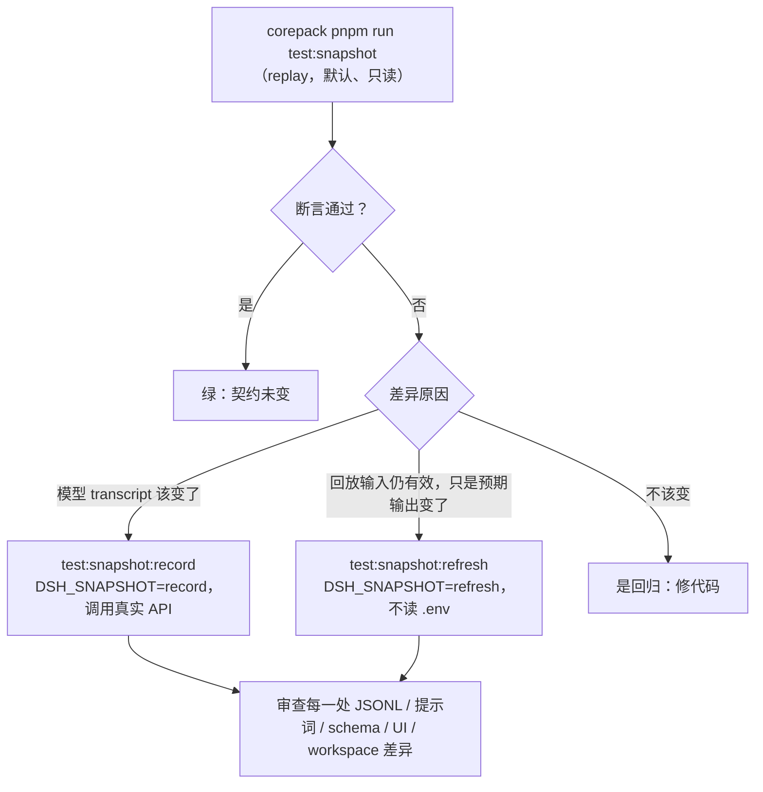

# 第 14 章 测试、调试与发布：模型不确定，系统要确定

> 前十三章把系统建起来了。这一章回答一个工程问题：**一个由"不确定的模型"驱动的系统，怎么测试？怎么调试？怎么发布？** DSH 的答案里有这个领域最值得学的一个想法：keyless snapshot——不花一分钱 API 费，也能回归测试 Agent 行为。

> **本章你将学到**：
> - 概念：测试分层、keyless 会话快照、质量门、调试三板斧、致命诊断、发布序列
> - 设计：模型不确定，系统要确定（快照哲学）；验证外部世界而非自我报告
> - 动手：跑一次无 Key 的快照回放，读一个快照场景目录
>
> 本章基于源码 `0.1.7-rc.2`。命令约定：Windows PowerShell，在 deepseek-harness 根目录执行，pnpm 一律写作 `corepack pnpm ...`。测试策略的权威文档是 `docs/testing.zh.md`，命令清单在根目录 `AGENTS.md`。

## 14.1 先问"为什么"：Agent 系统测试难在哪？

传统软件测试的前提是"确定性"：同样的输入，同样的输出。Agent 系统破坏了两个前提：

- **模型行为不稳定**：同样的 prompt，两次调用可能给出不同回答（采样、版本升级、服务端更新）；
- **真实调用要钱和时间**：每次 E2E 都消耗 API 配额和等待时间。

所以 Agent 系统的测试不能只建立在"模型这次说什么"上，还要建立在"系统的骨架是否稳定"上。有意思的是，DSH 的测试文档对第二点的态度相当反直觉：**"我们是 DeepSeek，不要吝惜真实 API 测试"**——无密钥测试只能证明底层通路，只有带密钥运行才能证明 Agent 能对接真实模型；自动跳过只是为了不阻塞无密钥的 CI 和贡献者，"不是成本信号"。keyless 与 keyed 不是二选一，而是互补的两层。

### 测试分层一览

根目录下有八个 vitest 配置（外加共享模块 `vitest.shared.ts`），大体每个对应一条测试"车道"：

| 层 | 命令 | 配置 | 说明 |
| --- | --- | --- | --- |
| 单元 | `corepack pnpm run test` | `vitest.config.ts` | 先 `build:native-system`，再跑各包 `tests/**` 与 `scripts/**/*.spec.ts` |
| 覆盖率门禁 | `corepack pnpm run test:coverage` | `vitest.config.ts` | `packages/*/*/src` **按文件 100%**；CI 拆成并发分区（`test:coverage:partitioned`） |
| 真实 API e2e | `corepack pnpm run test:e2e` | `vitest.e2e.config.ts` | 各自由自己的密钥控制（`DEEPSEEK_API_KEY`、`EXA_API_KEY`、`PERPLEXITY_API_KEY` 等），缺密钥自跳过 |
| 所属位置预期输出 | `corepack pnpm run test:expected` | `vitest.expected.config.ts` | 无录制会话的 CLI/进程预期，驱动为 `*.expected.e2e.ts`，产物在各自的 `tests/expected/` |
| 会话快照 | `corepack pnpm run test:snapshot` | `vitest.snapshot.config.ts` | 无 Key 回放录制会话（14.2 节） |
| Web 浏览器快照 | `corepack pnpm run test:web` | `vitest.web.config.ts` | 构建后用 Chromium 比较 `snapshots/web/` 与 `apps/web/tests/expected/`；部分场景还跑 WebKit |
| 性能基准 | `corepack pnpm run test:bench` | `vitest.bench.config.ts` | `benchmarks/` 按用户路径组织，纯 Node 计时，Linux PR 必需门禁 |
| 手动性能诊断 | `test:web:perf` / `test:web:stress` | `vitest.web.perf.config.ts` / `vitest.web-stress.config.ts` | 高基数与压力诊断，不在任何默认清单与 CI 车道中 |
| 静态检查 | `typecheck` / `lint` / `duplication` | — | tsc 全量、oxlint（经 `scripts/run-oxlint.ts`）、jscpd 重复代码 |

覆盖率门禁有一句值得抄下来的话：**未覆盖的行往往是门禁正确标记出的死代码（应删除），而非需要补写的测试**；行覆盖率是必要条件，但永远不是充分条件。唯一的平台豁免是 `packages/shell/pwsh-local/src`：缺少真实 `pwsh` 时其套件自跳过、`vitest.config.ts` 豁免该文件，CI runner 自带 pwsh 仍按完整标准执行。

## 14.2 设计思考：keyless snapshot——把"模型跑过"变成"可回放的事实"

最值得学习的是 **keyless 会话快照**，思路浓缩成一句话：**模型行为不稳定，但 UI/协议契约应该稳定。**

做法：用真实模型跑一次，把会话事件流录成 JSONL；之后**不花钱也能回放**——录制下来的模型响应充当"模型"，真实子进程路径照常启动，最后比较组装出的请求、规范化后的协议/记录输出，以及持久化日志。

这和第 6 章的事件溯源是同一个思想的测试版：**事实（事件流）是可记录的，状态（输出）是可推导的**。录制一次真实事件流，重放就等价于"再跑一次模型"——而重放不消耗 API。

### 快照长什么样

录制会话都放在仓库根的 `snapshots/` 下，按驱动协议分四类：`snapshots/session/`（headless 一次性行为）、`snapshots/sdk/`（SDK 持久控制）、`snapshots/acp/`（ACP 自动化协议）、`snapshots/web/`（浏览器与 ARIA 证据）。**每个被测进程都通过 `dsh` CLI 以随附 profile 启动**（`snapshots/AGENTS.md`：不许为测试另开入口或隐藏模式）。

以 `snapshots/session/agent-instructions/` 为例，一个场景目录包含：

| 文件 | 作用 |
| --- | --- |
| `snapshot.yml` | 场景声明：`profile`、`composition`、录制策略、请求头类别、回放例外、workspace 事实 |
| `session.v2.jsonl`、`session.v3.jsonl` | 父会话的多个格式代际；回放总是选**数字最大**的代际 |
| `session.<序号>[.vN].jsonl` | 子会话角色（如子 Agent） |
| `cordis.yml` / `cordis.snapshot.yml` | 场景组合，以及它的无 Key 回放对应版（换掉真实模型行） |
| `system-prompt.expected.md`、`tool-schemas.expected.json` | 请求头"钉住"的提示词与工具 schema 旁车文件 |
| `workspace/`（以及变更型场景的 `workspace.expected/`） | 场景本地的工作区种子与**独立的外部效果预期** |

文件名规则很严格：父会话 `session[.vN].jsonl`，v0 省略 `.v0`，正版本必须小写 `.vN`，且必须与文件头一致。会话里的易变身份被替换为**保留父子关系的带类型 token**，请求的系统提示词和工具 schema 也被替换为 token，每类请求头只有一个可读旁车文件拥有者。

### 三种模式：replay / record / refresh



几条纪律：replay 和 refresh 绝不加载 `.env`，只有 record 从环境或根 `.env` 读密钥；record 与 refresh 写出**以版本命名的新文件**，不改名、不删除已提交的代际；`workspace.expected/` 是独立预言，record 与 refresh 都不改写它——**模型的文字和工具结果不能证明外部效果**。Web 车道在 CI 中强制只读的 `DSH_SNAPSHOT=replay`，record/refresh 只在本地做。

> **Windows 提示**：`test:snapshot:record` / `test:snapshot:refresh` 在 `package.json` 中写作 `DSH_SNAPSHOT=record vitest ...` 这种 POSIX 前缀赋值。如果你的 pnpm 在 Windows 上不以 POSIX 风格 shell 执行脚本，可以先 `$env:DSH_SNAPSHOT = 'record'`，再运行 `corepack pnpm exec vitest run --config vitest.snapshot.config.ts --update`。

### 什么时候必须加快照

`docs/testing.zh.md` 的规则是：**每项非平凡的模型可见、协议可见或人类可见变更，都在同一 PR 中添加或更新无密钥录制场景**；包级测试、仅 mock 的测试和 PR 说明都不能替代组装后的 transcript。Agent loop、会话生命周期或 `SessionEventMap` 的变更还要同时更新两个 SDK 投影（TypeScript 在 `snapshots/sdk/`，Python 在 `scripts/snapshots/python-sdk-single-exe/`）。

它还带来一个副产品：**快照文件本身就是文档**。一个 `session.vN.jsonl` 展示了"当时那次真实会话长什么样"——事件结构、工具结果、消息顺序，比任何文档都真实。第 6 章的"解剖一次会话"实验，没有 Key 时就可以靠读快照完成。会话格式升级时（v3 canonical envelopes、v4 等，见第 6 章），历史代际按 `docs/cookbook/adding-a-session-format-version.zh.md` 添加后继代际，不改动前代。

## 14.3 测试哲学：几条比工具更重要的规则

`docs/testing.zh.md` 里有几条规则，值得每个写 Agent 系统的人记住：

1. **优先真实实现而非 mock**：只 mock 开销高或不确定的边界（LLM 适配器、网络、时钟），下游一切保持真实。例如 ACP 的桥接测试 `makeBridgeHarness()`（`packages/acp/acp/tests/harness.ts`）挂真实的 agent loop、会话存储、工具注册表与 JSONL 持久化，唯一的 mock 是脚本化 `MockAdapter`。仓库还提供 `packages/test-support/`（`llm-mock-server`、`llm-replay`、`agent-loop-testkit`、`session-snapshot` 等）作为共享测试设施。
2. **验证外部世界，而非自我报告**：e2e 断言应重新运行命令或从外部重新读文件；对 Agent 自身输出做关键词探测，会让"作弊的 Agent"通过。
3. **测试真实入口路径**：产品可见的插件必须有非单元的真实组合测试（通过 Loader 和 app/process 启动测试用 `cordis.yml`）；"真实入口"指已发布的产物——`bin` 运行构建后的 `lib/bin.js`，用普通 `node` 执行，以暴露 tsx 会掩盖的失败。Profile 级集成测试位于 `apps/cli/tests/profiles/`。
4. **测试解析只走源码**：每个 vitest 配置都把 vite-tsconfig-paths 指向 `tsconfig.base.json`，裸导入解析到 `src`，绝不经由 `exports` 落到构建后的 `lib/`——陈旧产物会加载第二份模块单例。
5. **并发下的 spec 自己负责资源**：worker 并行、覆盖率分区并行、自托管 runner 共享宿主，被隔离的只有进程；"只有单独运行时才通过"的 spec 是 spec 的缺陷，而不是 runner 不稳定。

### 设计思考：为什么"验证外部世界"这么重要？

Agent 最擅长的事情之一就是"说自己做完了"。如果测试只检查 Agent 的输出文字，你测的是它的**表达能力**，不是它的**行为**。快照里独立的 `workspace.expected/`、e2e 里"重新读文件、逐字节比较未修改文件"，都是同一个原则：**证据要来自被测对象之外**。

## 14.4 质量门与本地钩子

### 聚合门禁：`scripts/run-gates.ts`

与其记几十个 `verify-*` 脚本，不如记住几个聚合入口，它们都由 `scripts/run-gates.ts` 按依赖图并发调度：

| 命令 | 模式 | 内容概要 |
| --- | --- | --- |
| `corepack pnpm run check:all` | `check-all` | 本地全量：单元、快照、预期输出、构建、Web 构建、hygiene、doc-sync、模块图等 |
| `corepack pnpm run hygiene` | `hygiene` | 发布卫生：vendor rescope 检查、`publint`、workspace 约束、默认产品隔离、包依赖、应用入口、许可证、包不变式、构建后包不变式、node-next 类型、Cordis 配置、运行时闭包等 |
| `corepack pnpm run doc-sync` | `doc-sync` | 生成类文档（工具目录、配置目录、Cordis API 目录等）是否与源码同步 |
| `corepack pnpm run test:docs` | `doc-quick` | 文档快速检查 |
| `check:ci:*` | `ci-*` | CI 各车道（primary、static、coverage、bench、snapshot、artifacts、consumers、Windows 等） |

注意 hygiene 的内容已经与旧版不同：**不再使用 knip**，取而代之的是一组仓库自有的 `verify-*` 检查。其中 `verify-default-product-isolation` 值得一提——它保证默认产品不被实验包"污染"，并拒绝缺少图标与本地化元数据的可选 bundle（第 13 章 13.8 节）。

### 本地钩子：lefthook

`lefthook.yml`（`postinstall` 时由 `scripts/install-lefthook.mjs` 自动安装）刻意保持"快"，全量矩阵留给 CI：

- **pre-commit**：翻译配对检查（`*.i18n.yaml`）、归档笔记检查、暂存文件 oxlint `--fix`、第三方声明**自动重新生成**（依赖改了却忘了更新 `THIRD_PARTY_NOTICES.md` 时直接帮你生成并 `git add`）、空白检查、vendor manifest 守卫；
- **pre-merge-commit**：翻译配对与归档笔记；
- **pre-push**：`pnpm run typecheck`。

"重新生成而不是拒绝"这条注释很有代表性：能机械修复的就在本地修掉，不要让一个忘记的生成步骤在很久之后才在 CI 里失败。

### Makefile：只是短名字

根目录 `Makefile` 只为 Web 和 Desktop 提供短命令（`make build`、`make web`、`make desktop`、`make dev-web`、`make dev-desktop`，`ARGS='--no-open --port 3081'` 转发参数），`package.json` 脚本仍是唯一事实来源。Windows 上没有 make 时直接用对应的 `corepack pnpm run start:web` 等即可。

## 14.5 调试三板斧：从"系统以为自己在跑什么"开始

Agent 系统调试的难处在于链路太长：浏览器 → RPC → 主循环 → 模型 → 工具 → 沙箱。DSH 的调试思路是**逐层缩小怀疑范围**：

1. **看配置**：`dsh --profile <name> --dump-config`——先确认"系统认为自己在跑什么"，输出按层标注（`# == <层名>`）。配置错了，后面全错。想看每个插件行的 Config 形状，可以用 `--dump-config-schema`：它不挂载插件，把 Schemastery 声明投影为 JSON Schema；**只要有部分近似或不支持的条目就以退出码 1 结束**，因为退出码回答的是"这份文档能否替代原生验证"（笔记 `2026-09-20-config-schema-dump-validation-policy`）。
2. **看日志与事件**：启动时 stdout/stderr；会话内容看 JSONL 持久化文件；headless 可加 `--json` 得到机器可读结果；前端问题看浏览器 DevTools Network。
3. **看源码**：`rg <事件名或服务名> packages -g *.ts`，从事件流倒推代码路径——事件名就是你的调试锚点（第 5 章）。

两个额外工具：

- **Inspector（实验）**：`corepack pnpm run demo:inspector` 以源码树挂载 `dsh-experimental-inspector`，可在 Chrome DevTools 里同时检查 Host 与浏览器 Client 的 Console、Sources、Network 采集与 Cordis 树（第 13 章）；
- **本地 mock LLM**：`corepack pnpm run mock:llm` 启动 `packages/test-support/llm-mock-server`，在不想花钱或需要可控响应时把模型换掉。

常用排查命令：

```powershell
# 端口被谁占（Web 默认 3080，Desktop 默认 19387）
Get-NetTCPConnection -LocalPort 3080

# 从源码启动 Web 并查看配置层
corepack pnpm dsh --profile web --dump-config | Select-String "== "

# 看某个包的中文说明
Get-Content packages\<group>\<pkg>\README.zh.md -Encoding UTF8
```

### 致命诊断与崩溃报告

笔记 `2026-09-22-fatal-diagnostics-and-crash-reports` 源于两起只能靠"致命对话框截图"定位的 Desktop 事故，它交付了四条决定，都体现"**失败要响亮、证据要留下**"：

- **未捕获异常是致命的**：`dsh-app-boot` 的 `installFailLoud` 为 `uncaughtException` 注册与 `unhandledRejection` 相同的处理：向 stderr 写带标签的 `util.inspect` 诊断（标签分别是 `fatal uncaught exception` 与 `fatal load failure`），在超时内等待 release 钩子，以 1 退出。**控制流绝不回到失败的操作**——只有抛出点知道哪些状态仍完整，恢复运行会把可见的崩溃变成静默的错误输出。用 `util.inspect` 而不是 `err.stack`，是因为 `code`、`syscall`、`path` 和 `cause` 链都不在堆栈行里。
- **spill 文件尽力而为**：`dsh-subprocess-local` 的输出溢写在任何文件系统失败时丢弃该 spill、通过 logger 报告一次，内存尾部继续收集——一个可失败的辅助步骤不应拖垮整个进程。
- **Desktop 弹窗前先写崩溃报告**：报告写到 `app.getPath('logs')` 下，包含来源（`host`/`web-boot`/`renderer`/`main`）、版本、完整错误和主窗口最近的 error 级 console 输出；各段有上限（错误 256 KiB、Host 诊断 64 KiB、console 尾部 64 KiB），平台允许时仅所有者可读，保留最新十份；对话框单独一行给出文件路径，用户知道自己要分享什么。
- **Client 批量脚本加载失败是"按行的问题"**：传输失败在同一 URL 重试一次，仍缺失的行回退到单资源 URL，而不是整个启动失败。

### 会话日志上传：调试之外的默认行为

还有一个与"可观测性"相关、使用者必须知道的默认值：`session-log-deepseek`（`packages/session/session-log-deepseek`）会把规范会话日志随 DeepSeek 请求一起上传，**`Config.enabled` 在所有进程中默认为 `true`**，显式设置 `enabled: false` 才关闭（笔记 `2026-09-14-session-log-upload-default`）。随后的笔记 `2026-09-24-bounded-session-log-upload` 给它加了上限：`maxBytes` 默认 8 MiB，每次请求只携带水位之后能放进上限的最长连续事件段；单条事件超限时省略该字段并记告警，而不是让模型请求失败。快照语料里 headless 与 ACP 的基础 patch 以及 Web scaffold 显式关闭了上传，SDK 录制则保留默认值来验证默认路径。

## 14.6 发布插件/Bundle：让世界用上你的插件

官方教程是 `docs/user/develop/basic/publish.zh.md`，核心概念只有两个：

- **组合包（bundle）**：`package.json` 声明 `dsh.bundle`（如 `{ "patch": "./cordis.patch.yml" }`），回答"这个包贡献什么"；patch 里按**包名**引用插件行；
- **profile**：`$DSH_HOME/profiles/<name>` 下的目录，`package.json` 声明 `dsh.profile.bundles`（有序列表），回答"由哪些组合包按什么顺序组成"。

流程：

1. 写好包（`package.json` + `cordis.patch.yml` + 插件模块），需要与宿主共享实例的 dsh 包同时声明在 `peerDependencies` 与 `devDependencies`；
2. 安装进 profile：`dsh plugin --profile demo add ./hello-plugin`——它在 profile 目录里转发给 pnpm，首次使用会初始化 profile（`@deepseek-ai/dsh-base` 作为第一个组合包），并把声明了 `dsh.bundle` 的包追加进 `dsh.profile.bundles`；
3. 验证：`dsh --profile demo --dump-config` 应出现 `# == dsh-hello-plugin` 层；
4. 分发：发布到 npm（`pnpm publish` 时构建好 `lib/`），或用 `pnpm pack` 交付 tarball（`dsh plugin add ./hello-plugin-0.1.0.tgz`）；也可以从 git 安装，但 git 拉的是源码，作者要提供自包含的 `prepare` 脚本，用户还要在 profile 的 `pnpm-workspace.yaml` 里用 `allowBuilds` 显式授权——**这等于允许该包在你机器上、在任何 Agent 沙箱之外执行安装脚本**，务必锁定 commit。

生效配置的层顺序是：各组合包 patch（按 `dsh.profile.bundles` 顺序）→ profile 自己的 `cordis.patch.yml` → `$DSH_HOME/cordis.patch.yml` → 每个 `--patch`（按 argv 顺序）。后应用的层按行胜出，且**替换整个 `config` 值而不是深度合并**——覆盖别人的行时要重述所需的每一个键。还记得第 4 章的 insert 吗？发布插件和配置插件用的是同一套机制，这正是"配置即扩展"闭环的最后一环。

用户侧还有一条图形化路径：Web 侧边栏的插件页（`ui-plugin-manager`）。自旧基准以来它变得"有引导"了（笔记 `2026-09-15-guided-plugin-installation`、`2026-09-18-plugin-install-registries`）：宿主先用 `PluginManager.inspect` 读 spec（`pnpm view` 或读目录 `package.json`），**没有组合包 patch 的包在 pnpm 运行前就被拒绝**；安装失败或取消会恢复 `package.json` 与 `pnpm-lock.yaml`；注册表按"计划"而非单一地址询问，默认备选源为 npmmirror，而私有源永远不会回落到公共源。

## 14.7 仓库自身的发布：三条序列与发布范围

### 三条独立的 npm 发布序列

笔记 `2026-08-10-npm-release-sequences` 把可发布包分成三条互不等待的序列：

| 序列 | 成员 | tag | workflow |
| --- | --- | --- | --- |
| dsh | `packages/*/*` + `apps/*` 中的公开成员 | `dsh-v<版本>` | `release.yml`（pack）/ `release-publish.yml`（publish） |
| vendored framework | `vendor/*` 九个包，各自一条版本线 | `vendor-<包名>-v<版本>` | `release-vendor.yml` / `release-vendor-publish.yml` |
| native | `native/system/packages/*` | `node-addon-system-v<版本>` | `node-addon-system-release.yml` |

Python SDK 另有 `python-release.yml`。对应的本地脚本都在 `scripts/release/`：

- `corepack pnpm run release:dsh`（`bump.ts --family dsh`）：接受 `major`/`minor`/`patch` 或显式版本，把**同一个版本**写进可发布族、`packages/*/*` 下的私有包和 workspace 根，更新 lockfile 并提交；tag 由人在合入 master 后打，**CI 不写仓库**。当前根版本就是这样得到的 `0.1.7-rc.2`；
- `release:verify`：校验版本基线，发布时还要求运行来自该序列的 tag；
- `release:pack`：无凭据地从一个 commit 打出整套 tarball 并记录发布顺序——**pack 是发布边界**；
- `release:verify-packed-install`：把 tarball 装进仓库外的临时消费者，用普通 Node 驱动已安装的可执行文件；
- `release:publish`：**只在 GitHub Actions 执行**，对每个 tarball 与 registry 比对：缺失则发布，完整性相同则跳过（因此可安全重跑），完整性不同则失败（说明内容变了却没升版本）。

dist-tag 规则：`alpha`、`canary` 映射到同名 dist-tag，包括 `rc` 在内的其他预发布映射到 `next`，稳定版用 `latest`——所以 `0.1.7-rc.2` 这样的版本会进 `next`。

### Workspace 依赖的发布范围

笔记 `2026-09-22-workspace-release-ranges` 规定：消费者对 DSH 目标写 `workspace:*`（打包后为**精确版本**），对 `vendor/` 或 `native/system` 家族的目标写 `workspace:~`（打包后为 `~x.y.z`，接收补丁更新但不自动接纳新次版本）。理由很朴素：DSH 各包随同一次产品发布，必须精确对齐；Cordis 与原生 addon 独立发布，消费者应能吃到它们的补丁。

### Desktop 的构建与发布校验

Desktop 的打包入口在根脚本 `package:desktop:*`（如 `package:desktop:win:x64`、`package:desktop:mac:arm64`，转发到 `apps/desktop` 的 `scripts/package-target.ts`）。几个与"发布正确性"相关的决定：

- **Electron 壳与 `@deepseek-ai/dsh` 始终使用同一精确版本**，即使壳代码不变，升级 dsh 也必须发布新 Desktop 版本（`apps/desktop/README.zh.md`）；
- **兼容性在打包时验证，而不是每次启动验证**（笔记 `2026-09-09-desktop-build-release-validation`）：打包验证器负责描述文件 schema、shell 版本、平台、架构、Host 协议版本以及 Node/pnpm semver；启动时只读准备 profile 所需字段，真正的 Host ready 消息仍校验协议版本；
- Windows 签名打包按 PE 内容扫描并补签未签名代码，发布完成记录前还要通过最终签名检查与 Host 冒烟检查；
- 主进程 bundle 必须在工作区 tsdown 之后构建，并由 `desktop-bundle-imports` 检查拒绝任何在打包应用内无法解析的导入（笔记 `2026-09-22-desktop-main-bundle-after-workspace-tsdown`）；
- 本地更新验证：`apps/desktop` 的 `test:updates:local` 在 Electron 中运行真实 HTTP updater 与强更页面，报告写到 `.desktop-build/qualification/`（`apps/desktop/tests/README.zh.md`）。

## 14.8 贡献代码前必读

- `AGENTS.md`：仓库对 Agent/开发者的行为规范与命令清单；
- `docs/testing.zh.md`：本章 14.1–14.3 的权威来源；
- `docs/development.zh.md`：TypeScript 项目布局、代码风格；
- `docs/defensive-patterns.zh.md`：生命周期、并发、子进程、teardown 的防御模式；
- `docs/cookbook/adding-a-package.zh.md`：新增一个包的标准步骤。

`docs/defensive-patterns.md` 的存在本身就是一个信号：这个仓库把"防御性编程"当成了显式的工程规范——第 10 章那些"宿主退出也要清干净"的细节，以及 14.5 节"失败要响亮"的致命诊断，都不是偶然，是规范。

## 14.9 动手实验

1. 跑一次快照回放，观察它如何离线驱动 Agent 会话：
   ```powershell
   corepack pnpm run test:snapshot
   ```
2. 读一个场景目录，把 `snapshot.yml`、`cordis.snapshot.yml` 与最高代际的 `session.vN.jsonl` 对照，理解"场景声明 + 回放组合 + 事实记录"三件套：
   ```powershell
   git ls-files snapshots/session/agent-instructions
   Get-Content snapshots\session\agent-instructions\snapshot.yml
   ```
3. 看会话模块测了什么：
   ```powershell
   rg "test\(" packages/core/session/tests -g *.spec.ts | Select-Object -First 5
   ```
4. 跑一次发布卫生检查，数一数它调度了哪些 gate：
   ```powershell
   corepack pnpm run hygiene
   ```

## 14.10 常见坑

- **改行为不更新快照**：模型/UI 可见行为变了，回放会红；先看差异，确认是预期变化再选 record（transcript 该变）或 refresh（回放输入仍有效）——快照是回归保护，不是免责金牌；
- **e2e 需要 Key**：没有 Key 时 e2e 自跳过，别误以为"测试全绿 = 真跑过模型"；
- **在测试里走构建产物解析**：陈旧的 `lib/` 会加载第二份模块单例，只有显式的构建产物冒烟测试才应使用它；
- **发布前漏跑 hygiene**：publint、包不变式、默认产品隔离能拦住"导出不存在/包结构不合法/实验包混进默认产品"这类发布事故；
- **本地尝试 `release:publish`**：发布只在 GitHub Actions 执行，本地该做的是 bump、pack 与 verify-packed-install；
- **忘了会话日志默认上传**：对隐私敏感的部署要显式设置 `session-log-deepseek` 的 `enabled: false`；
- **把快照当单元测试**：快照是回归保护，不是正确性证明，逻辑测试还要写。

## 14.11 思考题

1. 快照回放依赖"录制时的事件流"。如果模型升级后行为变了（合理的变化），快照会红——你是 record、refresh 还是审查差异？怎么区分"回归"和"演进"？
2. 覆盖率要求逐文件 100%（CI 门禁），而文档说"未覆盖的行往往是死代码"。对 Agent 系统来说，这条门禁的价值和代价各是什么？防御性代码值得测吗？
3. 调试三板斧的顺序是"配置 → 日志 → 源码"。你遇到过"配置对了、日志看着正常、但行为不对"的情况吗？这时候缺的是什么？（提示：想想第 6 章的事件溯源，以及"验证外部世界"原则）
4. 致命诊断的决定是"未捕获异常一律退出，绝不恢复失败的操作"。这和"尽量让服务活着"的直觉相冲突。在什么场景下"响亮地死掉"比"带伤继续跑"更安全？
5. 发布插件的最后一步是"把组合包加进 profile 的 bundles 列表"，插件页还会拒绝没有组合包 patch 的包。这暗示"插件的安装"就是"配置的修改"。这个设计对"插件市场"（第 15 章）意味着什么？
6. dsh 序列用精确版本互相引用，vendor/native 用 `~` 范围。如果反过来（dsh 用 `^`、vendor 用精确），会出现什么问题？

## 小结

- 测试分多条车道：单元（逐文件 100% 覆盖）、真实 API e2e（按密钥自跳过）、所属位置预期输出、会话快照、Web 浏览器快照、性能基准，外加手动性能诊断；
- keyless 会话快照 = 事件溯源思想的测试版：`snapshots/{session,sdk,acp,web}` 下按场景存放多代际 JSONL，replay 只读、record 调真实 API、refresh 更新预期，所有差异都要审查；
- 规则比工具重要：真实实现优先、验证外部世界、测试真实入口、解析只走源码；
- 质量门由 `run-gates.ts` 聚合（`check:all`/`hygiene`/`doc-sync`），lefthook 负责快速本地检查；
- 调试从配置 → 日志 → 源码逐层推进，致命诊断保证"失败响亮、证据留存"；会话日志上传默认开启且有 8 MiB 上限；
- 发布分插件与仓库两层：插件 = 组合包 + profile 的 bundles 列表；仓库 = 三条独立 npm 序列 + GitHub-only publish + workspace 发布范围 + Desktop 打包时校验。

下一章（最后一章）：展望——Agent Harness 的过去、现在与未来。把前十四章串成一条演进主线。
