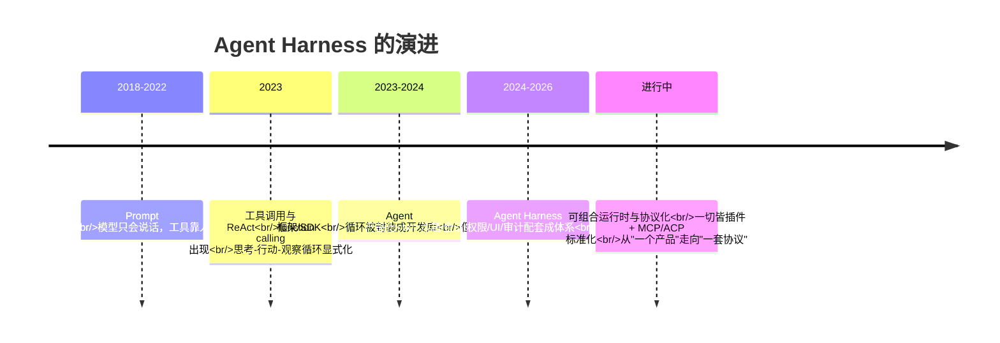
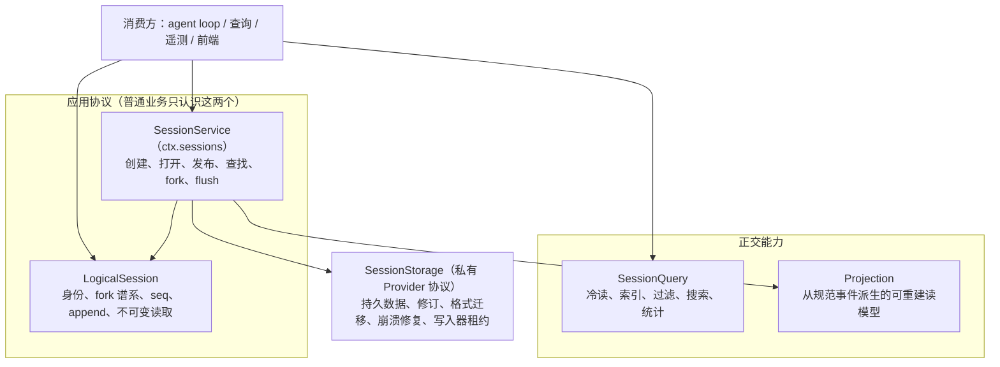

# 第 15 章 展望：Agent Harness 的过去、现在与未来

> 前十四章我们拆解了 DSH 的每一个零件。这一章把它们装回时间轴：Agent Harness 是怎么一步步演化出来的？DSH 的选择在行业里处于什么位置？上一版书稿里写下的"预测"，有哪些已经在 `0.1.7-rc.2` 里落地？仓库里正在讨论的提案，又透露了哪些下一步？

> **本章你将学到**：
> - 演进史：五阶段范式转移
> - 趋势：协议标准化 / 安全与信任 / Agent 生态 / 边界移动——以及每条趋势在 DSH 里的"已落地"证据
> - 近期路线：从 `.agents/notes/proposed/` 读出的下一步（逻辑会话与存储重建、会话能力协议、Composer 模型、计时用户提问等）
> - 开放问题：六个属于这个时代的分岔口
>
> 阅读提示：本章区分三种说法——**已落地**（HEAD 源码中存在且有 implemented 笔记）、**提案中**（`.agents/notes/proposed/` 下、Status 为 proposed）、**判断**（作者对行业趋势的看法）。提案可能被修改或否决，引用时请以仓库最新状态为准。

## 15.1 演进史：从 API 调用到 Agent Harness

Agent Harness 不是凭空出现的，它是过去几年里五次"范式转移"的叠加产物。每一次转移，都是把上一层的隐性假设显式化：

### 阶段一：Prompt 工程时代（2018-2022）

模型只能"说话"。你要让模型"做事"，就得把工具的执行结果手动复制进 prompt，再把模型的回答复制出去。这一阶段的核心假设是：**模型是唯一的智能，其余都是手工活**。

### 阶段二：工具调用与 ReAct（2023）

模型学会了输出结构化的工具调用（function calling），宿主程序负责执行。ReAct（Reason + Act）模式第一次把"思考-行动-观察"循环显式化：模型推理 → 调用工具 → 看到结果 → 再推理。这一阶段的核心洞见是：**智能不只存在于模型参数里，还存在于"模型与世界的循环"里**。但循环本身——谁来转、怎么转、怎么保证安全——还是每个应用自己写。

### 阶段三：Agent 框架/SDK（2023-2024）

LangChain、OpenAI Agents SDK、CrewAI 等把循环封装成开发库：你 import 一个 agent，配几个工具，循环就转起来了。这一阶段解决的是"开发效率"，但暴露了下一个问题：**库不是产品**。库不管会话怎么存、命令怎么沙箱化、权限怎么审批、UI 怎么展示、审计怎么做。

### 阶段四：Agent Harness / 产品化（2024-2026）

Claude Code、Codex、Cursor、DSH 这批产品/框架出现。它们把"运行 Agent 的全部配套"——沙箱、会话、权限、UI、凭据、遥测——做成一个可运行的整体。这一阶段的核心判断是：**Agent 的下一个瓶颈不是模型，而是宿主**。模型负责"想"，宿主负责"活"：让它安全地活在真实世界里。

### 阶段五（正在发生）：可组合运行时与协议化

DSH 属于这一阶段：一切皆插件、能力接缝可替换、多入口（CLI/Web/Desktop/ACP/JSON-RPC/Python SDK）。同时，行业里 MCP（Model Context Protocol）统一工具与资源协议、ACP（Agent Client Protocol）统一 Agent 与客户端之间的通信。方向很清晰：**Agent 基础设施正在从"一个产品"走向"一套协议 + 可组合的运行时"**。

五阶段的时间线一目了然：

### 一条主线

把五个阶段串起来看，演进的主线是：**把"隐性假设"逐层显式化**——循环从应用代码里显式出来（阶段二），从库的封装里显式出来（阶段四），配置从代码里显式出来（DSH 的 profile），安全从信任里显式出来（fail-closed 沙箱），状态从内存里显式出来（事件溯源）。DSH 的价值，就是把这五条显式化做到了极致。15.7 节会看到，它的下一步依然沿着这条主线走：把"会话"本身从一个具体类里显式成一组协议。

## 15.2 为什么是现在：三个技术条件

Agent Harness 不是"早有人想到但没人做"，而是条件不成熟。三个条件在 2024-2026 年才同时到位：

1. **模型能力的拐点**：长上下文、可靠的工具调用、多步推理。没有这些，循环转两圈就散架，Harness 无从谈起。
2. **成本与开源的临界点**：API 成本下降 + 开源模型（DeepSeek 是其中代表）让"跑一个编码 Agent"从研究项目变成日常开发工具。DSH 的测试文档甚至写道"推理在这里很便宜"，鼓励大量真实 API 测试（第 14 章）。
3. **代码领域的天然适配**：代码是可验证的（跑测试就知道对错）、结构化的（文件、仓库、AST）、有明确反馈的（编译错误、测试失败）。这使编码 Agent 成为 Agent 技术最成熟的试验场——DSH 是编码 Agent 起家，但它的设计（接缝、事件溯源、沙箱）并不是编码专属的：第 13 章的 Office 技能、文档预览、定时提醒、浏览器与电脑操作，已经在把同一副骨架伸向非代码任务。

## 15.3 趋势一：能力接缝与协议标准化

DSH 的接缝设计（服务定义/Provider/Consumer）和行业协议（MCP、ACP）在回答同一个问题：**能力如何被声明、发现、复用**。

- MCP 把"工具与资源"标准化：一个 MCP 服务器 = 一套工具、资源与使用指引，任何 Agent 都能挂载。
- ACP 把"Agent 会话控制"标准化：一个 ACP 服务器 = 一个可被程序化驱动的 Agent。
- DSH 的接缝是"协议的内化版"：不依赖网络协议，而是把"换实现"变成一行配置。

**已落地的证据**（自上一版以来）：

- MCP 不再只是"工具桥"：`mcp-resources` 提供按需读取的资源工具，每个服务器的指令以作用域段落进入提示词；`dsh-mcp-client` 改用官方 TypeScript client 2.0.0 **自动协商协议版本**，现代发现、列表变化订阅、分页、取消与输出校验都交给 SDK（笔记 `2026-09-12-mcp-resources-and-instructions`、`2026-09-12-mcp-sdk-protocol-negotiation`）。
- ACP 走向"标准子集而非私有扩展"：`dsh-acp` 实现标准 ACP v1 的自动化控制子集，明确不加自定义方法与私有 `_meta`（笔记 `2026-08-22-standard-acp-automation-controls`）。
- 生态分发变得可用：插件页的引导式安装与注册表计划（带 npmmirror 备选源）让"装一个第三方组合包"不再需要手写 `.npmrc`（第 14 章）。

**判断**：未来 Harness 的竞争焦点将从"内置多少工具"转向"能接入多少生态"。值得注意的是 DSH 在协议上的克制——它宁可采用官方 SDK、只实现标准子集，也不在协议上"加私货"。谁把接缝做得越干净、对标准越诚实，谁就越能成为 Agent 世界的"操作系统"。

## 15.4 趋势二：安全与信任会成为第一公民

当 Agent 开始写代码、改文件、执行命令、访问网络时，信任从"人格信任"（相信模型不会干坏事）变成了"机制信任"（系统保证它干不了坏事）。DSH 展示了机制信任的三个层次：

- **OS 级**：平台原生沙箱（Landlock/Seatbelt/ACL），fail-closed——沙箱失败就拒绝执行；
- **应用级**：审批策略、permission presets、写前必读的 observation policy；
- **审计级**：事件溯源日志，任何行为可回放。

上一版书稿在这里写过三句预测。对照 `0.1.7-rc.2`，它们的结局各不相同：

| 上一版的预测 | 现状 | 依据 |
| --- | --- | --- |
| "沙箱会更强（云沙箱、E2B 式的隔离环境）" | **部分落地，路线改变**：E2B Provider 已从仓库移除；远程执行改由 POSIX SSH 运行时承担，它通过已有 `ctx.fs`/`ctx.subprocess`/`ctx.sandbox` 接缝把执行搬到远端，不引入专用工具。本地沙箱也在加固：Windows ACL 增加强制完整性级别约束，堵住经父目录 `FILE_DELETE_CHILD` 删除工作区外文件的路径 | `2026-09-11-remove-e2b-providers`、`2026-09-11-posix-ssh-runtime`、`2026-09-19-windows-acl-mandatory-integrity-confinement` |
| "审批会更智能（基于上下文的动态策略）" | **已落地（实验）**：Auto review 在每次工具调用前用同一模型按"实际效果"分级审查；策略拒绝时回退到用户审批，审查器失败则直接拒绝 | `2026-08-28-auto-review`、`2026-09-24-auto-review-user-approval-fallback` |
| "审计会与安全分析结合（异常行为检测）" | **尚未看到对应实现**：事件溯源与会话日志仍是审计底座，但仓库中未找到异常检测相关的包或笔记 | — |

E2B 的移除尤其值得读一读它的理由：E2B SDK 没有额外的描述符传输，而 PTC Node 约束需要一条独立于程序 stdin/stdout/stderr 的双向控制通道；硬补这条桥会把一个实验变成独立的远程传输项目。于是团队选择**用更小的维护范围换取放弃这个集成**，同时明确"远程执行仍是预期能力"——SSH 运行时就是在同一套接缝约定下给出的替代答案。这是一个很好的工程范例：**预测的方向对了，但实现路径由约束条件决定**。

**判断**：沙箱的粒度永远追不上模型的想象力——总会有"合法但危险"的操作。Auto review 的设计给出了一个有意思的方向：不是让机器完全替人决定，而是让机器先筛、把真正的"灰区"交给人（15.8 节再展开）。

## 15.5 趋势三：从单 Agent 到 Agent 生态

第 13 章我们看到了 DSH 的子 Agent 委派（进程内 / ACP / Codex / Claude Code / 另一个 DSH 运行时）。上一版书稿说 Agent Team 是"多 Agent 协作从概念走向实现的信号"，并预测了三件事。现状如下：

- **角色分化与团队协作 —— 已落地（实验）并产品化**：Agent Teams 现在是一个可选组合包，在 Web 插件页一键启用，携带服务、九个模型工具与浏览器 UI；持久 mailbox 与共享任务板跨崩溃存活（笔记 `2026-09-18-agent-teams-single-bundle`）。
- **工作流引擎 —— 已落地，并且更安全了**：工作流脚本从 worker 线程迁到共享的 PTC Node 进程运行时，继承 OS 文件约束与受管清理（笔记 `2026-09-13-workflow-ptc-sandbox-reuse`），并支持后台运行。
- **"Agent 经济"（能力成为可交易的服务）—— 未落地**：仓库中没有对应实现，这仍是纯粹的行业判断。

同时出现了两个"反向"信号，同样值得记下：

- **克制**：固定的全新 Agent 循环 `ralph` 在随附默认组合中被关闭，因为"完成与否是 worker 的自我声明，没有独立评估"（笔记 `2026-09-12-ralph-off-in-shipped-defaults`）。能力保留，但不再默认宣传尚未背书的自治能力。
- **事实归属**：子 Agent 目录改为由父会话的 `subagent/catalog` 事件持有，并进一步只保留成员关系（笔记 `2026-09-01-parent-owned-subagent-catalog`、`2026-09-16-subagent-catalog-membership-only`）——多 Agent 越多，"谁生了谁"越要是一条可审计的事实。

**判断**：单机、单进程的运行时需要变成"分布式协作的中枢"。DSH 的接缝和事件溯源恰好为此准备：事件溯源让每个 Agent 的决策都可审计，接缝让不同 Agent 共享同一套能力。但上面两个反向信号提醒我们，**生态的扩张速度应该受"可验证性"约束**。

## 15.6 趋势四：模型与 Harness 的边界在移动

这是最深刻也最不确定的趋势。模型能力在指数增长，Harness 的能力在稳步增长，两者的边界会不断移动：

- **哪些能力会被模型内化？** 工具调用已经是原生能力；未来"长上下文管理"（也许取代部分 compaction）、"自我纠错"（也许取代部分 loop 控制）可能被内化。
- **哪些能力必须留在宿主？** 沙箱、凭据、审计、审批——这些是"信任基础设施"，不应该交给模型，否则就是让囚犯管钥匙。即便是 Auto review 这样"用模型审模型"的设计，最终兜底依然是宿主的审批服务和用户。
- **事件溯源 vs 原生长上下文**：如果模型一次能"记住"整个仓库，会话日志还需要吗？答案是：需要——因为日志不只是给模型看的，还是给人审计、给系统回放、给 UI 重放、给第 14 章的 keyless 快照做测试输入的。**上下文是算出来的，事实是记下来的，两者永远分工。**

仓库里一个尚在提案中的想法把这个问题推得更远：**可召回的压缩**（`proposed/feature/2026-07-06-recallable-compaction`）。它指出压缩对模型当前上下文不可逆——被摘要遮蔽的内容虽然仍在只追加日志里，模型却无法再读到；提案认为事件溯源会话"具备持久原文、可按 seq 寻址和精确回放"，是让模型在循环内回溯、并让压缩感知前缀缓存的天然底座。**如果这条路走通，"事实记下来"就不只服务于人和系统，也重新服务于模型本身。**

一个可能的终局图景：**Harness 成为"模型的运行时操作系统"**——模型是 CPU，Harness 是内核，插件是驱动，事件溯源是文件系统（一切皆事实），沙箱是内存保护，审批是权限管理。这个类比不完美，但足够引发思考。

## 15.7 近期路线：从提案看下一步

`.agents/notes/proposed/` 是 DSH 的"公开待办"。下面挑出与本书主线最相关的几组（均为 **Status: proposed**，细节可能变化）。

### 逻辑会话与存储重建

`2026-09-06-logical-session-storage-rebuild` 是规模最大的一组提案，配套还有 `2026-09-10-session-capability-protocols`（能力协议与整体架构）、`2026-09-10-session-developer-transition`（开发者迁移）、`2026-09-10-session-data-compatibility`（历史数据兼容）与 `2026-09-10-session-refactor-faq`。

问题是：会话消费方直接依赖具体的事件日志类、实时会话注册表、投影注册表与持久化句柄——逻辑行为、发布、存储、物理格式混在一起。于是任何新的会话或存储实现，都要改动消费方、agent loop、持久化、查询、遥测和前端。提案的目标结构是"一个小逻辑核心 + 若干正交能力"：

提案按"堆叠阶段"推进：阶段 1 让每个生产消费方都持有 `LogicalSession`，具体 `Session` 类及 `Session.create`/`Session.fromRestore` 作为 deprecated 兼容入口保留；阶段 2 集中服务所有权；阶段 3 分离存储读取器与写入器。FAQ 写明"前三个阶段的草稿已齐备，但阶段 4–5 和内存 provider 抽取尚未完成"，且**阶段 1–3 不改变磁盘格式或启动方式**。截至 HEAD，核心会话包中尚未出现提案中的 `LogicalSession` 抽象类（`packages/session-query/session-query/src/corpus.ts` 里有一个同名的局部只读接口，不是它）。数据兼容笔记写于 V3 为当前格式之时；HEAD 的写入格式已是 V4（`SESSION_FORMAT_VERSION = 4`，第 6 章）。

这是 15.1 节"主线"的延续：**当年把状态从内存里显式成事件，现在要把"会话"本身从一个具体类里显式成一组协议**。

### Composer 模型与 DraftEditor

`2026-09-14-composer-model-and-draft-editor` 要解决的是：同一个 Client 需要在不同视图里编辑同一个 Session 的草稿，而 Lexical 的一个 editor 只能绑定一个 DOM root；多个编辑实例不能各自拥有互不相干的草稿和上传任务，也不能让 Session Controller 理解光标、输入法或 DOM。提案分两个 PR：第一阶段只做机械的职责提取（例如把 Lexical 运行时提到 `input/editor/runtime.ts`、编辑区呈现提到 `input/editor/DraftEditor.tsx`），第二阶段才改行为。HEAD 中 `packages/client/ui-conversation/src/client/input/editor/` 下已能看到 `runtime.ts` 与 `DraftEditor.tsx`，说明提取工作至少部分进入了代码；但笔记状态仍为 proposed，多实例共享草稿的行为改动应视为尚未落地。

### 计时用户提问的两次结算

`2026-09-19-timed-user-question-two-settlements` 关心一个非常"人机协作"的问题：Agent 向用户提问后，**即使还有不依赖回答的工作可做，也会被阻塞**。提案增加显式的 `mode: timed`（`timeout` 默认 120 秒；默认 `mode: legacy` 保持阻塞语义）：超时后前台请求结束并返回 pending，Agent 可以继续；用户的**迟到回答**再通过业务 RPC 作为一条持久用户消息 steer 进会话。关键在于"pending 既不是跳过回答，也不是开展需要批准的工作的授权"——计划评审仍保持阻塞的 `ask()`。

### 一批"做减法"的提案

2026-09-19 前后还集中出现了一批 simplification 提案，方向都是"删掉没有生产方或消费方的东西"：例如 `config-only-hmr`（HMR 只保留 profile 配置刷新，源码模块替换改为重启）、`python-sdk-directional-client`（删去 Python 客户端里没有受支持运行时生产方的反向请求接口）、`trim-session-query-convenience-api`、`retire-prompt-registry-change-event` 等。它们与第 14 章"未覆盖的行往往是死代码"的覆盖率哲学是一脉相承的。

### 更早仍在排队的提案

- **Desktop 更新**：`2026-09-08-desktop-update-policy-and-installation` 等三篇记录尚未完成的发布与后端工作；客户端侧的强制更新已由 implemented 笔记与 `apps/desktop/README.zh.md` 负责。
- **交互式侧会话**（`2026-07-08-interactive-side-sessions`）：从当前会话最后一个完成轮次 fork 出一个只读顾问会话，再合并回写一条精简笔记。
- **任务界面**（`2026-08-04-task-surface`）：用有界、可回放的描述定义只属于一次工具调用的临时 UI，替代"加产品组件"或"生成客户端插件代码"两种不理想的变通。

## 15.8 开放问题：写给读者

以下问题没有标准答案，它们代表这个领域真正的分岔口。读完本书的你，已经有足够的知识去形成自己的判断：

1. **Self-modification 的边界**：DSH 已经把"模型改自己的运行时"收敛为"只读检查 + 需要完全访问或逐次批准的持久化组合包安装"（第 13 章创造模式）。如果模型的自我扩展能力与日俱增，这条边界够不够？下一步应该是更细的审批、注册表白名单，还是完全交给审计？
2. **事件溯源 vs 压缩**：当模型上下文窗口继续扩大，"从日志推导一切"的成本会越来越高。未来是更大窗口直接读日志，还是像"可召回压缩"提案那样，让模型能按 seq 回溯被压缩的原文？还是两者结合？
3. **协议 vs 产品**：Agent 基础设施最终会像 HTTP 一样标准化（人人互通），还是像操作系统一样赢家通吃？DSH 选择"采用官方 SDK、只实现标准子集"——这种克制在竞争中是优势还是劣势？
4. **人机决策边界**：Auto review 让机器先筛、把灰区交给人；计时提问提案让 Agent 在等待回答时不必停工。当 Agent 能完成越来越完整的任务链条，"必须人来批准"的操作应该越来越少还是越来越精？人的回答"迟到"时，系统该如何对待已经发生的工作？
5. **Agent 编写 Agent**：当子 Agent 可以再开子 Agent（`maxDepth` 就是为此设的护栏），当工作流可以一次扇出多个 Agent、团队成员可以互发消息——"控制深度"和"释放能力"的平衡点在哪？`ralph` 被默认关闭，说明了什么？
6. **重构 vs 稳定**：逻辑会话重建承诺"阶段 1–3 不改变磁盘格式"，但会话格式本身已从 V3 走到 V4。一个事件溯源系统在"持续演进内部抽象"和"保证每一段历史仍可回放"之间，应该如何分配成本？

## 15.9 结语：这本书想留给你的

如果你只从这本书带走一样东西，希望是这句话：**DSH 的价值不在 DSH 本身，而在于它示范了一组可迁移的设计思想**——

- **一切皆插件**：把变化点变成配置，把扩展点变成注册；
- **可逆副作用**：能干净卸载的系统，才能干净重启；
- **事件溯源**：状态会骗人，事实不会；
- **fail-closed 沙箱**：安全不是功能，是默认状态；
- **编译期契约**：让错误在构建时暴露，而不是在用户面前；
- **证据来自外部**：测试验证外部世界，失败响亮并留下证据。

这些思想适用于你未来写的任何系统——无论它是不是 Agent。而 DSH 自己的演进（从上一版到 `0.1.7-rc.2`，有的预测落地、有的路线改变、有的能力被主动收回）也在示范最后一条：**好的系统不只会加东西，也敢于做减法。**

最后，回到第 1 章那个问题："模型只能说话，谁替它做事？"读完这本书，你已经知道答案：**是 Harness，而 Harness 是你通过配置和插件塑造的。** 现在，去塑造你自己的那个。

（全书完。欢迎回到每一章的思考题，带着这本书读到的全部知识，重新回答一次。）
