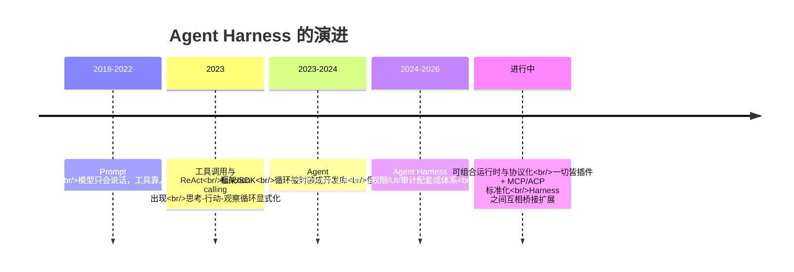
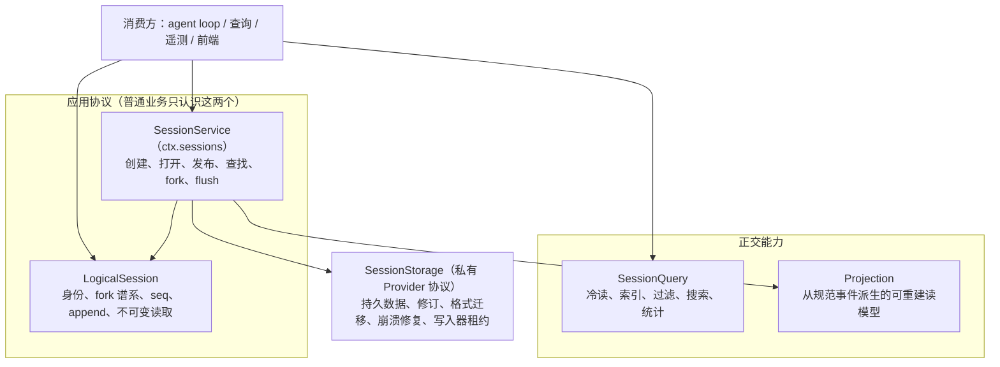
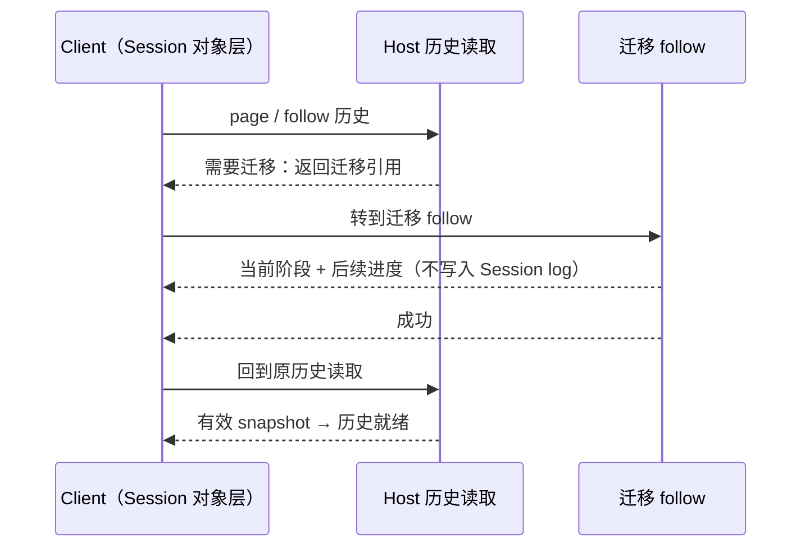

# 第 15 章 展望：Agent Harness 的过去、现在与未来

> 前十四章我们拆解了 DSH 的每一个零件。这一章把它们装回时间轴：Agent Harness 是怎么一步步演化出来的？DSH 的选择在行业里处于什么位置？上一版书稿（基准 `0.1.7-rc.2`）里写下的"预测"和"提案"，有哪些已经在 `0.2.1-alpha.2` 里落地？仓库里正在讨论的提案，又透露了哪些下一步？

> **本章你将学到**：
> - 演进史：五阶段范式转移
> - 趋势：协议标准化 / 安全与信任 / Agent 生态 / 边界移动——以及每条趋势在 DSH 里的"已落地"证据
> - 对账：上一版的提案与预测，在上一版基准 0.1.7-rc.2 → 0.2.1-alpha.2 之间各自走到了哪里（计时用户提问已落地）
> - 近期路线：从 `.agents/notes/proposed/` 读出的下一步（逻辑会话与存储重建、单会话迁移重定向、插件市场索引、Pi 扩展桥接与插件兼容分级等）
> - 开放问题：七个属于这个时代的分岔口
>
> 阅读提示：本章区分三种说法——**已落地**（HEAD 源码中存在且有 implemented 笔记）、**提案中**（`.agents/notes/proposed/` 下、Status 为 proposed）、**判断**（作者对行业趋势的看法）。另有一类 **已归档**（`.agents/notes/archived/`）：那是"有历史决策价值、但对未来指导有限"的 implemented 笔记，被整体冻结，仓库明确说明**不能把它当作当前行为的依据**——本章引用它们时只当历史看。提案可能被修改或否决，引用时请以仓库最新状态为准。

## 15.1 演进史：从 API 调用到 Agent Harness

Agent Harness 不是凭空出现的，它是过去几年里五次"范式转移"的叠加产物。每一次转移，都是把上一层的隐性假设显式化：

### 阶段一：Prompt 工程时代（2018-2022）

模型只能"说话"。你要让模型"做事"，就得把工具的执行结果手动复制进 prompt，再把模型的回答复制出去。这一阶段的核心假设是：**模型是唯一的智能，其余都是手工活**。

### 阶段二：工具调用与 ReAct（2023）

模型学会了输出结构化的工具调用（function calling），宿主程序负责执行。ReAct（Reason + Act）模式第一次把"思考-行动-观察"循环显式化：模型推理 → 调用工具 → 看到结果 → 再推理。这一阶段的核心洞见是：**智能不只存在于模型参数里，还存在于"模型与世界的循环"里**。但循环本身——谁来转、怎么转、怎么保证安全——还是每个应用自己写。

### 阶段三：Agent 框架/SDK（2023-2024）

LangChain、OpenAI Agents SDK、CrewAI 等把循环封装成开发库：你 import 一个 agent，配几个工具，循环就转起来了。这一阶段解决的是"开发效率"，但暴露了下一个问题：**库不是产品**。库不管会话怎么存、命令怎么沙箱化、权限怎么审批、UI 怎么展示、审计怎么做。

### 阶段四：Agent Harness / 产品化（2024-2026）

Claude Code、Codex、Cursor、DSH 这批产品/框架出现。它们把"运行 Agent 的全部配套"——沙箱、会话、权限、UI、凭据、遥测——做成一个可运行的整体。这一阶段的核心判断是：**Agent 的下一个瓶颈不是模型，而是宿主**。模型负责"想"，宿主负责"活"：让它安全地活在真实世界里。

### 阶段五（正在发生）：可组合运行时与协议化

DSH 属于这一阶段：一切皆插件、能力接缝可替换、多入口（CLI/Web/Desktop/ACP/JSON-RPC/Python SDK）。同时，行业里 MCP（Model Context Protocol）统一工具与资源协议、ACP（Agent Client Protocol）统一 Agent 与客户端之间的通信。方向很清晰：**Agent 基础设施正在从"一个产品"走向"一套协议 + 可组合的运行时"**。这一版里还出现了一个新的信号：Harness 之间开始互相"兼容对方的扩展"——DSH 已能加载 Claude Code 的 hooks 与 mods，并在提案里评估 Pi 的扩展与插件（15.7 节）。

五阶段的时间线一目了然：

### 一条主线

把五个阶段串起来看，演进的主线是：**把"隐性假设"逐层显式化**——循环从应用代码里显式出来（阶段二），从库的封装里显式出来（阶段四），配置从代码里显式出来（DSH 的 profile），安全从信任里显式出来（fail-closed 沙箱），状态从内存里显式出来（事件溯源）。DSH 的价值，就是把这五条显式化做到了极致。这一版又多了两条：**执行坐标**从隐含的进程 cwd 里显式出来（工作目录服务与 `working-directory/change` 事件，第 13 章），**结果投递**从"后台任务 + 模型自己记得去取"里显式出来（子 Agent 的统一激活与 caller 投递，第 13 章）。15.7 节会看到，它的下一步依然沿着这条主线走：把"会话"本身从一个具体类里显式成一组协议。

## 15.2 为什么是现在：三个技术条件

Agent Harness 不是"早有人想到但没人做"，而是条件不成熟。三个条件在 2024-2026 年才同时到位：

1. **模型能力的拐点**：长上下文、可靠的工具调用、多步推理。没有这些，循环转两圈就散架，Harness 无从谈起。
2. **成本与开源的临界点**：API 成本下降 + 开源模型（DeepSeek 是其中代表）让"跑一个编码 Agent"从研究项目变成日常开发工具。DSH 的测试文档甚至写道"推理在这里很便宜"，鼓励大量真实 API 测试（第 14 章）。
3. **代码领域的天然适配**：代码是可验证的（跑测试就知道对错）、结构化的（文件、仓库、AST）、有明确反馈的（编译错误、测试失败）。这使编码 Agent 成为 Agent 技术最成熟的试验场——DSH 是编码 Agent 起家，但它的设计（接缝、事件溯源、沙箱）并不是编码专属的：第 13 章的 Office 技能、文档预览、定时提醒、浏览器与电脑操作、思维链翻译，已经在把同一副骨架伸向非代码任务。

## 15.3 趋势一：能力接缝与协议标准化

DSH 的接缝设计（服务定义/Provider/Consumer）和行业协议（MCP、ACP）在回答同一个问题：**能力如何被声明、发现、复用**。

- MCP 把"工具与资源"标准化：一个 MCP 服务器 = 一套工具、资源与使用指引，任何 Agent 都能挂载。
- ACP 把"Agent 会话控制"标准化：一个 ACP 服务器 = 一个可被程序化驱动的 Agent。
- DSH 的接缝是"协议的内化版"：不依赖网络协议，而是把"换实现"变成一行配置。

**已落地的证据**：

- MCP 不再只是"工具桥"：`mcp-resources` 提供按需读取的资源工具，每个服务器的指令以作用域段落进入提示词；`dsh-mcp-client` 改用官方 TypeScript client **自动协商协议版本**（上一版引用的两篇笔记 `2026-09-12-mcp-resources-and-instructions`、`2026-09-12-mcp-sdk-protocol-negotiation` 现已归档）。
- ACP 走向"标准子集而非私有扩展"：`dsh-acp` 实现标准 ACP v1 的自动化控制子集，明确不加自定义方法与私有 `_meta`（笔记 `2026-08-22-standard-acp-automation-controls`，已归档）。
- **新**：外部 Agent 成为"按需官方组合包"。Claude Code 与 Codex 子 Agent 不再随 `@deepseek-ai/dsh` 安装，而是列在 `ON_DEMAND_BUNDLES` 里、由插件页按需安装，安装后贡献全局工具 `tool-subagent-claude-code` / `tool-subagent-codex`（笔记 `2026-10-05-official-on-demand-bundles`，第 13 章）。
- **新**：兼容别家的扩展。Claude Code 与 Codex 的 shell hooks 由实验性 hooks 组桥接，Claude Code mods 由 `docs/subsystems/claude-code-mods.zh.md` 描述的桥接加载（第 13 章）。
- **新**：可观测性走标准协议。`ctx.otel` 把事件与会话日志以 OpenTelemetry 形式上报（`session-telemetry-otel`，base 默认 `FEEDBACK_ONLY`），而不是再造一套私有遥测格式。
- 生态分发变得可用：插件页的引导式安装与注册表计划（带 npmmirror 备选源）让"装一个第三方组合包"不再需要手写 `.npmrc`（第 14 章）；下一步的"插件市场索引"已进入提案（15.7 节）。

**判断**：未来 Harness 的竞争焦点将从"内置多少工具"转向"能接入多少生态"。值得注意的是 DSH 在协议上的克制——它宁可采用官方 SDK、只实现标准子集，也不在协议上"加私货"；市场索引提案同样选择**复用 npm 的包名、版本、范围与 dist-tag 语义**，而不是另立一套。谁把接缝做得越干净、对标准越诚实，谁就越能成为 Agent 世界的"操作系统"。

## 15.4 趋势二：安全与信任会成为第一公民

当 Agent 开始写代码、改文件、执行命令、访问网络时，信任从"人格信任"（相信模型不会干坏事）变成了"机制信任"（系统保证它干不了坏事）。DSH 展示了机制信任的三个层次：

- **OS 级**：平台原生沙箱（Landlock/Seatbelt/ACL），fail-closed——沙箱失败就拒绝执行；
- **应用级**：审批策略、permission presets、写前必读的 observation policy；
- **审计级**：事件溯源日志，任何行为可回放。

这一版在 OS 级与应用级之间还补了一块：**Python PTC 现在要求沙箱**（升级指南 `v0.2.1-alpha.1/python-ptc-sandbox`），而切换工作目录**不会**扩大沙箱写根（第 13 章 13.12 节）——"Agent 去了哪里"和"Agent 能写哪里"被刻意分开。

上上版书稿（0.1.7-rc.2 之前）在这里写过三句预测，上一版做过一次对账。到 `0.2.1-alpha.2`，它们的状态如下：

| 早先的预测 | 0.1.7-rc.2 时的现状 | 0.2.1-alpha.2 的现状 | 依据 |
| --- | --- | --- | --- |
| "沙箱会更强（云沙箱、E2B 式的隔离环境）" | 部分落地，路线改变：E2B 移除，SSH 运行时接替 | **继续加固**：SSH 改为 `launch` 配置 + 新的 `ssh-helper-runtime`，helper 归档随 GitHub Release 发布；Python PTC 强制沙箱 | `2026-09-11-remove-e2b-providers`、`2026-09-11-posix-ssh-runtime`、`2026-09-19-windows-acl-mandatory-integrity-confinement`；升级指南 `ssh-helper-launch`、`python-ptc-sandbox` |
| "审批会更智能（基于上下文的动态策略）" | 已落地（实验）：Auto review | **维持**：`auto-review` 仍是 `OPTIONAL_BUNDLES` 中的可选组合包，未升级为默认 | `2026-08-28-auto-review`、`2026-09-24-auto-review-user-approval-fallback` |
| "审计会与安全分析结合（异常行为检测）" | 未见实现 | **仍未见异常检测**；但"把事实送出去"的管道已经有了：OTel 事件/会话日志上报（`ctx.otel`）与 Session Inspector | 第 13 章 13.8、13.12 节 |

E2B 的移除值得再读一遍它的理由：E2B SDK 没有额外的描述符传输，而 PTC Node 约束需要一条独立于程序 stdin/stdout/stderr 的双向控制通道；硬补这条桥会把一个实验变成独立的远程传输项目。于是团队选择**用更小的维护范围换取放弃这个集成**，同时明确"远程执行仍是预期能力"——SSH 运行时就是在同一套接缝约定下给出的替代答案。这是一个很好的工程范例：**预测的方向对了，但实现路径由约束条件决定**。

**判断**：沙箱的粒度永远追不上模型的想象力——总会有"合法但危险"的操作。Auto review 的设计给出了一个有意思的方向：不是让机器完全替人决定，而是让机器先筛、把真正的"灰区"交给人（15.8 节再展开）。至于"异常检测"，OTel 管道的出现说明 DSH 更可能把它交给外部的可观测性系统，而不是在 Harness 内部自己做——这仍是判断，不是事实。

## 15.5 趋势三：从单 Agent 到 Agent 生态

第 13 章我们看到了 DSH 的子 Agent 委派（本地 DSH 子会话 / ACP / Codex / Claude Code）。早先的书稿说 Agent Team 是"多 Agent 协作从概念走向实现的信号"，并预测了三件事。到 `0.2.1-alpha.2`：

- **角色分化与团队协作 —— 已落地（实验），而且变简单了**：Agent Teams 仍是一个可选组合包（`agent-team-profile`，在插件页一键启用，九个模型工具）。上一版写的"持久 mailbox"已被拆掉：Team 消息**直接进入目标 Agent 的 inbox**，`send_message` 只返回准入结果，不再保留未投递意图、不在重启后重试（笔记 `2026-09-26-team-direct-inbox`）。历史 mailbox 记录仍可解码、可回放，但不再投递。
- **工作流引擎 —— 已落地，并且更安全了**：工作流脚本运行在共享的 PTC Node 进程运行时，继承 OS 文件约束与受管清理（笔记 `2026-09-13-workflow-ptc-sandbox-reuse`）。
- **"Agent 经济"（能力成为可交易的服务）—— 仍未落地，但有了第一块地基**：仓库里仍没有交易或计费层；不过"插件市场索引格式"提案（15.7 节）第一次把"可浏览、可发现的第三方能力目录"写成了格式，并且明确要支持**第三方发布的市场**。从"能装"到"能找"，是"能交易"之前必须走的一步。

同时出现的"收敛"信号，比扩张更值得记下：

- **统一激活**：子 Agent 不再走后台 Jobs，`run_in_background`/`backgroundMode` 被删除；模型侧工具一律返回 `{ kind: 'activation', subagentId }`，结果由 caller 投递回来（笔记 `2026-09-17-unified-subagent-activations`）。进程内 driver（`subagent-in-process-driver`）随之删除——**多一种投递方式，就多一种"结果丢了谁负责"的歧义**。
- **克制**：固定的全新 Agent 循环 `ralph` 在随附默认组合中仍是关闭的（笔记 `2026-09-12-ralph-off-in-shipped-defaults`，已归档），理由是"完成与否是 worker 的自我声明，没有独立评估"；这一版它变成了可选的 `ralph-bundle`——能力可以一键装，但仍不默认替用户打开。
- **事实归属**：子 Agent 目录由父会话的 `subagent/catalog` 事件持有（笔记 `2026-09-01-parent-owned-subagent-catalog`）；外部子 Agent 的目录项带 `mode: 'external'`——多 Agent 越多，"谁生了谁、谁在本地谁在外部"越要是一条可审计的事实。

**判断**：单机、单进程的运行时需要变成"分布式协作的中枢"。DSH 的接缝和事件溯源恰好为此准备：事件溯源让每个 Agent 的决策都可审计，接缝让不同 Agent 共享同一套能力。但这一版的几次收敛（统一激活、直接 inbox、删 in-process driver）提醒我们，**生态的扩张速度应该受"可验证性"和"职责唯一性"约束**：两套投递路径、两个 inbox owner，比少一点功能更危险。

## 15.6 趋势四：模型与 Harness 的边界在移动

这是最深刻也最不确定的趋势。模型能力在指数增长，Harness 的能力在稳步增长，两者的边界会不断移动：

- **哪些能力会被模型内化？** 工具调用已经是原生能力；未来"长上下文管理"（也许取代部分 compaction）、"自我纠错"（也许取代部分 loop 控制）可能被内化。
- **哪些能力必须留在宿主？** 沙箱、凭据、审计、审批——这些是"信任基础设施"，不应该交给模型，否则就是让囚犯管钥匙。即便是 Auto review 这样"用模型审模型"的设计，最终兜底依然是宿主的审批服务和用户。
- **事件溯源 vs 原生长上下文**：如果模型一次能"记住"整个仓库，会话日志还需要吗？答案是：需要——因为日志不只是给模型看的，还是给人审计、给系统回放、给 UI 重放、给第 14 章的 keyless 快照做测试输入的。**上下文是算出来的，事实是记下来的，两者永远分工。**

仓库里一个仍在提案中的想法把这个问题推得更远：**可召回的压缩**（`proposed/feature/2026-07-06-recallable-compaction`）。它指出压缩对模型当前上下文不可逆——被摘要遮蔽的内容虽然仍在只追加日志里，模型却无法再读到；提案认为事件溯源会话"具备持久原文、可按 seq 寻址和精确回放"，是让模型在循环内回溯、并让压缩感知前缀缓存的天然底座。**如果这条路走通，"事实记下来"就不只服务于人和系统，也重新服务于模型本身。**

"事实记下来"本身也在变得更讲究：implemented 笔记 `2026-10-08-session-reader-compatibility-review` 规定，**Session 格式要不要升版本，取决于旧读取器的行为**，而不是 schema 有没有结构差异——旧读取器能正确恢复、安全忽略可选特性，或在执行与尾部修复之前拒绝必需特性，就可以保持同一版本；只有不存在能阻止错误解释的判别标记时才必须升版本。写入格式目前是 V4（`SESSION_FORMAT_VERSION = 4`，第 6 章）。

一个可能的终局图景：**Harness 成为"模型的运行时操作系统"**——模型是 CPU，Harness 是内核，插件是驱动，事件溯源是文件系统（一切皆事实），沙箱是内存保护，审批是权限管理，工作目录就是进程的 cwd。这个类比不完美，但足够引发思考。

## 15.7 近期路线：从提案看下一步

`.agents/notes/proposed/` 是 DSH 的"公开待办"。先对一次账，再看新提案。

### 对账：上一版的提案走到了哪里

| 上一版（0.1.7-rc.2）列出的提案 | 0.2.1-alpha.2 的状态 | 证据 |
| --- | --- | --- |
| 计时用户提问的两次结算 | **已落地** | 笔记移入 `implemented/architecture/2026-09-19-timed-user-question-two-settlements`；`packages/interaction/tool-ask-user/src/index.ts` 的配置有 `mode: 'legacy' \| 'timed'`（默认 `legacy`）与 `timeout`（默认 120，`-1` 表示阻塞） |
| 逻辑会话与存储重建（含能力协议、开发者迁移、数据兼容、FAQ 四篇配套） | 仍为提案，五篇笔记自基准以来**未修改** | `LogicalSession` 在 HEAD 仍只是 `packages/session-query/session-query/src/corpus.ts` 里的局部接口 |
| Composer 模型与 DraftEditor | 仍为提案；相邻的"结构化草稿初始化"已落地 | `input/editor/DraftEditor.tsx`、`runtime.ts` 存在；implemented 笔记 `2026-09-30-structured-draft-initialization` 在保留 `DraftEditorRuntime` 的前提下实现了带引用的草稿恢复 |
| 一批"做减法"提案（`config-only-hmr`、`python-sdk-directional-client`、`trim-session-query-convenience-api`、`retire-prompt-registry-change-event` 等） | 仍为提案 | 文件仍在 `proposed/simplification/` |
| `omit-fs-payload-invariant` | **提案被删除**——不是落地，而是它要优化的对象没了：运行时不变式机制在提交"remove runtime invariant plugins"中被整体移除 | 升级指南 `v0.2.0-rc.2/remove-runtime-invariants`（第 14 章） |
| Desktop 更新三篇、交互式侧会话、任务界面、可召回压缩 | 仍为提案 | 文件仍在 `proposed/feature/` |

### 计时用户提问：从提案到实现

`2026-09-19-timed-user-question-two-settlements` 是上一版"近期路线"里唯一走完全程的一项，值得看看它落地成了什么样：

- 默认 `mode: legacy` 保留阻塞式 schema 与 `ask()` 路径；显式 `mode: timed` 才启用 `timeout`，省略时用配置默认值 120 秒。正整数超时选择 `askTimed()`，`-1` 选择阻塞式 `ask()`；
- 超时后前台请求结束、返回 pending，Agent 可以继续做不依赖回答的工作；用户的**迟到回答**作为一条持久用户消息 steer 进会话；
- 问题状态由 `userQuestions` 投影**从现有 Session 事件重建**——timed 调用通过 `request/header` 记录的 `timeout` 参数识别，`tool/result` 为 pending 时问题标为"已继续"；PTC 子调用也纳入投影；
- 实现笔记自己列出了尚未覆盖的部分："真实多 Client 投递竞争与真实 Host 重启"仍是集成覆盖缺口。

关键语义没有变："pending 既不是跳过回答，也不是开展需要批准的工作的授权"。

### 逻辑会话与存储重建（仍在排队）

`2026-09-06-logical-session-storage-rebuild` 是规模最大的一组提案，配套还有 `2026-09-10-session-capability-protocols`、`2026-09-10-session-developer-transition`、`2026-09-10-session-data-compatibility` 与 `2026-09-10-session-refactor-faq`。

问题是：会话消费方直接依赖具体的事件日志类、实时会话注册表、投影注册表与持久化句柄——逻辑行为、发布、存储、物理格式混在一起。提案的目标结构是"一个小逻辑核心 + 若干正交能力"：

提案按"堆叠阶段"推进，且**阶段 1–3 不改变磁盘格式或启动方式**。这五篇笔记在上一版基准之后没有任何修改，HEAD 中也未出现提案里的 `LogicalSession` 抽象。与此同时，会话这一侧落地的是一些更"窄"的决定：`2026-09-29-explicit-session-history-preparation` 让侧栏 fork 在源会话需要格式迁移时被拒绝并引导用户先打开原会话（`allowMigration: false`、`formatStatus`、`kind: migration-required`），`2026-10-08-session-reader-compatibility-review` 改写了升版本的标准（15.6 节）。**大重构在排队，边界上的小决定在持续落地**——这本身就是 15.1 节"主线"的一种推进方式。

### 新提案：单会话迁移的 follow 重定向

`2026-09-29-session-migration-follow-redirect` 接着上面那篇 implemented 笔记往下走：打开历史会话可能要等一次较长的格式转换，普通 loading 说不清当前阶段，也显示不了失败；而把进度写进历史事件，又会污染模型日志、改变历史流的序号语义。

提案给单会话历史读取加一个 **typed 业务重定向**——"302"是业务结果，不是浏览器跳转，也不接受任意 URL：

几个约束很有 DSH 风格：多个等待者共享同一个迁移任务，关闭一个视图只释放它自己的等待；进度**不写入 Session log**，也不借用 `session.control`；不知道总量就**不显示伪造的百分比**；已开始的持久发布遵守"运行至结算"。提案也坦白了一个尚未决定的问题——"完成"到底指读准备完成，还是新 generation 写入发布完成；前者要求迁移引用一直持有准备结果，后者会让"打开旧历史"额外需要写权限。实现前必须二选一，不能用一个模糊的 done 混用两种里程碑。

### 新提案：插件市场索引格式

`2026-10-02-plugin-market-index-format` 回答的是"用户怎么**找到**插件"。现在 DSH 只能从用户已知的 spec（npm 包名、Git URL、tarball、本地路径）安装组合包；只给一份"包名列表"又会让列表页为每一行去取 manifest、语言文件和图标。提案因此：

- **把"索引"与"索引生成器"分开**：DSH 只定义并读取一种 JSON 索引格式（`"format": 1`），索引怎么生成、从哪份源列表生成由生成器负责；读取器、Discover 页面和参考生成器是各自独立的变更；
- 索引自带列表页要显示的一切：本地化标题与描述、图标、作者、可用版本、兼容性（例如 `engines.dsh`）、发布时间；市场自己的分类、标签、下载量、评分放在 `metadata` 里，**DSH 不需要理解这些值的含义**；
- 复用 npm 的包名、版本、范围、dist-tag 与 person 语义，新增字段必须是 npm 满足不了的市场需求；
- 目前没有官方市场，以后可能会有，所以机制必须支持**第三方发布的索引**；安装仍走引导式插件安装（第 14 章）。

截至 HEAD，仓库里还没有市场索引的读取器或 Discover 页面。

### 新提案：Pi 扩展桥接与 Pi 插件兼容分级

两篇 10 月 3 日的提案把"兼容别家扩展"推进到第三个生态——Pi（1.0.0）：

- **扩展桥接**（`2026-10-03-pi-extensions-bridge`）：Pi 扩展是进程内的 TypeScript 工厂函数 `(pi: ExtensionAPI) => void`，订阅约四十个生命周期/上下文/工具/提供方事件；提案统计"截至 2026 年 10 月 npm 上约有 11,000 个包带有 `pi-package` 关键字"。DSH 拟新增实验包 `@deepseek-ai/dsh-experimental-pi-extensions`（Host，提供 `ctx.piExtensions`）与 `@deepseek-ai/dsh-experimental-client-ui-pi-extensions`（Web）。它们**不是可选 bundle**，而是像 Claude Code mods 一样由按需启用的 overlay 组合；源码用 `jiti` 导入，Pi 的事件映射到 DSH 已有的扩展点（`tools/pre-execute`、`tools/post-execute`、`agent/turn-stopping`、`system-prompt/assemble` 等），Pi 的 `bash/read/edit/write/grep/find` 与 DSH 工具之间做双向参数转换。它被定位为一次**能力演示**：现有机制承载不了的部分就不提供，并逐条列入兼容性页面——这同时在回答"DSH 的哪些核心机制比 Pi 窄"。
- **插件兼容分级**（`2026-10-03-pi-plugins-compatibility`）：Pi 的"插件"是另一套构建在 Chord 组合运行时上的机制。提案把兼容划成 **0–5 共六级**，每一级写明插件作者得到什么、哪个**上游触发条件**出现才值得做、DSH 要付出什么工作；结论是 **DSH 停留在 0 级**（"本 Agent Note 是唯一产物"），理由来自上游自己：插件 API 未发布且不稳定（需要 `PI_EXPERIMENTAL=1`），而且插件能做的事比扩展还少。

截至 HEAD，`packages/experimental/` 下并没有 Pi 相关的包。

### 仍在排队的其他提案

- **Desktop 更新**：`2026-09-08-desktop-update-policy-and-installation` 等三篇记录尚未完成的发布与后端工作；客户端侧的强制更新由 implemented 笔记与 `apps/desktop/README.zh.md` 负责，测试包鉴权弹窗的默认关闭见第 14 章。
- **交互式侧会话**（`2026-07-08-interactive-side-sessions`）：从当前会话最后一个完成轮次 fork 出一个只读顾问会话，再合并回写一条精简笔记。
- **任务界面**（`2026-08-04-task-surface`）：用有界、可回放的描述定义只属于一次工具调用的临时 UI。
- **做减法**：上表那批 simplification 提案，方向都是"删掉没有生产方或消费方的东西"，与第 14 章"未覆盖的行往往是死代码"一脉相承。这一版最大的一次减法——移除整套运行时不变式——甚至不是从这批提案里来的，而是直接以升级指南的形式交付。

## 15.8 开放问题：写给读者

以下问题没有标准答案，它们代表这个领域真正的分岔口。读完本书的你，已经有足够的知识去形成自己的判断：

1. **Self-modification 的边界**：DSH 已经把"模型改自己的运行时"收敛为"只读检查 + 需要完全访问或逐次批准的持久化组合包安装"（第 13 章创造模式）。如果模型的自我扩展能力与日俱增，这条边界够不够？下一步应该是更细的审批、注册表白名单，还是完全交给审计？
2. **事件溯源 vs 压缩**：当模型上下文窗口继续扩大，"从日志推导一切"的成本会越来越高。未来是更大窗口直接读日志，还是像"可召回压缩"提案那样，让模型能按 seq 回溯被压缩的原文？还是两者结合？
3. **协议 vs 产品**：Agent 基础设施最终会像 HTTP 一样标准化（人人互通），还是像操作系统一样赢家通吃？DSH 选择"采用官方 SDK、只实现标准子集"，市场索引也复用 npm 语义——这种克制在竞争中是优势还是劣势？
4. **人机决策边界**：Auto review 让机器先筛、把灰区交给人；计时提问已经落地，让 Agent 在等待回答时不必停工。当 Agent 能完成越来越完整的任务链条，"必须人来批准"的操作应该越来越少还是越来越精？人的回答"迟到"时，系统该如何对待已经发生的工作？
5. **Agent 编写 Agent**：当子 Agent 可以再开子 Agent（`maxDepth` 就是为此设的护栏），当工作流可以一次扇出多个 Agent、团队成员可以互发消息——"控制深度"和"释放能力"的平衡点在哪？`ralph` 变成可选组合包却仍不默认开启，Team 消息放弃了重启后重试，说明了什么？
6. **重构 vs 稳定**：逻辑会话重建承诺"阶段 1–3 不改变磁盘格式"，而升版本的标准已改为"看旧读取器的行为"。一个事件溯源系统在"持续演进内部抽象"和"保证每一段历史仍可回放"之间，应该如何分配成本？迁移进度为什么坚持不写进 Session log？
7. **兼容别人的生态**：DSH 已桥接 Claude Code 的 hooks 与 mods，又提案桥接 Pi 扩展，却对 Pi 插件停在 0 级。一个 Harness 应该在什么条件下去兼容另一个 Harness 的扩展 API？"上游 API 是否已发布、是否稳定"之外，还有哪些触发条件值得写进分级表？兼容层会不会反过来限制自己核心机制的演进？

## 15.9 结语：这本书想留给你的

如果你只从这本书带走一样东西，希望是这句话：**DSH 的价值不在 DSH 本身，而在于它示范了一组可迁移的设计思想**——

- **一切皆插件**：把变化点变成配置，把扩展点变成注册；
- **可逆副作用**：能干净卸载的系统，才能干净重启；
- **事件溯源**：状态会骗人，事实不会；
- **fail-closed 沙箱**：安全不是功能，是默认状态；
- **编译期契约**：让错误在构建时暴露，而不是在用户面前；
- **证据来自外部**：测试验证外部世界，失败响亮并留下证据。

这些思想适用于你未来写的任何系统——无论它是不是 Agent。而 DSH 自己的演进（上一版基准 0.1.7-rc.2 → 0.2.1-alpha.2：计时提问从提案走进代码，Schedule 组合包退役为 `tool-schedule`，子 Agent 投递统一为激活，Team 改用直接 inbox，整套运行时不变式被移除，每一次破坏都配上一篇升级指南）也在示范最后一条：**好的系统不只会加东西，也敢于做减法——并且告诉用户怎么跟上。**

最后，回到第 1 章那个问题："模型只能说话，谁替它做事？"读完这本书，你已经知道答案：**是 Harness，而 Harness 是你通过配置和插件塑造的。** 现在，去塑造你自己的那个。

（全书完。欢迎回到每一章的思考题，带着这本书读到的全部知识，重新回答一次。）
