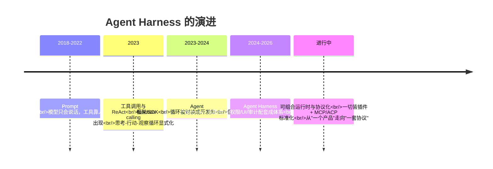

# 第 15 章 展望：Agent Harness 的过去、现在与未来

> 前十四章我们拆解了 DSH 的每一个零件。这一章把它们装回时间轴：Agent Harness 是怎么一步步演化出来的？DSH 的选择在行业里处于什么位置？未来五年，这个领域最有可能发生什么？

## 15.1 演进史：从 API 调用到 Agent Harness

Agent Harness 不是凭空出现的，它是过去几年里五次"范式转移"的叠加产物。每一次转移，都是把上一层的隐性假设显式化：

### 阶段一：Prompt 工程时代（2018-2022）

模型只能"说话"。你要让模型"做事"，就得把工具的执行结果手动复制进 prompt，再把模型的回答复制出去。这一阶段的核心假设是：**模型是唯一的智能，其余都是手工活**。

### 阶段二：工具调用与 ReAct（2023）

模型学会了输出结构化的工具调用（function calling），宿主程序负责执行。著名的 ReAct（Reason + Act）模式第一次把"思考-行动-观察"循环显式化：模型推理 → 调用工具 → 看到结果 → 再推理。这一阶段的核心洞见是：**智能不只存在于模型参数里，还存在于"模型与世界的循环"里**。但循环本身——谁来转、怎么转、怎么保证安全——还是每个应用自己写。

### 阶段三：Agent 框架/SDK（2023-2024）

LangChain、OpenAI Agents SDK、CrewAI 等把循环封装成开发库：你 import 一个 agent，配几个工具，循环就转起来了。这一阶段解决的是"开发效率"，但暴露了下一个问题：**库不是产品**。库不管会话怎么存、命令怎么沙箱化、权限怎么审批、UI 怎么展示、审计怎么做。

### 阶段四：Agent Harness / 产品化（2024-2026）

Claude Code、Codex、Cursor、DSH 这批产品/框架出现。它们把"运行 Agent 的全部配套"——沙箱、会话、权限、UI、凭据、遥测——做成一个可运行的整体。这一阶段的核心判断是：**Agent 的下一个瓶颈不是模型，而是宿主**。模型负责"想"，宿主负责"活"：让它安全地活在真实世界里。

### 阶段五（正在发生）：可组合运行时与协议化

DSH 属于这一阶段：一切皆插件、能力接缝可替换、多入口（CLI/Web/ACP/JSON-RPC/Python SDK）。同时，行业里 MCP（Model Context Protocol）统一工具协议、ACP（Agent Client Protocol）统一 Agent 间通信。方向很清晰：**Agent 基础设施正在从"一个产品"走向"一套协议 + 可组合的运行时"**。

五阶段的时间线一目了然：

### 一条主线

把五个阶段串起来看，演进的主线是：**把"隐性假设"逐层显式化**——循环从应用代码里显式出来（阶段二），从库的封装里显式出来（阶段四），配置从代码里显式出来（DSH 的 profile），安全从信任里显式出来（fail-closed 沙箱），状态从内存里显式出来（事件溯源）。DSH 的价值，就是把这五条显式化做到了极致。

## 15.2 为什么是现在：三个技术条件

Agent Harness 不是"早有人想到但没人做"，而是条件不成熟。三个条件在 2024-2026 年才同时到位：

1. **模型能力的拐点**：长上下文、可靠的工具调用、多步推理。没有这些，循环转两圈就散架，Harness 无从谈起。
2. **成本与开源的临界点**：API 成本下降 + 开源模型（DeepSeek 是其中代表）让"跑一个编码 Agent"从研究项目变成日常开发工具。
3. **代码领域的天然适配**：代码是可验证的（跑测试就知道对错）、结构化的（文件、仓库、AST）、有明确反馈的（编译错误、测试失败）。这使编码 Agent 成为 Agent 技术最成熟的试验场——DSH 是编码 Agent 起家，但它的设计（接缝、事件溯源、沙箱）完全不是编码专属的。

## 15.3 趋势一：能力接缝与协议标准化

DSH 的接缝设计（服务定义/Provider/Consumer）和行业协议（MCP、ACP）在回答同一个问题：**能力如何被声明、发现、复用**。

- MCP 把"工具"标准化：一个 MCP 服务器 = 一套工具，任何 Agent 都能挂载。
- ACP 把"Agent"标准化：一个 ACP 服务器 = 一个可被委派的 Agent，Claude Code 可以当 DSH 的父 Agent，反之亦然。
- DSH 的接缝是"协议的内化版"：不依赖网络协议，而是把"换实现"变成一行配置。

可以预见：未来 Harness 的竞争焦点将从"内置多少工具"转向"能接入多少生态"。谁把接缝做得越干净，谁就越能成为 Agent 世界的"操作系统"。

## 15.4 趋势二：安全与信任会成为第一公民

当 Agent 开始写代码、改文件、执行命令、访问网络时，信任从"人格信任"（相信模型不会干坏事）变成了"机制信任"（系统保证它干不了坏事）。DSH 展示了机制信任的三个层次：

- **OS 级**：平台原生沙箱（Landlock/Seatbelt/ACL），fail-closed——沙箱失败就拒绝执行；
- **应用级**：审批策略、permission presets、写前必读的 observation policy；
- **审计级**：事件溯源日志，任何行为可回放。

未来方向：沙箱会更强（云沙箱、E2B 式的隔离环境）、审批会更智能（基于上下文的动态策略）、审计会与安全分析结合（异常行为检测）。但一个值得思考的问题是：**沙箱的粒度永远追不上模型的想象力**——总会有"合法但危险"的操作。所以信任问题的最终答案，可能不是更强的沙箱，而是更清晰的"人机边界"：哪些事必须人来拍板（第 15.7 节再展开）。

## 15.5 趋势三：从单 Agent 到 Agent 生态

第 13 章我们看到了 DSH 的子 Agent 委派（进程内/ACP/Codex/Claude Code）。这只是开始。未来几年你会看到：

- **角色分化**：写代码的、审代码的、跑测试的、查资料的 Agent 各司其职，通过协议协作；
- **工作流引擎**：让模型编写编排脚本（DSH 的 workflow 已经这么做了），Agent 从"单兵"变成"指挥官"；
- **Agent 经济**：Agent 订阅其他 Agent 的能力，能力成为可交易的服务。

这对 Harness 的含义：单机、单进程的运行时需要变成"分布式协作的中枢"。DSH 的接缝和事件溯源恰好是为此准备的架构——事件溯源让每个 Agent 的决策都可审计，接缝让不同 Agent 共享同一套能力。

## 15.6 趋势四：模型与 Harness 的边界在移动

这是最深刻也最不确定的趋势。模型能力在指数增长，Harness 的能力在稳步增长，两者的边界会不断移动：

- **哪些能力会被模型内化？** 工具调用已经是原生能力；未来"长上下文管理"（也许取代部分 compaction）、"自我纠错"（也许取代部分 loop 控制）可能被内化。
- **哪些能力必须留在宿主？** 沙箱、凭据、审计、审批——这些是"信任基础设施"，不应该交给模型，否则就是让囚犯管钥匙。
- **事件溯源 vs 原生长上下文**：如果模型一次能"记住"整个仓库，会话日志还需要吗？答案是：需要——因为日志不只是给模型看的，还是给人审计、给系统回放、给 UI 重放的。**上下文是算出来的，事实是记下来的，两者永远分工。**

一个可能的终局图景：**Harness 成为"模型的运行时操作系统"**——模型是 CPU，Harness 是内核，插件是驱动，事件溯源是文件系统（一切皆事实），沙箱是内存保护，审批是权限管理。这个类比不完美，但足够引发思考。

## 15.7 开放问题：写给读者

以下问题没有标准答案，它们代表这个领域真正的分岔口。读完本书的你，已经有足够的知识去形成自己的判断：

1. **Self-modification 的边界**：DSH 的 tool-cordis 允许模型改自己的运行时（官方警告等同 shell 权限）。如果模型的自我修改能力与日俱增，信任边界应该画在哪？是禁止、审批、还是审计？
2. **事件溯源 vs 压缩**：当模型上下文窗口继续扩大，"从日志推导一切"的成本会越来越高。未来是更大窗口直接读日志，还是更聪明的压缩（compaction）？还是两者结合？
3. **协议 vs 产品**：Agent 基础设施最终会像 HTTP 一样标准化（人人互通），还是像操作系统一样赢家通吃（少数 Harness 垄断）？DSH 的"一切皆插件"倾向哪个方向？
4. **人机决策边界**：当 Agent 能完成越来越完整的任务链条（写代码→测试→部署），"必须人来批准"的操作应该越来越少还是越来越精？审批的粒度会变成什么样？
5. **Agent 编写 Agent**：当子 Agent 可以再开子 Agent（DSH 的 maxDepth 就是为此设的护栏），深度失控会带来什么？"控制深度"和"释放能力"的平衡点在哪？

## 15.8 结语：这本书想留给你的

如果你只从这本书带走一样东西，希望是这句话：**DSH 的价值不在 DSH 本身，而在于它示范了一组可迁移的设计思想**——

- **一切皆插件**：把变化点变成配置，把扩展点变成注册；
- **可逆副作用**：能干净卸载的系统，才能干净重启；
- **事件溯源**：状态会骗人，事实不会；
- **fail-closed 沙箱**：安全不是功能，是默认状态；
- **编译期契约**：让错误在构建时暴露，而不是在用户面前。

这些思想适用于你未来写的任何系统——无论它是不是 Agent。

最后，回到第 1 章那个问题："模型只能说话，谁替它做事？"读完这本书，你已经知道答案：**是 Harness，而 Harness 是你通过配置和插件塑造的。** 现在，去塑造你自己的那个。

（全书完。欢迎回到每一章的思考题，带着这本书读到的全部知识，重新回答一次。）