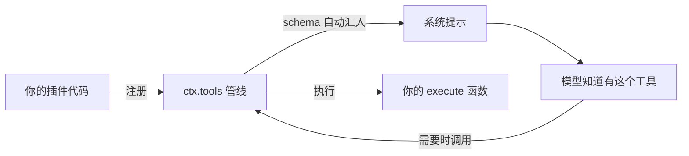

# 附录 D 从零写一个插件：端到端练习

> 这是全书唯一的"抄代码"附录——因为它的目的是让你**亲手跑通一个插件**。我们做一个最简单的工具：统计一个文件的行数。做完这个，你就有能力读任何真实插件的源码（比如 `tool-fs`），并照着写自己的。

## D.1 我们要做什么

目标：写一个工具 `count_lines`，模型可以调用它统计任意文件的行数。完成后，模型会在合适的时候自己选择调用它——因为**注册一个工具 = 模型自动知道怎么用它**（第 8 章）。



## D.2 准备

你需要一个能跑的 DSH 源码仓库（第 2 章），以及一个可写的目录放插件。我们以 `D:\plugins\count-lines` 为例。

## D.3 插件骨架

一个插件 = 一个 npm 包 + 一个入口文件。先创建目录和 `package.json`：

```json
{
  "name": "@yourname/dsh-count-lines",
  "version": "0.1.0",
  "type": "module",
  "main": "./src/index.ts",
  "exports": {
    ".": "./src/index.ts"
  },
  "dependencies": {
    "@deepseek-ai/cordis": "workspace:^",
    "@deepseek-ai/dsh-tools": "workspace:^",
    "@deepseek-ai/dsh-system-prompt": "workspace:^"
  }
}
```

> 说明：`workspace:^` 表示这个包将作为 DSH monorepo 的一部分解析——最省事的做法是把插件目录放进仓库的 `packages/` 下（比如 `packages/my-tools/count-lines`），享受仓库已有的依赖解析和构建。第 14 章的发布流程会把独立 npm 包讲透。

## D.4 写工具：src/index.ts

对照第 8 章的骨架，加上真实的细节（参数校验、返回值 schema、render、错误处理）：

```ts
import { readFile } from 'node:fs/promises'
import type { Context } from '@deepseek-ai/cordis'
import { defineTool } from '@deepseek-ai/dsh-tools'

export const name = 'count-lines'
export const inject = ['tools'] // 依赖声明：等 ctx.tools 就绪

export function apply(ctx: Context) {
  ctx.tools.register(defineTool({
    name: 'count_lines',
    description: '统计一个 UTF-8 文本文件的行数。',
    parameters: {
      file_path: { type: 'string', required: true, description: '要统计的文件的绝对路径' },
    },
    output: {
      schema: {
        type: 'object',
        additionalProperties: false,
        properties: {
          path: { type: 'string', required: true },
          lines: { type: 'integer', required: true },
        },
      },
      // render 面向模型：把结构化结果转成模型可读文本
      render: (_args, value) => [{ type: 'text', text: `文件 ${value.path} 共 ${value.lines} 行` }],
    },
    async execute(args, exec) {
      // args 已被 schema 校验：类型是 { file_path: string }
      // exec.signal 是取消信号：用户停止时停止在途工作
      const content = await readFile(args.file_path, { encoding: 'utf8', signal: exec.signal })
      return { path: args.file_path, lines: content.split(/\r?\n/).length }
    },
  }))
  // 注册即 effect：插件卸载时工具自动注销（第 3 章）
}
```

五个必须回答的"为什么"（对照第 8.2 节）：

1. `inject: ['tools']`——声明依赖，框架保证 `ctx.tools` 就绪后才加载你；
2. `parameters` 用对象映射——模型生成的 arguments 会按它校验，非法直接拒绝；
3. `output.schema` 声明返回值的结构——它是"模型看到的契约"；
4. `render` 是纯函数——它在直播和重放两个场景都会运行，**不要在里面做 I/O**；
5. `exec.signal`——不遵守取消契约会留下僵尸任务（第 7 章）。

## D.5 挂载：让 DSH 加载你的插件

两种方式，从临时到持久：

### 方式一：临时补丁（--patch，演示用）

写一个 patch 文件（比如 `my-plugin.yml`），用 insert 挂上你的插件：

```yaml
- insert:
    - id: count-lines
      name: '@yourname/dsh-count-lines'
```

然后带 patch 启动（需要你的插件能被加载器解析到，见 D.6 的安装说明）：

```powershell
corepack pnpm dsh --profile headless --patch .\my-plugin.yml 统计一下 README.md 有几行
```

### 方式二：profile 持久化

把插件装进 web profile 并 insert 条目（第 14.3 节的发布流程是这条路的正式版）：

```powershell
dsh plugin --profile web add @yourname/dsh-count-lines
```

然后编辑 `~/.dsh/profiles/web/cordis.patch.yml`，insert 同上的条目。

## D.6 让加载器能找到你的插件

最简单可靠的路径：**把插件放进 DSH 仓库的 `packages/` 下**（如 `packages/my-tools/count-lines/`），然后：

```powershell
corepack pnpm install   # 让 workspace 注册新包
corepack pnpm run build # 构建产物
```

之后 `name: '@yourname/dsh-count-lines'` 就能被解析（包名与 `packages/my-tools/count-lines/package.json` 的 `name` 一致）。

## D.7 成功标准（怎么确认做对了）

按顺序检查，任何一步失败都能定位到原因：

| # | 检查 | 成功标准 | 失败时看哪里 |
| --- | --- | --- | --- |
| 1 | 插件被加载 | `dsh --profile web --dump-config | Select-String count-lines` 能看到你的条目 | cordis.patch.yml 的 id/name 拼写 |
| 2 | 模型知道工具 | headless 任务的系统提示/日志里出现 `count_lines` 的工具说明 | `ctx.systemPrompt` 组装、schema 声明 |
| 3 | 工具被调用 | 会话 JSONL 里出现 `tool/call`（name=count_lines）和 `tool/result` | 模型是否觉得需要统计行数（换个明确要求的 prompt） |
| 4 | 结果正确 | `tool/result` 里的结果 = 手工 `(Get-Content file).Count` 的值 | `execute` 的实现 |
| 5 | 取消生效 | 运行中按停止，无僵尸进程 | `exec.signal` 是否传给 `readFile` |

## D.8 进阶：同一插件里再加一件事

工具只是插件的一种形态。同一个 `apply` 里，你还可以：

- **加系统提示段**（告诉模型什么时候该用你的工具）：

```ts
ctx.systemPrompt.section({
  name: 'tool:count-lines',
  order: 100,
  text: '统计行数时使用 count_lines 工具，不要用 shell 的 find/cat。',
})
```

- **监听事件**（做观测、做策略）：

```ts
ctx.on('tools/post-execute', (info) => {
  ctx.logger.info('工具 %s 执行完成，结果 %o', info.name, info.result)
})
```

- **提供服务**（给别人用，而不是只给模型用）：把能力注册到 `ctx` 上，成为其他插件的依赖。

## D.9 发布：让别人也能装你的插件

完整流程见第 14.3 节。摘要：构建（`pnpm run build`）→ 卫生检查（`pnpm run hygiene`）→ `npm publish` → 用户 `dsh plugin --profile web add <包名>`。发布包需要在 `package.json` 里声明 `dsh.bundle`（第 4.3 节），这样安装后它会自动成为 profile 的一个 bundle 层。

## D.10 常见错误速查

- **`inject` 写错服务名**：加载报 fail-loud，日志会列出可用的服务键；
- **`parameters` 少了 `required: true`**：模型可能不传这个参数，`execute` 里拿到 undefined；
- **`render` 里做文件读取**：重放场景会重复执行，甚至读到不一致的结果——render 必须纯函数；
- **忘了 `exec.signal`**：取消后 `readFile` 还在读，任务变成僵尸；
- **patch 的 `name` 与包名不一致**：加载器找不到包，报 module not found。

做完这个练习，你已经走完了 DSH 插件开发的完整闭环：写代码 → 挂载 → 验证 → 发布。现在可以打开 `packages/fs/tool-fs/src/read.ts` 读一个生产级工具——你会发现它的结构和你的插件几乎一模一样，只是多了错误处理和边界情况。