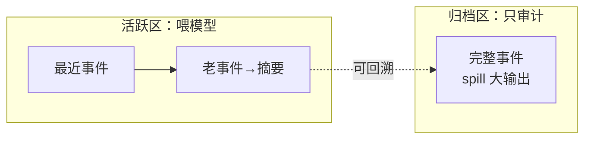

# 附录 F 性能与规模：Agent 系统在什么量级下会慢

> 前面章节讨论"怎么工作"，这个附录讨论"工作得多快、能撑多大"。Agent 系统的性能问题和传统 Web 服务不同——瓶颈往往不在请求数，而在**日志体积、上下文组装、沙箱开销、模型往返**。

## F.1 事件溯源日志：最大的"慢"来源

第 6 章说过：状态是"算"出来的，日志是"存"下来的。日志越大，"算"越慢。DSH 的日志膨胀有三个层次的问题和三个对策：

| 膨胀源 | 问题 | DSH 的对策 |
| --- | --- | --- |
| `assistant/chunk` 逐 token 保留 | UI 保真要它，但体积大 | 存储时以"chunk run"打包（`packChunkRuns`），压缩后落盘 |
| 工具大输出直接入日志 | 一次 grep 可能输出几 MB | **spill 机制**：超出阈值落外部存储，日志只留定位信息（第 6.8 节） |
| 老事件永不清除 | 长会话日志无限增长 | **compaction**：把老区间压成摘要（`compaction-basic`，默认 `thresholdRatio: 0.8`、`retainRatio: 0.16`） |

### compaction 的权衡：压缩多少，是个经济学问题

compaction 的核心参数是**什么时候触发**和**保留多少**：

- `thresholdRatio`（默认 0.8）：当推导出的历史接近上下文窗口的 80% 时触发压缩——太早压缩浪费信息，太晚压缩可能超出窗口；
- `retainRatio`（默认 0.16）：压缩后只保留最近 16% 的事件，老事件变成摘要——保留越多越保真（回放更完整），保留越少越省上下文。

这里的深层权衡是：**事件日志承担两个冲突的职责**——给模型当上下文（要短）和给人当审计（要全）。DSH 的答案是把日志分成"活跃区（喂模型）"和"归档区（只审计）"：活跃区压缩，归档区完整保留。**审计永远不丢，上下文永远不爆**。

## F.2 持久化后端：JSONL 还是 SQLite？

第 6.4 节介绍了两个后端，选型不只是"哪个简单"：

| 维度 | JSONL（`persistence-jsonl`） | SQLite（`persistence-sqlite`） |
| --- | --- | --- |
| 写入 | 追加写，极快，无索引开销 | 事务写，有索引维护 |
| 查询 | 全表扫描（从头到尾读） | 索引查询（按会话/时间/类型） |
| 规模拐点 | 单会话几百 MB 内没问题 | 需要搜索/统计时（`session-query-sqlite`） |
| 适用 | 学习、单机小规模 | 生产、多会话检索 |

经验法则：**如果只是"跑得起来"，JSONL 足够；一旦你开始搜索历史会话、做统计、或者日志超过 GB 级，换 SQLite**。切换就是配置里换一个插件行（第 6.4 节）——这是接缝设计在运维层面的红利。

## F.3 沙箱与子进程：毫秒级的坚持

第 10 章讲过 DSH 选平台原生沙箱而非容器的原因之一是"粒度"。性能上的具体账：

- **Landlock（Linux）**：`landlock-run` 自我设置规则集 + exec，实测微秒~毫秒级——比容器（百毫秒起步）快 1-2 个数量级，这正是"每次命令调用都要过沙箱"能成立的先决条件；
- **Windows ACL**：令牌创建 + DACL 物化有一次性开销，DSH 用"workspace ACE 常驻 + O(1) 缓存"摊薄（第 10.4 节）——跨会话只付一次物化成本；
- **子进程树**：独立进程树（detached）比共享进程组多一点点创建开销，换来的是干净的终止语义（第 10.5 节）——这笔账值。

### 远程沙箱的延迟账

E2B 式远程沙箱（第 8.4 节）把执行环境搬到云端：**功能更隔离，但每次命令调用多一次网络往返**（通常数十~数百毫秒）。DSH 的应对思路是"分层"：高频小操作走本地（fs、grep），重活/高风险走远程（编译、不可信代码）。**性能选型在这里变成了安全选型**——延迟是买隔离的价钱。

## F.4 主循环性能：别让模型等

主循环的性能目标只有一个：**模型等待的时间 = 它该等待的时间**（请求传输 + 工具执行），不能有系统自身的无谓延迟。几个关键点：

- **并行工具调用**：`DEFAULT_MAX_PARALLEL_TOOL_CALLS` 控制一次请求里工具并行执行的上限——并行度太低浪费模型回合，太高可能打爆资源；
- **事件日志追加**：`session/event` 是 fire-and-forget 广播，持久化是异步 drain（`session/flush`）——**主循环不被磁盘 IO 阻塞**；
- **监听器纪律**：第 5.7 节说过，监听器在主路径上，重活要移到 `ctx.jobs`——这是性能问题也是响应性问题；
- **上下文组装**：`deriveMessages()` + 投影缓存（`session-projection-cache`）——日志越大，缓存的价值越大。

## F.5 启动与构建：238 个包的冷启动

DSH 是 237 个 workspace 包（前言），冷启动不是免费的：

- **构建**：`tsc -b` 增量构建 + `tsbuildinfo` 缓存，全量构建一次约几分钟；改一个包只重编它和依赖（第 2.4 节）；
- **加载**：`cordis-plugin-loader` 增量扫描 + 依赖推导，大部分包是懒加载（用到了才 apply）；
- **Web 前端**：客户端插件按 `__DSH_BOOT__` 清单加载，`immediately: true` 的预取、其余懒加载（第 11.4 节）——启动只拉必要的前端代码。

优化心智：**启动快不快，取决于"第一批必要的东西"多大，而不是"总共有多少"**。DSH 的懒加载哲学贯穿宿主和前端两侧。

## F.6 性能调优清单（实操）

按"先测量、再优化"的顺序：

1. **先量化**：一个典型任务产生多少事件？日志多大？`turn` 时长分布？（`session-telemetry` 能看统计）；
2. **日志膨胀是头号嫌疑**：检查 spill 阈值、compaction 参数（`thresholdRatio`/`retainRatio`）；
3. **持久化瓶颈**：搜索历史慢？换 SQLite + `session-query-sqlite`；
4. **模型往返太多**：看 turn 里的 step 数——是不是工具调用粒度太碎？合并工具或让模型少走几步；
5. **沙箱开销**：本地 vs 远程的耗时对比，把高频操作留在本地；
6. **监听器拖慢主路径**：`ctx.jobs` 转移重活。

## 小结

- 性能瓶颈排序：日志膨胀 > 上下文组装 > 沙箱/子进程 > 启动加载 > 模型往返；
- 核心哲学：**审计不丢、上下文不爆、主循环不被阻塞**——日志分活跃/归档两区；
- 换后端、换沙箱、调 compaction 都是配置/插件级操作——性能调优也是"配置即扩展"的用武之地。