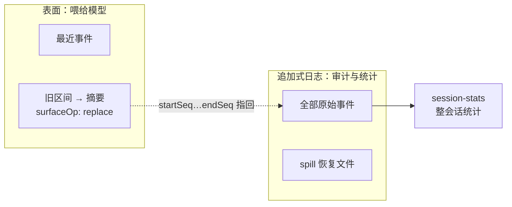

# 附录 F 性能与规模：Agent 系统在什么量级下会慢

> 前面章节讨论"怎么工作"，这个附录讨论"工作得多快、能撑多大"。Agent 系统的性能问题和传统 Web 服务不同——瓶颈往往不在请求数，而在**日志体积、上下文组装、执行环境开销、模型往返**。本附录的数字全部来自 HEAD（0.2.1-alpha.2）的源码常量、仓库级性能门 `benchmarks/` 及其设计笔记（`.agents/notes/` 下，路径省略该前缀）；凡是笔记里标明"只在某台参考机上测得"的数字，这里也照样标明。

## F.1 事件溯源日志：最大的"慢"来源

第 6 章说过：状态是"算"出来的，日志是"存"下来的。日志越大，"算"越慢。DSH 对日志膨胀的三个来源各有对策：

| 膨胀源 | 问题 | DSH 的对策（HEAD） |
| --- | --- | --- |
| 模型流式输出 | 逐 token 保存最保真，但事件数会随输出长度爆炸 | v2 起不再持久化逐块的 `assistant/chunk`：每条 `assistant/message` 内嵌一份**紧凑的 `stream`**（文本/推理增量与时间差），JSONL 后端默认再用 zstd 压缩 |
| 工具大输出 | 一次 grep 可能输出几 MB | **spill**：`dsh-spill-policy`（`dsh-base` 默认 `maxInlineTokens: 12500`）只把首尾内容留给模型，完整结果写进恢复文件；**工具结果裁剪** `dsh-compaction-tool-result-pruner`（默认 `thresholdChars: 8192`、`headChars: 4096`、`tailChars: 1024`）在压缩触发时先裁剪超大结果 |
| 长会话 | 历史无限增长，终将超出上下文窗口 | **compaction**：`dsh-compaction-basic`（默认 `thresholdRatio: 0.8`、`retainRatio: 0.16`）把旧区间在表面上替换为摘要；`dsh-compaction-image-offload` 在图片超预算时把最旧的图片换成占位符后重试 |

紧凑 `stream` 并不是"免费的午餐"：v2 上线时，JSONL 后端的迁移路径和客户端对内嵌流的折叠都曾退化——笔记 `implemented/testing/2026-09-04-session-open-performance-gate.md` 记录，一个 127,400 事件的合成日志首次打开从约 35 ms 涨到约 5 s，一份 575,000 块的真实日志从约 0.3 s 涨到 26 s、峰值 RSS 2.7 GB。这些退化悄悄进了主干，正是 F.3 节性能门诞生的原因。

### compaction 的权衡：压缩多少，是个经济学问题

compaction 的核心参数是**什么时候触发**和**保留多少**：

- `thresholdRatio`（默认 0.8）：推导出的历史接近上下文窗口的 80% 时触发——太早压缩浪费信息，太晚可能超出窗口；
- `retainRatio`（默认 0.16）：压缩后保留最近约 16% 的内容，其余变成摘要——保留越多越保真，保留越少越省上下文。配置校验要求 `retainRatio` 必须小于 `thresholdRatio`，否则插件加载失败。也可以改用绝对数量 `retainTokens`，它与 `retainRatio` 互斥。

深层的权衡是：**事件日志承担两个冲突的职责**——给模型当上下文（要短）和给人当审计（要全）。DSH 的答案是把两者分开：compaction 只改写**表面**（`surfaceOp: { op: 'replace', startSeq, endSeq }`），被替换的原始事件仍然留在追加式日志里；工具结果裁剪同样"只动模型看到的那份"。所以整会话统计 `dsh-session-stats`（turn/step 数、LLM/工具/首 token/解码耗时）从完整的持久日志计算，**分页和压缩都不改变它**。**审计永远不丢，上下文永远不爆**。

## F.2 持久化与查询：JSONL 存储，SQLite 只做索引

旧版书稿把"JSONL 还是 SQLite"写成二选一。HEAD 的真实分工是：**会话持久化只有 JSONL 一个后端，SQLite 只是可选的派生全文索引**。

| 维度 | 会话持久化 `dsh-session-persistence-jsonl` | 会话检索 `dsh-session-query-sqlite` |
| --- | --- | --- |
| 职责 | 唯一的持久事实来源 | 从实时与持久历史派生的 SQLite FTS5 索引，独立数据库，不修改持久化存储 |
| 写入 | 追加写；默认 zstd 压缩；每个格式版本一个代际文件（`session.v4.jsonl.zstd` 等），旧代际永不覆盖 | 后台对账，每个索引路径只允许一个进程拥有 |
| 读取加速 | 投影缓存 `dsh-session-projection-cache`（`dsh-base` 默认 `writeEveryEvents: 200`、`writeIntervalMs: 5000`），日志领先、缓存跟随 | 排序的 token/短语检索 + 游标分页 |
| 默认状态 | 始终挂载，根目录 `$DSH_HOME/sessions` | `dsh-base` 中挂载但 `openAt: never`、`path: ':memory:'`：精确读取、标题、谱系追踪照常可用，全文搜索报 `SESSION_QUERY_SEARCH_DISABLED` |

经验法则：**只要"跑得起来、能恢复"，默认配置就够了；需要跨会话按内容搜索时，在 profile 补丁里把 `session-query-sqlite` 的 `openAt` 改成 `first-search`（首次搜索才加载 `node:sqlite`）或 `startup`，并给一个持久的 `path`**。这仍是配置里改一行——接缝设计在运维层面的红利。另一条路是启用随附的可选 bundle `session-search`：它插入一个隔离的 `cordis:group`（`isolate: { sessionQuery: true }`），组内有自己的 `session-query-sqlite`（`path: ':memory:'`、`openAt: first-search`）和 `tool-session-query`，所以索引只活在内存里，每次进程启动后的第一次搜索都要重建一遍。

这笔"第一次搜索"的账有多大，F.3 的 `session-corpus/` 性能门给了数字：在 1,000 个真实长度会话上，首次 `session.search`（含建索引）的托管 CI 预期是 145 s，再搜一次的预期是 3.5 s（预算再乘 1.25）。随附 profile 默认不开全文搜索，开启前应把这笔首搜成本算进去。

格式升级也有一笔一次性成本：打开旧代际日志的**第一次**要经过相邻版本迁移，之后读的都是当前代际。F.3 节的性能门把这两种访问分开计预算，正是为了既保护"升级那一刻"，又保护"之后每一次"。

## F.3 性能门：DSH 怎样"量"性能

"先测量、再优化"在 DSH 里不是口号，而是一个必过的 CI 任务。结构如下（`benchmarks/AGENTS.md` 与 `implemented/testing/` 下的性能门笔记）：

- **位置与命名**：仓库级性能门放在顶层 `benchmarks/`，按"被测的用户路径"分目录，不按包结构；宿主侧用 `*.bench.ts`，客户端侧用 `*.bench.client.ts`。包内的 `.perf.ts` 只是不设门槛的诊断，不进 `test:bench`。
- **命令**：`corepack pnpm run test:bench`（先 `build:bench` 构建库与 `benchmarks/.dsh-build/` 下的 worker，再构建 Web，最后用 `vitest.bench.config.ts` 编排）；CI 入口是 `check:ci:bench`。另有手动的 `test:web:perf`（`vitest.web.perf.config.ts`，收集 `apps/web/tests/**/*.perf.ts` 等高基数诊断），明确不在任何 CI 车道里。
- **运行环境**：必需的 `node 24 / benchmarks` 任务跑在标准 GitHub 托管的 `ubuntu-24.04` 上，整个任务限时 20 分钟（上一版基准 0.1.7-rc.2 时是 15 分钟），独占车道——性能测量不和其它门禁挤在同一台机器上。
- **测量纪律**：每个样本在全新的已编译纯 Node 子进程里跑（去掉 `NODE_OPTIONS`、不挂 TypeScript loader），输入由固定常量合成（绝不使用录制的真实会话），通常取 5 个样本的中位数；内存预算在显式 GC 之后测量，另有一个 128 MB old-space 受限模式只检查"能不能跑完"。
- **预算换算**：`benchmarks/support/calibration.ts` 的 `ciTimeBudget(expectedMs)` = 参考机预期 × `CI_TIME_SCALE`（2）× `PERFORMANCE_BUDGET_HEADROOM`（1.25）；内存和比值只乘 1.25。如果预期本身就是在托管机上测的（如 `session-corpus/`），只乘 1.25。预算是评审过的源码常量，**不能用环境变量覆盖**。
- **换算报告**：每个有预算的计时端点在断言前都要交给 `support/scaling-report.ts` 的 `recordTimings`（尽量附上同一区间的进程 CPU 时间），整进程峰值 RSS 交给 `recordPeakMemory`。`support/machine-profiles.ts` 按 PassMark 单线程分数把结果换算到 2015、2019、2023、2026 年的笔记本和云主机上；每次运行写出 `benchmarks/.dsh-report/report.html`，CI 任务把它发布成 `benchmark-report` 制品。这份报告回答的是"在用户那种机器上大概多快"，门禁本身仍只看预算。
- **内存受限重跑**：`corepack pnpm run test:bench:memory 4g`（或 `8g`）由 `scripts/run-memory-pressure-bench.ts` 在一个禁用 swap、上限 4 或 8 GiB 的 cgroup v2 里（`systemd-run --user --scope`，`MemoryMax` + `MemorySwapMax=0`）重跑 `session-corpus`、`projection-list`、`session-open`、`long-session-browser` 这几个文件，**预算不变**；只支持 Linux，是手动场景，不进 PR 的 CI。笔记 `implemented/testing/2026-10-07-memory-limited-benchmarks.md` 记录的校准（2026-10-07，Apple silicon 上的 Docker Linux 虚拟机）是：38 个用例在两种上限下全部通过、没有 OOM，cgroup 峰值从不限时的 3,538 MB 到 8 GiB 下 3,649 MB、4 GiB 下 3,895 MB；变化最明显的是 3,000 会话列表的首次调用（1,235 → 1,365 → 2,613 ms），因为会话日志的页缓存也算在同一个上限里，被逐出后要重读。

目前的场景：

| 目录 | 测什么 | 工作量（合成） |
| --- | --- | --- |
| `session-open/` | 打开大会话：四阶段（open、read、restore、projection）+ 首屏历史 + Agent 冷恢复，分"首次打开（含迁移）"和"升级后重开"两种 | 200 turn × (500 文本增量 + 125 推理增量) = 127,400 个逻辑事件 |
| `agent-continuation/` | 长工具对话之后继续干活：请求准备、工具密集的新 turn、子会话目录、随附 `sdk-minimal` profile 的端到端 SDK 流程 | 800 个两步 turn，每 turn 4 次工具调用、2,048 字符结果，共 13,600 事件 |
| `conversation-fold/` | 客户端把历史窗口折叠成对话节点；另测模型流式生成工具参数时（"preparing"）客户端发布进度的开销 | 大小两个 v2 历史窗口；`write` 512 KiB、`bash` 128 KiB 的流式工具参数，各 3 个样本 |
| `session-corpus/` | Web Host 面对重度用户的会话库：冷启动后列出会话、全文搜索、fork；`session-corpus/projection-list.bench.ts` 另测会话列表投影和 JSON 的开销及期间最长的 Host 排队延迟 | 列表 3,000 个、搜索与 fork 各 1,000 个会话，每个会话至少和一份实测本地语料同分位一样长（p99 为 7,229 事件，最长 84,467 事件）；整个文件须在托管 CI 上 5 分钟内跑完 |
| `long-session-browser/` | 浏览器里的长会话：冷打开、翻旧页、首次打开 Trajectory、流式回复期间打字 | 240 个已结束 turn（含 40 个工具结果、20 个代码块），回复为 120 个增量、16 ms 间隔 |
| `active-stream-reconnect/` | 活跃流重连时重建客户端流 | 100,000 个推理增量前缀 |
| `terminal-io/` | 终端输出保留窗口：容量扩大 32 倍（128 KiB → 4 MiB）时稳态开销的增长 | 容量比值 ≤ 4，保留堆 ≤ 16 MiB |

几个代表性的 CI 预算（全部是源码常量）：

| 指标 | CI 预算 |
| --- | ---: |
| 首次打开（含迁移）的 `open` | 550 ms |
| 当前代际重开的 `open` | 63 ms |
| 首次打开 / 重开的首屏历史 | 550 ms / 120 ms |
| 首次打开 / 重开的 Agent 冷恢复 | 562 ms / 100 ms |
| Agent 常驻保留堆 | 33 MB |
| 浏览器冷打开 | 1125 ms |
| 活跃流重连的重建 | 125 ms（保留堆 30 MiB） |
| 流式 `write` 参数 512 KiB / `bash` 参数 128 KiB 的客户端发布 | 750 ms / 375 ms |
| 3,000 会话：冷启动 / 首次列表 / 再次列表 | 3,000 / 4,125 / 3,375 ms |
| 1,000 会话：首次搜索（含建索引）/ 再次搜索 | 181,250 / 4,375 ms |
| 1,000 会话 fork：十个长度分层的中位数 / p99 会话 / 最长会话 | 125 / 1,375 / 25,500 ms |
| `session-corpus` 峰值 RSS：列表 / 搜索 / fork | 938 / 1,500 / 938 MB |

和上一版基准 0.1.7-rc.2 相比，活跃流重连从 63 ms 放宽到 125 ms：它现在和其它参考机预期一样走 `ciTimeBudget(50)`（50 × 2 × 1.25）。`session-corpus` 的预算则是托管机实测中位数（EPYC 7763 与 EPYC 9V74 两种机型取较高者）取整后只乘 1.25，因为笔记测得托管机与参考机的比值在 2.4–3.4 之间，固定的 2 倍换算罩不住。

这些预算的来历本身就是一课。例如"当前代际 `open` 63 ms"：它由标准托管机上实测中位数 48.6 ms、取整为 50 ms 的预期再乘 1.25 得来，而不是在参考机数字上再乘一遍 2 倍——笔记坦白记录了每一次放宽都要附上**正、负对照**（录得的中位数能过新门槛、过不了旧门槛，合成的回退值被拒绝）。**预算不是愿望，是有证据的合同**。

### 设计思考：为什么不直接和"上一个版本"比？

最直观的回归检测是"每次 CI 检出历史提交跑一遍，比较快慢"。笔记明确拒绝了它：历史检出要单独安装依赖，新旧版本还可能把同一份工作划到不同的 API 阶段，比较的就不再是同一件事。固定工作量 + 经正负对照校准的静态预算，更容易复现和评审。代价是：Node 版本或托管机型变了，就得重新采样、重新评审预算——这笔账被明确写进了笔记的"后果"一节。

## F.4 执行环境：沙箱、子进程与远程主机

第 10 章讲过 DSH 选平台原生沙箱而非容器，原因之一是"粒度"：每一次命令调用都要过沙箱，所以每次的额外开销必须小。和性能相关的机制有：

- **runner 探测只做一次**：`dsh-sandbox-local` 在只有唯一候选时不探测；有竞争候选（如 Linux 上 bwrap 与 Landlock）时每个探测一次并缓存结果（`probeTimeoutMs` 默认 5000）。探测成本不落在每条命令上。
- **自我限制再 exec**：Landlock 路径由不到 300 行 C 的 `landlock-run` 先限制自身再 `execvp`，不需要启动额外的守护进程或镜像。
- **Windows**：受限令牌 + 工作区能力 SID + 强制完整性标签。0.1.7 的修复把 Low 完整性标签**常驻**在工作区根上（第 10.4 节），不需要每次命令重新写 ACL。
- **子进程收容**：Linux 上用 `systemd-run --user --scope`、Windows 上用 kill-on-close Job 管理整棵进程树（第 10.5 节）。它比裸 `spawn` 多一层收容，换来的是干净、可验证的终止语义——这笔账值。
- **终端输出**：`terminal-io` 性能门保证终端保留窗口变大时，每块输出不会重新扫描整个窗口。

以上几项源码里没有给出统一的延迟数字，本书也不编造；需要数字时，按 F.7 的方法在你自己的机器上测。

### 远程执行的网络账：SSH runtime

旧版书稿在这里讨论 E2B 远程沙箱。E2B provider 已在 0.1.7 移除（`implemented/simplification/2026-09-11-remove-e2b-providers.md`），远程执行改由 POSIX SSH runtime（`packages/ssh`）承担。它的性能特征来自设计本身（`implemented/architecture/2026-09-11-posix-ssh-runtime.md`）：

- **往返落在"执行"上，不落在"思考"上**：Harness、模型传输、会话持久化都留在本地；只有文件、进程、终端和沙箱执行在远端辅助程序里完成。
- **每条程序流都有建立成本**：管理 RPC 与每条程序流使用独立的 SSH channel；每条流先经管理 RPC 拿到一个新的 256 位预共享密钥，再做一次 TLS-PSK 握手才开始传输。所以"启动一个进程"比本地多出若干次网络往返，高频的小命令最吃亏。
- **流控独立**：stdout、stderr 与 fd 7 控制流各用各的 channel 窗口，暂停一个输出不会卡住控制流量；收集的输出只保留有界的尾部快照。
- **断线不重放**：连接丢失会使待处理操作失效，不自动重连——吞吐让位于"不重复执行可能已生效的操作"。

一个容易踩的误区是沿用旧思路"高频操作走本地、重活走远程"。SSH 家族的 fs、subprocess、sandbox 三个 provider 共享同一个远端辅助程序，目的就是让文件工具、Bash、终端、LSP、PTC 看到**同一个执行世界**；把 `ctx.fs` 留在本地、`ctx.subprocess` 放到远端，模型读到的文件和命令改动的文件就不是同一份。**这里的选型单位是"整个执行世界"，而不是"单个操作"**：要降低往返代价，应该减少进程启动次数（比如让一条命令做完一批事），而不是拆开接缝。

## F.5 主循环性能：别让模型等

主循环的性能目标只有一个：**模型等待的时间 = 它该等待的时间**（请求传输 + 工具执行），不能有系统自身的无谓延迟。几个关键点：

- **并行工具调用**：`dsh-agent-loop` 的 `maxParallelToolCalls` 默认 `DEFAULT_MAX_PARALLEL_TOOL_CALLS = 10`——并行度太低浪费模型回合，太高可能打爆资源。
- **持久化在哪里阻塞、在哪里不阻塞**：会话服务只维护内存日志并广播 `session/event`，持久化插件订阅它，在 `session/flush` 时排空。流式生成期间的增量不逐条落盘；但 `dsh-session-checkpoint-policy`（`dsh-base` 默认挂载）会在**每次模型请求前、每个顶层工具 body 可能产生外部效果前、下一步开始前**等待一次持久检查点，写失败则不调用模型、不执行工具（fail-closed）。这是有意为之：用少量、可预期的磁盘等待，换崩溃后"从已存的请求、调用和结果继续，不丢数据"。
- **上下文组装**：`deriveMessages()` 带增量缓存，投影单元结果深冻结。`agent-continuation` 性能门的剖析曾发现，请求历史操作的大半时间花在请求构建里反复 `deepFreeze` 已经冻结过的历史上。这个优化后来落地了（`archived/simplification/2026-09-06-agent-request-freeze-evidence.md`）：每个循环用一个 `WeakSet<Message>` 记住已冻结的消息（`packages/core/agent-loop/src/agent.ts`），参考机（M4 Pro）上请求历史的中位数从 246.1 ms 降到 66.7 ms（−72.9%）。托管 CI 上的请求历史预算是 297 ms（238 × 1.25 向下取整）。
- **监听器纪律**：第 5 章说过，监听器在主路径上，重活要移到 `ctx.jobs`。后台任务完成时以会话内通知唤醒拥有它的 Agent，**无需轮询**（第 7、13 章）。

## F.6 启动与构建：353 个包的冷启动

DSH 共有 353 个 workspace 包（其中 `packages/*/*` 下 52 个分组、331 个包），冷启动不是免费的：

- **构建**：`build:lib:host` 是 `tsc -b tsconfig.host.json` 增量构建加 tsdown 打包，`build:lib:client` 对客户端做同样的事，`build:web` 用 Vite 构建前端；改一个包只重编它和受影响的依赖（第 2.4 节）。
- **模块解析**：profile 启动时一次性计算不可变的解析代（`RuntimeResolution`）并装进 Node 的 ESM/CommonJS 解析器，不再在磁盘上创建和对账链接（第 4 章）。
- **加载**：Loader 按配置树挂载所有未禁用的条目，每个插件在 `inject` 的服务就绪后才 apply；整棵树结算后由启动审计检查未激活的条目（附录 G）。**启动快不快，取决于配置树里挂了多少行**——关掉用不到的行（`disabled: true`），比优化任何单个插件都有效。
- **Web 前端**：客户端插件按 `__DSH_BOOT__` 启动图（`WebBootGraph`，分 bootstrap 与 application 两批）加载，模块通过带 `rev` 的 combo 请求批量获取（第 11.5 节）。
- **冷恢复也在门里**：F.3 的 Agent 冷恢复预算覆盖"创建 Agent、setup、发布、启动循环"的完整路径。笔记记录过一个测量驱动的改进：把冷验证器通过工作区构建打包、去掉运行时模块解析后，参考机上首次可写恢复的中位数从 162.4 ms 降到 121.8 ms（约 25%）；笔记也特意注明，这个本地结果**不代表** Linux 托管机上的计时。

## F.7 性能调优清单（实操）

按"先测量、再优化"的顺序：

1. **先量化**：一个典型任务有多少 turn、多少 step？LLM、工具、首 token、解码各花多少时间？看 Web 里的会话统计（来自 `dsh-session-stats`，从完整日志计算）；
2. **日志与上下文膨胀是头号嫌疑**：用 `corepack pnpm dsh web --dump-config` 确认 `spill-policy`、`tool-result-pruner`、`compaction-basic` 的实际配置；
3. **搜索慢或搜不到**：先确认 `session-query-sqlite` 的 `openAt` 不是 `never`，再给它一个持久 `path`；用可选 bundle `session-search` 时索引在内存里，每次启动后的首次搜索都要重建；
4. **模型往返太多**：看 turn 里的 step 数——是不是工具调用粒度太碎？合并工具或让模型少走几步；
5. **执行环境开销**：沙箱的 `enforcement` 是否如预期；用 SSH runtime 时，减少进程启动次数；
6. **监听器拖慢主路径**：把重活转到 `ctx.jobs`；
7. **担心小内存机器**：在 Linux 上跑 `corepack pnpm run test:bench:memory 4g`（或 `8g`），看会话库、会话打开、浏览器长会话这几个文件在禁用 swap 的内存上限下是否仍在预算内；
8. **给仓库贡献性能改进**：跑 `corepack pnpm run test:bench`（CI 在 Linux 上执行，浏览器场景需要 Chromium），打开 `benchmarks/.dsh-report/report.html` 看换算到不同年代机器上的结果（CI 上是 `benchmark-report` 制品），并按 `benchmarks/AGENTS.md` 的要求在对应笔记里记录工作量、计时边界和正负对照——**收紧预算要有重复测量，放宽预算更要有证据**。新文件如果加入内存受限清单，它的预算要在 4 GiB 和 8 GiB 两种上限下都成立。

## 小结

- 性能瓶颈排序：日志与上下文膨胀 > 上下文组装 > 执行环境（沙箱、子进程、远程往返）> 启动加载 > 模型往返；
- 核心哲学：**审计不丢、上下文不爆、只在该等的地方等**——compaction 只改表面，检查点只在请求与副作用之前；
- 性能靠性能门守住：固定合成工作量、独立进程、中位数、校准过的源码常量预算，不能用环境变量绕过；换算报告和内存受限重跑把"在用户机器上会怎样"也纳入了视野；
- 远程执行的单位是"整个执行世界"，降低 SSH 往返靠减少进程启动，而不是拆接缝；
- 换检索后端、调 spill 与 compaction 都是配置级操作——性能调优也是"配置即扩展"的用武之地。
