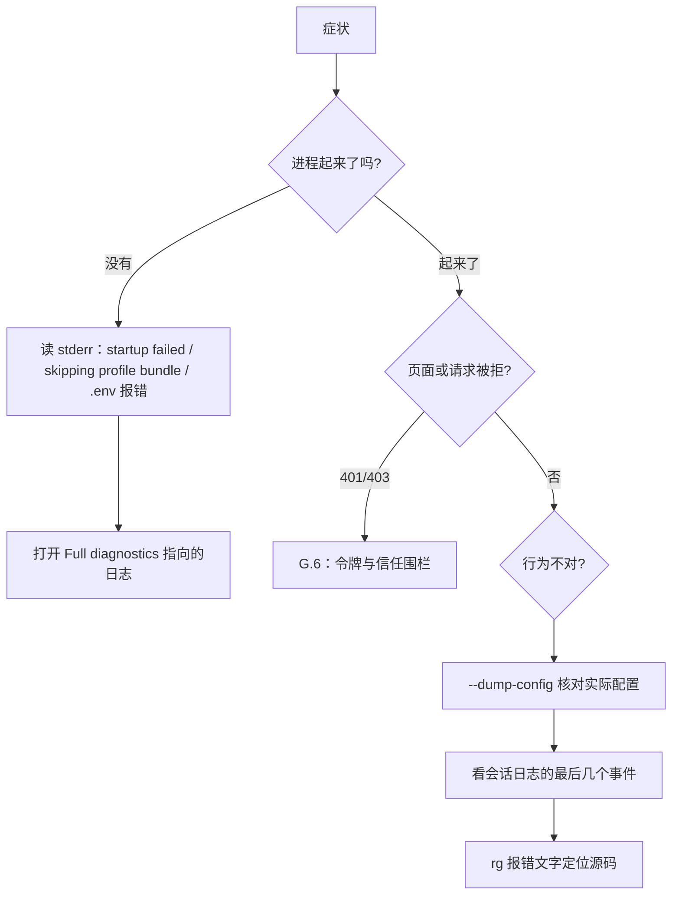

# 附录 G 故障排查手册：从症状到根因

> 第 14 章给了"三板斧"方法论（配置 → 日志 → 源码），这个附录是它的速查版：**症状 → 可能原因 → 排查命令 → 修复**。表中带引号的报错文字都取自 HEAD（0.2.1-alpha.2）源码或仓库的升级指南（`docs/upgrade-guide/`），`<...>` 表示会被替换的部分；命令默认在 deepseek-harness 根目录的 PowerShell 中执行。遇到问题先查这里，再按三板斧深入。从上一版基准 0.1.7-rc.2 升级上来、旧 profile 突然起不来时，先看 G.2.1。

## G.1 排查方法论：四句话

1. **先问系统以为自己在跑什么**——`--dump-config` 永远第一；怀疑某个字段写错了，用 `--dump-config-schema` 看它到底接受什么；
2. **再看启动审计**——stderr 里的 `did not activate` 与 `skipping profile bundle` 会直接告诉你哪一行、哪个包、缺哪个服务；启动失败时最后一行 `Full diagnostics: <路径>` 指向完整报告；
3. **然后看事件流**——会话日志是"已发生的事实"，从最后一个事件往前找断点；
4. **最后才看源码**——用报错文字、事件名、服务名 `rg` 定位，别从头读。

## G.2 启动类故障

| 症状 | 可能原因 | 排查 | 修复 |
| --- | --- | --- | --- |
| `dsh: startup failed: <N> required plugin(s) did not activate`，下面分 `Failed plugins` 与 `Plugins waiting for services` 两组 | 必需条目（`agent-loop`、`webserver`、`web-runtime`、`modules`、`connection`、`headless-runner`、`acp`、`sdk-jsonrpc-server` 中出现在配置树里且未禁用的）激活失败或一直在等服务 | 看每个条目下的 `Package:` 和原始错误；打开 `Full diagnostics:` 指向的 `$DSH_HOME/logs/startup-<时间戳>-<uuid>.log` | 按原始错误修；等待服务的条目检查提供该服务的行是否被禁用或拼错 |
| `dsh: warning: <N> entries did not activate`，条目后跟 `pending (waiting for service: <名字>)` | 非必需条目的 `inject` 服务没人提供（包名/服务名拼错、提供方行被禁用） | `--dump-config` 查提供方那一行；第 3 章 Fiber 的 PENDING 状态 | 修正 `inject` 或补上提供方；其余插件照常运行 |
| 同上，但条目后是一段错误堆栈，或 `failed to import`、`disabled expression failed` | 插件 `apply` 抛错；模块路径/导出不对；`disabled: !!js ...` 表达式本身抛错 | 看堆栈里的第一个插件帧 | 修插件代码、`main`/`exports`，或修表达式 |
| `dsh: skipping profile bundle "<包名>": <原因>` | bundle 解析失败、清单损坏、补丁文件读不到，或 `peerDependencies` 里的 dsh 版本范围不覆盖当前运行时 | 原因文字；`dsh plugin --profile <名字> version-exemptions` 查看已登记的豁免 | 更新 peer 范围，或用 `dsh plugin --profile <名字> allow-version <包>@<版本> --dsh-version <精确版本> --accept-risk` 在 profile 的 `compatibility.json` 登记"精确包版本 × 精确 dsh 版本"豁免（附录 D） |
| 启动时 `dsh: disabling profile plugin row "<id>": Plugin <包>@<版本> is incompatible with dsh 0.2.1-alpha.2: peerDependencies {...}. Running it may cause crashes or data loss. ...`（bundle 则是 `dsh: skipping profile bundle "<包名>": Plugin ...`），末尾是 `Exact-version exemption: not active.`；`dsh plugin add` 安装前也会给出同样的文字 | 第三方插件的 peer 写的是 `^0.1.x` 一类范围。版本比较用 `semver.satisfies(..., { includePrerelease: true })`，`^0.1.0` 不覆盖 0.2.x，预发布版本也照样参与比较 | 插件 `package.json` 的 `peerDependencies` 里以 `@deepseek-ai/dsh` 开头的项；`dsh plugin --profile <名字> version-exemptions` | 首选升级插件或把 peer 改成覆盖 0.2.x 的范围；确认要冒险时，`dsh plugin --profile <名字> allow-version <包>@<版本> --dsh-version 0.2.1-alpha.2 --accept-risk`。豁免只对这一个包版本 × 这一个 dsh 版本有效，升级 dsh 后要重新评估 |
| 端口被占，`dsh web` 起不来（`webserver` 出现在 `Failed plugins` 里） | 上一个实例没退 / 别的程序占了 3080（Desktop 用系统分配的空闲端口，不会撞固定端口） | `Get-NetTCPConnection -LocalPort 3080` → 找 PID | `Stop-Process -Id <pid>`，或 `corepack pnpm dsh web --port 3081`（`--port 0` 让系统挑一个空闲端口） |
| `error: --port must be a number, got "<值>"` | `--port` 后面跟的不是纯数字 | — | 改成数字；`0` 表示由系统分配 |
| `dsh: failed to parse overlay <文件>` / `overlay <文件> must be a top-level YAML array of loader patch entries`（profile 自己的补丁报 `patches`） | 补丁 YAML 语法错，或顶层不是条目数组 | 用编辑器校验 YAML | 补丁文件顶层必须是 `- id: ...` 列表 |
| 改了补丁却没效果 | 用 `id` 定位的补丁找不到目标行时只警告并跳过，不会让启动失败（附录 D.9）；只有注释或完全为空的补丁文件则会让启动失败 | `--dump-config` 看合成结果；stderr 里的补丁警告 | 修正 `id`；想表示"什么都不改"写 `[]` |
| 插件加载时报配置校验错误 | 条目 `config` 不符合插件的 Schemastery 声明；记住补丁是整行替换 `config`（第 4 章） | `corepack pnpm --silent dsh web --dump-config-schema > web-schema.json` 后对照该条目的 schema；`--dump-config` 看合成值 | 修正补丁。注意 schema 投影不完整时 `x-cordis.complete` 为 false、退出码为 1，但 stdout 里的 schema 仍然可用 |
| `dsh: <路径>\.env sets "<变量>", which only the launching environment may set ...` | 项目或 home 的 `.env` 写了 `BOOTSTRAP_NAMES` 里的变量（`PATH`、`NODE_OPTIONS`、`DEEPSEEK_BASE_URL` 等） | 报错里已写明变量与文件 | 改为在启动环境里 `$env:<变量>=...` 设置；代理变量可以放进 `$DSH_HOME/.env` |
| `dsh: unknown default profile "<名字>"; expected one of ...` / `profile "<名字>" already exists ...; omit --from-default-profile to use it` | `--from-default-profile` 后跟的模板名不对，或目标 profile 已存在 | 模板只有 `acp`、`headless`、`sdk`、`sdk-minimal`、`web` | 改模板名，或去掉 `--from-default-profile` 直接启动已有 profile |
| `error: --host 0.0.0.0 is an unspecified (wildcard) address, which is not supported: binding every interface would expose remote code execution to the network; bind one concrete IPv4 or IPv6 address instead`（补丁里写 `host: 0.0.0.0` 时报 `webserver: host "0.0.0.0" is an unspecified (wildcard) address, ...`） | `0.0.0.0`、`::` 等通配地址在加载时就被拒绝：绑定全部网卡等于把远程代码执行暴露到网络 | — | 绑定本机某块网卡的一个具体地址，如 `corepack pnpm dsh web --host 10.0.0.7`；绑定的 IP 会被信任围栏直接接受，经代理或域名访问时再加 `--trusted-host`（仍需令牌 Cookie） |
| `webserver: host "<值>" is not a concrete IPv4 or IPv6 address literal` | `host` 写成了主机名（如 `localhost`、`myhost.lan`），而不是 IP 字面量 | — | 改成 `127.0.0.1`、`::1` 或网卡的具体 IP |
| 用非 loopback 地址启动后出现警告 `dsh web: listening on <地址> over plain HTTP; restrict this port to a trusted proxy or network` | 监听在非本机地址上却没开 TLS，令牌和 Cookie 会以明文经过网络 | — | 只让可信代理或可信网络访问这个端口，或加 `--tls-cert`/`--tls-key` 直接提供 HTTPS |
| `error: --tls-cert and --tls-key must be supplied together` | 只给了证书或私钥中的一个 | — | 两个一起给：`corepack pnpm dsh web --tls-cert ./server-chain.pem --tls-key ./server-key.pem` |
| `webserver: cannot read tls.certFile <路径>: ...` / `webserver: tls.keyFile <路径> is empty` | 证书或私钥文件不存在、没有读权限，或是空文件（空文件会被提前拒绝，否则监听永远完成不了握手） | 报错已写明字段和解析后的绝对路径 | 修正路径或文件内容；证书文件只在启动时读一次，换证书要重启 |
| `webserver: tls.certFile <路径> and tls.keyFile <路径> are not a usable certificate and key pair: ...` | 证书与私钥不配对，或私钥是加密的（只支持未加密的 PEM 私钥） | 冒号后的原始 TLS 错误 | 换成配对的 PEM 证书链和未加密私钥 |
| `error: --public-url must be an absolute http or https URL ...` / `must not include a query or fragment (? or #)` / `must not include credentials ...` | `--public-url` 只接受 `http(s)://host[/prefix]` 形式的根地址 | — | 去掉查询串、片段和用户名密码，只保留协议、主机和路径前缀 |
| `'pnpm' 不是内部或外部命令` | 没有全局 pnpm，构建脚本内部调了裸 pnpm | `Get-Command pnpm` | 用 `corepack pnpm run build`，或逐个执行 `corepack pnpm run build:lib`、`corepack pnpm run build:web`（第 2.4 节） |

### G.2.1 从 0.1.7-rc.2 升级后的启动问题

上一版基准 0.1.7-rc.2 → 0.2.1-alpha.2 之间删除、迁移、改名了一批包和配置项。仓库在 `docs/upgrade-guide/<升级前的版本>/<主题>/guide.zh.md` 为每一项写了迁移步骤，下表只列最常见的症状。

| 症状 | 可能原因 | 排查 | 修复 |
| --- | --- | --- | --- |
| 启动审计报必需的 `connection` 一直 `pending (waiting for service: webRuntime)`，或 `ctx.webRuntime.trustedHosts` 表达式求值失败 | 自定义补丁或 overlay 还在 `inject: [webRuntime]`；Web profile 已改由 `web-startup` 行提供 `webStartup` 服务 | `--dump-config \| Select-String webRuntime` | 改成 `inject: [webStartup]` 和 `ctx.webStartup.trustedHosts`，删掉 `ctx.webRuntime.lanAddresses`；补丁整行替换 `config`，要完整重述（升级指南 `web-listener-trust-config`） |
| 模块找不到（module-not-found），或警告 `patch: entry <id> not found`（`<id>` 为 `invariants`、`session-invariant`、`agent-invariant`、`scope-invariant`、`agent-loop-invariant` 之一） | 运行时 invariants 在 0.2.1-alpha.1 删除，`@deepseek-ai/dsh-invariants` 和各包的 `<包>/invariant` 伴生插件都不存在了 | `--dump-config \| Select-String invariant` | 删除名为 `@deepseek-ai/dsh-invariants` 或以 `/invariant` 结尾的行，以及指向上面五个 id 的补丁（升级指南 `remove-runtime-invariants`） |
| 配置里的 hooks（`@deepseek-ai/dsh-hooks-claude-code`、`@deepseek-ai/dsh-hooks-codex`）或 webhook 行报模块找不到 / 缺 peer | 这些包移入 `packages/experimental/`，包名不变，但不再随 CLI 安装；profile 禁用了自动安装 peer | `--dump-config` 找到该行；看 profile 的 `package.json` 依赖 | 连同 peer 一起显式安装，例如 `dsh plugin --profile web add @deepseek-ai/dsh-hooks-claude-code @deepseek-ai/dsh-hook-protocol`；GitHub 适配器要同时装 `@deepseek-ai/dsh-webhook` 和 `@deepseek-ai/dsh-webhook-github`（升级指南 `experimental-package-composition`） |
| 补丁里给某行写了 `disabled: false`，但那个插件仍然没出现 | Base 与完整 Web 预设已经省略了休眠的 Ralph 行，base 也省略了徽章行；只"启用"已移除行的补丁不会插入插件，而且只警告不报错 | `--dump-config` 看该 `id` 是否存在；stderr 的 `patch: entry <id> not found` | 改成完整的 `- insert:` 条目（写出 `id` 和 `name`），或启用提供该行的可选 bundle |
| `required option '--profile <name>' not specified` | `dsh plugin` 只认写在 pnpm 参数**之前**的 `--profile`，例如 `dsh plugin add <包> --profile web` 会失败 | `dsh plugin --help` 应打印 `Usage: dsh plugin [options] [args...]` | 改成 `dsh plugin --profile web add <包>`；查看 pnpm 子命令帮助用 `dsh plugin --profile web add --help`（升级指南 `plugin-option-placement`） |
| 插件管理页里原来的"自动化任务"开关不见了，`package.json` 被改写 | Schedule 可选 bundle（`@deepseek-ai/dsh-experimental-schedule-bundle`）在 0.2.1-alpha.1 退役；加载 profile 时会自动把它从 `dsh.profile.bundles` 删掉。Web App 现在直接挂 `schedule` 和 `ui-schedule` | 侧栏是否有"自动化任务" | 不用处理，已存储的任务继续生效；顶层针对 `time-context` 的覆盖不再匹配任何行，删掉即可（升级指南 `schedule-bundle-retired`） |
| 设置 `DSH_TOOLS_MODE=both` 或 `mode: both` 后配置加载失败 | 工具呈现方式只接受 `native` 或 `ptc`，混合的 `both` 被拒绝 | — | 改成 `native` 或 `ptc`；需要按 preset 区分时改该 preset 的 `@deepseek-ai/dsh-agent-tool-presentation` 行（升级指南 `tool-presentation-mode`） |
| `agent-instructions` 行的 `dshHome` 不再生效，指令文件读的是另一个 home | `dshHome` 字段已移除，残留的键被忽略；指令加载始终用 `$DSH_HOME`（未设置时 `~/.dsh`） | `--dump-config` 看 `agent-instructions` 行 | 删掉 `dshHome`，改为在进程环境里设置 `DSH_HOME`（升级指南 `instruction-home-override`） |
| 子 Agent 委派不再直接返回结果或 Job 编号，`run_in_background` 参数和 `backgroundMode` / `enableRunInBackground` 配置不再起作用 | 子 Agent 统一为 activation 模型：每次委派返回 `{ kind: 'activation', subagentId }`，结果通过完成通知交付；`@deepseek-ai/dsh-subagent-in-process-driver` 已删除 | `--dump-config` 看 `tool-subagent` 行 | 删掉这些配置键；宿主代码改用 `ctx.subagents.startActivation()`（升级指南 `subagent-activations`） |

> 启动诊断日志是原始 `util.inspect` 输出，文件开头就写着 `WARNING: Raw diagnostics may contain configuration or credential values from plugin errors. Review before sharing.`——分享给别人之前先检查一遍。

## G.3 凭据与模型请求类故障

| 症状 | 可能原因 | 排查 | 修复 |
| --- | --- | --- | --- |
| 模型选择器里没有 DeepSeek 分组，界面显示"请选择模型" | `deepseek-official` 路由没有可用的 API Key 时，模型发现返回空目录，界面隐藏整个分组；之前保存的模型选择仍在，只是暂时不在目录里。凭据格式错误或读取失败也会由模型发现报告 | `$env:DEEPSEEK_API_KEY`；设置 → 模型页 | 在设置 → 模型里保存 Key，或在启动环境里提供 `apiKeyEnv` 指定的变量（默认 `DEEPSEEK_API_KEY`），再重新打开模型选择器。分组出现只说明有 Key，不代表远端已经接受它（升级指南 `deepseek-model-discovery`） |
| `MISSING_CREDENTIAL` | 官方 API Key 路由（`deepseek-official`）找不到 Key | `$env:DEEPSEEK_API_KEY`；检查 `$DSH_HOME/.credentials.yaml`；设置 → 模型页的脱敏描述 | 在设置页保存 Key，或设环境变量 / `.env`。凭据按请求解析，改了下一次请求就生效（第 9.3 节） |
| `INVALID_CREDENTIAL` | Key 格式不对，报错会点名要修的凭据引用（从不回显 Key 本身） | 看报错里的引用名 | 重新录入 Key |
| 请求失败，错误码 `AUTH` | 服务端返回 401/403：Key 被吊销或无权限 | 同上 | 换 Key |
| `ACCOUNT_SIGN_IN_REQUIRED` / `ACCOUNT_TOKEN_INVALID` | DeepSeek 账号路由（`deepseek-account`）未登录或登录失效；两条路由**互不回退** | Desktop 账号设置页 | 重新登录，或把会话切到 API Key 路由的模型 |
| 账号登录弹窗提示"可能是网络异常，请检查你的网络状况后重试"（错误码 `no-response`） | 登录请求在拿到任何 HTTP 响应之前就失败了（含单次请求超时）。HTTP 错误响应仍报 `network`，显示通用重试提示；授权尝试过期报 `expired` | 网络与代理 | 检查网络和代理（第 9.7 节）后点重试（升级指南 `account-sign-in-errors`） |
| `QUOTA` / `ACCOUNT_QUOTA` | 余额或额度不足 | 平台控制台 | 充值（Desktop 会给出充值提示） |
| `CONTEXT_WINDOW_EXCEEDED` | 上下文超出模型窗口 | 看 compaction 是否挂载、阈值（附录 F.1） | 检查 `compaction-basic`；手动 `/compact` |
| `TIMEOUT` | 流式响应空闲超时（`llm-deepseek` 默认 300000 ms 无数据） | 网络与代理 | 检查代理配置（第 9.7 节）；重试 |
| Key 已设，但 headless / 子进程里读不到 | 凭据解析顺序：继承的环境变量 → `$DSH_HOME/.credentials.yaml` → 调用目录的 `.env` → `$DSH_HOME/.env`；仓库根的 `.env` 只在从仓库根运行时生效 | `Get-Location`；检查各层 | 放进 `.credentials.yaml`（设置页保存即可）或 `$DSH_HOME/.env` |

## G.4 主循环与工具类故障

| 症状 | 可能原因 | 排查 | 修复 |
| --- | --- | --- | --- |
| 模型从不调用某个工具 / 回复"工具不存在" | 工具行被禁用或没激活；当前 preset 用 `tools.restrict` 过滤掉了它（被过滤的全局工具既不进提示词，也拒绝执行，和不存在无法区分） | `--dump-config \| Select-String <工具包名>`；启动时有无 `did not activate`；当前会话用的 preset | 启用该行；在 preset 的子插件列表里加上它 |
| 同一个工具被反复调用 | 模型陷入循环 | 会话日志里连续的 `tool/call`；`repeat-tool-reminder` 会在重复 3/5/8 次时提醒模型 | 停止按钮取消本轮；调整任务描述或工具粒度 |
| 工具调用超时后迟迟不返回 | `dsh-tool-call-timeout-policy` 只能**请求**取消，工具没响应 `exec.signal` | 看工具实现是否传递 signal | 遵守取消契约（第 7.6 节）；每个工具的时限在它自己的配置里，没有全局默认 |
| 审批从没弹出，工具直接被拒 | 审批结果 `unavailable`（没有能答复的界面，如 headless）按拒绝处理；被委派的进程内子 Agent 启动时权限范围就固定了，需要审批的操作自动拒绝（审批策略固定为 `never`） | 会话审计日志里的审批请求与结果 | 调整权限预设（`workspace-write` / `danger-full-access`），或在有 UI 的入口运行 |
| 开了 Auto review 后频繁弹出审批 / 工具报 `Auto review of tool "<名字>" failed; its body was not executed: ...` | 审查器判定需要授权时，`ask` 策略把决定交还给用户；审查器响应格式错误或技术故障则直接让调用失败（不弹审批）；被委派的进程内子 Agent 固定 `never`，拒绝即最终结果 | 审批卡片里的原始理由；失败信息里的 provider 错误 | 允许一次或拒绝；Auto review 是实验层（`packages/experimental/auto-review`），误判多时切回三种常规权限模式 |
| 后台任务完成了，Agent 没有继续 | 该 Agent 显式配置了 `maxConsecutiveWakes` 上限；或任务属于另一个会话 | `dsh-tool-jobs` 的 `completionDelivery` 配置 | 默认每次完成都唤醒（第 7.4 节），去掉不需要的上限 |
| `plugin_manager` 工具调用被拒 | 创造模式的管理工具要求 `danger-full-access` 或单次审批 | 当前权限预设 | 按需审批；注意批准的 profile 变更会影响该 profile 的所有会话 |

## G.5 会话与持久化类故障

| 症状 | 可能原因 | 排查 | 修复 |
| --- | --- | --- | --- |
| 会话找不到 / 历史"消失" | 用的不是同一个 Harness home：`DSH_HOME` 不同；`dev:desktop` 默认使用隔离的 `apps/desktop/.desktop-build/development/home` | `$env:DSH_HOME`；会话目录 `$DSH_HOME/sessions/--<cwd>--/<id>/` | 统一 `DSH_HOME` |
| 旧会话打开时被拒绝 | v3 规范信封与原生 v4 关系校验：读侧遇到不规范或关系矛盾的记录**拒绝而不修复**（第 6.5 节） | 报错里的事件位置；是否手工改过日志 | 别手工编辑日志；旧代际文件永不被覆盖，可以回到上一代文件确认；从正常边界 fork 新会话 |
| 恢复后最后一轮显示为中断 | 未收尾的 turn 在恢复时以 `interrupted` 原因闭合；有调用没结果的工具调用由 `dsh-session` 补一条 `TOOL_OUTCOME_UNKNOWN` 结果，**不自动重试** | 会话日志末尾 | 这是设计：让模型或用户决定是否重做 |
| 搜索会话报 `SESSION_QUERY_SEARCH_DISABLED` | `dsh-base` 默认 `session-query-sqlite` 的 `openAt: never`，只做精确读取 | `--dump-config \| Select-String -Context 0,4 session-query-sqlite` | 在 profile 补丁里改 `openAt: first-search`（或 `startup`）并给一个持久 `path`；或启用随附的可选 bundle `session-search`，它自带一份隔离的内存索引和 `tool-session-query` 工具，每次启动后的首次搜索要重建索引（附录 F.2） |
| 归档会话失败，报 `workspace/session-active` | 会话仍有运行中的工作（自己的 turn、子 Agent、后台任务或定时任务），归档被拒且没有写入 | 错误里的 `activity` 列出要先停的东西 | 先停掉这些工作；或以 `stopActivity: true` 发起归档，由控制器先请求停止再归档 |
| 日志或上下文暴涨 | spill 没生效 / compaction 没挂载或阈值不合适 | `--dump-config` 看 `spill-policy`、`tool-result-pruner`、`compaction-basic` | 调整 `maxInlineTokens`、`thresholdRatio` 等（附录 F.1） |

## G.6 Web 前端与认证类故障

| 症状 | 可能原因 | 排查 | 修复 |
| --- | --- | --- | --- |
| 页面只显示 `dsh web authentication required; reopen the URL printed by dsh web.`（HTTP 401） | 直接输入了地址、没带启动令牌；Cookie 过期（默认 30 天）；换了端口或主机名（Cookie 绑定 `host:port`，`localhost` 与 `127.0.0.1` 算两个 authority） | 启动日志里 `dsh web: ` 开头、带 `?token=` 的那一行 | 打开这行打印的完整 URL；令牌只在 `GET /` 上兑换一次 Cookie，随后重定向到干净的 `./` |
| `curl` 访问首页得到 401 而不是 200 | 这是正常的：首页也受令牌保护，401 恰好说明服务已在监听 | `curl.exe -s -o NUL -w '%{http_code}' http://127.0.0.1:3080/` | 用 `-c`/`-b` 带 Cookie，或访问带 `?token=` 的 URL |
| `/api` 请求返回 403 `forbidden` | 信任围栏：`Host` 不是绑定 IP、不是 loopback、也不在 `trustedHosts`；`Origin` 与 `Host` 不一致；`sec-fetch-site: cross-site` | DevTools Network 看请求头 | 绑定的 IP 会被信任围栏直接接受；经代理或域名访问时给 `dsh web` 加 `--trusted-host <authority>`；不要从别的站点页面调用 `/api` |
| `/api` 请求返回 401 `unauthorized` | 通过了信任围栏，但没有有效 Cookie | 同上 | 重新打开带令牌的 URL |
| 用了 `--public-url https://app.example/ui/`，浏览器打不开或 `/api` 仍 403 | `--public-url` 只改打印、打开、`web-surface` 和 `DSH_WEB_URL` 里广告的根地址，**不授予信任**；代理剥掉路径前缀后，浏览器发来的 Host 仍是代理的 authority | 启动命令是否同时带了 `--trusted-host app.example`；DevTools 里请求的 Host | 一起写：`corepack pnpm dsh web --public-url https://app.example/ui/ --trusted-host app.example`（见 `docs/user/guide/public-deployments.md`） |
| HTTPS 反代后面 Cookie 不带 `Secure`，或反过来明文 HTTP 下 Cookie 带了 `Secure` 导致浏览器不存 | Cookie 的 `Secure` 只看**本进程监听器**是不是 TLS：开了 `--tls-cert`/`--tls-key` 才加 `Secure`；前面是 HTTPS 反代、本进程仍是明文 HTTP 时不会加 | 启动命令有没有 TLS 标志；DevTools → Application → Cookies | 需要浏览器只在 HTTPS 下发送 Cookie 时，让本进程直接提供 TLS，或由反代自己改写 Cookie |
| 所有旧 Cookie 同时失效 | `.credentials.yaml` 里的 `client-connection/browser-session` 签名密钥被删除或替换，下次 Connection 激活时生效 | 检查凭据文件 | 重新打开带令牌的 URL |
| 页面白屏 | 客户端产物没构建或过期；启动图里的客户端模块请求失败 | DevTools Console 与 Network 里第一个失败的脚本请求 | `corepack pnpm run build` 后刷新页面（第 11 章） |
| 界面一直显示"连接中" | `$events` 握手未就绪：3 秒后记录慢宿主警告，默认 15 秒超时中止，然后按 500ms…10s 的退避重试 | DevTools Network → WS `/api/remote.mux` 帧 | 检查宿主是否卡住；浏览器离线时会暂停重试，恢复在线后重新开始 |

## G.7 沙箱与进程类故障

| 症状 | 可能原因 | 排查 | 修复 |
| --- | --- | --- | --- |
| `sandbox mode "<模式>" is requested but no sandbox backend is usable on this host; refusing to run the command unconfined. ...`（错误码 `SANDBOX_UNAVAILABLE`） | 请求了 `read-only` / `workspace-write`，但本机没有可用 runner | 报错尾部的 `Runner failure: ...`；`--dump-config` 看 `sandbox`、`sandbox-policy` 行 | 按提示安装 bubblewrap 或使用支持 Landlock 的内核（Linux）、确保 `sandbox-exec` 可用（macOS）、确保 ACL 受限令牌 runner 能启动（Windows）；或**明知风险**地切到 `danger-full-access`。fail-closed 是设计（第 10 章） |
| 沙箱能跑，但提示约束只是 `partial` | `confine()` 如实上报 `enforcement: 'partial'`（例如 Windows 仍为 partial） | 工具结果里的沙箱说明 | 了解剩余风险；敏感任务放进 VM 或容器（见 `SAFETY.md`） |
| 命令杀不掉 / 残留进程 | 原生收容不可用而退回弱兜底（只警告一次）；工具没响应取消 | `Get-Process` 找残留 | 长任务走 `ctx.jobs`；遵守取消契约 |
| 子进程能读到 API Key | 凭据不应进子进程环境（`scrubbedParentEnv()`）；但代理变量会被继承，若代理 URL 含密码也会一起继承 | 在工具里打印环境变量对比 | 检查是否有插件显式注入；代理凭据另行管理（第 9.7 节） |
| SSH runtime 下操作突然全部失败 | SSH 连接丢失：待处理操作失效，不自动重连、不重放 | 连接状态；远端辅助程序摘要校验是否通过 | 重启会话重新建立连接；确认远端安装的辅助程序与 Node bootstrap 版本匹配 |

## G.8 崩溃类故障

| 症状 | 可能原因 | 排查 | 修复 |
| --- | --- | --- | --- |
| 进程输出 `dsh: fatal uncaught exception: ...` 或 `dsh: fatal load failure: ...` 后以 1 退出 | 未捕获异常 / 未处理的 Promise rejection。DSH 把两者都视为致命：写 `util.inspect` 诊断（含 `code`、`syscall`、`path`、`cause` 链），限时等待清理，然后退出，**绝不回到失败的操作继续跑** | 诊断里的 `cause` 链 | 按根因修；这类崩溃不要靠"加 try/catch 吞掉"解决 |
| Desktop 弹出致命错误对话框 | Host、web-boot、renderer 或 main 进程崩溃 | 对话框单独一行给出崩溃报告路径（应用日志目录，保留最新十份） | 检查报告里的来源、版本、完整错误和最近的 console 错误后再分享 |

## G.9 性能类故障（速查）

| 症状 | 可能原因 | 排查方向 |
| --- | --- | --- |
| 任务越来越慢 | 上下文膨胀 / compaction 未生效 | 附录 F.1：spill、工具结果裁剪与 compaction |
| 模型回合数过多 | 工具粒度太碎 | 合并工具 / 引导模型少走弯路（附录 F.7） |
| 启动慢 | 配置树挂了太多用不到的行 | 禁用不需要的行（附录 F.6） |
| 远程执行慢 | SSH 每次启动进程都有多次网络往返 | 减少进程启动次数（附录 F.4） |
| 想确认是不是回归 | 没有基准 | `corepack pnpm run test:bench` 与 `benchmarks/`（附录 F.3）；CI 上的 `benchmark-report` 制品是换算到不同年代机器上的报告 |
| 怀疑小内存机器上会 OOM | 会话库、会话打开、浏览器长会话吃内存 | 在 Linux 上跑 `corepack pnpm run test:bench:memory 4g`（或 `8g`）（附录 F.3） |
| 全文搜索第一次特别慢 | 可选 bundle `session-search` 用内存索引，每次启动后首次搜索要重建；即使挂了持久 `path`，首次建索引本身也很重 | 附录 F.2、F.3 的 `session-corpus` 预算 | 接受首搜成本，或给 `session-query-sqlite` 一个持久 `path` 并在进程间复用 |

## G.10 实战案例：推送 514 之谜（排查思路示范）

这个案例与 DSH 本身无关——它是写作本书时把书稿推送到 GitCode 遇到的一次真实故障，留在这里是因为它把"排除法"示范得很完整。

**症状**：`git push` 到 GitCode 报 `514 PostReceivePack: exit status 128`。

**排查链**：

1. **看配置/环境**：`git remote -v` 确认 URL 正确；`git credential fill` 确认凭据存在；
2. **排除仓库**：GET `info/refs` 返回 200（仓库可读）；换一个确定正常的仓库同样 514 → **不是仓库问题**；
3. **排除认证**：无认证/错误认证返回 401（提示"密码认证已移除，请用 PAT"）→ 认证通过了，凭据有效；
4. **排除传输**：试 Content-Type 变体——错误的 CT 返回 403、正确的 CT 进入 git 层返回 514 → **路由正常，失败在 git 处理层**；
5. **缩小范围**：`git-upload-pack`（读操作）POST 也 514 → 不是写权限问题，是所有 git POST 处理失败；
6. **结论**：服务端 git 命令 exit 128，最可能是**协议请求与服务端期望不符**（非标准客户端请求），或服务端对空仓库首次推送的特殊处理。

**启示**：514 这类"网关包装的错误"信息量极少，正确姿势是**用排除法逐步缩小范围**，而不是反复试同一个方向。推送到 GitCode 时优先确认三件事：用 Personal Access Token 而不是密码（GitCode 已移除密码认证）、远端仓库已存在、URL 无拼写错误。DSH 的启动审计把这种排除法做进了产品：它直接告诉你是"失败"还是"在等哪个服务"，省掉了你自己一层层排除的功夫。

## 小结

- 排查顺序：配置（`--dump-config` / `--dump-config-schema`）→ 启动审计（`did not activate`、`skipping profile bundle`、`Full diagnostics`）→ 会话事实流 → 源码；
- Web 的 401 和 403 是两道不同的门：403 问"从哪来"（信任围栏），401 问"是谁"（令牌 Cookie）；
- 大部分 Agent 特有故障，根因在"契约没遵守"（取消信号、凭据路径、`.env` 能设什么）或"配置没对齐"（补丁整行替换、peer 范围、`openAt`）；
- 安全相关的失败一律 fail-closed（`SANDBOX_UNAVAILABLE`、检查点写失败），崩溃一律 fail-loud——看到它们时，先别想着绕过，先想"它在保护什么"。
