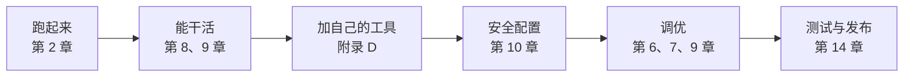

# 附录 H 案例研究：用 DSH 从零搭一个个人编码助手

> 前面的章节像零件手册，这个附录把它们**装成一台机器**。我们一步步从"什么都没有"搭出一个能用的个人编码助手——每一步都引用对应的章节，让你看到知识如何落地。本附录基于 DSH 0.2.1-alpha.2，命令默认在 deepseek-harness 根目录的 PowerShell 中执行。

## H.1 需求定义：我要什么

目标（克制一点，别贪多）：

- 能听懂"帮我看看这个报错"这种自然语言指令；
- 能在我的工作区里读文件、跑命令、改代码；
- 每次操作都可审计（它干了什么我能查）；
- 换模型、加工具是配置级操作（我不想改代码）。

对照第 1 章的框架：这就是一个"模型负责想、Harness 负责活"的最小产品。



## H.2 第一步：跑起来（第 2 章）

按第 2 章完成克隆、安装、构建（第 2.4 节），启动 web profile：

```powershell
corepack pnpm dsh web
```

启动日志里有一行以 `dsh web: ` 开头、带 `?token=` 的地址，默认还会自动打开浏览器（`--no-open` 关闭）。**首页也受浏览器令牌保护**（第 11.4 节）：直接访问 `http://127.0.0.1:3080/` 会得到 401，必须用那条带令牌的 URL 换取 Cookie。

验收：

```powershell
curl.exe -s -o NUL -w '%{http_code}' http://127.0.0.1:3080/
```

返回 `401` 说明服务已经在监听、而且认证在工作；再用浏览器打开日志里那条带令牌的 URL，能看到界面。此刻你已经有了一个"能聊天的 DSH"。

## H.3 第二步：让它能干活（第 8、9 章）

一个只能聊天的助手不是编码助手。要让它"干活"，需要：

1. **模型**（第 9.3、9.4 节）：`dsh-base` 默认挂了两条互不回退的 DeepSeek 路由——API Key 路由 `deepseek-official`（`llm-deepseek` 条目，默认模型 `deepseek-flash`）和账号路由 `deepseek-account`。在设置 → 模型页保存 API Key（或设置环境变量 `DEEPSEEK_API_KEY`）——**Key 走凭据层（`$DSH_HOME/.credentials.yaml`），不进配置**。没配 Key 时模型选择器里看不到 DeepSeek 分组，界面显示"请选择模型"；填好后再打开选择器，分组才会出现（第 2 章、附录 G.3）；
2. **工具**（第 8 章）：`dsh-base` 已经带了文件读写、shell 命令、子进程、`working_directory` 等工具——"注册即可用"，不用自己写。验证：

   ```powershell
   corepack pnpm dsh web --dump-config | Select-String tool-fs, tool-bash, tool-working-directory
   ```

3. **工作区与当前目录**：新建会话时选择你的项目目录；会话日志按原始工作目录分组存放在 `$DSH_HOME/sessions/--<cwd>--/<id>/`（第 6 章）。会话头部的 `cwd` 是原始项目（不可变），当前执行目录由 `ctx.workingDirectory` 投影，模型可以用 `working_directory({ cd })` 切换（第 6.8、13.12 节）。**"新会话"总是新的 Agent**——改过 preset 之后想立刻生效，就开一个新会话，不要指望复用工作区里的空白会话。

验收：在 Web UI 里输入"列出当前目录并读一下 README，然后总结"，看到它真的调用了工具并返回总结。会话日志里能看到 `tool/call` / `tool/result` 事件——**审计从第一天就在**（第 6.9 节的实验教你读它）。

## H.4 第三步：加自己的工具（第 8 章 + 附录 D）

内置工具够用，但"你的助手"应该有你自己的工具。按附录 D 写一个 `count_lines`（或你真正需要的工具）：

- **先跑通**（附录 D.3 路线 A）：一个 `scratch\count-lines.ts` + 一个 `insert` 补丁，用 `corepack pnpm dsh web --patch .\scratch\count-lines.yml` 临时挂载；
- **再打包**（附录 D.4 路线 B）：做成带 `dsh.bundle.patch` 的 bundle；
- **装进 profile**（附录 D.5）：`corepack pnpm dsh plugin --profile <名称> add .\count-lines`（`--profile` 必须写在 pnpm 参数之前，附录 G.2.1），或用 Web 侧栏的插件页；
- **按附录 D.6 的成功标准验收**。

验收：`--dump-config | Select-String count-lines` 能看到它；启动时 stderr 没有 `did not activate` 或 `skipping profile bundle`（没出现就去附录 G.2 对症查）；任务里模型会主动调用它。**此刻你的助手开始"有你专属的能力"了。**

## H.5 第四步：安全配置（第 10 章）

助手要碰你的代码，安全边界必须明确：

1. **沙箱**（第 10.3 节）：`--dump-config` 确认 `sandbox` 条目启用；在支持的主机上它自动选择平台 runner，没有可用 runner 时以 `SANDBOX_UNAVAILABLE` 拒绝执行，**绝不静默裸跑**；
2. **权限预设**（第 10.6 节）：`dsh-base` 带三种常规模式——`read-only`、`workspace-write`（两者审批策略都是 `ask`）和 `danger-full-access`（`never`，不再询问）。日常用 `workspace-write`：命令在沙箱里只能写工作区，需要越过这条边界的敏感动作按 `ask` 策略先弹审批。启用可选 bundle `auto-review` 后还会多出一种 `auto` 预设（第 13.8 节），审查器判定需要授权时同样走 `ask`；
3. **写前先读**（`dsh-fs-observation-policy`）：防止它盲改没读过或已被外部改动的文件；
4. **凭据清洗**（第 10.5 节）：子进程环境经 `scrubbedParentEnv()` 清洗，API Key 不传给模型下的命令。

验收：在 `workspace-write` 下让它"删掉工作区外的一个文件"，观察沙箱拒绝或审批卡片如何拦下这次操作；每一次审批请求和你的决定都记入该会话的审计日志。**安全不是附加功能，是配置项。**

## H.6 第五步：调优体验（第 6、7、9 章）

现在开始"打磨手感"：

- **换模型**（第 9.4 节）：在会话里 `deepseek-flash` ↔ `deepseek-v4-pro` 对比速度与质量；
- **上下文管理**（第 6 章 + 附录 F.1）：长会话留意 spill、工具结果裁剪与 `compaction-basic` 的阈值，别让历史撑爆窗口；
- **打断与续聊**（第 7.4、7.6 节）：对比停止按钮（取消当前 turn）与运行中追加消息（steer，在下一个 step 边界被认领）的差别；
- **标题/统计**（第 6.4、6.8 节）：`session-title`、`session-stats` 这些都是"从日志派生"的投影——同一份日志，多种产出；
- **当前目录**（第 6.8、13.12 节）：让助手用 `working_directory` 切到另一个 checkout 再干活，确认相对路径文件操作跟着走、沙箱可写根仍锚定原始项目。

## H.7 第六步：前后端体验（第 11、12 章）

如果默认 Web UI 不够用：

- **前端也是插件**（第 11.1、11.5 节）：包声明 `dsh.client` 并导出 `./client`，宿主把它编进启动图 `__DSH_BOOT__`——你可以写自己的客户端插件加面板；
- **类型安全 RPC**（第 12 章）：`@Remote` 把宿主方法暴露给前端，改签名有编译期检查。

这一步是可选的——对多数人，默认 UI 够用。做它的意义是体验"前端插件化"（第 11.1 节的反直觉设计）。

## H.8 第七步：测试与发布（第 14 章 + 附录 D.8）

助手稳定了，开始"工程化"：

- **快照回放**（第 14.2 节）：录一次关键任务的会话流，之后无 Key 离线回归——你的助手行为从此"可测试"；
- **发布你的工具**（第 14.6 节 + 附录 D.8）：发布到 npm 后，别人用 `dsh plugin --profile <名称> add <包名>` 安装；也可以分发 `pnpm pack` 生成的 tarball；
- **贡献上游**（第 14.8 节）：如果发现 bug，先读仓库的 `AGENTS.md` 再提 PR。

## H.9 回顾：这台机器用到了什么

把整个搭建过程摊开，你会发现每个"步骤"恰好对应本书的一章：

| 步骤 | 章节 | 你实际获得的 |
| --- | --- | --- |
| 跑起来 | 2、11.4 | 可运行、默认受令牌保护的产品底座 |
| 模型+工具 | 9、8 | 会干活的 Agent |
| 自定义工具 | 8 + D | 你的专属能力 |
| 安全 | 10 | 敢让它碰代码的信任边界 |
| 调优 | 6、7、9 + F | 好用的手感 |
| 前端 | 11、12 | 可定制的界面 |
| 测试发布 | 14 + D | 可维护的工程 |

## H.10 下一步：把"助手"变成"产品"

从个人助手到产品，还有几步（第 15 章的趋势）：

- **多入口**（第 13.10 节）：CLI、headless、ACP、JSON-RPC、Python SDK——让别的系统接入你的助手；
- **子 Agent 委派**（第 13.1 节）：让助手把大任务拆给子 Agent；每次委派返回 activation 回执，最终答案通过完成通知交付，上下文隔离；
- **程序化执行**（第 13.3 节）：PTC 运行时与工作流，让模型写编排脚本，从"单兵"到"指挥官"；
- **后台任务**（第 13.5 节）：长命令交给 `ctx.jobs`，完成后唤醒 Agent，不堵主循环；
- **声明式 preset 与创造模式**（第 13.11 节）：用配置定义自己的 Agent 角色；创造模式能改 profile 的插件组成，每次操作需要 `danger-full-access` 或单次审批——谨慎，它装进来的宿主代码在工作区沙箱之外运行；
- **执行坐标与可观测**（第 13.12 节）：会话工作目录、实验性 Git worktree（可选 bundle `tool-worktree`）、OTel 通道——把"在哪干活"和"看得见干活"也做成一等能力；
- **可选与按需能力**（第 13.8 节）：随附的 11 个可选 bundle（会话搜索、Ralph、终端、徽章、会话标题、Agent Teams、语音输入、CoT 翻译、Auto review、Inspector、Git Worktrees）在插件页一键启用；Claude Code / Codex 子 Agent 是按需安装的组合包，装完才会出现在工具列表里。

到这里，你已经走完了从"读文档"到"有自己的 Agent 产品"的全程。剩下的，就是第 15 章开放问题里属于你的那个答案。
